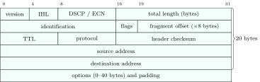
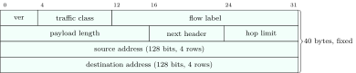

IP itself is small: a header, a forwarding rule (longest-prefix match), and a promise of nothing (“best effort”: packets may be lost, duplicated, reordered or corrupted). Around it sit the protocols that make it usable: ICMP reports errors, DHCP hands out addresses, NAT stretches the address space, and IPv6 replaces it.

## 7.1 The IPv4 header {#sec-cn-ipv4-header}

<div class="nb-proto">

<em><span>Prototypical example for this section:</span> a 1500-byte TCP packet leaving a host with TTL $64$, Don’t Fragment set, and a header checksum that every router must recompute.</em>

</div>

<figure class="nb-fig"></figure>

<div class="nb nb-definition" id="definition-7-1-1">

<strong>Definition 7.1.1</strong> (The fields that matter). The fields an exam can ask about, in header order:

- <strong>IHL</strong>: header length in $32$-bit words, $5$ to $15$, so the header is $20$ to $60$ bytes. <strong>Total length</strong>: header plus data in bytes, at most $65{,}535$.
- <strong>Identification, flags, fragment offset</strong>: for fragmentation ([Section 7.2](#sec-cn-frag)). Flags are a reserved bit, <strong>DF</strong> (don’t fragment) and <strong>MF</strong> (more fragments).
- <strong>TTL</strong>: decremented by every router; at $0$ the packet is dropped and an ICMP Time Exceeded is sent back. Prevents packets looping forever. Common initial values are $64$ (Linux, macOS) and $128$ (Windows).
- <strong>Protocol</strong>: what the payload is: $1$ ICMP, $6$ TCP, $17$ UDP ($89$ OSPF).
- <strong>Header checksum</strong>: Internet checksum over the header only; recomputed at every hop because TTL changes.
- <strong>DSCP/ECN</strong> (once “type of service”): a QoS class and explicit congestion notification bits.

</div>

```text {filename="Output of ipv4_header.py"}
header bytes: 45 00 05 dc 1c 46 40 00 40 06 e4 7b 0a 00 00 05 c6 33 64 22
version 4, IHL 5 words = 20 bytes, total length 1500 -> payload 1480 bytes
identification 0x1c46, flags DF=1 MF=0, fragment offset 0
TTL 64, protocol 6 (6 = TCP), checksum 0xe47b, 10.0.0.5 -> 198.51.100.34
receiver check: checksum over the whole header = 0x0000 (0 means OK)
after one hop: TTL 63, checksum recomputed 0xe57b, incremental update 0xe57b
```

The checksum of a correct header, recomputed over all of it, is $0$. Since only the TTL word changed, a router can update the checksum incrementally (RFC 1624) instead of summing the whole header; both give the same value. IPv6 dropped the header checksum entirely: the link layer and the transport layer already check, and routers get faster.

<div class="nb nb-moral">

IPv4 header: $20$–$60$ bytes, length in $4$-byte words, TTL against loops, protocol number to demultiplex, a checksum over the header alone.

</div>

## 7.2 Fragmentation {#sec-cn-frag}

<div class="nb-proto">

<em><span>Prototypical example for this section:</span> a 4000-byte datagram meets a 1500-byte MTU: fragments of 1480, 1480 and 1020 data bytes at offsets 0, 185 and 370.</em>

</div>

Every link has a <strong>maximum transmission unit</strong> (MTU): the largest IP packet its frames can carry ($1500$ bytes on Ethernet). A router that must forward a larger IPv4 packet onto a smaller-MTU link <strong>fragments</strong> it, unless DF is set.

<div class="nb nb-remark" id="algorithm-7-2-1">

<strong>Algorithm 7.2.1</strong> (IPv4 fragmentation) — Each fragment gets a copy of the header (with the same identification) and a slice of the data. Every fragment except the last carries a multiple of $8$ data bytes, because the offset field counts $8$-byte units: per fragment, data $= \lfloor (\text{MTU} - \text{header}) / 8 \rfloor \times 8$. The offset of a fragment is (its first data byte)$/8$. MF $=1$ on every fragment except the last one of the <em>original</em> datagram.

</div>

```text {filename="Output of fragment.py"}
4000-byte datagram (20 header + 3980 data) onto an MTU 1500 link:
   total  data  offset(x8)  byte range      MF
    1500  1480      0           0-1479     1
    1500  1480    185        1480-2959     1
    1040  1020    370        2960-3979     0
its second fragment crosses a later link with MTU 620:
   total  data  offset(x8)  byte range      MF
     620   600    185        1480-2079     1
     620   600    260        2080-2679     1
     300   280    335        2680-2959     1
5 fragments reach the destination, carrying 100 header bytes instead of 20
3000-byte datagram onto MTU 1006 (1006 - 20 = 986 is not a multiple of 8):
   total  data  offset(x8)  byte range      MF
    1004   984      0           0-983      1
    1004   984    123         984-1967     1
    1004   984    246        1968-2951     1
      48    28    369        2952-2979     0
```

<div class="nb nb-remark" id="remark-7-2-2">

<strong>Remark 7.2.2</strong> (The traps) — Five mistakes account for most wrong answers:

- The offset is in $8$-byte units: the second fragment’s offset is $1480/8 = 185$, not $1480$. That is also why a $13$-bit field suffices: $2^{13} \times 8 = 65{,}536$ covers the largest datagram.
- The header is not part of the offset arithmetic: only data bytes are numbered.
- When a fragment is fragmented again (second table), the new pieces keep offsets relative to the original datagram, and the last of them keeps MF $= 1$ because more of the original follows.
- If MTU minus header is not a multiple of $8$, round the data down (third table: $986 \to 984$).
- Reassembly happens only at the destination; routers never reassemble. If one fragment is lost, the whole datagram is lost, and TCP must resend all of it.

</div>

<div class="nb nb-definition" id="fact-7-2-3">

<strong>Fact 7.2.3</strong> (Why fragmentation is avoided). Fragments cost an extra header each, a lost fragment kills the datagram, and middleboxes cannot see port numbers in non-first fragments. Hosts therefore use <strong>path MTU discovery</strong>: send with DF set; a router that would have to fragment drops the packet and returns ICMP Destination Unreachable, “fragmentation needed and DF set” (type 3, code 4), with its next-hop MTU; the sender lowers its packet size. IPv6 routers never fragment; only the source may, using an extension header.

</div>

<div class="nb nb-moral">

Data per fragment $= \lfloor(\text{MTU}-20)/8\rfloor \times 8$; offset $=$ first data byte $/8$; MF $=0$ only on the very last piece; reassembly only at the destination.

</div>

## 7.3 ICMP, ping and traceroute {#sec-cn-icmp}

<div class="nb-proto">

<em><span>Prototypical example for this section:</span> `traceroute` sending probes with TTL $1, 2, 3, \dots$ and reading the addresses out of the ICMP errors they provoke.</em>

</div>

The <strong>Internet Control Message Protocol</strong> (RFC 792) carries error reports and diagnostics. ICMP messages travel inside IP packets (protocol $1$) but are part of the network layer. Each has a <strong>type</strong> and a <strong>code</strong>.

| Type | Code | Meaning |
|:-:|:-:|:--|
| 0 | 0 | echo reply (ping) |
| 3 | 0 / 1 / 3 / 4 | destination unreachable: network / host / port unreachable / fragmentation needed and DF set |
| 5 |  | redirect: use a better first-hop router |
| 8 | 0 | echo request (ping) |
| 11 | 0 / 1 | time exceeded: TTL reached $0$ in transit / fragment reassembly timed out |
| 12 |  | parameter problem: bad header field |

<div class="nb-caption" id="table-7-1">

<strong>Table 7.1.</strong> Common ICMPv4 messages (RFC 792). Source quench (type 4) is deprecated (RFC 6633).

</div>

<div class="nb nb-definition" id="fact-7-3-1">

<strong>Fact 7.3.1</strong> (When no ICMP error is sent). To avoid storms, no ICMP error is generated about an ICMP error message, about a fragment other than the first, about a packet sent to a broadcast or multicast address, or about a packet whose source is not a single host (such as `0.0.0.0` or a loopback address).

</div>

### 7.3.i Ping {#s7-3-i}

`ping` sends ICMP Echo Request (type $8$) and waits for Echo Reply (type $0$), reporting the round-trip time and loss. The program below is a real ping of `127.0.0.1`: it builds the request by hand, sends it on a raw socket, and decodes the reply the kernel returns.

```python {filename="ping_raw.py, lines 11–22",linenos=table,linenostart=11}
ident, payload = 0x4242, b"placement-notes"
s = socket.socket(socket.AF_INET, socket.SOCK_RAW, socket.IPPROTO_ICMP)
s.settimeout(2)
for seq in (1, 2):
    body = struct.pack("!BBHHH", 8, 0, 0, ident, seq) + payload
    req = body[:2] + struct.pack("!H", csum(body)) + body[4:]
    s.sendto(req, ("127.0.0.1", 0))
    while True:                     # skip our own request, also seen here
        pkt, addr = s.recvfrom(1024)
        ihl = (pkt[0] & 15) * 4
        t, code, ck, i, sq = struct.unpack("!BBHHH", pkt[ihl:ihl + 8])
        if t == 0 and i == ident and sq == seq: break
```

```text {filename="Output of ping_raw.py"}
reply from 127.0.0.1: type 0 (echo reply) code 0 id 0x4242 seq 1
   IP TTL 64, ICMP bytes 23, checksum ok True, data b'placement-notes'
reply from 127.0.0.1: type 0 (echo reply) code 0 id 0x4242 seq 2
   IP TTL 64, ICMP bytes 23, checksum ok True, data b'placement-notes'
```

A failed ping proves little: many hosts and firewalls drop ICMP echo. A successful ping of `127.0.0.1` proves the local stack works; of the gateway, that the LAN works; of a remote IP address but not of a name, that DNS is the problem.

### 7.3.ii Traceroute {#s7-3-ii}

<div class="nb nb-remark" id="algorithm-7-3-2">

<strong>Algorithm 7.3.2</strong> (How traceroute finds the path) — Send a probe with TTL $=1$. The first router decrements it to $0$, drops the probe, and returns ICMP Time Exceeded from its own address: that is hop $1$. Repeat with TTL $=2, 3, \dots$ (classically three probes per TTL, to time each hop). The probes are UDP datagrams to an unlikely high port (from $33434$ upwards), so when one finally reaches the destination, the host answers ICMP Port Unreachable, and traceroute stops. (Windows `tracert` sends ICMP echo requests instead and stops at the echo reply.)

</div>

```text {filename="Output of traceroute_sim.py"}
TTL 1, port 33434: ICMP 11/0 time exceeded    from 192.168.1.1   (gateway)
TTL 2, port 33435: ICMP 11/0 time exceeded    from 100.64.0.1    (isp-edge)
TTL 3, port 33436: ICMP 11/0 time exceeded    from 203.0.113.9   (isp-core)
TTL 4, port 33437: ICMP 11/0 time exceeded    from 198.51.100.77 (peering)
TTL 5, port 33438: ICMP  3/3 port unreachable from 192.0.2.80    (server)
```

Lines of `* * *` in a real trace are routers that do not send Time Exceeded (or whose messages are filtered); the path can differ from probe to probe because each packet is routed independently, and the reported address is that of the router’s <em>incoming</em> interface.

<div class="nb nb-moral">

ICMP reports errors back to the source. Ping uses echo request/reply; traceroute provokes Time Exceeded with increasing TTLs and stops at Port Unreachable.

</div>

## 7.4 DHCP and NAT {#sec-cn-dhcp}

<div class="nb-proto">

<em><span>Prototypical example for this section:</span> a phone joining hostel Wi-Fi: DHCP gives it `192.168.1.37`, and NAT lets it share the hostel’s single public address with five hundred others.</em>

</div>

### 7.4.i DHCP {#s7-4-i}

A host joining a network needs an IP address, a subnet mask, a default gateway and DNS servers. The <strong>Dynamic Host Configuration Protocol</strong> (RFC 2131) leases them from a server. It runs over UDP: the client uses port $68$, the server port $67$.

<figure class="nb-fig"></figure>

<div class="nb nb-definition" id="fact-7-4-1">

<strong>Fact 7.4.1</strong> (DHCP details interviewers probe). The four messages are often remembered as DORA.

- The DISCOVER is broadcast because the client knows neither its own address nor the server’s; the REQUEST is broadcast too, so that other servers that made offers learn they were not chosen.
- Leases expire; the client renews (unicast REQUEST) at half the lease time by default.
- Broadcasts do not cross routers, so one server can serve many subnets only through a <strong>relay agent</strong> on each subnet (usually the router), which forwards the broadcast as unicast and records the subnet it came from (the `giaddr` field).
- Before using an offered address, a client may ARP for it to check that no one already has it.
- DHCP grew out of BOOTP; both use the same ports and message format. RARP, older still, returned only an address and could not cross routers ([Section 5.5](../05-mac-lan/#sec-cn-arp)).

</div>

### 7.4.ii NAT {#s7-4-ii}

IPv4 has about four billion addresses, too few for every device. <strong>Network address translation</strong> lets a whole private network (RFC 1918 addresses) share one or a few public addresses. The common form, <strong>PAT</strong> (port address translation, NAPT), rewrites the source address <em>and</em> port of outgoing packets and keeps a table to reverse the translation on replies.

```text {filename="Output of nat_sim.py"}
out 192.168.1.10:51000 -> 198.51.100.7:443: source := 203.0.113.5:40000
out 192.168.1.11:51000 -> 198.51.100.7:443: source := 203.0.113.5:40001
out 192.168.1.10:51001 -> 192.0.2.53:53: source := 203.0.113.5:40002
in  198.51.100.7:443 -> 203.0.113.5:40001: dest := 192.168.1.11:51000
in  192.0.2.53:53 -> 203.0.113.5:40002: dest := 192.168.1.10:51001
in  198.51.100.99:22 -> 203.0.113.5:40000: no mapping, DROPPED
translation table:
   192.168.1.10:51000 <-> 203.0.113.5:40000   (peer 198.51.100.7:443)
   192.168.1.11:51000 <-> 203.0.113.5:40001   (peer 198.51.100.7:443)
   192.168.1.10:51001 <-> 203.0.113.5:40002   (peer 192.0.2.53:53)
```

Two hosts used the same private port $51000$; the NAT keeps them apart with different public ports. The unsolicited inbound packet matched no mapping and was dropped: a NAT behaves like a stateful firewall by accident.

<div class="nb nb-remark" id="remark-7-4-2">

<strong>Remark 7.4.2</strong> (Problems with NAT) — The standard list, with the reason for each:

- It breaks the end-to-end model: hosts behind NAT cannot be reached unless someone configures <strong>port forwarding</strong>, which hurts servers, peer-to-peer applications and VoIP. Workarounds: hole punching (STUN), relays (TURN), UPnP.
- Protocols that write addresses inside their payload (FTP’s `PORT` command, SIP) break unless the NAT has an application-level gateway that rewrites them too.
- It is per-connection state in the network: mappings time out (long-idle TCP and UDP flows die, hence keepalives), and the NAT box is a single point of failure.
- It must fix the IP and TCP/UDP checksums of every packet it rewrites.
- Carrier-grade NAT (`100.64.0.0/10`) puts many customers behind one address, which complicates abuse tracking and rate limiting.

NAT is not a security mechanism, and it is not a substitute for IPv6; it is the reason IPv4 lasted this long.

</div>

Cisco’s terminology names four addresses: <strong>inside local</strong> (the private address of an inside host), <strong>inside global</strong> (that host’s public address as the world sees it), <strong>outside global</strong> (the remote host’s real address) and <strong>outside local</strong> (the remote host’s address as seen from inside, normally the same).

<div class="nb nb-moral">

DHCP: Discover, Offer, Request, Ack, over UDP $67/68$, relayed across routers. NAT/PAT: rewrite source address and port on the way out, look up the port on the way back, drop what matches nothing.

</div>

## 7.5 IPv6 {#sec-cn-ipv6}

<div class="nb-proto">

<em><span>Prototypical example for this section:</span> `2001:0db8:0000:0000:0000:ff00:0042:8329` written as `2001:db8::ff00:42:8329`.</em>

</div>

<figure class="nb-fig"></figure>

<div class="nb nb-definition" id="fact-7-5-1">

<strong>Fact 7.5.1</strong> (What changed from IPv4). The differences that matter:

- $128$-bit addresses, written as eight groups of four hex digits.
- A fixed $40$-byte header; options moved to a chain of <strong>extension headers</strong> named by `next header`. No header checksum. No fragmentation by routers (only the source fragments; path MTU discovery is mandatory, minimum link MTU $1280$ bytes).
- TTL renamed `hop limit`; a 20-bit `flow label` lets routers keep packets of one flow together.
- No broadcast: multicast (`ff00::/8`) does that job. ARP is replaced by Neighbor Discovery (ICMPv6).
- Hosts can configure themselves without a server (<strong>SLAAC</strong>): take the `/64` prefix from a router advertisement and make the other $64$ bits from the MAC address (EUI-64) or, more privately, at random.

</div>

```text {filename="Output of ipv6.py"}
full       2001:0db8:0000:0000:0000:ff00:0042:8329
compressed 2001:db8::ff00:42:8329
   2001:db8:0:0:1:0:0:1     -> 2001:db8::1:0:0:1
   fe80:0:0:0:0:0:0:1       -> fe80::1
   0:0:0:0:0:0:0:1          -> ::1
   ff02:0:0:0:0:0:0:2       -> ff02::2
   (:: replaces one run of zero groups, the longest; ties: the first)
EUI-64 link-local for MAC 00:1b:21:0a:0b:0c: fe80::21b:21ff:fe0a:b0c
   ::1                loopback
   fe80::1            link-local
   ff02::1            multicast
   2001:db8::1        documentation
   fd12:3456::1       unique local (ULA)
   ::ffff:192.0.2.1   IPv4-mapped
   2400::1            global unicast
a /48 site holds 65536 /64 subnets; a /64 has 2^64 = 1.845e+19 addresses
total IPv6 addresses 2^128 = 3.403e+38; IPv4 2^32 = 4294967296
```

The EUI-64 identifier inserts `ff:fe` into the middle of the MAC address and flips the universal/local bit, which is why `00:1b:...` became `021b:...`, written `21b`.

<div class="nb nb-definition" id="fact-7-5-2">

<strong>Fact 7.5.2</strong> (Transition from IPv4). Three families of mechanisms:

- <strong>Dual stack</strong>: hosts and routers run both; applications prefer IPv6 when both work (“happy eyeballs” races the two).
- <strong>Tunnelling</strong>: carry IPv6 packets inside IPv4 packets across IPv4-only parts of the network (6in4, 6to4, Teredo).
- <strong>Translation</strong>: NAT64 with DNS64 lets IPv6-only clients reach IPv4-only servers; common on mobile networks.

</div>

<div class="nb nb-moral">

IPv6: $128$-bit addresses, a fixed $40$-byte header, no checksum, no router fragmentation, no broadcast, no ARP; `::` once per address.

</div>
