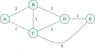
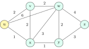

<strong>Forwarding</strong> is what a router does with one packet: look up the destination in its forwarding table (longest-prefix match, [Section 6.4](../06-addressing/#sec-cn-lpm)) and send it out of the right interface, in nanoseconds, in hardware. <strong>Routing</strong> is how the table gets filled: a distributed computation, over seconds, that finds good paths through the network. The two classic algorithms are distance vector (Bellman–Ford, each router talks to its neighbours about everyone) and link state (Dijkstra, each router talks to everyone about its neighbours). A router can forward perfectly well with a static table and no routing protocol at all; most hosts do exactly that, with one default route.

## 8.1 Distance vector {#sec-cn-dv}

<div class="nb-proto">

<em><span>Prototypical example for this section:</span> three routers in a line; the link at one end fails and the other two raise their costs $3, 4, 5, \dots$ until they hit RIP’s “infinity” of $16$.</em>

</div>

<figure class="nb-fig"></figure>

<div class="nb nb-remark" id="algorithm-8-1-1">

<strong>Algorithm 8.1.1</strong> (Distance-vector routing) — Each router $x$ keeps its <strong>distance vector</strong> $D_x(y)$, its best known cost to every destination $y$, with the next hop. Initially it knows only the costs $c(x,v)$ to its neighbours. Periodically, and whenever its vector changes, it sends the vector to its neighbours; on receiving them it applies the <strong>Bellman–Ford equation</strong>

$$
D_x(y) = \min_{v \in \text{neighbours}(x)} \big \{ c(x,v) + D_v(y) \big \}.
$$

</div>

```text {filename="Output of dv.py"}
Distance vector of A, round by round (cost/next hop):
   round 1: B=2/B  C=3/B  D=7/B  E=15/C
   round 2: B=2/B  C=3/B  D=5/B  E=8/B
   round 3: B=2/B  C=3/B  D=5/B  E=6/B
   round 4: B=2/B  C=3/B  D=5/B  E=6/B
   converged: round 4 changed nothing
Link A-B fails; plain DV:
   step  1: B hears C say  2 -> B->A =  3 (via C)
   step  2: C hears B say  3 -> C->A =  4 (via B)
   step  3: B hears C say  4 -> B->A =  5 (via C)
   step  4: C hears B say  5 -> C->A =  6 (via B)
   step  5: B hears C say  6 -> B->A =  7 (via C)
   step  6: C hears B say  7 -> C->A =  8 (via B)
   step  7: B hears C say  8 -> B->A =  9 (via C)
   step  8: C hears B say  9 -> C->A = 10 (via B)
   step  9: B hears C say 10 -> B->A = 11 (via C)
   step 10: C hears B say 11 -> C->A = 12 (via B)
   step 11: B hears C say 12 -> B->A = 13 (via C)
   step 12: C hears B say 13 -> C->A = 14 (via B)
   step 13: B hears C say 14 -> B->A = 15 (via C)
   step 14: C hears B say 15 -> C->A = 16 (via -)
   step 15: B hears C say 16 -> B->A = 16 (via -)
   step 16: C hears B say 16 -> C->A = 16 (via -)
Link A-B fails; poison reverse:
   step  1: B hears C say 16 -> B->A = 16 (via -)
   step  2: C hears B say 16 -> C->A = 16 (via -)
   step  3: B hears C say 16 -> B->A = 16 (via -)
```

The first block is A’s vector in synchronous rounds (everyone updates, then everyone advertises). Every router starts knowing its direct links, so after round $1$ A knows the best paths of up to two hops (E costs $15$ via C, the only two-hop route to E), after round $2$ three hops ($8$), after round $3$ four hops: A–B–C–D–E at cost $6$. Round $4$ changes nothing. In general, when routers start from their neighbours’ costs, synchronous distance vector settles after $h - 1$ rounds, where $h$ is the largest hop count of a shortest path (at most $n - 2$ rounds for $n$ routers).

### 8.1.i Count to infinity {#s8-1-i}

Good news travels fast: a new cheap link spreads one hop per exchange. Bad news travels slowly. In the second block, link A–B fails. B looks for an alternative and sees C advertising A at cost $2$; it cannot know that C’s route goes through B itself, so it adopts “A via C, cost $3$”. C then sees B at $3$ and moves to $4$, and the two bounce the cost upwards, one step per exchange, while packets for A loop between them, until the cost reaches the protocol’s infinity.

<div class="nb nb-definition" id="definition-8-1-2">

<strong>Definition 8.1.2</strong> (The fixes). <strong>Split horizon</strong>: never advertise a route back to the neighbour you learned it from. <strong>Poison reverse</strong>: advertise it back, but with cost $\infty$ (“do not route to $y$ through me”). Both cure two-node loops, as the last block shows: C tells B that its distance to A is $16$, and both learn the truth in one exchange. Neither cures loops of three or more routers; for those, a small infinity bounds the damage, and triggered updates and hold-down timers shorten it. Path-vector protocols (BGP) avoid loops properly by carrying the whole path.

</div>

<div class="nb nb-moral">

Bellman–Ford: $D_x(y) = \min_v\{c(x,v) + D_v(y)\}$, from neighbours only. Good news is fast, bad news counts to infinity; split horizon and poison reverse fix two-node loops only.

</div>

## 8.2 Link state {#sec-cn-ls}

<div class="nb-proto">

<em><span>Prototypical example for this section:</span> router $u$ runs Dijkstra on the full map and finds that every destination except $v$ is best reached through $x$.</em>

</div>

<figure class="nb-fig"></figure>

<div class="nb nb-remark" id="algorithm-8-2-1">

<strong>Algorithm 8.2.1</strong> (Link-state routing) — Four steps, repeated whenever the topology changes:

1. Each router discovers its neighbours and link costs (hello messages).
2. It builds a <strong>link-state advertisement</strong> (LSA) listing them and <strong>floods</strong> it to every router in the area, with a sequence number so that old copies are discarded.
3. Every router now holds the same map (the link-state database) and runs Dijkstra’s shortest-path algorithm from itself.
4. The first hop on each shortest path becomes the forwarding-table entry.

</div>

```text {filename="Output of dijkstra.py"}
step  N'        D(v),p(v)   D(w),p(w)   D(x),p(x)   D(y),p(y)   D(z),p(z) 
   0  u         2,u         6,u         1,u         inf         inf       
   1  ux        2,u         4,x                     2,x         inf       
   2  uxv                   4,x                     2,x         inf       
   3  uxvy                  4,x                                 5,y       
   4  uxvyw                                                     5,y       
   5  uxvywz                                                              
shortest paths and u's forwarding table:
   to v: cost 2, path u-v, next hop v
   to w: cost 4, path u-x-w, next hop x
   to x: cost 1, path u-x, next hop x
   to y: cost 2, path u-x-y, next hop x
   to z: cost 5, path u-x-y-z, next hop x
```

Each row moves the closest unfinished node into $N'$ and relaxes its edges: $w$ starts at $6$ (direct), drops to $4$ through $x$ in step $1$. Three paths to $w$ cost $4$ (via $x$, via $v$, via $x$–$y$); the program keeps the first it found, while a real router may use all of them (equal-cost multipath). The last block is $u$’s forwarding table: only the <em>next hop</em> is stored, not the path.

|  | Distance vector | Link state |
|:--|:--|:--|
| Who tells whom | each router tells its neighbours about all destinations | each router tells all routers about its neighbours |
| Algorithm | distributed Bellman–Ford | Dijkstra on a full map |
| Messages | small, to neighbours, periodic | LSAs flooded on change |
| Convergence | slow; count to infinity | fast; no counting |
| Robustness | a router’s wrong cost spreads through everyone’s vectors | each router computes its own routes |
| Examples | RIP | OSPF, IS-IS |

<div class="nb-caption" id="table-8-1">

<strong>Table 8.1.</strong> Distance vector against link state.

</div>

<div class="nb nb-moral">

Link state: flood the map, run Dijkstra locally, keep only the first hop. Faster and more robust than distance vector, at the price of more memory and CPU.

</div>

## 8.3 Routing in the Internet: RIP, OSPF, BGP {#sec-cn-protocols}

<div class="nb-proto">

<em><span>Prototypical example for this section:</span> a campus running OSPF inside, and BGP at its border to two ISPs.</em>

</div>

The Internet is a network of <strong>autonomous systems</strong> (ASes): networks under one administration (an ISP, a university, a cloud provider), each with an AS number. Inside an AS an <strong>interior gateway protocol</strong> (IGP) finds efficient paths; between ASes the <strong>exterior gateway protocol</strong>, BGP, decides reachability according to business policy. Hierarchy is what makes the scale work: no router needs a route to every host.

|  | RIP (v2: RFC 2453) | OSPF (v2: RFC 2328) | BGP-4 (RFC 4271) |
|:--|:--|:--|:--|
| Scope | intra-domain | intra-domain | inter-domain |
| Algorithm | distance vector | link state (Dijkstra) | path vector |
| Metric | hop count; $16 = \infty$, so at most $15$ hops | configurable cost (typically from link bandwidth) | policy; AS-path length is one tie-breaker |
| Updates | whole table every $30$ s | LSAs flooded on change, periodic refresh | incremental, over a long-lived session |
| Carried over | UDP port $520$ | directly over IP, protocol $89$ | TCP port $179$ |
| Special | split horizon, poison reverse | areas around a backbone area $0$; hello protocol; authentication | eBGP between ASes, iBGP inside; loops prevented by the AS path |

<div class="nb-caption" id="table-8-2">

<strong>Table 8.2.</strong> The three protocols every interview mentions.

</div>

<div class="nb nb-definition" id="fact-8-3-1">

<strong>Fact 8.3.1</strong> (BGP in four sentences). A BGP router advertises a prefix together with its <strong>AS path</strong>, the list of ASes the route passes through; a router rejects any route that already contains its own AS number, which prevents loops without counting to infinity. Each AS chooses among the routes it hears by local policy first (prefer customers over peers over providers, because of who pays), then shortest AS path, then other tie-breakers, and exports routes only where its business relationships allow. Inside an AS, iBGP spreads the external routes to all border routers, and the IGP finds the way to the chosen exit (“hot-potato” routing: the nearest exit). A misconfigured or malicious BGP announcement of someone else’s prefix (<strong>prefix hijacking</strong>) can divert traffic for large parts of the Internet.

</div>

<div class="nb nb-remark" id="remark-8-3-2">

<strong>Remark 8.3.2</strong> (Source routing) — Normally each router chooses the next hop. In <strong>source routing</strong> the sender lists the path (IPv4’s strict and loose source-route options); it is disabled almost everywhere because it lets attackers steer traffic around firewalls. Segment routing in modern networks revives the idea inside a single operator’s network.

</div>

<div class="nb nb-moral">

Inside an AS: RIP (distance vector, UDP $520$, $15$ hops) or OSPF (link state, IP protocol $89$, areas). Between ASes: BGP (path vector over TCP $179$), driven by policy.

</div>

## 8.4 Multicast and IGMP {#sec-cn-multicast}

<div class="nb-proto">

<em><span>Prototypical example for this section:</span> a live lecture stream sent once by the source and copied by routers only where the tree branches.</em>

</div>

<strong>Multicast</strong> delivers one packet to a group of receivers. With <strong>multiple unicast</strong> the source sends one copy per receiver, and the links near the source carry many identical copies; with multicast, a single copy crosses each link of a distribution tree and routers duplicate it where the tree branches. Group addresses come from `224.0.0.0/4`.

- <strong>IGMP</strong> (IPv4; MLD for IPv6) runs between hosts and their local router: a host sends a membership report to join a group; the router queries periodically and stops forwarding the group onto the LAN when no member answers.
- Multicast routing protocols (PIM is the common one) build the trees between routers: a shortest-path tree from each source, or one shared tree rooted at a rendezvous point.
- On Ethernet, the group address maps to a multicast MAC address so that the NIC can filter in hardware:

```text {filename="Output of mcast_mac.py"}
224.0.0.1    -> 01:00:5e:00:00:01
224.0.0.251  -> 01:00:5e:00:00:fb
239.1.2.3    -> 01:00:5e:01:02:03
224.129.2.3  -> 01:00:5e:01:02:03
225.1.2.3    -> 01:00:5e:01:02:03
32 groups share 1 MAC (01:00:5e:01:02:03),
   e.g. 224.1.2.3, 224.129.2.3, 239.129.2.3
```

A group identifier has $28$ bits but only $23$ fit in the MAC, so $32$ groups share every multicast MAC address; the IP layer must discard packets of groups it did not join. TCP cannot be used for multicast (it is a two-party connection); multicast applications use UDP. Inter-domain IP multicast never became widely deployed; within enterprises, IPTV networks and trading systems (market-data feeds) it is common.

<div class="nb nb-moral">

Multicast: one copy per link of a tree, groups in `224/4`, IGMP for joining at the edge, PIM for the trees, UDP only.

</div>
