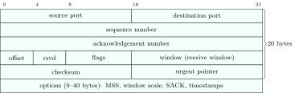
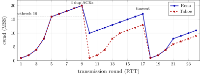
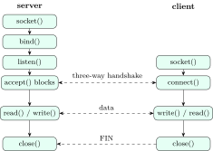

IP delivers packets between hosts, unreliably. The transport layer delivers data between <em>processes</em>, and TCP makes the delivery reliable, ordered and polite to the network. This is the chapter interviews dig deepest into: the handshake, TIME\_WAIT, congestion control, and the socket calls that sit on top of it all. (The system calls themselves, file descriptors and `fork`, are covered in the OS book.)

## 9.1 Ports, multiplexing and UDP {#sec-cn-udp}

<div class="nb-proto">

<em><span>Prototypical example for this section:</span> a DNS query: one UDP datagram out, one back, no connection, no state.</em>

</div>

### 9.1.i Ports and sockets {#s9-1-i}

A <strong>port</strong> is a 16-bit number that names a process’s endpoint on a host. Servers listen on <strong>well-known ports</strong> ($0$–$1023$, which on Unix need privilege to bind) or registered ones ($1024$–$49151$); clients get a temporary <strong>ephemeral port</strong> from the OS.

```text {filename="Output of services.py"}
ftp-data/tcp 20        ftp/tcp 21             ssh/tcp 22             telnet/tcp 23
smtp/tcp 25            domain/udp 53          domain/tcp 53          bootps/udp 67
bootpc/udp 68          http/tcp 80            pop3/tcp 110           ntp/udp 123
imap/tcp 143           snmp/udp 161           ldap/tcp 389           https/tcp 443
https/udp 443          submission/tcp 587     imaps/tcp 993          pop3s/tcp 995
mysql/tcp 3306         postgresql/tcp 5432
Linux ephemeral port range here: 32768-60999; IANA's dynamic range is 49152-65535
```

<strong>Demultiplexing</strong> is how the receiving host picks the socket for an arriving segment. A UDP socket is identified by (destination IP, destination port) only: datagrams from many senders arrive at one socket. A connected TCP socket is identified by the <strong>4-tuple</strong> (source IP, source port, destination IP, destination port), which is why one web server socket on port $443$ can carry thousands of connections: each has a different client address or port.

### 9.1.ii UDP {#s9-1-ii}

<figure class="nb-fig"></figure>

UDP (RFC 768) adds only ports, a length and a checksum to IP: an $8$-byte header. No connection, no acknowledgement, no ordering, no flow or congestion control; each `sendto()` becomes one datagram, and message boundaries are preserved. The checksum covers a <strong>pseudo-header</strong> with the IP addresses, so a datagram delivered to the wrong host is caught:

```text {filename="Output of udp_checksum.py"}
UDP header: ports 53001 -> 53, length 19 (8 + 11 data), checksum 0x7079
segment bytes: cf 09 00 35 00 13 70 79 68 65 6c 6c 6f 2c 20 64 6e 73 21
receiver: checksum over pseudo-header + segment = 0x0000 (0 = OK)
IP header says dst 192.0.2.54 instead: check = 0xfffe -> rejected (misdelivered)
```

<div class="nb nb-remark" id="remark-9-1-1">

<strong>Remark 9.1.1</strong> (Why anyone uses UDP) — No handshake (a DNS lookup is one round trip, not two); no head-of-line blocking (a lost packet of a video call is better skipped than waited for); no per-connection state on the server (a DNS server answers millions of clients); the application chooses its own reliability and timing (QUIC, games, VoIP, streaming). Multicast and broadcast work only with UDP. The price: the application must cope with loss, duplication and reordering, and must avoid flooding the network itself.

</div>

<div class="nb nb-moral">

UDP $=$ IP $+$ ports $+$ checksum. TCP demultiplexes on the 4-tuple, UDP on destination address and port.

</div>

## 9.2 TCP connections {#sec-cn-tcp-header}

<div class="nb-proto">

<em><span>Prototypical example for this section:</span> `connect()` returning after one round trip, and the client still sitting in TIME\_WAIT a minute after `close()`.</em>

</div>

### 9.2.i The header {#s9-2-i}

<figure class="nb-fig"></figure>

TCP (RFC 9293) numbers <em>bytes</em>, not segments. The <strong>sequence number</strong> is the number of the segment’s first data byte; the <strong>acknowledgement number</strong> is the next byte the sender of the ACK expects (cumulative). The <strong>window</strong> is how many bytes beyond that the receiver can buffer. The eight flag bits are CWR and ECE (congestion notification), URG, ACK, PSH, RST, SYN and FIN. The data offset gives the header length in words ($20$–$60$ bytes). Options are negotiated in the SYNs: the <strong>MSS</strong> (largest segment payload the receiver wants, typically $1460$ on Ethernet), the <strong>window scale</strong> shift (up to $14$), <strong>SACK</strong> permitted, and <strong>timestamps</strong>.

### 9.2.ii Three-way handshake and teardown {#s9-2-ii}

<figure class="nb-fig"></figure>

```text {filename="Output of seqack.py, lines 1–10"}
client ISN 4000, server ISN 9000
  SYN        seq=4000
  SYN+ACK    seq=9000  ack=4001
  ACK        seq=4001  ack=9001
  data 1000  seq=4001  (bytes 4001..5000)  -> server ACKs 5001
  data 1000  seq=5001  (bytes 5001..6000)  -> server ACKs 6001
  data  500  seq=6001  (bytes 6001..6500)  -> server ACKs 6501
  server sends 300 bytes: seq=9001, client ACKs 9301
  FIN        seq=6501  -> ACK 6502
2500 data bytes used numbers 4000..6501: SYN and FIN take one each
```

SYN and FIN each consume one sequence number, so that they can be acknowledged like data; a pure ACK consumes none.

<div class="nb nb-ques" id="question-9-2-1">

<strong>Question 9.2.1</strong> — Why three messages, not two?

</div>

Each side must tell the other its initial sequence number <em>and</em> learn that the other received it. With two messages the server would have no evidence that the client got its ISN, and, worse, an old duplicate SYN from a previous connection, still wandering the network, would make the server open a connection nobody asked for and start sending data. The third message proves the client is live and current: if the server’s SYN+ACK answers a stale SYN, the client replies with RST instead of ACK. Three is the minimum for both sides to agree on both ISNs; the SYN+ACK merges the server’s ACK and its own SYN.

<div class="nb nb-definition" id="fact-9-2-2">

<strong>Fact 9.2.2</strong> (Initial sequence numbers). ISNs are not $0$: a new connection reusing an old 4-tuple must not have its sequence space confused with stale segments of the old one, and an off-path attacker must not be able to guess them (which would let him inject data or reset connections). RFC 6528 specifies a clock-driven counter plus a keyed hash of the 4-tuple.

</div>

### 9.2.iii TIME\_WAIT {#s9-2-iii}

The side that closes first (the <strong>active close</strong>) ends in TIME\_WAIT and stays there for $2 \times \mathrm{MSL}$ (maximum segment lifetime: two minutes in the original specification; Linux uses a fixed $60$ s for the whole state). This program walks a real connection on this machine’s loopback through the teardown and reads the kernel’s state table after each step:

```text {filename="Output of time_wait.py"}
after the handshake:            client ESTABLISHED  server ESTABLISHED
client sent FIN, server ACKed:  client FIN_WAIT2    server CLOSE_WAIT
server read() returns b'' (end of stream)
server sent FIN, client ACKed:  client TIME_WAIT    server (gone)
   /proc/sys/net/ipv4/tcp_fin_timeout       = 60
   /proc/sys/net/ipv4/tcp_keepalive_time    = 7200
   /proc/sys/net/ipv4/tcp_keepalive_intvl   = 75
   /proc/sys/net/ipv4/tcp_keepalive_probes  = 9
   /proc/sys/net/ipv4/tcp_syn_retries       = 6
   /proc/sys/net/ipv4/tcp_syncookies        = 1
   /proc/sys/net/ipv4/tcp_window_scaling    = 1
   /proc/sys/net/ipv4/tcp_sack              = 1
   /proc/sys/net/ipv4/ip_default_ttl        = 64
```

<div class="nb nb-ques" id="question-9-2-3">

<strong>Question 9.2.3</strong> — Why does TIME\_WAIT exist, and why $2\,$MSL?

</div>

Two reasons. (1) <em>Reliable close</em>: the final ACK may be lost; the peer will then retransmit its FIN, and someone must still be there to ACK it again (rather than answer with RST). The last ACK may need up to one MSL to reach the peer, and a retransmitted FIN up to one more MSL to come back, so the state must outlive both. (2) <em>No ghosts</em>: segments of the old connection may still be in the network; a new connection with the same 4-tuple created too soon could accept them as its own. Waiting $2\,$MSL lets every old segment in both directions die. The cost: a busy client that opens and closes many connections to the same server accumulates TIME\_WAIT sockets and can run out of ephemeral ports; remedies are connection reuse (HTTP keep-alive, connection pools), a wider ephemeral port range, and Linux’s `tcp_tw_reuse`, which lets a new outgoing connection take over a TIME\_WAIT 4-tuple when timestamps make it safe. A server restarting on its port needs `SO_REUSEADDR` so that `bind()` does not fail because of old connections still in TIME\_WAIT.

<div class="nb nb-remark" id="remark-9-2-4">

<strong>Remark 9.2.4</strong> (Other ways a connection ends) — <strong>Half-close</strong>: after its FIN a side can still receive (the server above kept reading until `read()` returned $0$; `shutdown(SHUT_WR)` does exactly this). <strong>RST</strong> aborts a connection at once: sent for a segment to a closed port, for a connection the host does not recognise, or by an application closing with unread data. A host that crashes silently leaves a <strong>half-open</strong> connection that only a keepalive probe (by default after $2$ hours idle on Linux, as the output shows) or the next write discovers.

</div>

### 9.2.iv SYN flooding and SYN cookies {#s9-2-iv}

A server that receives a SYN allocates state and waits in SYN\_RCVD for the final ACK. A <strong>SYN flood</strong> sends huge numbers of SYNs from spoofed source addresses that will never answer; the half-open queue fills and real clients are refused: a denial of service. <strong>SYN cookies</strong> (RFC 4987) remove the state: when the queue is full the server encodes what it needs (a coarse timestamp, the MSS, and a keyed hash of the 4-tuple) into its own ISN $y$, stores nothing, and rebuilds the connection only when an ACK with ack $= y + 1$ arrives and the hash checks out. The output above shows them enabled (`tcp_syncookies = 1`). Rate limiting, larger backlogs and upstream filtering help too.

<div class="nb nb-moral">

Three-way handshake: both ISNs sent and both acknowledged, stale SYNs rejected. Active closer waits $2\,$MSL in TIME\_WAIT to re-ACK a lost FIN and to let old segments die.

</div>

## 9.3 Reliability and flow control {#sec-cn-tcp-flow}

<div class="nb-proto">

<em><span>Prototypical example for this section:</span> a fast server sending to a phone whose app is not reading: the advertised window shrinks to zero and the server waits, probing.</em>

</div>

### 9.3.i How TCP recovers losses {#s9-3-i}

TCP is a sliding-window protocol with features of both Go-Back-N and Selective Repeat ([Chapter 4](../04-arq/)): cumulative ACKs like GBN, but the receiver buffers out-of-order data like SR, and with SACK it reports exactly which blocks it holds. A loss is detected two ways:

- <strong>Timeout</strong>: the retransmission timer (RTO) for the oldest unacknowledged segment expires. Expensive: the pipe drains while the sender waits.
- <strong>Fast retransmit</strong>: every segment arriving after a gap triggers a duplicate ACK for the missing byte. After <em>three duplicate ACKs</em> the sender resends the missing segment without waiting for the timer (RFC 5681). Three, not one, because reordering alone can produce one or two duplicates.

### 9.3.ii The retransmission timer {#s9-3-ii}

The RTO must be a little above the RTT, which varies; too low causes needless retransmissions, too high slow recovery. RFC 6298 tracks a smoothed RTT and its variation with exponentially weighted moving averages:

```python {filename="rto.py, lines 1–6",linenos=table,linenostart=1}
# Retransmission timeout as specified in RFC 6298:
#   first sample R: SRTT = R, RTTVAR = R/2
#   later samples:  RTTVAR = (1 - beta) RTTVAR + beta |SRTT - R|, beta = 1/4
#                   SRTT   = (1 - alpha) SRTT + alpha R,          alpha = 1/8
#   RTO = SRTT + max(G, 4 RTTVAR), rounded up to 1 s if smaller; RTO = 1 s
#   before any sample; every timeout doubles the RTO (back-off).
```

```text {filename="Output of rto.py"}
sample   SRTT     RTTVAR   SRTT+4*RTTVAR   RFC min 1 s  Linux min 0.2 s
  100ms  100.00ms   50.00ms     300.00ms     1.000 s      0.300 s
  120ms  102.50ms   42.50ms     272.50ms     1.000 s      0.273 s
   90ms  100.94ms   35.00ms     240.94ms     1.000 s      0.241 s
  300ms  125.82ms   76.02ms     429.88ms     1.000 s      0.430 s
  110ms  123.84ms   60.97ms     367.71ms     1.000 s      0.368 s
  105ms  121.49ms   50.44ms     323.23ms     1.000 s      0.323 s
successive timeouts back off: 1 s, 2 s, 4 s, 8 s, 16 s
Karn's rule: no RTT sample from a retransmitted segment (which copy was ACKed?)
```

The $300$ ms outlier raises RTTVAR sharply and the RTO with it, then both decay. The RFC’s $1$ s floor dominates every row here; Linux uses a $200$ ms floor, so its RTO tracks the estimate. Each timeout doubles the RTO (exponential back-off). By <strong>Karn’s algorithm</strong> no RTT sample is taken from a retransmitted segment, because the ACK cannot say which copy it acknowledges.

### 9.3.iii Flow control and the receive window {#s9-3-iii}

The receiver advertises in every segment how much buffer space it has left (<strong>rwnd</strong>); the sender keeps (last byte sent $-$ last byte acked) $\le$ rwnd. When the application stops reading, rwnd falls to $0$ and the sender stops. The ACK that reopens the window could be lost, and ACKs are not themselves acknowledged, so both sides would wait forever; the sender therefore runs a <strong>persist timer</strong> and sends small <strong>zero-window probes</strong> until the window opens.

```text {filename="Output of seqack.py, lines 11–16"}
wrap-around: 2^32 sequence numbers at full speed vs a 120 s MSL
  100 Mbps: wraps in   343.60 s
  1 Gbps  : wraps in    34.36 s   < MSL: needs PAWS timestamps
  10 Gbps : wraps in     3.44 s   < MSL: needs PAWS timestamps
  100 Gbps: wraps in     0.34 s   < MSL: needs PAWS timestamps
window: 16-bit field 65535 bytes; scale shift 14: 1073725440 bytes (~1 GiB)
```

The 16-bit window limits a connection to $64$ KB in flight, too little for long fat pipes ([Section 1.3](../01-layering/#sec-cn-delay)); the window-scale option multiplies it by up to $2^{14}$. And at gigabit speeds the 32-bit sequence space wraps in less than an MSL, so an old duplicate could fall into the current window: <strong>PAWS</strong> (protection against wrapped sequences) rejects segments with stale timestamps.

### 9.3.iv Small segments: silly window, Nagle, delayed ACK {#s9-3-iv}

- <strong>Silly window syndrome</strong>: a receiver that reopens its window a few bytes at a time invites the sender to send a few bytes at a time, each with $40$ bytes of headers. Fix on the receiver (Clark): advertise nothing until a full MSS or half the buffer is free. Fix on the sender: do not send tiny segments either.
- <strong>Nagle’s algorithm</strong> (RFC 896): while any sent data is unacknowledged, buffer small writes and send them together when the ACK arrives or a full MSS accumulates. It stops a typist from sending one-byte packets (the $1\%$-efficient frames of [Section 1.1](../01-layering/#sec-cn-layers)). It is on by default (`TCP_NODELAY = 0` in the socket demo below).
- <strong>Delayed ACK</strong>: a receiver may wait briefly (the RFC limit is $500$ ms) before ACKing, hoping to piggyback the ACK on a reply, but must ACK at least every second full-sized segment.
- Together they misbehave: a sender with a small final write waits for an ACK (Nagle) that the receiver is delaying, adding up to a delayed-ACK timeout to every request. Latency-sensitive applications (interactive shells, RPC, games, trading) set `TCP_NODELAY`.

<div class="nb nb-moral">

Loss is found by timeout (RTO $=$ SRTT $+ 4\,$RTTVAR) or by three duplicate ACKs. rwnd is flow control: protect the receiver; a zero window is broken by persist probes.

</div>

## 9.4 Congestion control {#sec-cn-congestion}

<div class="nb-proto">

<em><span>Prototypical example for this section:</span> Tahoe and Reno side by side: both halve on three duplicate ACKs, but Tahoe falls back to one segment while Reno continues from half.</em>

</div>

Flow control protects the receiver; <strong>congestion control</strong> protects the network. With no signal from routers, TCP infers congestion from loss and keeps a second window, the <strong>congestion window</strong> cwnd. The sender may have $\min(\text{cwnd}, \text{rwnd})$ bytes in flight, so its rate is about $\text{cwnd}/\text{RTT}$.

<div class="nb nb-remark" id="algorithm-9-4-1">

<strong>Algorithm 9.4.1</strong> (TCP Reno (RFC 5681), per round trip) — The rules, with the window counted in segments:

- <strong>Slow start</strong>: start at cwnd $= 1$ MSS (modern stacks start at about $10$) and add $1$ MSS per ACK, which doubles cwnd every RTT, until cwnd reaches the threshold `ssthresh`.
- <strong>Congestion avoidance</strong>: above ssthresh add about $1$ MSS per RTT ($\text{MSS}^2/\text{cwnd}$ bytes per ACK): additive increase.
- <strong>Three duplicate ACKs</strong>: ssthresh $=$ cwnd$/2$; fast-retransmit the missing segment; <em>fast recovery</em>: cwnd $=$ ssthresh ($+3$, inflated by one per further duplicate ACK, deflated to ssthresh when new data is ACKed), and continue in congestion avoidance: multiplicative decrease.
- <strong>Timeout</strong>: ssthresh $=$ cwnd$/2$, cwnd $= 1$, slow start again.

<strong>Tahoe</strong>, the older variant, treats three duplicate ACKs like a timeout: cwnd $=1$.

</div>

The simulator applies these rules round by round (the usual exam model: the window used in the loss round is halved; Reno’s inflation is folded into “cwnd $=$ ssthresh”):

```python {filename="cwnd.py, lines 8–20",linenos=table,linenostart=8}
def simulate(kind, rounds, ssthresh, events):
    cwnd, trace = 1, []
    for r in range(1, rounds + 1):
        trace.append((r, cwnd, ssthresh))
        ev = events.get(r)
        if ev:
            ssthresh = max(cwnd // 2, 2)
            cwnd = 1 if (ev == "timeout" or kind == "Tahoe") else ssthresh
        elif cwnd < ssthresh:
            cwnd = min(2 * cwnd, ssthresh)
        else:
            cwnd += 1
    return trace
```

```text {filename="Output of cwnd.py, lines 1–28"}
initial ssthresh 16 MSS; triple duplicate ACK in round 9, timeout in round 17
round  Tahoe cwnd (ssthresh)  Reno cwnd (ssthresh)
    1           1 (16)                 1 (16)
    2           2 (16)                 2 (16)
    3           4 (16)                 4 (16)
    4           8 (16)                 8 (16)
    5          16 (16)                16 (16)
    6          17 (16)                17 (16)
    7          18 (16)                18 (16)
    8          19 (16)                19 (16)
    9          20 (16)                20 (16)  <- 3 dup ACKs
   10           1 (10)                10 (10)
   11           2 (10)                11 (10)
   12           4 (10)                12 (10)
   13           8 (10)                13 (10)
   14          10 (10)                14 (10)
   15          11 (10)                15 (10)
   16          12 (10)                16 (10)
   17          13 (10)                17 (10)  <- timeout
   18           1 ( 6)                 1 ( 8)
   19           2 ( 6)                 2 ( 8)
   20           4 ( 6)                 4 ( 8)
   21           6 ( 6)                 8 ( 8)
   22           7 ( 6)                 9 ( 8)
   23           8 ( 6)                10 ( 8)
   24           9 ( 6)                11 ( 8)
Tahoe: 203 segments sent in 24 RTTs
Reno: 258 segments sent in 24 RTTs
```

<figure class="nb-fig"></figure>

<div class="nb nb-remark" id="remark-9-4-2">

<strong>Remark 9.4.2</strong> (Reading cwnd questions) — Checked against the table above:

- In slow start cwnd doubles per RTT but never jumps past ssthresh: from $8$ with ssthresh $10$ the next window is $10$, not $16$ (Tahoe, rounds $13$–$14$).
- The new ssthresh is half of the window <em>at the moment of loss</em> ($20 \to 10$; $17 \to 8$ for Reno but $13 \to 6$ for Tahoe at the timeout, because Tahoe’s window was smaller by then).
- If a question gives no initial ssthresh, slow start continues until the first loss.
- If it says the connection needs a handshake first, add one RTT before data flows.
- Segments sent $=$ the sum of the windows: Reno sent $258$ segments to Tahoe’s $203$ in the same $24$ RTTs.

</div>

```text {filename="Output of cwnd.py, lines 29–35"}
cwnd    8 MSS after  3 RTTs = 150 ms (RTT 50 ms, MSS 1460) ->   1.87 Mbps
cwnd   64 MSS after  6 RTTs = 300 ms (RTT 50 ms, MSS 1460) ->  14.95 Mbps
cwnd 1024 MSS after 10 RTTs = 500 ms (RTT 50 ms, MSS 1460) -> 239.21 Mbps
sawtooth W = 40 MSS, RTT 100 ms: average 3.504 Mbps
loss rate 0.01: 1.22 MSS/(RTT sqrt p) =     1.425 Mbps
loss rate 0.0001: 1.22 MSS/(RTT sqrt p) =    14.250 Mbps
loss rate 1e-06: 1.22 MSS/(RTT sqrt p) =   142.496 Mbps
```

Slow start is “slow” only in name: it reaches a $1024$-segment window in $10$ RTTs. In the steady state the AIMD <strong>sawtooth</strong> oscillates between $W/2$ and $W$ and averages $\tfrac34 W$ per RTT; with random loss rate $p$, throughput is about $1.22\,\text{MSS}/(\text{RTT}\sqrt{p})$ (Mathis et al.): to go $10$ times faster on the same path, loss must be $100$ times rarer.

<div class="nb nb-definition" id="fact-9-4-3">

<strong>Fact 9.4.3</strong> (Fairness and newer algorithms). AIMD makes competing flows converge to equal shares: additive increase moves both flows’ rates up the same amount, multiplicative decrease cuts the larger one more. But the share is per flow and favours short RTTs. Linux’s default algorithm is CUBIC, which grows cwnd as a cubic function of the time since the last loss (faster recovery on long fat pipes); Google’s BBR estimates the bottleneck bandwidth and RTT instead of reacting to loss (this machine reports `bbr`). With <strong>ECN</strong>, routers mark packets instead of dropping them, and the sender reacts as if they had been lost.

</div>

### 9.4.i Traffic shaping: leaky bucket and token bucket {#s9-4-i}

Networks also police rates at the edge. A <strong>leaky bucket</strong> is a queue drained at a constant rate $R$: output is perfectly smooth, bursts beyond the queue are dropped. A <strong>token bucket</strong> of capacity $B$ fills with tokens at rate $R$; sending a byte costs a token. Idle time accumulates credit, so bursts up to $B$ are allowed at the line rate $M$, and the long-term rate is still $R$.

<div class="nb nb-theorem nb-block" id="theorem-9-4-4">

<strong>Theorem 9.4.4</strong> (Maximum burst of a token bucket)

Starting with a full bucket, output can run at $M$ for $S = B/(M - R)$ seconds, since $M S = B + R S$.

</div>

```text {filename="Output of bucket.py"}
B = 500000 bytes, R = 2 MB/s, M = 25 MB/s
   burst lasts S = B/(M-R) = 21.74 ms, sends 543478 bytes
time to send 2000000 bytes: 21.74 ms at M, then 728.26 ms at R = 750.00 ms
simulated with 0.1 ms steps: 750.1 ms
leaky bucket, queue 600000 bytes, drain 2 MB/s, 1 MB burst:
   400000 bytes dropped, 600000 drained in 300 ms
```

The total for $2$ MB is exactly $(L - B)/R = 750$ ms: after the burst the bucket simply meters the rest at $R$. The $0.1$ ms simulation agrees with the formula.

<div class="nb nb-moral">

cwnd: double per RTT below ssthresh, $+1$ per RTT above; halve on three duplicate ACKs (Reno continues from half, Tahoe from $1$); timeout: ssthresh $=$ cwnd$/2$, cwnd $=1$.

</div>

## 9.5 QUIC {#sec-cn-quic}

<div class="nb-proto">

<em><span>Prototypical example for this section:</span> HTTP/3 opening a secure connection in one round trip, over UDP port 443.</em>

</div>

<strong>QUIC</strong> (RFC 9000) is a transport built on UDP, implemented in user space, with TLS 1.3 built in. It exists because TCP is hard to change (middleboxes drop unfamiliar TCP options, and TCP lives in the kernel) and because TCP+TLS costs two to three round trips before the first request.

- <strong>Handshake</strong>: transport and cryptographic handshakes are combined: $1$ RTT for a new server, $0$ RTT when resuming (at the risk of replay for the early data).
- <strong>Streams</strong>: many independent streams in one connection; a lost packet stalls only the streams whose data it carried, not all of them (no transport-level head-of-line blocking, unlike HTTP/2 over TCP).
- <strong>Connection IDs</strong> instead of the 4-tuple: a phone moving from Wi-Fi to 5G keeps its connection.
- Almost everything, including most of the header, is encrypted; reliability, flow and congestion control are reimplemented on top of UDP.

HTTP/3 (RFC 9114) is HTTP over QUIC ([Section 10.2](../10-application/#sec-cn-http)).

## 9.6 The sockets API {#sec-cn-sockets}

<div class="nb-proto">

<em><span>Prototypical example for this section:</span> an echo server: `socket`, `bind`, `listen`, `accept` on one side; `socket`, `connect` on the other.</em>

</div>

<figure class="nb-fig"></figure>

<div class="nb nb-definition" id="definition-9-6-1">

<strong>Definition 9.6.1</strong> (What each call does). In the order a server and a client use them:

- `socket(domain, type, 0)` creates an endpoint and returns a file descriptor; `SOCK_STREAM` is TCP, `SOCK_DGRAM` UDP.
- `bind()` attaches a local address and port (a client usually skips it and gets an ephemeral port).
- `listen(fd, backlog)` makes the socket passive: the kernel completes handshakes on its own and queues finished connections, up to the backlog.
- `accept()` takes one completed connection off the queue and returns a <em>new</em> descriptor for it; the listening socket keeps listening. Note that `accept()` does not perform the handshake; the kernel already did.
- `connect()` on TCP runs the handshake and returns when it completes (one RTT); on UDP it only fixes the default peer.
- `read`/`recv` return what has arrived, possibly less than asked: TCP is a byte stream with no message boundaries, so applications must frame their own messages (length prefixes or delimiters). A return of $0$ means the peer closed.

</div>

The program below is a real TCP echo server and client on the loopback interface, in one file: the parent process is the server and the forked child is the client.

```c {filename="tcp_echo.c, lines 17–34",linenos=table,linenostart=17}
static void client(unsigned short port) {
    int fd = socket(AF_INET, SOCK_STREAM, 0);  // 1. a TCP socket
    struct sockaddr_in srv = {0};
    srv.sin_family = AF_INET;
    srv.sin_port = htons(port);
    inet_pton(AF_INET, "127.0.0.1", &srv.sin_addr);
    if (connect(fd, (struct sockaddr *)&srv, sizeof srv) < 0)  // 2. handshake
        die("connect");
    const char *msgs[] = {"hello", "what happens when you type a URL?"};
    char buf[128];
    for (int i = 0; i < 2; i++) {
        write(fd, msgs[i], strlen(msgs[i]));  // 3. send a request
        ssize_t n = read(fd, buf, sizeof buf - 1);  // 4. block for the reply
        buf[n] = '\0';
        printf("client: got back \"%s\" (%zd bytes)\n", buf, n);
    }
    close(fd);  // 5. FIN: client closes first
}
```

```c {filename="tcp_echo.c, lines 36–73",linenos=table,linenostart=36}
int main(void) {
    setvbuf(stdout, NULL, _IONBF, 0);
    int ls = socket(AF_INET, SOCK_STREAM, 0);
    int one = 1;
    setsockopt(ls, SOL_SOCKET, SO_REUSEADDR, &one, sizeof one);
    struct sockaddr_in addr = {0};
    addr.sin_family = AF_INET;
    addr.sin_addr.s_addr = htonl(INADDR_LOOPBACK);
    addr.sin_port = 0;  // let the kernel pick a port
    if (bind(ls, (struct sockaddr *)&addr, sizeof addr) < 0) die("bind");
    if (listen(ls, 16) < 0) die("listen");  // passive open
    socklen_t len = sizeof addr;
    getsockname(ls, (struct sockaddr *)&addr, &len);
    printf("server: listening on 127.0.0.1 (port chosen by the kernel)\n");

    pid_t pid = fork();
    if (pid == 0) { close(ls); client(ntohs(addr.sin_port)); return 0; }

    struct sockaddr_in peer;
    len = sizeof peer;
    int c = accept(ls, (struct sockaddr *)&peer, &len);  // a NEW socket
    printf("server: accepted %s; listening fd %d, connection fd %d\n",
           inet_ntoa(peer.sin_addr), ls, c);
    int nodelay; len = sizeof nodelay;
    getsockopt(c, IPPROTO_TCP, TCP_NODELAY, &nodelay, &len);
    printf("server: TCP_NODELAY = %d (Nagle on by default)\n", nodelay);
    char buf[128];
    ssize_t n;
    while ((n = read(c, buf, sizeof buf)) > 0) {  // 0 means the peer sent FIN
        printf("server: echoing %zd bytes\n", n);
        write(c, buf, (size_t)n);
    }
    printf("server: read() returned 0: client closed its side\n");
    close(c);
    close(ls);
    waitpid(pid, NULL, 0);
    return 0;
}
```

```text {filename="Output of tcp_echo.c"}
server: listening on 127.0.0.1 (port chosen by the kernel)
server: accepted 127.0.0.1; listening fd 3, connection fd 4
server: TCP_NODELAY = 0 (Nagle on by default)
server: echoing 5 bytes
client: got back "hello" (5 bytes)
server: echoing 33 bytes
client: got back "what happens when you type a URL?" (33 bytes)
server: read() returned 0: client closed its side
```

The listening socket and the connection socket are different descriptors ($3$ and $4$), and the server learns that the client finished when `read()` returns $0$, the FIN.

### 9.6.i Blocking, non-blocking and I/O multiplexing {#s9-6-i}

By default every call <strong>blocks</strong>: `accept` until a client connects, `read` until data arrives. One thread per connection works for hundreds of clients, not hundreds of thousands. The alternative is a <strong>non-blocking</strong> socket plus an <strong>event loop</strong>: ask the kernel which descriptors are ready, and handle only those.

```c {filename="nonblock.c"}
// flags: -D_GNU_SOURCE
// Blocking vs non-blocking reads, readiness with select() and epoll, on a
// connected pair of local stream sockets (socketpair): deterministic output.
#include <errno.h>
#include <fcntl.h>
#include <stdio.h>
#include <string.h>
#include <sys/epoll.h>
#include <sys/select.h>
#include <sys/socket.h>
#include <unistd.h>

int main(void) {
    int sv[2];
    socketpair(AF_UNIX, SOCK_STREAM, 0, sv);
    char buf[64];

    // 1. A non-blocking read with nothing to read fails at once with EAGAIN,
    //    where a blocking read would sleep until data arrived.
    fcntl(sv[1], F_SETFL, fcntl(sv[1], F_GETFL) | O_NONBLOCK);
    ssize_t n = read(sv[1], buf, sizeof buf);
    printf("non-blocking read, no data: returns %zd, errno %s\n", n,
           errno == EAGAIN ? "EAGAIN (try again later)" : strerror(errno));

    // 2. select(): which descriptors are readable now? (timeout 0: do not wait)
    fd_set rd;
    struct timeval tv = {0, 0};
    FD_ZERO(&rd); FD_SET(sv[1], &rd);
    printf("select before any data: %d descriptor(s) ready\n",
           select(sv[1] + 1, &rd, NULL, NULL, &tv));
    write(sv[0], "ping", 4);
    FD_ZERO(&rd); FD_SET(sv[1], &rd);
    int r = select(sv[1] + 1, &rd, NULL, NULL, &tv);
    printf("select after the peer wrote: %d ready, FD_ISSET = %d\n",
           r, FD_ISSET(sv[1], &rd));

    // 3. epoll: register once, then ask only for the descriptors with events.
    int ep = epoll_create1(0);
    struct epoll_event ev = {.events = EPOLLIN, .data.fd = sv[1]}, out[4];
    epoll_ctl(ep, EPOLL_CTL_ADD, sv[1], &ev);
    int k = epoll_wait(ep, out, 4, 0);
    printf("epoll_wait: %d event(s), fd matches: %d, EPOLLIN: %d\n", k,
           out[0].data.fd == sv[1], (out[0].events & EPOLLIN) != 0);
    n = read(sv[1], buf, sizeof buf);
    printf("read now returns %zd bytes: \"%.*s\"\n", n, (int)n, buf);
    k = epoll_wait(ep, out, 4, 0);
    printf("epoll_wait after draining: %d event(s)\n", k);
    close(ep); close(sv[0]); close(sv[1]);
    return 0;
}
```

```text {filename="Output of nonblock.c"}
non-blocking read, no data: returns -1, errno EAGAIN (try again later)
select before any data: 0 descriptor(s) ready
select after the peer wrote: 1 ready, FD_ISSET = 1
epoll_wait: 1 event(s), fd matches: 1, EPOLLIN: 1
read now returns 4 bytes: "ping"
epoll_wait after draining: 0 event(s)
```

|  | `select` | `poll` | `epoll` (Linux) |
|:--|:--|:--|:--|
| Interface | three bit sets, rebuilt every call | array of `pollfd` | register once with `epoll_ctl`, then `epoll_wait` |
| Limit | `FD_SETSIZE`, typically 1024 | none | none |
| Cost per call | $O(\text{all descriptors})$ | $O(\text{all descriptors})$ | $O(\text{ready descriptors})$ |
| Triggering | level | level | level or edge (`EPOLLET`) |

<div class="nb-caption" id="table-9-1">

<strong>Table 9.1.</strong> Readiness APIs. BSD and macOS have `kqueue`; Windows has IOCP; Linux also has `io_uring` for completion-based I/O.

</div>

Servers such as nginx, Redis and Node.js run one event loop per core over `epoll`. With <strong>edge-triggered</strong> epoll the kernel reports a descriptor once per change, so the loop must read until `EAGAIN` or it will never hear about the leftover data.

|  | TCP | UDP |
|:--|:--|:--|
| Connection | handshake, state at both ends | none |
| Delivery | reliable, in order, no duplicates | best effort |
| Unit | byte stream (no message boundaries) | datagrams (boundaries kept) |
| Flow / congestion control | yes / yes | no / no |
| Header | 20–60 bytes | 8 bytes |
| Use when | every byte matters: web, mail, file transfer, databases, SSH | timeliness matters or the app does its own reliability: DNS, VoIP, video calls, games, DHCP, QUIC |

<div class="nb-caption" id="table-9-2">

<strong>Table 9.2.</strong> TCP or UDP.

</div>

<div class="nb nb-moral">

Server: socket, bind, listen, accept (new descriptor per client). Client: socket, connect. TCP is a byte stream: frame your own messages. Scale with non-blocking sockets and epoll, not with a thread per connection.

</div>
