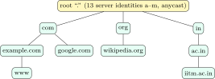
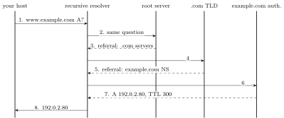

Applications are where interviews leave textbook territory and enter system design: DNS, HTTP and its versions, caching, cookies and tokens, proxies and load balancers. The protocols are text-based or close to it, so the best way to learn them is to read real messages, which is what this chapter does.

## 10.1 DNS {#sec-cn-dns}

<div class="nb-proto">

<em><span>Prototypical example for this section:</span> a browser asking “what is the address of `www.example.com`?” and a chain of servers, root to authoritative, answering in pieces.</em>

</div>

### 10.1.i A distributed, hierarchical database {#s10-1-i}

The <strong>Domain Name System</strong> (RFC 1034/1035) maps names to records. No single server could hold every name or take every query, so the namespace is a tree split into <strong>zones</strong>, each served by its own <strong>authoritative</strong> name servers:

<figure class="nb-fig"></figure>

The root servers know the top-level-domain (TLD) servers; the TLD servers know each domain’s authoritative servers; those hold the actual records. “13 root servers” means $13$ server <em>names</em>; each is replicated at many sites with <strong>anycast</strong> routing.

### 10.1.ii Resolution: recursive and iterative {#s10-1-ii}

<figure class="nb-fig"></figure>

<div class="nb nb-definition" id="definition-10-1-1">

<strong>Definition 10.1.1</strong>. In a <strong>recursive</strong> query the server asked must return the final answer, doing the work itself; in an <strong>iterative</strong> query a server may answer with a <strong>referral</strong> (“I don’t know, ask that server”). In practice the host’s resolver library sends one recursive query to a <strong>recursive resolver</strong> (the ISP’s, the campus’s, or a public one), and the resolver walks the hierarchy iteratively (steps $2$–$7$).

</div>

### 10.1.iii Records, caching and TTL {#s10-1-iii}

| Type | Holds |
|:--|:--|
| A / AAAA | an IPv4 / IPv6 address for the name |
| CNAME | “this name is an alias of that name” (canonical name) |
| MX | mail exchangers for the domain, with preferences |
| NS | the authoritative name servers for a zone (used for delegation) |
| PTR | reverse lookup: address to name (under `in-addr.arpa`) |
| SOA | start of authority: zone serial number, refresh timers, negative-caching TTL |
| TXT, SRV, CAA | free text (SPF, domain verification), service location, allowed certificate authorities |

<div class="nb-caption" id="table-10-1">

<strong>Table 10.1.</strong> Common DNS record types.

</div>

Every record carries a <strong>TTL</strong>: how many seconds a resolver may cache it. Caching is why DNS scales: a busy resolver almost never asks the root, because TLD referrals are cached for days. The cost is staleness: after changing a record, old answers survive until their TTL expires, so operators lower the TTL before a migration. Failed lookups are cached too (negative caching, with the TTL from the SOA). Browsers and operating systems keep their own caches, and `/etc/hosts` is consulted before DNS on most systems (the order is set by `/etc/nsswitch.conf`).

### 10.1.iv The message format {#s10-1-iv}

DNS normally uses UDP port $53$: one datagram each way, no handshake. It falls back to TCP when an answer does not fit (the server sets the <strong>truncated</strong> bit) and for zone transfers between servers. The program below builds a query byte by byte, answers it from a tiny authoritative server on the loopback, and parses the reply:

```text {filename="Output of dns_msg.py"}
query (33 bytes):
   1a 2b 01 00 00 01 00 00 00 00 00 00 03 77 77 77
   07 65 78 61 6d 70 6c 65 03 63 6f 6d 00 00 01 00
   01
  id 1a2b, flags 0100 (standard query, recursion desired)
  1 question: www.example.com A IN
reply (49 bytes): id 1a2b, flags 8500 (QR=1, AA=1, RD=1, RCODE=0), answers 1
  answer: www.example.com type 1 (A) class 1 (IN) TTL 300 s -> 192.0.2.80
  the answer's name is the 2-byte pointer c00c -> offset 12
resolver library on this host: ['127.0.0.1'] for localhost (/etc/hosts)
```

The header is $12$ bytes: ID, flags, and four counts. A name is a sequence of length-prefixed labels ending in a zero byte. In the reply the answer’s name is a 2-byte <strong>compression pointer</strong> (`c0 0c`: top two bits set, offset $12$) back to the name in the question. The ID ties a reply to its query; guessing it is the core of DNS cache poisoning ([Section 11.3](../11-security/#sec-cn-attacks)), which is why resolvers also randomise the source port and DNSSEC signs records. DNS over TLS (port $853$) and DNS over HTTPS encrypt the queries.

<div class="nb nb-moral">

DNS: a tree of zones; the host asks a recursive resolver, which asks root, TLD and authoritative servers iteratively and caches everything for its TTL. UDP $53$, TCP for big answers.

</div>

## 10.2 HTTP {#sec-cn-http}

<div class="nb-proto">

<em><span>Prototypical example for this section:</span> four requests on one kept-alive TCP connection to a real local server: 200, 304, 200 without a body, 404.</em>

</div>

### 10.2.i Messages {#s10-2-i}

HTTP is a request–response protocol. A request is a method, a target and a version, then header lines, a blank line and an optional body; a response is a version, a <strong>status code</strong> and reason, headers, a blank line and a body. HTTP is <strong>stateless</strong>: each request carries everything the server needs (state lives in cookies or tokens, [Section 10.3](#sec-cn-state)).

```text {filename="Output of http_local.py"}
>>> GET /hello.txt HTTP/1.1
>>> Host: localhost
<<< HTTP/1.1 200 OK
<<< Server: SimpleHTTP/0.6 Python/3.11.15
<<< Date: Fri, 02 Oct 2026 12:00:00 GMT
<<< Content-type: text/plain
<<< Content-Length: 23
<<< Last-Modified: Tue, 14 Nov 2023 22:13:20 GMT
<<< Hello from the server.

>>> GET /hello.txt HTTP/1.1
>>> Host: localhost
>>> If-Modified-Since: Tue, 14 Nov 2023 22:13:20 GMT
<<< HTTP/1.1 304 Not Modified
<<< Server: SimpleHTTP/0.6 Python/3.11.15
<<< Date: Fri, 02 Oct 2026 12:00:00 GMT

>>> HEAD /hello.txt HTTP/1.1
>>> Host: localhost
<<< HTTP/1.1 200 OK
<<< Server: SimpleHTTP/0.6 Python/3.11.15
<<< Date: Fri, 02 Oct 2026 12:00:00 GMT
<<< Content-type: text/plain
<<< Content-Length: 23
<<< Last-Modified: Tue, 14 Nov 2023 22:13:20 GMT

>>> GET /missing HTTP/1.1
>>> Host: localhost
<<< HTTP/1.1 404 File not found
<<< Server: SimpleHTTP/0.6 Python/3.11.15
<<< Date: Fri, 02 Oct 2026 12:00:00 GMT
<<< Connection: close
<<< Content-Type: text/html;charset=utf-8
<<< Content-Length: 335
<<< <!DOCTYPE HTML>
<<< <html lang="en">
```

All four exchanges used one TCP connection (HTTP/1.1 is persistent by default). The second request is a <strong>conditional GET</strong>: the client already holds the file from `Tue, 14 Nov 2023 22:13:20 GMT`, so the server answers `304 Not Modified` with no body. `HEAD` returns the headers of a GET without the body. The 404 adds `Connection: close`: this server ends the connection after an error.

| Method | Safe | Idempotent | Use |
|:--|:-:|:-:|:--|
| GET | yes | yes | read a resource |
| HEAD | yes | yes | GET without the body |
| OPTIONS | yes | yes | which methods are allowed (CORS preflight) |
| PUT | no | yes | create or replace the resource at this URL |
| DELETE | no | yes | delete it |
| POST | no | no | process this data: create a subordinate resource, submit a form |
| PATCH | no | no (in general) | partial modification |

<div class="nb-caption" id="table-10-2">

<strong>Table 10.2.</strong> Methods (RFC 9110). <em>Safe</em>: no intended side effect. <em>Idempotent</em>: sending it twice has the same effect as once, so a client may retry it after a timeout.

</div>

| Code | Meaning |
|:--|:--|
| 1xx | informational: `100 Continue`, `101 Switching Protocols` (WebSocket) |
| 2xx | success: `200 OK`, `201 Created`, `204 No Content` |
| 3xx | redirection: `301 Moved Permanently`, `302 Found`, `304 Not Modified`, `307`/`308` (redirect keeping the method) |
| 4xx | client error: `400 Bad Request`, `401 Unauthorized` (not authenticated), `403 Forbidden` (authenticated but not allowed), `404 Not Found`, `405 Method Not Allowed`, `409 Conflict`, `429 Too Many Requests` |
| 5xx | server error: `500 Internal Server Error`, `502 Bad Gateway` (the upstream sent garbage), `503 Service Unavailable`, `504 Gateway Timeout` (the upstream did not answer) |

<div class="nb-caption" id="table-10-3">

<strong>Table 10.3.</strong> Status codes (RFC 9110 and RFC 6585 for 429).

</div>

### 10.2.ii Versions {#s10-2-ii}

| Version | What changed |
|:--|:--|
| HTTP/1.0 | one request per TCP connection (non-persistent) unless both sides opt in |
| HTTP/1.1 | persistent connections by default; mandatory `Host` header (many sites on one IP address); chunked transfer; pipelining (rarely usable: responses must come back in order, so one slow response blocks the rest: <strong>head-of-line blocking</strong>). Browsers open about six parallel connections per host instead. |
| HTTP/2 (RFC 9113) | binary framing; many concurrent <strong>streams</strong> multiplexed on one TCP connection; header compression (HPACK); server push (now largely abandoned). Still suffers TCP-level head-of-line blocking: one lost packet stalls all streams. |
| HTTP/3 (RFC 9114) | HTTP/2’s ideas over QUIC ([Section 9.5](../09-transport/#sec-cn-quic)): streams are independent at the transport level too; 1-RTT (or 0-RTT) setup including TLS 1.3; survives network changes. |

<div class="nb-caption" id="table-10-4">

<strong>Table 10.4.</strong> HTTP versions.

</div>

```text {filename="Output of http_rtt.py"}
base page + 10 objects, RTT 50 ms (DNS and TLS not counted)
   HTTP/1.0 non-persistent, serial           22 RTTs =  1100 ms
   non-persistent, 5 parallel connections     6 RTTs =   300 ms
   HTTP/1.1 persistent, no pipelining        12 RTTs =   600 ms
   persistent with pipelining (or HTTP/2)     3 RTTs =   150 ms
   persistent + pipelining + TLS 1.3 handshake: 4 RTTs
   persistent + pipelining + TLS 1.2 handshake: 5 RTTs
```

Each non-persistent fetch costs two RTTs (TCP handshake, then request/response); persistence removes the handshakes, pipelining or HTTP/2 multiplexing removes the per-object waits.

### 10.2.iii Caching, CDNs and proxies {#s10-2-iii}

Responses say how they may be cached: `Cache-Control: max-age=3600` (fresh for an hour), `no-cache` (store, but revalidate every time), `no-store` (never store), `private` (only the browser, not shared caches). Revalidation uses validators: `ETag` with `If-None-Match`, or `Last-Modified` with `If-Modified-Since`, as in the 304 above. A <strong>CDN</strong> (content delivery network) runs caches in hundreds of locations; DNS or anycast sends each user to a nearby one, which cuts latency (shorter RTT for every handshake) and offloads the origin.

<div class="nb nb-definition" id="definition-10-2-1">

<strong>Definition 10.2.1</strong> (Proxies, reverse proxies, load balancers). A <strong>forward proxy</strong> acts for clients (a campus proxy: filtering, caching, hiding clients). A <strong>reverse proxy</strong> acts for servers (nginx in front of an application: TLS termination, caching, compression, routing, protection). A <strong>load balancer</strong> is a reverse proxy that spreads requests over a pool of servers with health checks. An <strong>L4</strong> balancer looks only at IP addresses and ports and forwards whole TCP connections (fast, protocol-agnostic, cannot see URLs); an <strong>L7</strong> balancer terminates HTTP and routes each request by host, path, header or cookie (can do sticky sessions, retries, canary releases, at more CPU per request). Policies: round robin, least connections, consistent hashing on a key.

</div>

<div class="nb nb-moral">

HTTP: stateless requests, methods with defined safety and idempotency, status classes 1xx–5xx, persistence in 1.1, multiplexing in 2, QUIC in 3. Cache with `Cache-Control` and validators; scale with CDNs, reverse proxies and L4/L7 load balancers.

</div>

## 10.3 State on a stateless protocol: cookies, sessions, tokens {#sec-cn-state}

<div class="nb-proto">

<em><span>Prototypical example for this section:</span> logging in once and staying logged in: the server either remembers you (a session) or hands you a signed note it can check later (a token).</em>

</div>

<div class="nb nb-definition" id="definition-10-3-1">

<strong>Definition 10.3.1</strong>. A <strong>cookie</strong> is a small name–value pair the server sets with `Set-Cookie` and the browser returns in a `Cookie` header on every later request to that site. Attributes control it: `Expires`/`Max-Age` (otherwise it is a <strong>session cookie</strong>, deleted when the browser closes), `Domain` and `Path` (where it is sent), `Secure` (HTTPS only), `HttpOnly` (invisible to JavaScript, which blunts XSS theft), `SameSite` (not sent on cross-site requests, which blunts CSRF).

</div>

A <strong>server-side session</strong> stores the user’s state on the server (in memory, Redis, a database) under a random session ID, and the cookie carries only the ID. A <strong>token</strong> such as a <strong>JWT</strong> carries the state itself, signed so that the client cannot alter it:

```text {filename="Output of jwt_demo.py"}
token (3 parts):
  eyJhbGciOiJIUzI1NiIsInR5cCI6IkpXVCJ9
  eyJzdWIiOiJ1c2VyNDIiLCJyb2xlIjoic3R1ZGVudCIsImV4cCI6MTc5MDAwMDAwMH0
  qcwrq88_vZ35nzrB1i3lHbgaSGyE87t-mS3yKJ4MkS0
payload is only encoded; anyone can read it:
  {"sub":"user42","role":"student","exp":1790000000}
verify original: True
verify with role changed to admin: False
```

|  | Session ID in a cookie | Signed token (JWT) |
|:--|:--|:--|
| State lives | on the server | in the token, on the client |
| Each request | look up the session store | verify a signature, no lookup |
| Logout / revoke | delete the session: immediate | hard: valid until `exp` unless a deny-list is kept (so: short lifetimes plus refresh tokens) |
| Scaling | needs a shared store or sticky sessions | any server with the key can verify |
| Size | a short ID | hundreds of bytes on every request |
| Secrecy | nothing exposed | payload readable by anyone (signed, not encrypted) |

<div class="nb-caption" id="table-10-5">

<strong>Table 10.5.</strong> Sessions against tokens. The two combine freely: a JWT can travel in a cookie.

</div>

<div class="nb nb-remark" id="remark-10-3-2">

<strong>Remark 10.3.2</strong> (Cookies vs sessions, the interview answer) — A cookie is a <em>transport</em> (client-side storage the browser sends back automatically); a session is <em>server-side state</em>. The usual design uses a cookie to carry a session ID. Cookies are limited (about $4$ KB each), visible to the user and sent with every request; never put secrets or authorisation decisions in an unsigned cookie.

</div>

<div class="nb nb-moral">

Cookies carry; sessions remember on the server; tokens remember on the client and are verified by signature. Signed is not encrypted.

</div>

## 10.4 APIs and push: REST, gRPC, WebSocket, long polling {#sec-cn-apis}

<div class="nb-proto">

<em><span>Prototypical example for this section:</span> a chat app: REST to load history, a WebSocket to receive new messages the moment they are sent.</em>

</div>

- <strong>REST</strong>: resources named by URLs, manipulated with the standard methods, stateless requests, representations usually in JSON, cacheable responses. Simple, debuggable, works everywhere.
- <strong>RPC</strong> styles call remote functions. <strong>gRPC</strong> uses HTTP/2, a binary encoding (Protocol Buffers) and an interface definition from which client and server code is generated; it supports streaming in both directions. Compact and fast, common between internal services; harder to call from a browser and to inspect by eye.
- HTTP is client-initiated. For server push: <strong>short polling</strong> (ask every few seconds: wasteful), <strong>long polling</strong> (the server holds the request open until there is news, then the client immediately asks again), <strong>server-sent events</strong> (one long response streaming events, server to client only), and <strong>WebSocket</strong> (RFC 6455): an HTTP request upgrades the TCP connection to a full-duplex, message-framed channel.

```text {filename="Output of ws_accept.py"}
client: GET /chat HTTP/1.1, Upgrade: websocket, Connection: Upgrade,
        Sec-WebSocket-Key: dGhlIHNhbXBsZSBub25jZQ==
server: HTTP/1.1 101 Switching Protocols
        Sec-WebSocket-Accept: s3pPLMBiTxaQ9kYGzzhZRbK+xOo=
```

The `Sec-WebSocket-Accept` value is $\mathrm{base64}(\mathrm{SHA1}(\text{key} \,\|\, \text{fixed GUID}))$; the program reproduces the example value printed in RFC 6455. It proves the server really speaks WebSocket and is not a cache replaying an old response.

## 10.5 Mail, file transfer and remote login {#sec-cn-mail}

<div class="nb-proto">

<em><span>Prototypical example for this section:</span> a mail from one university to another: SMTP pushes it from server to server, and the recipient’s phone pulls it with IMAP.</em>

</div>

- <strong>SMTP</strong> (RFC 5321) <em>pushes</em> mail: from the sender’s client to its mail server (submission, port $587$), then from server to server (port $25$), found through the recipient domain’s MX records. Commands `HELO`/`EHLO`, `MAIL FROM`, `RCPT TO`, `DATA`, `QUIT`; replies are three-digit codes (`250` OK, `354` start mail input, `550` mailbox unavailable). Mail is relayed through servers because the recipient’s machine is rarely online.
- <strong>POP3</strong> (port $110$; $995$ with TLS) and <strong>IMAP</strong> (port $143$; $993$) let the recipient <em>pull</em> mail. POP3 typically downloads and deletes; IMAP keeps mail and folders on the server and synchronises many devices, which is why it won.
- <strong>FTP</strong> uses two TCP connections: a control connection to port $21$ for commands (`USER`, `PASS`, `RETR`, `STOR`, `LIST`) and a separate data connection per transfer (“out-of-band” control). In <strong>active</strong> mode the server connects back to the client (from port $20$), which client firewalls and NATs block; in <strong>passive</strong> mode the client opens the data connection to a port the server names, which is why passive is the default today. FTP sends passwords in clear; SFTP (over SSH) and HTTPS replaced it.
- <strong>SSH</strong> (port $22$) gives an encrypted, authenticated remote shell: key exchange (Diffie–Hellman), server authentication by host key (the “fingerprint” prompt on first connection), user authentication by password or, better, public key; it also tunnels ports and carries SFTP and `scp`. Telnet (port $23$) did the same in clear text.

<div class="nb nb-moral">

SMTP pushes (25 between servers, 587 for submission), IMAP/POP3 pull; FTP keeps control (21) and data apart; SSH (22) is the encrypted replacement for telnet and FTP.

</div>
