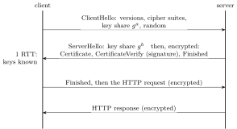

The Internet’s protocols were designed for a cooperative network: IP addresses can be forged, ARP and DNS answers believed, TCP connections hijacked. Security was added on top, mostly by cryptography at the transport and application layers. Interviews ask for the building blocks (what each primitive guarantees), how TLS combines them, and the classic attacks with their fixes.

## 11.1 The building blocks {#sec-cn-crypto}

<div class="nb-proto">

<em><span>Prototypical example for this section:</span> RSA with $p = 89$, $q = 97$: encrypt $3000$, get $3951$, decrypt back; and why this “textbook RSA” must never be used as is.</em>

</div>

### 11.1.i What we want, and which tool gives it {#s11-1-i}

| Goal | Meaning | Tool |
|:--|:--|:--|
| Confidentiality | only the intended party can read | encryption (symmetric for data) |
| Integrity | tampering is detected | MAC, or authenticated encryption |
| Authentication | you know who you are talking to | certificates and signatures, MACs with a shared key, passwords |
| Non-repudiation | the sender cannot deny it later | digital signature (only the private key could have made it) |
| Availability | the service stays up | redundancy, rate limiting, DDoS filtering |

<div class="nb-caption" id="table-11-1">

<strong>Table 11.1.</strong> Security goals.

</div>

<div class="nb nb-definition" id="definition-11-1-1">

<strong>Definition 11.1.1</strong>. <strong>Symmetric</strong> encryption uses one shared key to encrypt and decrypt (AES, ChaCha20): fast, but the two sides must first share the key secretly, and $n$ parties need $n(n-1)/2$ keys. <strong>Asymmetric</strong> (public-key) cryptography uses a key pair: what the public key encrypts only the private key decrypts, and what the private key signs anyone can verify with the public key (RSA, elliptic curves). It solves key distribution but is orders of magnitude slower. Real protocols are <strong>hybrid</strong>: public-key methods agree on or deliver a symmetric session key, which then encrypts the data.

</div>

### 11.1.ii RSA {#s11-1-ii}

<div class="nb nb-remark" id="algorithm-11-1-2">

<strong>Algorithm 11.1.2</strong> (RSA) — Pick primes $p, q$; $n = pq$; $\varphi(n) = (p-1)(q-1)$; choose $e$ coprime to $\varphi(n)$; $d = e^{-1} \bmod \varphi(n)$. Public key $(n, e)$, private key $d$. Encrypt $c = m^e \bmod n$; decrypt $m = c^d \bmod n$. Sign $s = h^d \bmod n$; verify $s^e \bmod n = h$. Security rests on the difficulty of factoring $n$.

</div>

```text {filename="Output of rsa_small.py"}
p = 89, q = 97, n = pq = 8633, phi(n) = (p-1)(q-1) = 8448
e = 5 (gcd(e, phi) = 1); private d = e^-1 mod phi = 5069; e*d mod phi = 1
encrypt m = 3000: c = m^e mod n = 3951;  decrypt: c^d mod n = 3000
sign h = 42 with d: s = 810;  anyone verifies s^e mod n = 42
Enc(12) * Enc(34) mod n decrypts to 408 = 12 * 34 -> why real RSA needs padding
same plaintext, same ciphertext every time: Enc(3000) = 3951 again
```

The last two lines are why <em>textbook</em> RSA is broken: it is deterministic (equal plaintexts give equal ciphertexts, so guesses can be checked) and malleable (multiplying ciphertexts multiplies plaintexts). Real systems add randomised padding (OAEP for encryption, PSS for signatures) and use $n$ of at least $2048$ bits.

### 11.1.iii Diffie–Hellman {#s11-1-iii}

<div class="nb nb-remark" id="algorithm-11-1-3">

<strong>Algorithm 11.1.3</strong> (Diffie–Hellman key agreement) — Public: a prime $p$ and a generator $g$. Alice picks secret $a$ and sends $A = g^a \bmod p$; Bob picks $b$ and sends $B = g^b \bmod p$. Both compute $g^{ab} \bmod p$: Alice as $B^a$, Bob as $A^b$. An eavesdropper sees $g$, $p$, $A$, $B$ and would have to solve the discrete logarithm.

</div>

```text {filename="Output of dh_small.py"}
public: p = 467, g = 2 (smallest generator)
Alice: a = 153, sends A = g^a mod p = 224
Bob:   b = 197, sends B = g^b mod p = 87
Alice computes B^a mod p = 367;  Bob computes A^b mod p = 367
eavesdropper must solve g^x = 224 (mod 467): brute force gives x = 153
    (infeasible with a 2048-bit p)
MITM: Mallory sends M = 86 to both. Alice's key = M^a = 450, Bob's key = M^b = 419
      Mallory knows both: A^m = 450, B^m = 419 -> relays and reads everything
```

Diffie–Hellman alone has no authentication: Mallory in the middle runs one exchange with each side and relays (and reads) everything. The fix is to sign the DH values with a long-term key whose public half is vouched for by a certificate: that is what TLS does. Using fresh DH secrets for every session gives <strong>forward secrecy</strong>: stealing the server’s long-term key later does not decrypt recorded traffic. Elliptic-curve DH (ECDHE) does the same with much smaller keys.

### 11.1.iv Hashes, MACs and signatures {#s11-1-iv}

<div class="nb nb-definition" id="definition-11-1-4">

<strong>Definition 11.1.4</strong>. A <strong>cryptographic hash</strong> maps any input to a fixed-size digest, and it must be infeasible to find an input for a given digest (preimage resistance) or two inputs with the same digest (collision resistance). A <strong>MAC</strong> (message authentication code) is a keyed checksum: only holders of the key can produce or check it, so it gives integrity and authentication between two parties. A <strong>digital signature</strong> is made with a private key and checked with the public one, so anyone can verify it and only the key owner could have made it.

</div>

```text {filename="Output of hashes.py"}
SHA-256(abc) = ba7816bf8f01cfea414140de5dae2223b00361a396177a9cb410ff61f20015ad
SHA-256(abb) = 715edf8ba8729420cd4d1ce85ed61954a9f531f8c548df728c407effe839296d
one input bit changed -> 124 of 256 output bits differ
digest sizes in bits: md5 128, sha1 160, sha256 256, sha512 512
HMAC-SHA256(key = 0x0b * 20, 'Hi There'), RFC 4231 test 1:
   b0344c61d8db38535ca8afceaf0bf12b881dc200c9833da726e9376c2e32cff7
plain SHA-256(key || data) is different:
   9000e06f7d262eac9b27728faaaee3a54d901591a9262c1af171f25fe97c7717
PBKDF2-SHA256,      1 iterations: fb5ecc835be977f350fab945de96f48f...
PBKDF2-SHA256, 600000 iterations: 0cae4f68c65c8799f96402ea497052ae...
```

Changing one input bit flips about half of the output bits (the <strong>avalanche effect</strong>). MD5 and SHA-1 have practical collision attacks and must not be used for signatures. <strong>HMAC</strong> (RFC 2104) is the standard way to build a MAC from a hash: the program reproduces the first test vector of RFC 4231, and shows that the naive $\mathrm{SHA256}(\text{key} \,\|\, \text{data})$ gives a different value (and, with SHA-2, is open to length-extension forgeries). Passwords are stored with a per-user <strong>salt</strong> and a deliberately slow function (PBKDF2, bcrypt, scrypt, Argon2), so that precomputed tables are useless and each guess is expensive.

<div class="nb nb-remark" id="remark-11-1-5">

<strong>Remark 11.1.5</strong> (Checksums are not MACs) — A CRC or the Internet checksum ([Chapter 3](../03-errors/)) detects accidents. An attacker who changes the data simply recomputes the checksum. Integrity against an adversary needs a key: a MAC, a signature, or authenticated encryption such as AES-GCM.

</div>

<div class="nb nb-moral">

Symmetric for speed, asymmetric for key exchange and signatures, hashes for fingerprints, MACs for keyed integrity. Textbook RSA and unauthenticated DH are both broken in practice.

</div>

## 11.2 Certificates and TLS {#sec-cn-tls}

<div class="nb-proto">

<em><span>Prototypical example for this section:</span> a browser refusing a certificate for the wrong host name, exactly as the real handshake below does.</em>

</div>

### 11.2.i Certificates and the chain of trust {#s11-2-i}

A public key is only useful if you know whose it is. A <strong>certificate</strong> (X.509) binds a name (in the subject alternative name extension) to a public key, with a validity period, signed by a <strong>certificate authority</strong> (CA). A browser trusts a fixed set of root CAs shipped with the operating system or browser; roots sign intermediate CAs, intermediates sign server certificates, and the server sends its certificate plus the intermediates.

<figure class="nb-fig"></figure>

To validate, the client checks every signature up to a trusted root, the validity dates, that the name matches the host it asked for, and (via OCSP or revocation lists) that the certificate was not revoked.

### 11.2.ii TLS 1.3 {#s11-2-ii}

<figure class="nb-fig"></figure>

The client guesses the key-exchange group and sends its DH share in the first message, so after one round trip both sides hold the session keys; the server proves it owns the certificate’s private key by signing the handshake transcript (CertificateVerify), and both Finished messages MAC the whole handshake so that tampering with it is detected.

|  | TLS 1.2 | TLS 1.3 (RFC 8446) |
|:--|:--|:--|
| Handshake | 2 RTTs before data | 1 RTT; 0-RTT on resumption (replayable) |
| Key exchange | RSA key transport or (EC)DHE | (EC)DHE only: forward secrecy always |
| Ciphers | many, including CBC modes and RC4 in old configurations | only AEAD (AES-GCM, ChaCha20-Poly1305) |
| Encrypted | application data | also most of the handshake, including the certificate |

<div class="nb-caption" id="table-11-2">

<strong>Table 11.2.</strong> TLS 1.2 against TLS 1.3.

</div>

The program below makes its own CA, issues a certificate for `notes.test`, and runs three real handshakes against a local server:

```text {filename="Output of tls_local.py"}
1. client trusts the CA, asks for notes.test:
  TLSv1.3, cipher TLS_AES_256_GCM_SHA384
  certificate for 'notes.test' issued by 'Notes Test CA'; reply b'HELLO OVER TLS'
2. client does not trust the CA:
  handshake refused: unable to get local issuer certificate
3. client trusts the CA but asks for bank.test:
  handshake refused: Hostname mismatch, certificate is not valid for 'bank.test'.
```

The first succeeds with TLS 1.3 and an AEAD cipher. The second fails because the client’s trust store does not contain the issuing CA: a self-signed or unknown-CA certificate proves nothing. The third fails on the name check: a valid certificate for another name is exactly what a man in the middle would present.

<div class="nb nb-remark" id="remark-11-2-1">

<strong>Remark 11.2.1</strong> (HTTP vs HTTPS) — HTTPS is HTTP inside TLS, on port $443$. It gives confidentiality (an on-path observer sees the server’s IP address and, unless Encrypted Client Hello is used, the server name from the handshake, but not URLs, headers or bodies), integrity (no injected ads or malware), and server authentication (the certificate). It does not make the server itself trustworthy, and it costs one extra round trip with TLS 1.3 (two with 1.2), which QUIC folds into the transport handshake.

</div>

<div class="nb nb-moral">

Certificates bind names to keys through a chain of CA signatures. TLS 1.3: one round trip, ephemeral DH for forward secrecy, a signature over the transcript, AEAD for the data.

</div>

## 11.3 Firewalls and attacks {#sec-cn-attacks}

<div class="nb-proto">

<em><span>Prototypical example for this section:</span> a forged ARP reply on hostel Wi-Fi that makes every laptop send its traffic through the attacker’s machine.</em>

</div>

### 11.3.i Firewalls and intrusion detection {#s11-3-i}

A <strong>packet filter</strong> allows or drops packets by addresses, protocol and ports. A <strong>stateful firewall</strong> tracks connections, so that replies to inside-initiated connections are let in and unsolicited packets are not (the behaviour NAT gives by accident). <strong>Application-level gateways</strong> (proxies, web application firewalls) inspect content. An <strong>IDS</strong> watches traffic for signatures of known attacks or for anomalies and raises alerts; an <strong>IPS</strong> sits inline and blocks. A <strong>VPN</strong> (IPsec, WireGuard, TLS-based) tunnels traffic over an encrypted channel, joining a remote host to a trusted network.

### 11.3.ii The attacks interviewers name {#s11-3-ii}

| Attack | How it works | Defences |
|:--|:--|:--|
| ARP spoofing | forged ARP replies map the gateway’s IP to the attacker’s MAC; victims send everything through the attacker (MITM on the LAN) | dynamic ARP inspection on switches, static entries for gateways, and end-to-end encryption (TLS) so that interception yields nothing |
| DNS cache poisoning | the attacker races the real answer with forged replies (guessing the query ID and port) so that a resolver caches a false record for every user | random source ports and IDs, DNSSEC signatures, encrypted DNS |
| SYN flood | half-open connections exhaust the server’s backlog ([Section 9.2](../09-transport/#sec-cn-tcp-header)) | SYN cookies, rate limits, filtering |
| DoS / DDoS | overwhelm bandwidth, connections or CPU, often from botnets; <strong>amplification</strong> sends small spoofed requests to open servers (DNS, NTP, memcached) whose large replies hit the victim | over-provisioning, scrubbing services and CDNs, anycast, rate limiting, source-address validation at ISPs |
| MITM | intercept and relay, reading or altering traffic (ARP spoofing, rogue Wi-Fi, unauthenticated DH) | authenticated key exchange with certificates; HSTS so that browsers never fall back to HTTP |
| Replay | resend a captured valid message | nonces, timestamps, sequence numbers |
| IP spoofing | forge the source address (no reply comes back, but enough for floods and reflection) | ingress filtering (BCP 38) |

<div class="nb-caption" id="table-11-3">

<strong>Table 11.3.</strong> Network-level attacks.

</div>

| Attack | How it works | Defences |
|:--|:--|:--|
| SQL injection | user input is pasted into an SQL string: `' OR '1'='1` turns a login check into “true” | parameterised queries (prepared statements), least-privilege database accounts |
| XSS | the site echoes attacker-controlled input into a page as HTML/JavaScript, which runs in other users’ browsers with the site’s privileges (stealing cookies, acting as the user) | escape output by context, Content-Security-Policy, `HttpOnly` cookies |
| CSRF | a malicious page makes the victim’s browser send a request to a site where the victim is logged in; the browser attaches the cookies automatically | `SameSite` cookies, anti-CSRF tokens in forms, checking `Origin` |

<div class="nb-caption" id="table-11-4">

<strong>Table 11.4.</strong> Web attacks, at one-paragraph depth.

</div>

<div class="nb nb-remark" id="remark-11-3-1">

<strong>Remark 11.3.1</strong> (XSS vs CSRF, the one-line difference) — XSS: the attacker’s code runs <em>in</em> the trusted site (the site trusted the input). CSRF: the attacker’s site makes the browser send a request <em>to</em> the trusted site (the site trusted the browser’s cookies). A good XSS defeats CSRF tokens; CSRF needs no XSS.

</div>

<div class="nb nb-moral">

Every protocol that believes unauthenticated answers (ARP, DNS, plain HTTP) can be spoofed; the cure is authentication and encryption end to end. Web attacks come from trusting input (SQLi, XSS) or ambient cookies (CSRF).

</div>
