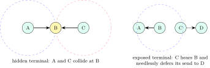
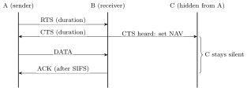
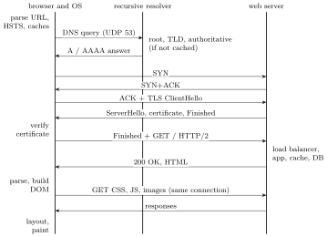

This chapter closes three gaps: how Wi-Fi shares the air, what cellular and SDN are in one page each, and the long-form answers interviewers expect to set questions such as “what happens when you type a URL and press Enter”. The set pieces mostly assemble material from earlier chapters, so they point back to it.

## 12.1 Wi-Fi {#sec-cn-wifi}

<div class="nb-proto">

<em><span>Prototypical example for this section:</span> two laptops on opposite sides of an access point that cannot hear each other and keep colliding at the AP.</em>

</div>

### 12.1.i Why wireless is different {#s12-1-i}

Signals fade with distance and obstacles, reflect along several paths, and suffer interference; bit error rates are far higher than on cable, so 802.11 acknowledges every unicast frame at the link layer and retransmits. A radio cannot listen while it transmits (its own signal swamps everything), so collisions cannot be detected as in Ethernet. And not every station hears every other.

<figure class="nb-fig"></figure>

<div class="nb nb-definition" id="definition-12-1-1">

<strong>Definition 12.1.1</strong>. The <strong>hidden terminal problem</strong>: A and C are both in range of B but not of each other; carrier sense at A says “idle” while C is sending to B, so their frames collide at B. The <strong>exposed terminal problem</strong>: C hears B transmitting to A and defers, although its own transmission to D would not interfere at A.

</div>

### 12.1.ii CSMA/CA and RTS/CTS {#s12-1-ii}

<div class="nb nb-remark" id="algorithm-12-1-2">

<strong>Algorithm 12.1.2</strong> (802.11 distributed coordination (CSMA/CA)) — A station with a frame waits until the channel has been idle for a DIFS interval, then counts down a random backoff (in slots) only while the channel stays idle, freezing the count when it becomes busy; at zero it sends the whole frame. The receiver answers with an ACK after a shorter SIFS interval (so that the ACK beats any new sender). No ACK means a collision or a corrupted frame: double the contention window and retry.

</div>

With the optional <strong>RTS/CTS</strong> exchange the sender first sends a short Request To Send; the receiver answers Clear To Send, which every station in <em>its</em> range hears, including the hidden ones; both messages carry the duration of the coming exchange, and stations set their <strong>network allocation vector</strong> (NAV, a virtual carrier sense) and stay quiet. Collisions can now only hit the short RTS. RTS/CTS costs overhead, so it is typically used only for large frames.

<figure class="nb-fig"></figure>

<div class="nb nb-definition" id="fact-12-1-3">

<strong>Fact 12.1.3</strong> (802.11 frames and roaming). An 802.11 data frame carries up to four MAC addresses (receiver, transmitter, and the original source and final destination when frames are relayed through the AP and a distribution system), so the AP can bridge wireless stations onto Ethernet. A station <strong>associates</strong> with one AP of a network (SSID); moving between APs of the same network is a link-layer handoff, invisible to IP if all the APs share one subnet. Security is WPA2/WPA3 (link-layer encryption between station and AP only).

</div>

## 12.2 Cellular networks and SDN, one page each {#sec-cn-cellular}

<div class="nb-proto">

<em><span>Prototypical example for this section:</span> a phone keeping its video call while the bus moves from one cell tower to the next.</em>

</div>

### 12.2.i Cellular {#s12-2-i}

A cellular network divides an area into <strong>cells</strong>, each served by a base station; cells far enough apart reuse the same frequencies, which is how a limited spectrum serves millions. A moving phone is <strong>handed off</strong> between base stations. The generations: 1G analogue voice; 2G (GSM) digital voice and SMS; 3G packet data (CDMA-based radio); 4G LTE all-IP, with OFDMA on the radio; 5G higher rates and lower latency with new spectrum, massive MIMO, and a service-based core that can be “sliced” into virtual networks. The core network tracks where each subscriber is (mobility management), authenticates the SIM, and anchors the phone’s IP sessions so that its address survives handoffs: mobility is handled below IP by tunnelling to the anchor, not by changing addresses.

### 12.2.ii Software-defined networking {#s12-2-ii}

A traditional router runs both the <strong>control plane</strong> (routing protocols that compute tables) and the <strong>data plane</strong> (forwarding each packet by table lookup), and each box is configured individually. <strong>SDN</strong> separates them: switches become simple match–action engines (“match these header fields, then forward, drop, rewrite or send to the controller”), and a logically centralised <strong>controller</strong> with a global view computes the tables and installs them through a southbound protocol such as OpenFlow. Network behaviour becomes software: traffic engineering, access control, load balancing and virtual networks for cloud tenants are programs on the controller. The price is a controller that must be scaled and replicated. Data centres and WANs of the large cloud providers are the main users.

<div class="nb nb-moral">

Wi-Fi avoids collisions it cannot detect (CSMA/CA, link-layer ACKs, RTS/CTS against hidden terminals). Cellular reuses frequencies across cells and hides mobility below IP. SDN moves the control plane out of the switches into a programmable controller.

</div>

## 12.3 The set pieces {#sec-cn-setpieces}

<div class="nb-proto">

<em><span>Prototypical example for this section:</span> “What happens when you type a URL into a browser and press Enter?”, answered layer by layer for five minutes.</em>

</div>

### 12.3.i What happens when you type a URL and press Enter {#s12-3-i}

<figure class="nb-fig"></figure>

<div class="nb nb-remark" id="algorithm-12-3-1">

<strong>Algorithm 12.3.1</strong> (The answer, in order) — A strong answer walks down and up the stack and names the protocol at each step.

1. <strong>Browser</strong>: parse the URL (scheme, host, port, path); if the input is not a URL, it is a search. Check the HSTS list (force HTTPS) and the HTTP cache; a fresh cached copy ends the story here.
2. <strong>DNS</strong> ([Section 10.1](../10-application/#sec-cn-dns)): browser cache, OS cache, `/etc/hosts`, then a query (UDP $53$) to the configured recursive resolver, which walks root, TLD and authoritative servers if it has nothing cached, and returns A/AAAA records with TTLs.
3. <strong>Routing the first packet</strong>: the host compares the server’s address with its own subnet ([Section 6.4](../06-addressing/#sec-cn-lpm)); it is remote, so the packet goes to the default gateway, whose MAC address comes from the ARP cache or an ARP request ([Section 5.5](../05-mac-lan/#sec-cn-arp)). Behind a home router, NAT rewrites the source address and port ([Section 7.4](../07-ip/#sec-cn-dhcp)); routers along the way forward by longest-prefix match with tables built by OSPF and BGP ([Chapter 8](../08-routing/)).
4. <strong>TCP</strong> ([Section 9.2](../09-transport/#sec-cn-tcp-header)): three-way handshake to port $443$ (one RTT); slow start begins ([Section 9.4](../09-transport/#sec-cn-congestion)).
5. <strong>TLS</strong> ([Section 11.2](../11-security/#sec-cn-tls)): ClientHello with SNI and key share; the server sends its certificate chain and proves possession of the key; the browser validates the chain, dates and name; both derive session keys. One RTT with TLS 1.3. (With HTTP/3 the TCP and TLS steps merge into a single QUIC handshake over UDP.)
6. <strong>HTTP</strong> ([Section 10.2](../10-application/#sec-cn-http)): `GET /` with `Host`, cookies, `Accept-Encoding`, usually over HTTP/2 negotiated by ALPN. On the server side: a CDN edge or load balancer, a reverse proxy, the application, caches and databases.
7. <strong>Response</strong>: status, headers (`Content-Type`, `Cache-Control`, `Set-Cookie`), compressed body. Redirects (3xx) restart the process for the new URL.
8. <strong>Rendering</strong>: parse HTML into the DOM, fetch CSS, JavaScript and images (reusing the connection; more DNS lookups for other domains), build the render tree, lay out, paint; JavaScript may issue further requests.

</div>

```text {filename="Output of url_latency.py"}
cold: DNS walk + TCP + TLS 1.2 + HTTP   DNS 85 ms + 4 RTT = 205 ms
DNS cached + TCP + TLS 1.2 + HTTP       DNS  0 ms + 4 RTT = 120 ms
DNS cached + TCP + TLS 1.3 + HTTP       DNS  0 ms + 3 RTT =  90 ms
DNS cached + QUIC (HTTP/3), new server  DNS  0 ms + 2 RTT =  60 ms
DNS cached + QUIC 0-RTT resumption      DNS  0 ms + 1 RTT =  30 ms
reused keep-alive connection            DNS  0 ms + 1 RTT =  30 ms
```

The latency budget explains the engineering of the modern web: DNS caching, connection reuse, TLS 1.3, QUIC and CDNs each remove round trips, and round trips, not bandwidth, dominate page loads.

### 12.3.ii Short answers to the other set pieces {#s12-3-ii}

- <strong>TCP vs UDP</strong>: reliable ordered byte stream with flow and congestion control and a handshake, against fire-and-forget datagrams; table in [Section 9.6](../09-transport/#sec-cn-sockets).
- <strong>How traceroute works</strong>: increasing TTLs provoke ICMP Time Exceeded from each router in turn; the destination answers Port Unreachable ([Section 7.3](../07-ip/#sec-cn-icmp)).
- <strong>Why the three-way handshake</strong>: both sides must send their ISN and see it acknowledged, and a stale duplicate SYN must not open a connection ([Section 9.2](../09-transport/#sec-cn-tcp-header)).
- <strong>Why TIME\_WAIT, why $2\,$MSL</strong>: re-ACK a lost final FIN; let old segments die before the 4-tuple is reused ([Section 9.2](../09-transport/#sec-cn-tcp-header)).
- <strong>NAT and its problems</strong>: rewriting addresses and ports breaks end-to-end reachability, embedded-address protocols, and adds state and timeouts ([Section 7.4](../07-ip/#sec-cn-dhcp)).
- <strong>HTTP vs HTTPS</strong>: HTTPS is HTTP inside TLS on port $443$: confidentiality, integrity and server authentication ([Section 11.2](../11-security/#sec-cn-tls)).
- <strong>Cookies vs sessions</strong>: the cookie is client-side storage sent back automatically; the session is server-side state, usually found through a session ID in a cookie ([Section 10.3](../10-application/#sec-cn-state)).
- <strong>Hub vs switch vs router</strong>: layer 1 repeater (one collision domain), layer 2 learning bridge (one broadcast domain), layer 3 forwarder between networks ([Section 5.3](../05-mac-lan/#sec-cn-ethernet)).

|  | ARP | RARP | DHCP |
|:--|:--|:--|:--|
| Question | “What MAC has this IP?” | “What is my IP? (here is my MAC)” | “Give me an IP address and configuration” |
| Layer / transport | link layer, EtherType `0806` | link layer | UDP $67/68$ |
| Crosses routers | no | no | through relay agents |
| Returns | a MAC address | an IP address only | address, mask, gateway, DNS, lease |
| Status | in use (IPv4); NDP in IPv6 | obsolete | in use |

<div class="nb-caption" id="table-12-1">

<strong>Table 12.1.</strong> ARP, RARP and DHCP side by side.

</div>

<div class="nb nb-moral">

For the URL question: browser and caches, DNS, ARP and routing, TCP, TLS, HTTP, server side, rendering; name the protocol and the port at every step, and count the round trips.

</div>
