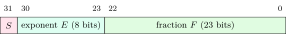
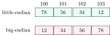

Every question in computer organization starts with bits: what a pattern of $n$ bits means, how to convert it in your head, and what the hardware does when the result does not fit. This chapter is the “number sense” the rest of the book assumes.

<div class="nb nb-remark" id="remark-1-0-1">

<strong>Remark 1.0.1</strong> (How to read this book) — Every number in the book was produced by a program in the book’s `code` folder, and the grey box under a listing is that program’s real output. C programs were compiled with gcc 13.3, `-std=c11`, x86-64 Linux; Python is 3.11; Verilog was simulated with Icarus Verilog 12 and VHDL with GHDL 4.1. Sizes such as `sizeof(long)` are for that platform (LP64); the text says when another platform differs.

<strong>Sources.</strong> The material follows four textbooks: Hamacher, Vranesic, Zaky and Manjikian, <em>Computer Organization and Embedded Systems</em> (6th ed.) [&#91;Ham+11&#93;](../references/#ref-hamacher); Patterson and Hennessy, <em>Computer Organization and Design</em> (5th ed.) [&#91;PH13&#93;](../references/#ref-patterson); Stallings, <em>Computer Organization and Architecture</em> (10th ed.) [&#91;Sta16&#93;](../references/#ref-stallings-coa); and Mano, <em>Computer System Architecture</em> (3rd ed.) [&#91;Man93&#93;](../references/#ref-mano), together with Mano’s <em>Digital Design</em> for the logic chapters. The coverage was checked against the GO Classes lecture notes on computer organization (lectures by Abdul Kadir and Deepak Poonia); the digital-logic chapters, the C and HDL experiments and the problems are new.

</div>

## 1.1 Number bases and fast conversions {#sec-coa-bases}

<div class="nb-proto">

<em><span>Prototypical example for this section:</span> $(2\mathrm{BAD})_{16}$ in decimal, and $(5432)_{10}$ in hexadecimal, each in under thirty seconds with pen and paper.</em>

</div>

### 1.1.i Positional notation {#s1-1-i}

A string $d_{k-1}\dots d_1 d_0$ in base $b$ means $\sum_i d_i b^i$. Two procedures do all conversions:

- <strong>Horner’s rule</strong> (base $b$ $\to$ decimal): start with $0$; for each digit from the left, multiply by $b$ and add the digit. No powers of $b$ need to be remembered.
- <strong>Repeated division</strong> (decimal $\to$ base $b$): divide by $b$, write down the remainder, repeat on the quotient; the remainders read <em>bottom up</em> are the answer. For a fraction, multiply by $b$ instead and read the integer parts <em>top down</em>.

Between bases $2$, $8$ and $16$ there is no arithmetic at all: one octal digit is exactly $3$ bits and one hex digit exactly $4$ bits, so group bits from the binary point outwards (padding with zeros at the ends) and translate group by group.

```python {filename="base-convert.py, lines 5–18",linenos=table,linenostart=5}
def to_base(n, b):                      # repeated division, remainders reversed
    s = ""
    while True:
        n, r = divmod(n, b)
        s = DIG[r] + s
        if n == 0:
            return s

def from_base(s, b):                    # Horner: ((d0*b + d1)*b + d2)...
    v = 0
    for ch in s.upper():
        v = v * b + DIG.index(ch)
    return v
```

```text {filename="Output of base-convert.py (Python 3.11)"}
(1011 0110)_2 = (B6)_16    [decimal 182]
(5432)_10 = (1538)_16    [decimal 5432]
(2BAD)_16 = (11181)_10    [decimal 11181]
(3F7)_16 = (1111110111)_2    [decimal 1015]
(743)_8 = (483)_10    [decimal 483]
(1 0111 0011)_2 = (563)_8    [decimal 371]
(10 1110 0111)_2 = (1347)_8    [decimal 743]
Horner for 2BAD: ((2*16 + 11)*16 + 10)*16 + 13 = 11181
   5432 / 16 =  339 remainder  8 (8)
    339 / 16 =   21 remainder  3 (3)
     21 / 16 =    1 remainder  5 (5)
      1 / 16 =    0 remainder  1 (1)
0.625 = 0.1010 (binary, exact)
0.1   = 0.0001100110011001... (0011 repeats)
37 & 37 = 37,  37 | 37 = 37,  37 ^ 37 = 0
```

<div class="nb nb-example nb-block" id="example-1-1-1">

<strong>Example 1.1.1</strong> (The OA conversions, done the fast way)

Read the answers off the output, then check that you could have done each by hand.

- $(1011\,0110)_2$: groups `1011`, `0110` are B, 6, so <strong>B6</strong>.
- $(3\mathrm{F7})_{16}$: write each digit as 4 bits, `0011 1111 0111`, and drop the leading zeros: `1111110111`.
- $(1\,0111\,0011)_2$ to octal: regroup in threes from the right, `101 110 011`, which is <strong>563</strong>.
- $(743)_8 = 7\cdot 64 + 4 \cdot 8 + 3 = 483$.

For hex to decimal, Horner is faster than powers of $16$ once there are four digits; for decimal to hex, divide by $16$ (the table in the output) or, for a quick check, divide by $256$ first: $5432 = 21\cdot 256 + 56$, and $21 = \mathrm{15}_{16}$, $56 = \mathrm{38}_{16}$, so $\mathrm{1538}_{16}$.

</div>

<div class="nb nb-remark" id="remark-1-1-2">

<strong>Remark 1.1.2</strong> (Traps) — Three mistakes cost marks here.

- Grouping always starts at the binary point: $(1011100111)_2$ is `1 011 100 111` $= (1347)_8$; grouping from the left (`101 110 011 1`) gives nonsense.
- $0.1$ has no finite binary expansion (it is $0.0\overline{0011}_2$), because $10$ has the prime factor $5$ and $2$ does not. A fraction terminates in base $b$ exactly when its reduced denominator’s prime factors divide $b$. $0.625 = 5/8$ terminates.
- “$A$ AND $A$” is $A$ (idempotence): $37 \mathbin{\&} 37 = 37$, while $37 \oplus 37 = 0$. OAs ask exactly this with a decimal $A$ to see whether you convert needlessly.

</div>

<div class="nb nb-moral">

Hex and octal are just binary with the bits grouped by four or three; only conversions to and from decimal need arithmetic (Horner one way, repeated division the other).

</div>

## 1.2 Signed integers {#sec-coa-signed}

<div class="nb-proto">

<em><span>Prototypical example for this section:</span> $-15$ in eight bits: `10001111` in sign-magnitude, `11110000` in 1’s complement, `11110001` in 2’s complement.</em>

</div>

### 1.2.i Three encodings {#s1-2-i}

<div class="nb nb-definition" id="definition-1-2-1">

<strong>Definition 1.2.1</strong>. For $n$ bits and a value $v$:

- <strong>Sign-magnitude</strong>: the top bit is the sign ($1$ = negative), the other $n-1$ bits are $|v|$.
- <strong>1’s complement</strong>: a negative number is the bitwise inverse of $|v|$, which equals $(2^n - 1) - |v|$.
- <strong>2’s complement</strong>: a negative number is $2^n - |v|$, that is, invert all bits of $|v|$ and add $1$. The top bit has weight $-2^{n-1}$: $v = -b_{n-1}2^{n-1} + \sum_{i<n-1} b_i 2^i$.

</div>

```python {filename="signed-repr.py, lines 1–10",linenos=table,linenostart=1}
# Signed integers in n bits: sign-magnitude, 1's complement, 2's complement.
def sm(v, n):                    # sign bit, then |v| in n-1 bits
    return format((1 << (n - 1)) | -v if v < 0 else v, f"0{n}b")

def ones(v, n):                  # negative: invert every bit of |v|
    return format(v if v >= 0 else ((1 << n) - 1) ^ -v, f"0{n}b")

def twos(v, n):                  # negative: 2^n - |v|
    return format(v % (1 << n), f"0{n}b")
```

```text {filename="Output of signed-repr.py (Python 3.11)"}
 value  sign-mag  1's-comp  2's-comp   (4 bits)
     7     0111      0111     0111
     1     0001      0001     0001
     0     0000      0000     0000
    -1     1001      1110     1111
    -7     1111      1000     1001
    -8      -         -       1000
negative zero:  sign-mag 1000, 1's-comp 1111; 2's-comp has none
-15 in 8 bits:  sign-mag 10001111  1's 11110000  2's 11110001
n= 8: sign-mag/1's [-127, 127]   2's [-128, 127]
n=16: sign-mag/1's [-32767, 32767]   2's [-32768, 32767]
n=32: sign-mag/1's [-2147483647, 2147483647]   2's [-2147483648, 2147483647]
8-bit additions:    result  C  V
    100 +    27 =   127   0  0
    100 +    28 =  -128   0  1
   -100 +   -28 =  -128   1  0
   -100 +   -29 =   127   1  1
     -1 +     1 =     0   1  0
    127 +  -128 =    -1   0  0
sign-extend -3: 1101 -> 11111101
sign-extend  5: 0101 -> 00000101
```

<div class="nb nb-definition" id="fact-1-2-2">

<strong>Fact 1.2.2</strong> (Ranges in $n$ bits). Sign-magnitude and 1’s complement: $[-(2^{n-1}-1),\, 2^{n-1}-1]$, with two zeros ($+0$ and $-0$). 2’s complement: $[-2^{n-1},\, 2^{n-1}-1]$, one zero, and one more negative number than positive ones.

</div>

<div class="nb nb-ques" id="question-1-2-3">

<strong>Question 1.2.3</strong> — Why did every machine settle on 2’s complement?

</div>

Three reasons, each a level deeper. (1) It has one zero, so equality tests are a plain bit compare. (2) Addition is the <em>same</em> circuit for signed and unsigned operands: the hardware adds bit patterns mod $2^n$ and does not look at signs, so one adder serves `int` and `unsigned`; subtraction is $a + \overline{b} + 1$, the same adder with the carry-in set. Sign-magnitude needs a compare-and-subtract path for mixed signs, and 1’s complement needs an end-around carry. (3) The weight $-2^{n-1}$ of the top bit makes sign extension a copy of the sign bit, so widening a value is free.

### 1.2.ii Overflow {#s1-2-ii}

<div class="nb nb-theorem nb-block" id="theorem-1-2-4">

<strong>Theorem 1.2.4</strong> (When an $n$-bit addition overflows)

Unsigned addition overflows exactly when there is a carry out of the top bit ($C=1$). 2’s-complement addition overflows exactly when both operands have the same sign and the result has the other sign; equivalently, when the carry <em>into</em> the sign bit differs from the carry <em>out of</em> it: $V = C_{n-1} \oplus C_n$. Adding operands of opposite signs never overflows.

</div>

The script asserts the two forms agree on every case it adds. Read its table: $100+28$ gives $C=0$, $V=1$ (signed overflow, unsigned fine), while $-1+1$ gives $C=1$, $V=0$ (unsigned overflow, signed fine). The flags are computed from the same bits; only the interpretation differs, which is why a processor sets both and lets the branch instruction choose (`JO` vs `JC` on x86, `BVS` vs `BCS` on ARM).

### 1.2.iii What C makes of it {#s1-2-iii}

```c {filename="overflow-warn.c"}
#include <stdio.h>
#include <limits.h>
#include <stdint.h>

int main(void) {
    unsigned u = UINT_MAX;
    printf("UINT_MAX + 1u   = %u   (unsigned wraps mod 2^32)\n", u + 1u);

    int r;   /* signed overflow is undefined behaviour: test it, never do it */
    printf("INT_MAX + 1 overflows? %d\n",
           __builtin_add_overflow(INT_MAX, 1, &r));

    int8_t c = (int8_t)200;    /* out of range: gcc keeps the low 8 bits */
    printf("(int8_t)200     = %d\n", c);

    printf("-1 < 1u         = %d   (-1 converts to UINT_MAX)\n", -1 < 1u);
    printf("-1 < (long)1u   = %d\n", -1 < (long)1u);

    unsigned char a = 200, b = 100;  /* both promote to int before + */
    printf("a + b           = %d   (integer promotion: no 8-bit wrap)\n", a+b);

    for (unsigned i = 2; i < 10; i--) {   /* i >= 0 would loop forever */
        printf("countdown %u\n", i);
    }
    printf("-7 / 2 = %d, -7 %% 2 = %d   (truncation towards zero)\n",
           -7 / 2, -7 % 2);
    printf("-7 >> 1 = %d   (arithmetic shift on gcc: floor)\n", -7 >> 1);
    return 0;
}
```

```text {filename="Compiler warning (gcc 13.3, -std=c11, x86-64 Linux, -Wall -Wextra)"}
overflow-warn.c:16:69: warning: comparison of integer expressions of different signedness: 'int' and 'unsigned int'
```

```text {filename="Output (gcc 13.3, -std=c11, x86-64 Linux)"}
UINT_MAX + 1u   = 0   (unsigned wraps mod 2^32)
INT_MAX + 1 overflows? 1
(int8_t)200     = -56
-1 < 1u         = 0   (-1 converts to UINT_MAX)
-1 < (long)1u   = 1
a + b           = 300   (integer promotion: no 8-bit wrap)
countdown 2
countdown 1
countdown 0
-7 / 2 = -3, -7 % 2 = -1   (truncation towards zero)
-7 >> 1 = -4   (arithmetic shift on gcc: floor)
```

<div class="nb nb-remark" id="remark-1-2-5">

<strong>Remark 1.2.5</strong> (Traps that OAs build on this) — Each line of the output is a classic MCQ.

- Signed overflow in C is undefined behaviour; unsigned wraps mod $2^n$. Compilers use the first fact to optimise (`x + 1 > x` may become `true`).
- In `-1 < 1u` the `int` is converted to `unsigned`, so $-1$ becomes `UINT_MAX` and the comparison is false. The compiler warns, which is why `-Wall -Wextra` is not optional.
- Arithmetic on `char` and `short` happens in `int` (integer promotion), so $200+100=300$ even for `unsigned char` operands, until the result is stored back.
- `for (unsigned i = n; i >= 0; i--)` never ends. Count down with `i < n` after wrap-around, or use a signed index.
- `/` truncates towards zero; `>>` of a negative number is implementation-defined (gcc: arithmetic shift, so it floors). $-7/2 = -3$ but $-7 \gg 1 = -4$.

</div>

<div class="nb nb-moral">

The adder does not know about signs. Signedness lives in the flags you test ($C$ for unsigned, $V$ for signed) and in the instructions the compiler picks.

</div>

## 1.3 IEEE-754 floating point {#sec-coa-ieee}

<div class="nb-proto">

<em><span>Prototypical example for this section:</span> $-6.75$ stored as `0xC0D80000`, and why `0.1 + 0.2 != 0.3`.</em>

</div>

### 1.3.i The format {#s1-3-i}

A float is scientific notation in base $2$: $(-1)^S \times 1.F \times 2^{E - \text{bias}}$.

<figure class="nb-fig"></figure>

| Format | Sign | Exponent | Fraction | Bias | Precision (significand bits) |
|:--|:-:|:-:|:-:|:-:|:--|
| single (`float`) | 1 | 8 | 23 | 127 | 24, about 7.2 decimal digits |
| double (`double`) | 1 | 11 | 52 | 1023 | 53, about 15.9 decimal digits |

<div class="nb-caption" id="table-1-1">

<strong>Table 1.1.</strong> The two formats every OA uses. The leading $1$ of the significand is not stored (the <strong>hidden bit</strong>), which is where the extra bit of precision comes from.

</div>

<div class="nb nb-definition" id="definition-1-3-1">

<strong>Definition 1.3.1</strong> (The five kinds of encodings). For single precision ($E$ is the stored 8-bit field):

- $1 \le E \le 254$: <strong>normal</strong>, value $(-1)^S\, 1.F \times 2^{E-127}$.
- $E = 0$, $F = 0$: $\pm 0$ (two zeros, which compare equal).
- $E = 0$, $F \ne 0$: <strong>subnormal</strong> (denormal), value $(-1)^S\, 0.F \times 2^{-126}$: no hidden bit, exponent pinned at $-126$, so the gap between $0$ and the smallest normal is filled evenly (<strong>gradual underflow</strong>).
- $E = 255$, $F = 0$: $\pm \infty$ (from overflow or $x/0$ with $x\neq 0$).
- $E = 255$, $F \ne 0$: <strong>NaN</strong> (from $0/0$, $\infty-\infty$, $\sqrt{-1}$); a NaN compares unequal to everything, itself included.

</div>

<div class="nb nb-remark" id="remark-1-3-2">

<strong>Remark 1.3.2</strong> (Bias, range and precision) — The stored exponent field is an unsigned number; the true exponent is the field <em>minus</em> the bias ($E - 127$), so normal exponents run from $1-127=-126$ to $254-127=+127$. A biased field (rather than 2’s complement) makes floats of the same sign order like unsigned integers, so one integer comparator can compare them. With a fixed word, $k$ bits always give $2^k$ patterns: moving a bit from the fraction to the exponent roughly squares the range but halves the precision; it does not let you represent more numbers.

</div>

<div class="nb nb-remark" id="algorithm-1-3-3">

<strong>Algorithm 1.3.3</strong> (Encoding a decimal by hand) — (1) Write $|x|$ in binary. (2) Normalise to $1.F \times 2^e$. (3) Store $E = e + 127$. (4) $F$ is the bits after the point, padded or rounded to 23 bits. (5) $S$ is the sign.

</div>

<div class="nb nb-example nb-block" id="example-1-3-4">

<strong>Example 1.3.4</strong> ($-6.75$)

$6.75 = 110.11_2 = 1.1011_2 \times 2^2$. So $S = 1$, $E = 2 + 127 = 129 = \texttt{10000001}$, $F = \texttt{1011}$ followed by $19$ zeros. Grouping the $32$ bits `1100 0000 1101 1000 0000 ...` gives `0xC0D80000`. Decoding `0x42F70000` the other way: $S=0$, $E = \texttt{10000101} = 133$, so $e = 6$; $1.F = 1.11101110_2$; the value is $1111011.1_2 = 123.5$.

</div>

```python {filename="ieee754.py, lines 15–21",linenos=table,linenostart=15}
def decode(word):                    # the formula, applied by hand
    s, e, m = word >> 31, (word >> 23) & 0xFF, word & 0x7FFFFF
    if e == 255:
        return "NaN" if m else ("-inf" if s else "+inf")
    if e == 0:              # subnormal: no hidden 1, exponent pinned at -126
        return (-1) ** s * (m / 2**23) * 2.0 ** -126
    return (-1) ** s * (1 + m / 2**23) * 2.0 ** (e - 127)
```

```text {filename="Output of ieee754.py (Python 3.11)"}
Encodings (sign | exponent | fraction):
      -6.75: 1 10000001 10110000000000000000000  = 0xC0D80000  (E=129)
        0.1: 0 01111011 10011001100110011001101  = 0x3DCCCCCD  (E=123)
        1.0: 0 01111111 00000000000000000000000  = 0x3F800000  (E=127)
       +0.0: 0 00000000 00000000000000000000000  = 0x00000000  (E=0)
       -0.0: 1 00000000 00000000000000000000000  = 0x80000000  (E=0)
     2^-149: 0 00000000 00000000000000000000001  = 0x00000001  (E=0)
     2^-126: 0 00000001 00000000000000000000000  = 0x00800000  (E=1)
  max float: 0 11111110 11111111111111111111111  = 0x7F7FFFFF  (E=254)
       +inf: 0 11111111 00000000000000000000000  = 0x7F800000  (E=255)
        NaN: 0 11111111 10000000000000000000000  = 0x7FC00000  (E=255)

-6.75 = -110.11b = -1.1011b x 2^2:  E = 2 + 127 = 129 = 10000001
decode 0xC0D80000 -> -6.75
decode 0x3F800000 -> 1.0
decode 0x00000001 -> 1.401298464324817e-45
decode 0x7F800000 -> +inf
decode 0x7FC00000 -> NaN
decode 0x42F70000 -> 123.5

0.1 stored as float  = 0.10000000149011611938
0.1 stored as double = 0.10000000000000000555
2^24 + 1 as float    = 16777216.0   (24-bit significand)
2^24 + 3 as float    = 16777220.0   (tie: round to even)
float epsilon 2^-23  = 1.192093e-07,  double 2^-52 = 2.220446e-16
largest float        = 3.402823e+38
smallest normal      = 1.175494e-38, smallest subnormal = 1.401298e-45
decimal digits: float ~ 7.22, double ~ 15.95
```

<div class="nb nb-definition" id="fact-1-3-5">

<strong>Fact 1.3.5</strong> (Rounding). The default rounding mode is <strong>round to nearest, ties to even</strong>: when a result lies exactly halfway between two floats, the one whose last significand bit is $0$ is chosen. It is unbiased on average, unlike “round half up”. The other modes (towards $0$, $+\infty$, $-\infty$) exist for interval arithmetic. In the output, $2^{24}+3$ lies halfway between $2^{24}+2$ and $2^{24}+4$ and goes to the even one, $2^{24}+4$.

</div>

### 1.3.ii Precision traps {#s1-3-ii}

```c {filename="float-traps.c"}
#include <stdio.h>
#include <math.h>

int main(void) {
    double a = 0.1 + 0.2;
    printf("0.1 + 0.2 == 0.3 ? %d   (0.1 + 0.2 = %.17g)\n", a == 0.3, a);
    printf("|a - 0.3| < 1e-9 ? %d\n", fabs(a - 0.3) < 1e-9);

    float f = 0.1f;
    printf("0.1f == 0.1   ? %d   (the float keeps its larger error)\n",
           f == 0.1);

    float s = 0.0f;
    for (int i = 0; i < 10; i++) s += 0.1f;
    printf("ten 0.1f added = %.9g\n", s);

    double big = 1e16;
    printf("(1e16 + 1) - 1e16 = %g   (ulp of 1e16 is 2: a tie, to even)\n",
           (big + 1) - big);

    int n = 16777217;              /* 2^24 + 1 */
    printf("(float)16777217 = %.1f\n", (float)n);

    float g = 1e20f;         /* distributivity fails when 1e40 overflows */
    printf("float : g*(g-g) = %g, g*g - g*g = %g\n", g*(g-g), g*g - g*g);
    double d = 1e20;
    printf("double: d*(d-d) = %g, d*d - d*d = %g\n", d*(d-d), d*d - d*d);

    double z = 0.0, nz = -0.0, nan = NAN;
    printf("0.0 == -0.0 ? %d,  1/-0.0 = %g\n", z == nz, 1.0 / nz);
    printf("NaN == NaN  ? %d,  isnan = %d\n", nan == nan, isnan(nan) != 0);
    printf("0.1 in hex-float: %a\n", 0.1);
    return 0;
}
```

```text {filename="Output (gcc 13.3, -std=c11, x86-64 Linux)"}
0.1 + 0.2 == 0.3 ? 0   (0.1 + 0.2 = 0.30000000000000004)
|a - 0.3| < 1e-9 ? 1
0.1f == 0.1   ? 0   (the float keeps its larger error)
ten 0.1f added = 1.00000012
(1e16 + 1) - 1e16 = 0   (ulp of 1e16 is 2: a tie, to even)
(float)16777217 = 16777216.0
float : g*(g-g) = 0, g*g - g*g = -nan
double: d*(d-d) = 0, d*d - d*d = 0
0.0 == -0.0 ? 1,  1/-0.0 = -inf
NaN == NaN  ? 0,  isnan = 1
0.1 in hex-float: 0x1.999999999999ap-4
```

<div class="nb nb-remark" id="remark-1-3-6">

<strong>Remark 1.3.6</strong> (What each line teaches) — Read the output line by line.

- `0.1`, `0.2` and `0.3` are each rounded to the nearest double; the rounded sum is one ulp (unit in the last place) away from the rounded `0.3`. Compare floats with a tolerance, never with `==`, unless both sides are exact (small integers, sums of powers of two).
- `0.1f == 0.1` is false: the float is widened to double exactly, keeping the float’s larger rounding error.
- From $2^{24}$ on, a float cannot represent every integer; from $2^{53}$ on, a double cannot. `(float)16777217` is $16777216$. That is why a 32-bit `int` does not fit in a `float` but does fit in a `double`.
- Absorption: adding a small number to a large one can do nothing ($10^{16}+1-10^{16}=0$). Summing many small terms into a large accumulator loses them; sort ascending or use Kahan summation.
- Float addition is not associative: $(a+b)+c$ and $a+(b+c)$ round differently. Compilers do not reorder it unless told to (`-ffast-math`). Distributivity fails too, but only when something rounds or overflows: in single precision $10^{20}\cdot 10^{20}$ overflows to $\infty$ and $\infty - \infty$ is NaN (printed `-nan` by glibc), while in double precision both sides are exactly $0$.

</div>

<div class="nb nb-moral">

A float is a $24$-bit integer times a power of two. Anything that needs more significand bits, or a factor of $5$ in the denominator, gets rounded, to nearest-even by default.

</div>

## 1.4 Codes: BCD, excess-3 and Gray {#sec-coa-codes}

<div class="nb-proto">

<em><span>Prototypical example for this section:</span> a rotary encoder whose output must never be wrong by more than one step while it moves.</em>

</div>

<div class="nb nb-definition" id="definition-1-4-1">

<strong>Definition 1.4.1</strong>. <strong>BCD</strong> (8421 code) stores each decimal digit in its own 4 bits; six of the sixteen patterns (`1010`–`1111`) are unused. <strong>Excess-3</strong> stores digit $d$ as $d+3$; it is <strong>self-complementing</strong>: inverting the bits of $d$’s code gives the code of $9-d$, which made 9’s-complement subtraction easy in old decimal machines. The <strong>Gray code</strong> of $b$ is $g = b \oplus (b \gg 1)$; consecutive values differ in exactly one bit.

</div>

```python {filename="codes.py, lines 8–17",linenos=table,linenostart=8}
def gray(b):           # adjacent values differ in exactly one bit
    return b ^ (b >> 1)

def gray_to_bin(g):    # b_i = g_i xor b_{i+1}: prefix XOR from the top
    b = 0
    while g:
        b ^= g
        g >>= 1
    return b
```

```text {filename="Output of codes.py (Python 3.11)"}
925:  binary 1110011101 | BCD 1001 0010 0101 | excess-3 1100 0101 1000
decimal  binary  Gray
   0      000    000
   1      001    001
   2      010    011
   3      011    010
   4      100    110
   5      101    111
   6      110    101
   7      111    100
Gray 1101 -> binary 1001
BCD 278 + 549 = 827  digit by digit, units first:
    8+9+carry 0 = 17 = 10001  > 9: add 0110, carry 1
    7+4+carry 1 = 12 = 01100  > 9: add 0110, carry 1
    2+5+carry 1 =  8 = 01000
    0+0+carry 0 =  0 = 00000
```

<div class="nb nb-definition" id="fact-1-4-2">

<strong>Fact 1.4.2</strong> (Conversions). Binary to Gray: $g_{n-1} = b_{n-1}$ and $g_i = b_{i+1} \oplus b_i$. Gray to binary: $b_{n-1} = g_{n-1}$ and $b_i = b_{i+1} \oplus g_i$ (each bit is the XOR of all Gray bits above and including it). Example from the output: Gray `1101` gives binary $1,\ 1\oplus1=0,\ 0\oplus0=0,\ 0\oplus1=1$, that is `1001`.

</div>

<div class="nb nb-remark" id="remark-1-4-3">

<strong>Remark 1.4.3</strong> (Why Gray codes matter in hardware) — When a value changes from `0111` to `1000`, four bits flip, and they never flip at exactly the same instant: a reader that samples in between can see any of sixteen values. With a Gray code only one bit changes, so a sample taken mid-change is either the old or the new value. That is why shaft encoders, K-map labels and the read/write pointers of an asynchronous FIFO (passed between clock domains, [Section 4.6](../04-sequential/#sec-coa-timing)) use Gray code.

</div>

<div class="nb nb-example nb-block" id="example-1-4-4">

<strong>Example 1.4.4</strong> (BCD addition)

Add digit by digit in binary; if a digit sum exceeds $9$ (or produces a carry), add $6 = \texttt{0110}$ to skip the six unused patterns and carry $1$ into the next digit. The output shows $278+549$: units $8+9=17 \to$ correct; tens $7+4+1=12 \to$ correct; hundreds $2+5+1=8$; result $827$.

</div>

## 1.5 Bytes in memory: endianness and alignment {#sec-coa-layout}

<div class="nb-proto">

<em><span>Prototypical example for this section:</span> the 32-bit word `0x12345678` at address $100$: which byte is at $100$?</em>

</div>

### 1.5.i Endianness {#s1-5-i}

<div class="nb nb-definition" id="definition-1-5-1">

<strong>Definition 1.5.1</strong>. A <strong>little-endian</strong> machine stores the least significant byte of a multi-byte value at the lowest address; a <strong>big-endian</strong> machine stores the most significant byte there. x86 and almost every ARM system in practice are little-endian; network byte order (the order of multi-byte fields in IP, TCP and UDP headers) is big-endian.

</div>

<figure class="nb-fig"></figure>

```c {filename="endian.c"}
#include <stdio.h>
#include <stdint.h>
#include <string.h>
#include <arpa/inet.h>   /* htonl: host to network (big-endian) byte order */

static void dump(const char *label, const void *p, size_t n) {
    const unsigned char *b = p;
    printf("%-16s", label);
    for (size_t i = 0; i < n; i++) printf(" [%zu]=%02X", i, b[i]);
    printf("\n");
}

int main(void) {
    uint32_t x = 0x12345678;
    dump("host order:", &x, sizeof x);
    uint32_t net = htonl(x);
    dump("htonl (network):", &net, sizeof net);

    uint16_t one = 1;   /* the classic run-time test */
    printf("little-endian? %s\n", *(unsigned char *)&one ? "yes" : "no");

    unsigned char wire[4] = {0x00, 0x00, 0x01, 0x2C};   /* 300, big-endian */
    uint32_t wrong, right;
    memcpy(&wrong, wire, 4);
    right = (uint32_t)wire[0] << 24 | (uint32_t)wire[1] << 16 |
            (uint32_t)wire[2] << 8 | wire[3];
    printf("memcpy of wire bytes = %u, assembled by shifts = %u\n",
           wrong, right);
    return 0;
}
```

```text {filename="Output (gcc 13.3, -std=c11, x86-64 Linux)"}
host order:      [0]=78 [1]=56 [2]=34 [3]=12
htonl (network): [0]=12 [1]=34 [2]=56 [3]=78
little-endian? yes
memcpy of wire bytes = 738263040, assembled by shifts = 300
```

<div class="nb nb-remark" id="remark-1-5-2">

<strong>Remark 1.5.2</strong> (Where endianness bites) — Only when the same bytes are viewed at two widths: casting an `int*` to a `char*`, `memcpy`-ing a received packet into a `uint32_t`, or reading a binary file written on another machine. The last line of the output reads the big-endian bytes `00 00 01 2C` (300) as a little-endian integer and gets $738263040$. Assembling with shifts is endian-independent, which is why portable parsers do it that way ([Section 13.5](../13-embedded/#sec-coa-emb-wire)). Arithmetic and shifts on a value in a register have no endianness.

</div>

### 1.5.ii Alignment and structure padding {#s1-5-ii}

<div class="nb nb-definition" id="definition-1-5-3">

<strong>Definition 1.5.3</strong>. A value of size $k$ (for $k = 1,2,4,8$) is <strong>naturally aligned</strong> if its address is a multiple of $k$. The compiler inserts <strong>padding</strong> inside a `struct` so that every member is aligned, and at the end so that the size is a multiple of the strictest member alignment (needed for arrays: element $i+1$ must also be aligned).

</div>

```c {filename="padding.c"}
#include <stdio.h>
#include <stddef.h>
#include <stdalign.h>

struct Bad  { char c; int i; char d; };     /* 1 + 3 pad + 4 + 1 + 3 pad */
struct Good { int i; char c; char d; };     /* 4 + 1 + 1 + 2 pad */
struct Mix  { char c; double x; short s; };
struct Ord  { double x; short s; char c; };
#pragma pack(push, 1)
struct Packed { char c; int i; char d; };   /* no padding at all */
#pragma pack(pop)

#define SHOW(T, ...) printf("%-14s size %2zu align %zu  " __VA_ARGS__ "\n", \
                            #T, sizeof(T), alignof(T)

int main(void) {
    SHOW(struct Bad,  "offsets c=%zu i=%zu d=%zu"), offsetof(struct Bad, c),
         offsetof(struct Bad, i), offsetof(struct Bad, d));
    SHOW(struct Good, "offsets i=%zu c=%zu d=%zu"), offsetof(struct Good, i),
         offsetof(struct Good, c), offsetof(struct Good, d));
    SHOW(struct Mix,  "offsets c=%zu x=%zu s=%zu"), offsetof(struct Mix, c),
         offsetof(struct Mix, x), offsetof(struct Mix, s));
    SHOW(struct Ord,  "offsets x=%zu s=%zu c=%zu"), offsetof(struct Ord, x),
         offsetof(struct Ord, s), offsetof(struct Ord, c));
    SHOW(struct Packed, "offsets c=%zu i=%zu d=%zu"),
         offsetof(struct Packed, c),
         offsetof(struct Packed, i), offsetof(struct Packed, d));
    struct Bad arr[10];
    printf("sizeof(struct Bad[10]) = %zu\n", sizeof arr);
    return 0;
}
```

```text {filename="Output (gcc 13.3, -std=c11, x86-64 Linux)"}
struct Bad     size 12 align 4  offsets c=0 i=4 d=8
struct Good    size  8 align 4  offsets i=0 c=4 d=5
struct Mix     size 24 align 8  offsets c=0 x=8 s=16
struct Ord     size 16 align 8  offsets x=0 s=8 c=10
struct Packed  size  6 align 1  offsets c=0 i=1 d=5
sizeof(struct Bad[10]) = 120
```

<div class="nb nb-example nb-block" id="example-1-5-4">

<strong>Example 1.5.4</strong> (Reading the output)

`struct Bad`: `c` at $0$, three padding bytes, `i` at $4$, `d` at $8$, then three tail bytes to make the size a multiple of $4$: $12$. Reordering the same members largest first (`struct Good`) gives $8$. `struct Mix` wastes $13$ of $24$ bytes. `#pragma pack(1)` removes the padding at the price of a misaligned `int` at offset $1$.

</div>

<div class="nb nb-ques" id="question-1-5-5">

<strong>Question 1.5.5</strong> — Why does the hardware care about alignment at all?

</div>

A naturally aligned value never straddles two cache lines or two pages, so one access reads it. A misaligned 4-byte load that crosses a line boundary needs two cache accesses and a shift-and-merge; across a page boundary it can need two TLB lookups and can fault on the second page. x86 tolerates this at a cost; many RISC cores (older ARM, MIPS) raise an alignment exception, and atomic instructions require alignment everywhere. The rule “sort members by decreasing size” gives the minimum padding for the usual power-of-two sizes.

<div class="nb nb-moral">

Endianness is about the order of bytes <em>within</em> a value; alignment is about where the value <em>starts</em>. Both only matter when bytes cross a boundary: a cast, a network, a file, a cache line.

</div>

## 1.6 C integer types and bit tricks {#sec-coa-bits}

<div class="nb-proto">

<em><span>Prototypical example for this section:</span> `x & (x - 1)` clears the lowest set bit; it is the heart of popcount and the power-of-two test.</em>

</div>

### 1.6.i Integer widths {#s1-6-i}

```c {filename="int-widths.c"}
#include <stdio.h>
#include <stdint.h>
#include <limits.h>

int main(void) {
    printf("char %zu, short %zu, int %zu, long %zu, long long %zu, void* %zu\n",
           sizeof(char), sizeof(short), sizeof(int), sizeof(long),
           sizeof(long long), sizeof(void *));
    printf("int32_t:  [%d, %d]\n", INT32_MIN, INT32_MAX);
    printf("uint32_t: [0, %u]\n", UINT32_MAX);
    printf("int16_t:  [%d, %d]\n", INT16_MIN, INT16_MAX);
    printf("char is %s here (CHAR_MIN = %d)\n",
           CHAR_MIN < 0 ? "signed" : "unsigned",
           CHAR_MIN);
    return 0;
}
```

```text {filename="Output (gcc 13.3, -std=c11, x86-64 Linux)"}
char 1, short 2, int 4, long 8, long long 8, void* 8
int32_t:  [-2147483648, 2147483647]
uint32_t: [0, 4294967295]
int16_t:  [-32768, 32767]
char is signed here (CHAR_MIN = -128)
```

<div class="nb nb-definition" id="fact-1-6-1">

<strong>Fact 1.6.1</strong>. The C standard guarantees only minimums: `char` $\ge 8$ bits, `short` and `int` $\ge 16$, `long` $\ge 32$, `long long` $\ge 64$. On 64-bit Linux (LP64) `long` is $64$ bits; on 64-bit Windows (LLP64) it is $32$. When the width matters, use `<stdint.h>`: `int32_t` is <em>exactly</em> $32$ bits, two’s complement, no padding; `int_least32_t` and `int_fast32_t` are “at least” types. Whether plain `char` is signed is implementation-defined (signed on x86, unsigned on ARM Linux).

</div>

### 1.6.ii The bit tricks interviewers ask {#s1-6-ii}

```c {filename="bittricks.c"}
#include <stdio.h>
#include <stdint.h>

static void show(const char *what, unsigned v, const char *note) {
    printf("%-12s = ", what);
    for (int i = 7; i >= 0; i--) putchar('0' + (v >> i & 1));
    printf("  %s\n", note);
}

int main(void) {
    uint8_t x = 0x58;                                   /* 0101 1000 */
    show("x", x, "");
    show("x & (x-1)", x & (x - 1), "clear lowest set bit");
    show("x & -x", x & -x, "isolate lowest set bit");
    show("x | (x-1)", x | (x - 1), "fill trailing zeros");
    show("x | 1<<0", x | 1u << 0, "set bit 0");
    show("x & ~(1<<4)", x & ~(1u << 4), "clear bit 4");
    show("x ^ 1<<7", x ^ 1u << 7, "toggle bit 7");
    printf("bit 3 of x   = %u\n", x >> 3 & 1u);
    printf("popcount(x)  = %d, ctz(x) = %d\n",
           __builtin_popcount(x), __builtin_ctz(x));

    for (unsigned v = 0; v <= 64; v += 16)            /* 0 is not a power of 2 */
        printf("%2u is a power of two? %d\n", v, v && !(v & (v - 1)));

    uint32_t v = 37;                                  /* round up to 2^k */
    v--; v |= v >> 1; v |= v >> 2; v |= v >> 4; v |= v >> 8; v |= v >> 16;
    v++;
    printf("next power of two >= 37 = %u\n", v);

    int a = 5, b = 9;                                 /* a, b distinct objects */
    a ^= b; b ^= a; a ^= b;
    printf("after xor swap a=%d b=%d\n", a, b);

    int32_t n = -20;
    int32_t mask = n >> 31;                 /* 0 or -1 (gcc: arithmetic shift) */
    printf("abs(-20) = (n ^ mask) - mask = %d\n", (n ^ mask) - mask);
    printf("x * 9 = (x << 3) + x = %d\n", (x << 3) + x);
    return 0;
}
```

```text {filename="Output (gcc 13.3, -std=c11, x86-64 Linux)"}
x            = 01011000  
x & (x-1)    = 01010000  clear lowest set bit
x & -x       = 00001000  isolate lowest set bit
x | (x-1)    = 01011111  fill trailing zeros
x | 1<<0     = 01011001  set bit 0
x & ~(1<<4)  = 01001000  clear bit 4
x ^ 1<<7     = 11011000  toggle bit 7
bit 3 of x   = 1
popcount(x)  = 3, ctz(x) = 3
 0 is a power of two? 0
16 is a power of two? 1
32 is a power of two? 1
48 is a power of two? 0
64 is a power of two? 1
next power of two >= 37 = 64
after xor swap a=9 b=5
abs(-20) = (n ^ mask) - mask = 20
x * 9 = (x << 3) + x = 792
```

<div class="nb nb-ques" id="question-1-6-2">

<strong>Question 1.6.2</strong> — Why does `x & (x-1)` clear the lowest set bit?

</div>

Subtracting $1$ turns the lowest $1$ into $0$ and every $0$ below it into $1$, leaving the higher bits alone; ANDing with $x$ keeps the high bits and zeroes the rest. So `x & (x-1) == 0` exactly when $x$ has at most one set bit: the power-of-two test (guard $x \neq 0$ separately). Similarly `-x` is `~ x + 1`, which agrees with $x$ only at the lowest set bit, so `x & -x` isolates it (the Fenwick-tree step).

<div class="nb nb-remark" id="remark-1-6-3">

<strong>Remark 1.6.3</strong> — The XOR swap fails when both names refer to the same object (`a ^= a` zeroes it) and is slower than a temporary on modern cores; know it, do not use it. `x << k` is $x \cdot 2^k$ only while no significant bit falls off and, for signed types, while no overflow occurs.

</div>

## 1.7 Number formats and switching power {#sec-coa-lowpower}

<div class="nb-proto">

<em><span>Prototypical example for this section:</span> a sensor value that hovers around $0$, sent on a 16-bit bus: which encoding burns less power?</em>

</div>

Dynamic power is spent each time a wire or flip-flop changes value: $P \propto \alpha C V^2 f$, where $\alpha$ is the fraction of bits that toggle per cycle ([Section 11.3](../11-perf/#sec-coa-power)). For a fixed bus, the number format decides $\alpha$.

```python {filename="toggles.py, lines 1–15",linenos=table,linenostart=1}
# Dynamic power ~ number of bit toggles on a bus or in a register.
# A signal that wobbles around 0: count toggles between consecutive samples.
import random
random.seed(7)
N, BITS = 10000, 16
samples = [random.randint(-3, 3) for _ in range(N)]     # small noise around 0

def twos(v):   return v & 0xFFFF
def signmag(v): return (0x8000 | -v) if v < 0 else v

def toggles(enc):
    pairs = zip(samples, samples[1:])
    return sum(bin(enc(a) ^ enc(b)).count("1") for a, b in pairs)

for name, enc in [("two's complement", twos), ("sign-magnitude", signmag)]:
```

```text {filename="Output of toggles.py (Python 3.11)"}
two's complement :  78375 toggles,  7.84 per sample
sign-magnitude   :  14601 toggles,  1.46 per sample
example: +1 -> -1 is 0000000000000001 -> 1111111111111111 in 2's complement
                     0000000000000001 -> 1000000000000001 in sign-magnitude
```

<div class="nb nb-theorem nb-block" id="theorem-1-7-1">

<strong>Theorem 1.7.1</strong> (Sign-magnitude for small signals around zero)

When data fluctuate in sign around $0$ with small magnitude, sign-magnitude toggles far fewer bits than 2’s complement. In 2’s complement every sign change flips all the high bits ($+1 = \texttt{0\dots01}$, $-1 = \texttt{1\dots11}$); in sign-magnitude it flips only the sign bit and a few low bits.

</div>

On the simulated noise of $\pm 3$ around $0$, 2’s complement toggled $7.84$ bits per sample against $1.46$ for sign-magnitude, a factor of more than five. The same reasoning explains why low-power DSP buses sometimes use sign-magnitude or bus-invert coding, while arithmetic units keep 2’s complement because it makes the adder simple. Gray code attacks the same quantity for counters and addresses that step by one.

<div class="nb nb-moral">

Power follows toggles. Pick the encoding whose bit patterns change least for the data you actually expect.

</div>
