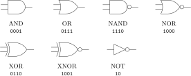
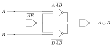
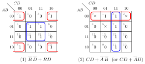
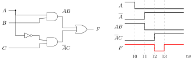

Texas Instruments and Qualcomm put more digital-logic questions in their OAs than any other part of computer organization: reduce this expression, which gate is this circuit, which law is this, how many gates fit in an LSI package, does this function have a hazard. This chapter and the next two are a complete digital-design refresher, written for someone who has not touched a K-map since the first year.

## 2.1 Gates and the laws of Boolean algebra {#sec-coa-laws}

<div class="nb-proto">

<em><span>Prototypical example for this section:</span> $(XY + PQ) + \overline{XY}$ is $1$, in one line, because it has the form $Z + \overline{Z} + \dots$.</em>

</div>

### 2.1.i The seven gates {#s2-1-i}

<figure class="nb-fig"></figure>

The bit string under each gate is its output for inputs $AB = 00, 01, 10, 11$ (for NOT, $A = 0, 1$). Two facts worth knowing cold: an $n$-input XOR outputs the <em>parity</em> ($1$ when an odd number of inputs are $1$), and XNOR is the 1-bit equality comparator.

### 2.1.ii The laws, and their OA names {#s2-1-ii}

Every identity below was checked on all eight input combinations by a script; the two tempting non-laws at the end were refuted with a counterexample.

```text {filename="Output of bool-laws.py (Python 3.11)"}
holds  identity        A.1 = A,  A+0 = A
holds  null/dominance  A.0 = 0,  A+1 = 1
holds  idempotent      A.A = A,  A+A = A
holds  complement      A.A' = 0, A+A' = 1
holds  involution      (A')' = A
holds  distributive    A+BC = (A+B)(A+C)
holds  absorption      A+AB = A, A(A+B) = A
holds  redundancy      A+A'B = A+B
holds  De Morgan       (AB)' = A'+B'
holds  De Morgan       (A+B)' = A'B'
holds  consensus       AB+A'C+BC = AB+A'C
holds  consensus (POS) (A+B)(A'+C)(B+C) = (A+B)(A'+C)
holds  XOR             A^B = A'B + AB'
holds  XNOR            (A'B + AB')' = AB + A'B'
holds  XOR             A^1 = A',  A^A = 0
holds  XOR assoc.      (A^B)^C = A^(B^C)
holds  AND over XOR    A(B^C) = AB ^ AC
FAILS  A+BC = (A+B)C   e.g. at ABC = 100
FAILS  OR over XOR  A+(B^C) = (A+B)^(A+C)   e.g. at ABC = 100
(XY + PQ) + (XY)' takes the values [1]: it is the constant 1
```

| Name | AND form | OR form (the dual) |
|:--|:--|:--|
| identity | $A\cdot 1 = A$ | $A + 0 = A$ |
| null (dominance, annulment) | $A \cdot 0 = 0$ | $A + 1 = 1$ |
| idempotent | $A A = A$ | $A + A = A$ |
| complement | $A\overline{A} = 0$ | $A + \overline{A} = 1$ |
| absorption | $A(A+B) = A$ | $A + AB = A$ |
| redundancy | $A(\overline{A}+B) = AB$ | $A + \overline{A}B = A + B$ |
| distributive | $A(B+C) = AB + AC$ | $A + BC = (A+B)(A+C)$ |
| De Morgan | $\overline{AB} = \overline{A} + \overline{B}$ | $\overline{A+B} = \overline{A}\,\overline{B}$ |
| consensus | $(A{+}B)(\overline{A}{+}C)(B{+}C) = (A{+}B)(\overline{A}{+}C)$ | $AB + \overline{A}C + BC = AB + \overline{A}C$ |

<div class="nb-caption" id="table-2-1">

<strong>Table 2.1.</strong> The laws in dual pairs. Some MCQ banks call the AND-with-a-constant rules the <strong>intersection law</strong> ($P\cdot 1 = P$, $P \cdot 0 = 0$) and the OR rules the <strong>union law</strong> ($P + 0 = P$, $P + 1 = 1$), after set intersection and union.

</div>

<div class="nb nb-theorem nb-block" id="theorem-2-1-1">

<strong>Theorem 2.1.1</strong> (Duality)

Any identity stays true when AND and OR are swapped and $0$ and $1$ are swapped (variables and complements are left alone). So every law needs to be learnt only once.

</div>

<div class="nb nb-remark" id="remark-2-1-2">

<strong>Remark 2.1.2</strong> (Distributivity goes both ways, and that is the surprise) — In ordinary algebra $a + bc \neq (a+b)(a+c)$, so the OR-over-AND law is the one people forget. It is also the only quick way to see $A + \overline{A}B = (A + \overline{A})(A+B) = A+B$. AND distributes over XOR ($A(B\oplus C) = AB \oplus AC$), but OR does not: the script finds the counterexample $ABC = 100$.

</div>

<div class="nb nb-example nb-block" id="example-2-1-3">

<strong>Example 2.1.3</strong> (Three OA reductions, each in one line)

Each follows from one law.

- $(XY + PQ) + \overline{XY} = (XY + \overline{XY}) + PQ = 1 + PQ = 1$: complement, then null. The script confirms the expression is the constant $1$.
- $\overline{(X\overline{Y}) + (\overline{X}Y)} = \overline{X \oplus Y} = XY + \overline{X}\,\overline{Y}$, the XNOR (checked as the XNOR law).
- A circuit that ANDs $\overline{A}$ with $B$, ANDs $\overline{B}$ with $A$ and ORs the two is $\overline{A}B + A\overline{B} = A \oplus B$: it is an XOR gate.

</div>

<div class="nb nb-moral">

Before expanding anything, look for $Z + \overline{Z}$, $Z + ZW$ and $\overline{A}B + A\overline{B}$ patterns: most OA reductions are one law applied to a sub-expression.

</div>

## 2.2 Universal gates {#sec-coa-universal}

<div class="nb-proto">

<em><span>Prototypical example for this section:</span> an XOR gate built from four two-input NAND gates.</em>

</div>

<div class="nb nb-definition" id="definition-2-2-1">

<strong>Definition 2.2.1</strong>. A gate is <strong>universal</strong> (functionally complete on its own) if every Boolean function can be built from copies of it. NAND and NOR are universal; AND, OR, XOR and NOT alone are not.

</div>

NAND is universal because it gives NOT ($\overline{AA} = \overline{A}$) and AND (NAND followed by a NAND-inverter), and {AND, NOT} is complete by De Morgan ($A + B = \overline{\overline{A}\,\overline{B}}$). By duality the same holds for NOR. AND and OR alone cannot make NOT: they are monotone (raising an input never lowers the output), and NOT is not.

<figure class="nb-fig"></figure>

<div class="nb nb-definition" id="fact-2-2-2">

<strong>Fact 2.2.2</strong> (Gate counts with two-input universal gates). The minimum number of two-input NAND or NOR gates for each function, found by an exhaustive search over all small circuits:

```text {filename="Output of gatecount.py (Python 3.11)"}
function NAND gates  NOR gates
NOT A             1          1
AND               2          3
OR                3          2
NAND              1          4
NOR               4          1
XOR               4          5
XNOR              5          4
```

By duality the NOR column is the NAND column with AND$\leftrightarrow$OR and XOR$\leftrightarrow$XNOR swapped.

</div>

<div class="nb nb-remark" id="remark-2-2-3">

<strong>Remark 2.2.3</strong> (Bubble pushing) — A two-level AND–OR (SOP) circuit becomes NAND–NAND by replacing every gate with a NAND: the inverting bubbles at the AND outputs cancel the bubbles at the (De Morgan) NAND inputs. Dually, OR–AND (POS) becomes NOR–NOR. That is why SOP maps naturally onto NAND logic, the cheapest gate in CMOS.

</div>

## 2.3 Canonical forms: minterms and maxterms {#sec-coa-canonical}

<div class="nb-proto">

<em><span>Prototypical example for this section:</span> $F = \prod M(0,2,3,8,9,10,11,13)$: the list names where $F$ is <em>zero</em>.</em>

</div>

<div class="nb nb-definition" id="definition-2-3-1">

<strong>Definition 2.3.1</strong>. For $n$ variables, a <strong>minterm</strong> $m_i$ is the AND of all $n$ variables, each complemented or not, that is $1$ only on input $i$ (for $i = 5 = \texttt{101}$: $m_5 = A\overline{B}C$). A <strong>maxterm</strong> $M_i$ is the OR that is $0$ only on input $i$ ($M_5 = \overline{A} + B + \overline{C}$): complement exactly the variables that are $1$ in $i$. $M_i = \overline{m_i}$. Every function is the OR of the minterms where it is $1$, $F = \sum m(\dots)$ (<strong>canonical SOP</strong>), and the AND of the maxterms where it is $0$, $F = \prod M(\dots)$ (<strong>canonical POS</strong>). The two index lists are complementary.

</div>

<div class="nb nb-example nb-block" id="example-2-3-2">

<strong>Example 2.3.2</strong> (Converting a product of maxterms)

$F(A,B,C,D) = \prod M(0,2,3,8,9,10,11,13)$ is $0$ on those eight inputs and $1$ on the other eight, so $F = \sum m(1,4,5,6,7,12,14,15)$. Its minimal forms are computed in [Section 2.4](#sec-coa-kmap) (case 3 of the output there): $F = B\overline{D} + BC + \overline{A}\,\overline{C}D$ and $F = (B+D)(B+\overline{C})(\overline{A}+C+\overline{D})$. In an MCQ, check a candidate against two or three of the listed maxterms: each must make it $0$.

</div>

<div class="nb nb-remark" id="remark-2-3-3">

<strong>Remark 2.3.3</strong> (The trap) — $\prod M(\dots)$ lists zeros, $\sum m(\dots)$ lists ones. And $\overline{F}$ is $\sum m(\text{the maxterm list})$, not $\prod M$ of it.

</div>

## 2.4 Karnaugh maps and Quine–McCluskey {#sec-coa-kmap}

<div class="nb-proto">

<em><span>Prototypical example for this section:</span> $\sum m(0,2,5,7,8,10,13,15) = \overline{B}\,\overline{D} + BD$: four corners and a centre square.</em>

</div>

### 2.4.i K-maps {#s2-4-i}

A <strong>Karnaugh map</strong> lays out the truth table so that cells next to each other (including across the edges, which wrap around) differ in exactly one variable. Rows and columns are therefore labelled in Gray order $00, 01, 11, 10$. A rectangle of $2^k$ adjacent $1$-cells is one product term with $n-k$ literals: the variables that change inside the rectangle drop out.

<div class="nb nb-definition" id="definition-2-4-1">

<strong>Definition 2.4.1</strong>. An <strong>implicant</strong> is a product term that implies $F$ (a rectangle of $1$s); a <strong>prime implicant</strong> is one that cannot be enlarged; an <strong>essential prime implicant</strong> is the only prime covering some $1$-cell. A minimal SOP consists of all essential primes plus a cheapest set of other primes covering the remaining $1$s. <strong>Don’t-care</strong> cells ($\times$, inputs that never occur or whose output does not matter) may be included in a rectangle when it helps and ignored otherwise.

</div>

<figure class="nb-fig"></figure>

In map (1) the four corners are one group: they differ only in $A$ and $C$, so the term is $\overline{B}\,\overline{D}$. In map (2) the don’t-cares $0$ and $2$ let the top row become the group $\overline{A}\,\overline{B}$; using $0$, $1$, $5$, … instead gives the equally cheap $\overline{A}D$. A minimisation can have several minimal answers, which is why MCQ options sometimes look different and are both right.

For five variables, use two $4$-variable maps (one for $A = 0$, one for $A = 1$) and treat the same cell in both maps as adjacent. Beyond five, use an algorithm.

### 2.4.ii Quine–McCluskey {#s2-4-ii}

<div class="nb nb-remark" id="algorithm-2-4-2">

<strong>Algorithm 2.4.2</strong> (Quine–McCluskey) — (1) Write the minterms and don’t-cares in binary. (2) Repeatedly merge pairs that differ in exactly one bit, replacing that bit by a dash; terms that never merge are prime implicants. (3) Build the prime-implicant chart (primes against ON-minterms), take the essential primes, and cover what is left with the fewest further primes (Petrick’s method, or exhaustive search for small charts).

</div>

The book’s implementation, used to check every minimisation in this book:

```python {filename="_qm.py, lines 5–25",linenos=table,linenostart=5}
def _combine(a, b):              # implicants as strings over {0,1,-}
    diff = [i for i in range(len(a)) if a[i] != b[i]]
    if len(diff) == 1 and "-" not in (a[diff[0]], b[diff[0]]):
        i = diff[0]
        return a[:i] + "-" + a[i + 1:]
    return None

def covers(imp, m, n):
    bits = format(m, f"0{n}b")
    return all(c == "-" or c == b for c, b in zip(imp, bits))

def primes(ones, dc, n):
    level = {format(m, f"0{n}b") for m in set(ones) | set(dc)}
    result = set()
    while level:
        used, nxt = set(), set()
        for a, b in combinations(sorted(level), 2):
            c = _combine(a, b)
            if c:
                nxt.add(c); used.update((a, b))
        result |= level - used
```

```text {filename="Output of qm.py (Python 3.11)"}
1) F = sum m(0,2,5,7,8,10,13,15)
  ON  = [0, 2, 5, 7, 8, 10, 13, 15]
  prime implicants: B'D', BD
  minimal SOP: F = B'D' + BD
  minimal POS: F = (B + D')(B' + D)
2) F = sum m(1,3,7,11,15) + d(0,2,5)
  ON  = [1, 3, 7, 11, 15]   don't care = [0, 2, 5]
  prime implicants: CD, A'D, A'B'
  minimal SOP: F = CD + A'D
  minimal SOP: F = CD + A'B'
  minimal POS: F = (D)(A' + C)
3) F = prod M(0,2,3,8,9,10,11,13)
  ON  = [1, 4, 5, 6, 7, 12, 14, 15]
  prime implicants: BD', BC, A'C'D, A'B
  minimal SOP: F = BD' + BC + A'C'D
  minimal POS: F = (B + D)(B + C')(A' + C + D')
4) F(A,B,C) = AB + AC' + BC  (ON-set from the truth table)
  ON  = [3, 4, 6, 7]
  prime implicants: BC, AC', AB
  minimal SOP: F = BC + AC'
  minimal POS: F = (B + C')(A + C)
5) F(A,B,C,D,E) = sum m(0,2,4,6,9,11,13,15,17,21,25,27,29,31)
  ON  = [0, 2, 4, 6, 9, 11, 13, 15, 17, 21, 25, 27, 29, 31]
  prime implicants: BE, A'B'E', AD'E
  minimal SOP: F = BE + A'B'E' + AD'E
  minimal POS: F = (B + D' + E')(B' + E)(A + B + E')(A' + E)
  minimal POS: F = (B' + E)(A + B + E')(A' + E)(A' + B + D')
```

<div class="nb nb-remark" id="remark-2-4-3">

<strong>Remark 2.4.3</strong> (Reading the output) — Case 4 is the OA favourite $AB + A\overline{C} + BC$: the minimum is $A\overline{C} + BC$. The term $AB$ is the consensus of $A\overline{C}$ and $BC$ (on $C$) and is redundant, even though it is a prime implicant. Case 5 is a five-variable function whose three primes are all essential. The minimal POS comes from minimising the zeros and complementing each term.

</div>

<div class="nb nb-moral">

Minimisation is set cover: primes are the candidate sets, essential primes are forced, and the rest is a small search. K-maps are the same algorithm done with your eyes.

</div>

## 2.5 Hazards {#sec-coa-hazards}

<div class="nb-proto">

<em><span>Prototypical example for this section:</span> $F = AB + \overline{A}C$ with $B = C = 1$: $F$ should stay at $1$ while $A$ falls, but it dips to $0$ for one gate delay.</em>

</div>

### 2.5.i Static and dynamic hazards {#s2-5-i}

<div class="nb nb-definition" id="definition-2-5-1">

<strong>Definition 2.5.1</strong>. A <strong>hazard</strong> is a possible momentary wrong output (a <strong>glitch</strong>) caused by unequal path delays when one input changes. A <strong>static-1 hazard</strong>: the output should stay $1$ but briefly goes $0$; a <strong>static-0 hazard</strong>: should stay $0$, briefly goes $1$; a <strong>dynamic hazard</strong>: should change once but changes three or more times ($0\to1\to0\to1$).

</div>

<figure class="nb-fig"></figure>

When $A$ falls, $AB$ falls after one gate delay but $\overline{A}C$ rises only after two (the inverter is in its path), so for one delay both AND outputs are $0$. The simulation, with $1$ ns per gate, shows exactly that; $G$ adds the redundant term $BC$ and never glitches:

```verilog {filename="glitch.v"}
// F = AB + A'C with 1 ns per gate: a static-1 hazard when A falls (B = C = 1).
// G adds the consensus term BC and stays at 1.
`timescale 1ns/1ns
module glitch;
  reg A = 1, B = 1, C = 1;
  wire nA, t1, t2, t3, F, G;
  assign #1 nA = ~A;
  assign #1 t1 = A & B;
  assign #1 t2 = nA & C;
  assign #1 t3 = B & C;          // consensus term
  assign #1 F  = t1 | t2;
  assign #1 G  = t1 | t2 | t3;
  initial begin
    $monitor("t=%0d  A=%b nA=%b AB=%b A'C=%b  F=%b  G=%b", $time, A, nA, t1, t2, F, G);
    #10 A = 0;
    #10 $finish;
  end
endmodule
```

```text {filename="Simulation output (Icarus Verilog 12, -g2012)"}
t=0  A=1 nA=x AB=x A'C=x  F=x  G=x
t=1  A=1 nA=0 AB=1 A'C=x  F=x  G=x
t=2  A=1 nA=0 AB=1 A'C=0  F=1  G=1
t=10  A=0 nA=0 AB=1 A'C=0  F=1  G=1
t=11  A=0 nA=1 AB=0 A'C=0  F=1  G=1
t=12  A=0 nA=1 AB=0 A'C=1  F=0  G=1
t=13  A=0 nA=1 AB=0 A'C=1  F=1  G=1
```

<div class="nb nb-theorem nb-block" id="theorem-2-5-2">

<strong>Theorem 2.5.2</strong> (Removing static hazards in two-level logic)

A two-level SOP circuit is free of static-1 hazards (for single-input changes) if and only if every pair of adjacent $1$-cells of the K-map is covered by a common product term. Adding the consensus terms (all prime implicants, in the limit) achieves this. Dually, a POS circuit needs every pair of adjacent $0$-cells inside one sum term to avoid static-0 hazards.

</div>

The checker below applies the theorem mechanically:

```text {filename="Output of hazard.py (Python 3.11)"}
F = AB + A'C: 1 static-1 hazard(s)
    when A changes while B=1, C=1
F = AB + A'C + BC: no static-1 hazard
F = A + B' + C: no static-1 hazard
F = AB' + A'C + BD: 4 static-1 hazard(s)
    when A changes while B=0, C=1, D=0
    when A changes while B=0, C=1, D=1
    when B changes while A=1, C=0, D=1
    when B changes while A=1, C=1, D=1
```

<div class="nb nb-ques" id="question-2-5-3">

<strong>Question 2.5.3</strong> — Does $Z = A + \overline{B} + C$ have a hazard or a race?

</div>

No to both. A static hazard needs a variable that reaches the output along two paths of different polarity (like $A$ and $\overline{A}$ above), so that the changing input briefly turns one term off before the other turns on. In $A + \overline{B} + C$ each variable appears once; when one input changes, the others hold the output where it is. And <strong>races</strong> are a property of asynchronous <em>sequential</em> circuits (two state variables changing together, [Section 4.1](../04-sequential/#sec-coa-latches)); a combinational function has no state to race.

<div class="nb nb-remark" id="remark-2-5-4">

<strong>Remark 2.5.4</strong> (Why hazards matter, and when they do not) — In a synchronous design a glitch is harmless if it settles before the next clock edge: the flip-flops sample only at the edge ([Section 4.6](../04-sequential/#sec-coa-timing)). Hazards matter where a signal is used without a clock: asynchronous resets, clock gating, latch enables, asynchronous circuits, and anything driving another chip’s edge-sensitive input. They also cost power, since every glitch toggles a wire.

</div>

<div class="nb nb-moral">

A static hazard is a consensus term that minimisation removed. Put it back wherever a glitch could be seen.

</div>

## 2.6 Logic families and integration scales {#sec-coa-families}

<div class="nb-proto">

<em><span>Prototypical example for this section:</span> “What is the primary advantage of RTL?” Simplicity: one transistor and a few resistors per input.</em>

</div>

<div class="nb nb-definition" id="definition-2-6-1">

<strong>Definition 2.6.1</strong> (Parameters of a logic family). <strong>Fan-out</strong>: how many gate inputs one output can drive while keeping valid levels. <strong>Noise margin</strong>: how much noise a valid level tolerates ($V_{OH} - V_{IH}$ for high, $V_{IL} - V_{OL}$ for low). <strong>Propagation delay</strong> $t_{pd}$: input change to output change. <strong>Power dissipation</strong> per gate, and the <strong>speed–power product</strong> $t_{pd} \times P$, the energy per switching event and the usual figure of merit.

</div>

| Family | Basic gate | Strengths | Weaknesses |
|:--|:--|:--|:--|
| RTL (resistor–transistor) | NOR | simplest and cheapest: transistors and resistors only | low fan-out, poor noise margin, high power, slow |
| DTL (diode–transistor) | NAND | better fan-out than RTL | slow (saturating transistors) |
| TTL (transistor–transistor) | NAND | fast for its era, good fan-out; totem-pole output; open-collector and tri-state variants | static power even when idle; a floating input reads as logic $1$ |
| ECL (emitter-coupled) | OR/NOR | fastest bipolar family: transistors never saturate | highest power, small voltage swing, negative supply |
| CMOS | NAND, NOR, inverter | almost no static power, highest noise margin (close to rail-to-rail swing), huge DC fan-out, highest density | power grows with switching frequency ($\alpha C V^2 f$); floating inputs must be tied off |

<div class="nb-caption" id="table-2-2">

<strong>Table 2.2.</strong> Logic families at OA depth (qualitative; numbers depend on the series). CMOS is what every modern chip is made of; the others matter for MCQs and for interfacing with old boards.

</div>

<div class="nb nb-remark" id="remark-2-6-2">

<strong>Remark 2.6.2</strong> (Output stages that OAs ask about) — A <strong>totem-pole</strong> output drives actively both high and low; two of them must never be tied together. An <strong>open-collector</strong> (open-drain in CMOS) output only pulls low, so several can share one wire with a pull-up resistor, giving a <strong>wired-AND</strong> (the wire is high only if every output releases it); I<sup>2</sup>C and interrupt request lines work this way. A <strong>tri-state</strong> output adds a third state, high impedance, so many drivers can share a bus as long as only one is enabled.

</div>

<div class="nb nb-definition" id="definition-2-6-3">

<strong>Definition 2.6.3</strong> (Integration scales). Chips are classified by the number of gates in one package. Mano’s convention [&#91;Man93&#93;](../references/#ref-mano): <strong>SSI</strong> (small-scale) fewer than $10$ gates; <strong>MSI</strong> (medium) about $10$–$200$ gates (adders, multiplexers, decoders, counters); <strong>LSI</strong> (large) between $200$ and a few thousand gates (small processors, memories); <strong>VLSI</strong> (very large) thousands of gates and more (processors, large memories).

</div>

<div class="nb nb-remark" id="remark-2-6-4">

<strong>Remark 2.6.4</strong> — Textbooks draw these boundaries in different places, so an MCQ asking “how many gates in an LSI package” should be answered by order of magnitude: SSI is a handful of gates (a 7400 has four NANDs), MSI tens to a couple of hundred, LSI hundreds to thousands, VLSI beyond that (today, billions of transistors).

</div>

## 2.7 Testability: controllability and observability {#sec-coa-testability}

<div class="nb-proto">

<em><span>Prototypical example for this section:</span> a fault inside a chip that changes nothing at the pins unless the right input vector reaches it and the right path carries its effect out.</em>

</div>

<div class="nb nb-definition" id="definition-2-7-1">

<strong>Definition 2.7.1</strong>. The <strong>stuck-at fault model</strong> assumes a defect makes one wire permanently $0$ (stuck-at-0) or $1$ (stuck-at-1). A test vector <strong>detects</strong> a fault if the faulty circuit’s output differs from the good one’s. <strong>Controllability</strong> of a node is how easily the inputs can set it to $0$ or $1$; <strong>observability</strong> is how easily its value can be seen at an output.

</div>

To detect a fault on a node you must <em>control</em> the node to the opposite of the stuck value (excite the fault) and <em>observe</em> it: propagate the difference to an output. For $F = AB + CD$:

```text {filename="Output of stuckat.py (Python 3.11)"}
A stuck-at-0:  3 tests, e.g. ABCD = 1100
A stuck-at-1:  3 tests, e.g. ABCD = 0100
B stuck-at-0:  3 tests, e.g. ABCD = 1100
B stuck-at-1:  3 tests, e.g. ABCD = 1000
C stuck-at-0:  3 tests, e.g. ABCD = 0011
C stuck-at-1:  3 tests, e.g. ABCD = 0001
D stuck-at-0:  3 tests, e.g. ABCD = 0011
D stuck-at-1:  3 tests, e.g. ABCD = 0010
X stuck-at-0:  3 tests, e.g. ABCD = 1100
X stuck-at-1:  9 tests, e.g. ABCD = 0000
Y stuck-at-0:  3 tests, e.g. ABCD = 0011
Y stuck-at-1:  9 tests, e.g. ABCD = 0000
F stuck-at-0:  7 tests, e.g. ABCD = 0011
F stuck-at-1:  9 tests, e.g. ABCD = 0000
minimum complete test set: 4 vectors, e.g. 0011 0101 1010 1100
```

To see $X = AB$ stuck-at-$0$, the test must set $A=B=1$ (control) <em>and</em> keep $CD = 0$ so that the OR gate passes $X$ through (observe): three of sixteen vectors do it. Four vectors detect all fourteen single stuck-at faults, against sixteen for exhaustive testing.

<div class="nb nb-definition" id="fact-2-7-2">

<strong>Fact 2.7.2</strong>. The higher the observability (and controllability) of internal nodes, the <em>fewer</em> test vectors and test cycles are needed to reach a given fault coverage, because each vector can excite and expose more faults. Design-for-test techniques exist to raise both: <strong>scan chains</strong> (every flip-flop can be loaded and read out serially, turning a sequential circuit into a combinational test problem), test points, and <strong>built-in self-test</strong> (BIST: on-chip pattern generators, often LFSRs ([Section 4.3](../04-sequential/#sec-coa-shift)), and signature compressors). JTAG (IEEE 1149.1) is the standard port for boundary scan.

</div>

<div class="nb nb-moral">

A fault is found only if a vector both excites it and carries its effect to a pin. Testability is designed in, by making internal nodes controllable and observable.

</div>
