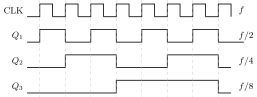
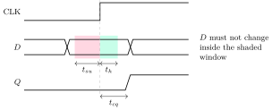

A <strong>sequential</strong> circuit has memory: its outputs depend on the inputs <em>and</em> on the stored state. This chapter goes from the two-gate latch to flip-flops, counters, shift registers and state machines, then to the timing rules that decide how fast a clock can run, and ends with reading the Verilog, VHDL and SystemVerilog snippets that hardware companies put in OAs. Every waveform here was simulated.

## 4.1 Latches {#sec-coa-latches}

<div class="nb-proto">

<em><span>Prototypical example for this section:</span> two cross-coupled NOR gates: $S = R = 0$ holds the stored bit, which is what “latched” means.</em>

</div>

### 4.1.i The SR latch {#s4-1-i}

<figure class="nb-fig"></figure>

The gate-level simulation below updates both gates together every step (equal delays):

```text {filename="Output of latch.py (Python 3.11)"}
NOR latch (inputs R on the Q gate, S on the Qbar gate), start Q=0:
  S=1 R=0: Q=1 Qbar=0   set
  S=0 R=0: Q=1 Qbar=0   hold
  S=0 R=1: Q=0 Qbar=1   reset
  S=0 R=0: Q=0 Qbar=1   hold
  S=1 R=1: Q=0 Qbar=0   forbidden: Q = Qbar = 0
  then S=R=0 together: oscillates (race)
NAND latch (active-low inputs S', R'), start Q=0:
  S'=0 R'=1: Q=1 Qbar=0   set
  S'=1 R'=1: Q=1 Qbar=0   hold
  S'=1 R'=0: Q=0 Qbar=1   reset
  S'=1 R'=1: Q=0 Qbar=1   hold
  S'=0 R'=0: Q=1 Qbar=1   forbidden: Q = Qbar = 1
  then S'=R'=1 together: oscillates (race)
```

<div class="nb nb-theorem nb-block" id="theorem-4-1-1">

<strong>Theorem 4.1.1</strong> (What keeps a latch latched)

A NOR latch holds its state when both inputs are $0$ (a $0$ is NOR’s non-controlling value, so each gate just inverts the other’s output). A NAND latch holds when both inputs are $1$ (NAND’s non-controlling value). In general: <em>a cross-coupled latch stores its bit while every external input sits at the non-controlling value of its gate</em>.

</div>

<div class="nb nb-remark" id="remark-4-1-2">

<strong>Remark 4.1.2</strong> (The forbidden input and the race) — $S = R = 1$ on a NOR latch forces $Q = \overline{Q} = 0$ (on a NAND latch $\overline{S} = \overline{R} = 0$ forces both to $1$): the outputs are no longer complements. Worse, if both inputs then return to the hold value <em>together</em>, both gates try to switch at once. With exactly equal delays the simulation oscillates forever; in real silicon the faster gate wins or the latch goes <strong>metastable</strong> for a while ([Section 4.6](#sec-coa-timing)). The final state is unpredictable, which is why $S=R=1$ is not allowed. This is the race OAs mean.

</div>

### 4.1.ii Gated latches {#s4-1-ii}

Adding an enable (often the clock) in front gives the <strong>gated SR latch</strong>, and tying $R = \overline{S}$ gives the <strong>gated D latch</strong>: while $EN = 1$ the output follows $D$ (the latch is <strong>transparent</strong>); while $EN = 0$ it holds the last value. The D latch has no forbidden input. Its weakness is transparency: during the whole enable pulse, any change of $D$ goes straight through, possibly around a feedback loop and back again.

<div class="nb nb-moral">

A latch is level-sensitive: it watches its input for as long as the enable is high. Flip-flops exist to shrink that window to an instant.

</div>

## 4.2 Flip-flops {#sec-coa-ff}

<div class="nb-proto">

<em><span>Prototypical example for this section:</span> a master–slave flip-flop whose output changes only when the clock falls, however many times $D$ changes while the clock is high.</em>

</div>

### 4.2.i Master–slave and edge-triggered flip-flops {#s4-2-i}

<div class="nb nb-definition" id="definition-4-2-1">

<strong>Definition 4.2.1</strong>. A <strong>flip-flop</strong> changes state only at a clock edge. A <strong>master–slave</strong> flip-flop is two latches in series with opposite enables: while $CLK = 1$ the master follows $D$ and the slave holds; when $CLK$ falls the master closes on its last value and the slave opens and shows it. The output therefore changes only at the falling edge (the edge that closes the master), and $Q$ never sees $D$ directly. An <strong>edge-triggered</strong> flip-flop samples $D$ in a short window around one edge. Modern CMOS flip-flops are master–slave pairs of latches clocked so that they act as positive-edge-triggered.

</div>

```verilog {filename="msff.v"}
// Master-slave D flip-flop from two gated D latches.
// Master is transparent while CLK = 1, slave while CLK = 0.
`timescale 1ns/1ns
module dlatch(input en, d, output reg q);
  always @* if (en) q = d;            // transparent while en = 1, holds otherwise
endmodule

module tb;
  reg clk = 0, d = 0;
  wire m, q;
  dlatch master(clk, d, m);
  dlatch slave(~clk, m, q);
  initial begin
    $monitor("t=%2t  CLK=%b D=%b  master=%b  Q=%b", $time, clk, d, m, q);
    #10 clk = 1;          // master opens, slave closes
    #5  d = 1;            // D changes while CLK is high: master follows...
    #5  d = 0;            // ...and follows again
    #5  d = 1;
    #5  clk = 0;          // falling edge: master closes on 1, slave shows it
    #10 d = 0;            // CLK low: master closed, nothing moves
    #10 $finish;
  end
endmodule
```

```text {filename="Simulation output (Icarus Verilog 12, -g2012)"}
t= 0  CLK=0 D=0  master=x  Q=x
t=10  CLK=1 D=0  master=0  Q=x
t=15  CLK=1 D=1  master=1  Q=x
t=20  CLK=1 D=0  master=0  Q=x
t=25  CLK=1 D=1  master=1  Q=x
t=30  CLK=0 D=1  master=1  Q=1
t=40  CLK=0 D=0  master=1  Q=1
```

$D$ changed three times while $CLK$ was high; the master followed each change, and $Q$ moved once, at the falling edge at $t=30$, to the value the master held at that instant.

<div class="nb nb-remark" id="remark-4-2-2">

<strong>Remark 4.2.2</strong> (Race-around and ones-catching in JK flip-flops) — A <em>level-triggered</em> JK with $J = K = 1$ toggles, and the new output feeds back through the gating while the clock is still high, so it toggles again and again until the clock falls (<strong>race-around</strong>). A master–slave JK cures this because the slave is closed while the master is open. It keeps one flaw, <strong>ones-catching</strong>: a short glitch on $J$ (or $K$) while the clock is high sets the master, and the master cannot be cleared again before the falling edge. Edge-triggered flip-flops have neither problem.

</div>

### 4.2.ii The four flip-flops and their tables {#s4-2-ii}

The characteristic equation gives $Q^+$ (the state after the edge) from the inputs and $Q$; the excitation table inverts it (which inputs cause a given transition, $\times$ = don’t care). Both were generated from the equations:

```text {filename="Output of fftables.py (Python 3.11)"}
SR flip-flop   characteristic: Q+ = S + R'Q (SR = 0)
   S R -> 00:hold, 01:reset, 10:set, 11:invalid
   excitation (SR): 0->0: 0x; 0->1: 10; 1->0: 01; 1->1: x0
JK flip-flop   characteristic: Q+ = JQ' + K'Q
   J K -> 00:hold, 01:reset, 10:set, 11:toggle
   excitation (JK): 0->0: 0x; 0->1: 1x; 1->0: x1; 1->1: x0
D flip-flop   characteristic: Q+ = D
   D -> 0:reset, 1:set
   excitation (D): 0->0: 0; 0->1: 1; 1->0: 0; 1->1: 1
T flip-flop   characteristic: Q+ = T xor Q
   T -> 0:hold, 1:toggle
   excitation (T): 0->0: 0; 0->1: 1; 1->0: 1; 1->1: 0
```

<div class="nb nb-definition" id="fact-4-2-3">

<strong>Fact 4.2.3</strong> (Conversions). Every flip-flop is a D flip-flop with logic in front of $D$, the next-state equation: T from D: $D = T \oplus Q$; JK from D: $D = J\overline{Q} + \overline{K}Q$; D from JK: $J = D$, $K = \overline{D}$; T from JK: $J = K = T$. The JK’s don’t-cares (two per row of the excitation table) are why JK designs often need the least logic.

</div>

### 4.2.iii Frequency division, and $D = X \oplus Q$ {#s4-2-iii}

```verilog {filename="ff.v, lines 1–14",linenos=table,linenostart=1}
// D flip-flop tricks: D = ~Q divides the clock by 2; D = X ^ Q is a T flip-flop.
`timescale 1us/1us
module dff(input clk, d, output reg q = 0);
  always @(posedge clk) q <= d;
endmodule

module tb;
  reg clk = 0, x = 0, qprev;
  always #50 clk = ~clk;                     // 100 us period: 10 kHz
  wire q1, q2, q3, qt;
  dff div2(clk, ~q1, q1);                    // D = Q'
  dff div4(~q1, ~q2, q2);                    // clocked by Q1': ripple
  dff div8(~q2, ~q3, q3);
  dff tff(clk, x ^ qt, qt);                  // D = X xor Q
```

```text {filename="Simulation output (Icarus Verilog 12, -g2012)"}
time(us)  Q1 Q2 Q3   Q3Q2Q1
    51     1  0  0   = 1
   151     0  1  0   = 2
   251     1  1  0   = 3
   351     0  0  1   = 4
   451     1  0  1   = 5
   551     0  1  1   = 6
   651     1  1  1   = 7
   751     0  0  0   = 0
   851     1  0  0   = 1
clock 10.0 kHz; Q1 period 200 us = 5.0 kHz; Q3 = clock / 8
D = X xor Q:  X  Q before -> Q after the edge
              1  0         1
              1  1         0
              0  0         0
              1  0         1
              1  1         0
              0  0         0
```

<figure class="nb-fig"></figure>

<div class="nb nb-theorem nb-block" id="theorem-4-2-4">

<strong>Theorem 4.2.4</strong> (Two OA favourites)

(1) A D flip-flop with $D = \overline{Q}$ toggles on every active edge, so its output has half the clock frequency: a $10$ kHz clock gives $5$ kHz with a $50\%$ duty cycle (the simulation measured a $200\,\mu$s period). $n$ such stages in a chain divide by $2^n$. (2) With $D = X \oplus Q$, the flip-flop holds when $X = 0$ and toggles when $X = 1$: it <em>is</em> a T flip-flop with $T = X$ (characteristic equation $Q^+ = T \oplus Q$), as the last table of the output shows.

</div>

<div class="nb nb-moral">

Feedback from $\overline{Q}$ to $D$ makes a toggle; a toggle halves the frequency. Most counter and divider questions reduce to that.

</div>

## 4.3 Registers and shift registers {#sec-coa-shift}

<div class="nb-proto">

<em><span>Prototypical example for this section:</span> a 4-bit register shifting right every clock whose new MSB is the XOR of its two low bits: it visits all fifteen non-zero states.</em>

</div>

<div class="nb nb-definition" id="definition-4-3-1">

<strong>Definition 4.3.1</strong>. A <strong>register</strong> is $n$ flip-flops sharing a clock (with a load enable, usually a mux in front of each $D$). A <strong>shift register</strong> connects each flip-flop’s $Q$ to the next one’s $D$; by how data enter and leave it is SISO, SIPO (serial-to-parallel, as in a UART receiver), PISO or PIPO. A <strong>universal</strong> shift register has a 4:1 mux per bit to hold, shift left, shift right or load. Feeding the output back to the input gives a <strong>ring counter</strong> ($n$ states, one hot bit circulating), feeding back the complement gives a <strong>Johnson</strong> (twisted-ring) counter ($2n$ states), and feeding back an XOR of selected bits (<strong>taps</strong>) gives a <strong>linear-feedback shift register</strong> (LFSR).

</div>

```text {filename="Output of lfsr.py (Python 3.11)"}
LFSR, feedback Q1 xor Q0 (maximal length), start 1000:
   1000 0100 0010 1001 1100 0110 1011 0101 1010 1101 1110 1111 0111 0011 0001
   -> 1000 again after 15 clocks (cycle length 15)
LFSR, feedback Q2 xor Q0 (not maximal), start 1000:
   1000 0100 1010 0101 0010 0001
   -> 1000 again after 6 clocks (cycle length 6)
Ring counter, feedback Q0, start 1000:
   1000 0100 0010 0001
   -> 1000 again after 4 clocks (cycle length 4)
Johnson (twisted ring), feedback Q0', start 0000:
   0000 1000 1100 1110 1111 0111 0011 0001
   -> 0000 again after 8 clocks (cycle length 8)
Feedback (Q3 AND Q0) OR (Q2 AND Q1)', start 1011:
   1011 1101 1110 0111 0011 1001 1100
   -> 1110 again after 7 clocks (cycle length 5)
Same LFSR started at 0000 (the lock-up state):
   0000
   -> 0000 again after 1 clocks (cycle length 1)
max period of an n-bit XOR LFSR is 2^n - 1 = 15 for n = 4
```

<div class="nb nb-definition" id="fact-4-3-2">

<strong>Fact 4.3.2</strong> (LFSRs). An $n$-bit XOR-feedback LFSR never leaves the all-zero state (the XOR of zeros is zero), so its longest possible cycle has $2^n - 1$ states; taps that achieve it (<strong>maximal length</strong>) correspond to a primitive polynomial. Taps $Q_1, Q_0$ above are maximal (15 states); taps $Q_2, Q_0$ are not (6). LFSRs generate pseudo-random test patterns (BIST), scramble serial links, compute CRCs, and make very fast counters because the next state is one XOR away.

</div>

<div class="nb nb-remark" id="remark-4-3-3">

<strong>Remark 4.3.3</strong> (Tracing a non-linear feedback register) — With feedback built from AND/OR gates the register need not return to its start: the fifth trace starts at `1011`, enters a cycle at `1110` and repeats every $5$ clocks. To answer “what is the state after $k$ clocks”, trace it state by state, as the script does: compute the feedback bit from the <em>current</em> outputs, then shift.

</div>

## 4.4 Counters {#sec-coa-counters}

<div class="nb-proto">

<em><span>Prototypical example for this section:</span> a ripple counter going from `0111` to `1000` passes through `0110`, `0100` and `0000` first.</em>

</div>

### 4.4.i Ripple versus synchronous {#s4-4-i}

In a <strong>ripple</strong> (asynchronous) counter each flip-flop is a toggle clocked by the previous one’s output, so the $k$-th bit changes $k$ clock-to-$Q$ delays after the clock. In a <strong>synchronous</strong> counter all flip-flops share the clock and logic decides which toggle (bit $k$ toggles when all lower bits are $1$: $T_k = Q_0Q_1\cdots Q_{k-1}$).

```verilog {filename="counter.v"}
// 4-bit ripple counter vs synchronous counter, 1 ns clock-to-Q per flip-flop.
// The ripple counter passes through false states on 0111 -> 1000.
`timescale 1ns/1ns
module tff(input clk, output reg q = 0);       // toggles on the falling edge
  always @(negedge clk) q <= #1 ~q;
endmodule

module tb;
  reg clk = 1;
  wire [3:0] r;                                // ripple: each stage clocks the next
  tff t0(clk, r[0]), t1(r[0], r[1]), t2(r[1], r[2]), t3(r[2], r[3]);
  reg [3:0] s = 0;                             // synchronous: one clock for all
  always @(negedge clk) s <= #1 s + 1;
  always #10 clk = ~clk;
  initial begin
    #135;                                      // just before the 7th falling edge
    $monitor("t=%3t  ripple=%b (%2d)  sync=%b (%2d)", $time, r, r, s, s);
    #20 $finish;
  end
endmodule
```

```text {filename="Simulation output (Icarus Verilog 12, -g2012)"}
t=135  ripple=0111 ( 7)  sync=0111 ( 7)
t=151  ripple=0110 ( 6)  sync=1000 ( 8)
t=152  ripple=0100 ( 4)  sync=1000 ( 8)
t=153  ripple=0000 ( 0)  sync=1000 ( 8)
t=154  ripple=1000 ( 8)  sync=1000 ( 8)
```

<div class="nb nb-remark" id="remark-4-4-1">

<strong>Remark 4.4.1</strong> (Consequences) — The ripple counter is correct only after the last stage settles ($n \cdot t_{cq}$); in between it shows false states (here $6, 4, 0$), which decoding logic will see as glitches. Its maximum clock frequency for a readable count is about $1/(n\,t_{cq} + t_{\text{decode}})$, while a synchronous counter’s is $1/(t_{cq} + t_{\text{logic}} + t_{su})$, independent of $n$ apart from the AND chain. Ripple counters survive where power matters and only the final value is read (clock dividers): each stage switches half as often as the previous.

</div>

### 4.4.ii Counters from J/K equations, and designing one {#s4-4-ii}

To trace a synchronous counter, evaluate every $J$ and $K$ from the <em>present</em> state, then update all flip-flops together, and repeat. To design one, write the state table, use the excitation table to get the required $J$, $K$ per present state, and minimise each with the unused states as don’t-cares:

```text {filename="Output of jkcounter.py (Python 3.11)"}
J_A = Q_B, K_A = Q_B', J_B = K_B = Q_A'; states Q_A Q_B:
   from 00 : 00 -> 01 -> 10 -> 00 -> 01 -> 10
   from 11 : 11 -> 11 -> 11 -> 11 -> 11 -> 11
mod-6 counter, Q_C Q_B Q_A, minimal J/K equations (states 6, 7 don't care):
   J_C = BA,   K_C = A
   J_B = C'A,   K_B = A
   J_A = 1,   K_A = 1
   000 -> 001
   001 -> 010
   010 -> 011
   011 -> 100
   100 -> 101
   101 -> 000
   110 -> 111   (unused state)
   111 -> 000   (unused state)
```

<div class="nb nb-example nb-block" id="example-4-4-2">

<strong>Example 4.4.2</strong> (What the output shows)

The first counter cycles $00 \to 01 \to 10 \to 00$, a mod-3 counter, but from $11$ it stays at $11$ for ever: $J_A = Q_B = 1$, $K_A = \overline{Q_B} = 0$ set $A$ again, and $J_B = K_B = \overline{Q_A} = 0$ hold $B$. That is a <strong>lock-up state</strong>; a counter whose unused states all lead back into the main cycle is <strong>self-starting</strong>. The designed mod-6 counter is self-starting: $110 \to 111 \to 000$. Its equations ($J_A = K_A = 1$, $J_B = \overline{C}A$, $K_B = A$, $J_C = BA$, $K_C = A$) were found by Quine–McCluskey and then verified by simulation of all eight states.

</div>

<div class="nb nb-remark" id="remark-4-4-3">

<strong>Remark 4.4.3</strong> (Mod-$N$ by clearing) — A quick mod-$N$ counter detects state $N$ and clears the flip-flops. With an <em>asynchronous</em> clear, state $N$ exists for a few nanoseconds (a glitch every cycle); with a <em>synchronous</em> clear you must detect $N-1$ instead, and the clear happens at the next edge. A counter with $N$ states needs $\lceil \log_2 N \rceil$ flip-flops (binary), $N$ (ring) or $N/2$ (Johnson).

</div>

## 4.5 Finite-state machines: Mealy and Moore {#sec-coa-fsm}

<div class="nb-proto">

<em><span>Prototypical example for this section:</span> a detector for the bit pattern `1011` on a serial line.</em>

</div>

<div class="nb nb-definition" id="definition-4-5-1">

<strong>Definition 4.5.1</strong>. A <strong>Moore</strong> machine’s outputs depend only on the state; a <strong>Mealy</strong> machine’s depend on the state and the present inputs. A Mealy machine usually needs fewer states and reacts in the same cycle; a Moore machine’s output is registered-friendly and glitch-free but appears one cycle later.

</div>

<figure class="nb-fig"></figure>

The Moore machine above (state/output) has a fifth state that means “`1011` just seen”; the Mealy version raises its output on the transition out of $S_3$ with input $1$. Both, on the same input stream:

```verilog {filename="seqdet.v, lines 1–13",linenos=table,linenostart=1}
// "1011" detector (overlapping), as a Mealy and as a Moore machine.
module mealy(input clk, rst, x, output z);
  reg [1:0] s;                     // 0: -, 1: "1", 2: "10", 3: "101"
  always @(posedge clk)
    if (rst) s <= 0;
    else case (s)
      0: s <= x ? 1 : 0;
      1: s <= x ? 1 : 2;
      2: s <= x ? 3 : 0;
      3: s <= x ? 1 : 2;           // after "1011" the last "1" starts a new match
    endcase
  assign z = (s == 3) && x;        // output depends on state AND input
endmodule
```

```text {filename="Simulation output (Icarus Verilog 12, -g2012)"}
cycle  x  Mealy z  Moore z   (z sampled just before each edge)
  0    1     0        0
  1    0     0        0
  2    1     0        0
  3    1     1        0
  4    0     0        1
  5    1     0        0
  6    1     1        0
  7    0     0        1
  8    1     0        0
  9    1     1        0
 10    0     0        1
 11    0     0        0
```

The Mealy output is high in the cycle in which the final $1$ arrives; the Moore output one cycle later. Overlapping matches (cycles 3, 6, 9) are caught because after a match the machines fall back to the state for the longest suffix that is still a prefix (`1`, or `10` after a $0$), exactly as in KMP string matching.

<div class="nb nb-remark" id="remark-4-5-2">

<strong>Remark 4.5.2</strong> (State encoding) — $k$ states need $\lceil \log_2 k \rceil$ flip-flops in binary encoding, $k$ in <strong>one-hot</strong> encoding (one flip-flop per state). FPGAs favour one-hot (flip-flops are plentiful, next-state logic becomes trivial); ASICs often favour binary or Gray.

</div>

## 4.6 Timing: setup, hold, skew and metastability {#sec-coa-timing}

<div class="nb-proto">

<em><span>Prototypical example for this section:</span> a flip-flop whose $Q$ comes back to its own $D$ through $0.3$ ns of logic, with a $1.8$ ns hold time: it fails at every clock frequency.</em>

</div>

### 4.6.i The two inequalities {#s4-6-i}

<div class="nb nb-definition" id="definition-4-6-1">

<strong>Definition 4.6.1</strong>. <strong>Setup time</strong> $t_{su}$: $D$ must be stable this long <em>before</em> the clock edge. <strong>Hold time</strong> $t_h$: $D$ must stay stable this long <em>after</em> it. <strong>Clock-to-Q</strong> $t_{cq}$: delay from the edge to the new output. <strong>Clock skew</strong> $\delta$: arrival time of the clock at the capturing flip-flop minus that at the launching one.

</div>

<figure class="nb-fig"></figure>

<div class="nb nb-theorem nb-block" id="theorem-4-6-2">

<strong>Theorem 4.6.2</strong> (Timing constraints between two flip-flops)

For a path from flip-flop 1 to flip-flop 2 through logic with delays between $t_{\min}$ and $t_{\max}$, with clock period $T$:

$$
\begin{align*}
		\text{setup:}\quad & t_{cq} + t_{\max} + t_{su} \le T + \delta, \\
		\text{hold:}\quad & t_{cq} + t_{\min} \ge t_h + \delta.
	\end{align*}
$$

So $f_{\max} = 1/(t_{cq} + t_{\max} + t_{su} - \delta)$. The hold inequality does not contain $T$: a hold violation cannot be fixed by slowing the clock.

</div>

```text {filename="Output of timing.py (Python 3.11)"}
1) two flip-flops, no skew
   setup: T >= 0.5 + 3.2 + 0.3 - (0.0) = 4.00 ns  -> fmax = 250 MHz
   hold slack = 0.5 + 0.2 - (0.2 + 0.0) = +0.50 ns   ok
2) same path, capture clock 0.4 ns late
   setup: T >= 0.5 + 3.2 + 0.3 - (0.4) = 3.60 ns  -> fmax = 278 MHz
   hold slack = 0.5 + 0.2 - (0.2 + 0.4) = +0.10 ns   ok
3) same path, capture clock 0.6 ns late
   setup: T >= 0.5 + 3.2 + 0.3 - (0.6) = 3.40 ns  -> fmax = 294 MHz
   hold slack = 0.5 + 0.2 - (0.2 + 0.6) = -0.10 ns   VIOLATION
4) one FF, Q -> 0.3 ns -> D, clock buffer 0.9 ns into the same FF
   setup: T >= 1.2 + 0.3 + 0.8 - (0.0) = 2.30 ns  -> fmax = 435 MHz
   at T = 5 ns the setup slack is +2.70 ns
   hold slack = 1.2 + 0.3 - (1.8 + 0.0) = -0.30 ns   VIOLATION
5) as 4) but the 0.9 ns buffer feeds only the capturing FF of a pair
   setup: T >= 1.2 + 0.3 + 0.8 - (0.9) = 1.40 ns  -> fmax = 714 MHz
   hold slack = 1.2 + 0.3 - (1.8 + 0.9) = -1.20 ns   VIOLATION
1-flip-flop synchronizer, resolution time 0.2 ns: MTBF = 0.22 s
2-flip-flop synchronizer, resolution time 1.9 ns: MTBF = 1.81e+36 s
```

<div class="nb nb-example nb-block" id="example-4-6-3">

<strong>Example 4.6.3</strong> (Reading cases 1–5)

Positive skew (the capture clock arrives later) <em>helps</em> setup and <em>hurts</em> hold: from case 1 to case 3 the minimum period drops from $4.0$ to $3.4$ ns while the hold slack goes from $+0.5$ to $-0.1$ ns. Case 4 is the single flip-flop feeding itself: the clock buffer delays launch and capture equally, so the skew is $0$ and the buffer is irrelevant; the data come back after $1.2 + 0.3 = 1.5$ ns but must stay stable for $1.8$ ns: a hold violation of $0.3$ ns at any frequency. The fix is to add at least $0.3$ ns of delay in the feedback path (buffers on the data, not the clock). Case 5 puts the same buffer on only the capturing clock of a pair: now it is $0.9$ ns of skew and the hold violation grows to $1.2$ ns.

</div>

### 4.6.ii Metastability and synchronizers {#s4-6-ii}

<div class="nb nb-definition" id="definition-4-6-4">

<strong>Definition 4.6.4</strong>. If $D$ changes inside the setup–hold window, the flip-flop can enter a <strong>metastable</strong> state, balanced between $0$ and $1$, and take an unbounded (though usually short) time to resolve. The probability of still being unresolved after time $t_r$ decays like $e^{-t_r/\tau}$, giving $\text{MTBF} = e^{t_r/\tau} / (T_0 f_{clk} f_{data})$, where $\tau$ and $T_0$ are properties of the flip-flop.

</div>

Signals from another clock domain (or from a button) violate setup and hold sooner or later, so they pass through a <strong>synchronizer</strong>: two (or three) flip-flops in series in the receiving domain, so that the first one gets almost a full clock period to resolve. The last two lines of the output use illustrative parameters to show the effect of that exponent: $0.2$ s for one flip-flop against an astronomically long MTBF for two. Multi-bit values must not be synchronized bit by bit (the bits resolve independently); cross them with a handshake, an asynchronous FIFO whose pointers are Gray-coded ([Section 1.4](../01-data/#sec-coa-codes)), or a mux-recirculation scheme.

<div class="nb nb-moral">

Setup limits the clock frequency; hold does not depend on it. Skew trades one against the other, and asynchronous inputs need a synchronizer because metastability can only be made rare, never impossible.

</div>

## 4.7 Reading Verilog, VHDL and SystemVerilog {#sec-coa-hdl}

<div class="nb-proto">

<em><span>Prototypical example for this section:</span> `a <= b; b <= a;` swaps two registers; `a = b; b = a;` does not.</em>

</div>

### 4.7.i Verilog: always blocks and the two kinds of assignment {#s4-7-i}

<div class="nb nb-definition" id="fact-4-7-1">

<strong>Fact 4.7.1</strong>. `always @(posedge clk)` describes flip-flops; `always @*` describes combinational logic (a latch if some path leaves an output unassigned, as in an `if` without `else`). A <strong>blocking</strong> assignment `=` updates immediately, so later statements in the block see the new value; a <strong>nonblocking</strong> assignment `<=` evaluates every right-hand side first and updates all left-hand sides together at the end of the time step, which is how flip-flops sharing a clock behave. Rule: `<=` in clocked blocks, `=` in combinational blocks, never both for the same variable.

</div>

```verilog {filename="blocking.v"}
// Blocking (=) vs nonblocking (<=) assignments in clocked always blocks.
module tb;
  reg clk = 0;
  reg [3:0] a1 = 1, b1 = 2;          // swapped with blocking
  reg [3:0] a2 = 1, b2 = 2;          // swapped with nonblocking
  reg [3:0] p1 = 1, q1 = 0, r1 = 0;  // 3-stage shift register, blocking
  reg [3:0] p2 = 1, q2 = 0, r2 = 0;  // 3-stage shift register, nonblocking
  always @(posedge clk) begin
    a1 = b1;  b1 = a1;               // b1 reads the NEW a1
    a2 <= b2; b2 <= a2;              // both read the OLD values
    q1 = p1;  r1 = q1;               // collapses into one stage
    q2 <= p2; r2 <= q2;              // a real two-flip-flop pipeline
  end
  initial begin
    #1 clk = 1; #1;
    $display("after one edge:  blocking a=%0d b=%0d | nonblocking a=%0d b=%0d",
             a1, b1, a2, b2);
    $display("shift p->q->r:   blocking q=%0d r=%0d | nonblocking q=%0d r=%0d",
             q1, r1, q2, r2);
  end
endmodule
```

```text {filename="Simulation output (Icarus Verilog 12, -g2012)"}
after one edge:  blocking a=2 b=2 | nonblocking a=2 b=1
shift p->q->r:   blocking q=1 r=1 | nonblocking q=1 r=0
```

### 4.7.ii VHDL: a process with synchronous reset, set and clock enable {#s4-7-ii}

```vhdl {filename="dff-sync.vhd, lines 1–20",linenos=table,linenostart=1}
-- A rising-edge D flip-flop with synchronous reset, synchronous set and clock enable.
library ieee;
use ieee.std_logic_1164.all;

entity dff_rsce is
  port (clk, reset, set, ce, d : in std_logic; q : out std_logic);
end entity;

architecture rtl of dff_rsce is
begin
  process (clk)                      -- only CLK in the sensitivity list
  begin
    if rising_edge(clk) then
      if reset = '1' then q <= '0';  -- reset has the highest priority
      elsif set = '1' then q <= '1';
      elsif ce = '1' then q <= d;    -- otherwise hold
      end if;
    end if;
  end process;
end architecture;
```

```text {filename="Simulation output (GHDL 4.1, VHDL-2008)"}
reset set ce d -> q after the rising edge
    1    1   0  0 -> 0
    0    1   0  0 -> 1
    0    0   1  1 -> 1
    0    0   0  0 -> 1
    0    0   1  0 -> 0
    1    1   1  1 -> 0
    0    0   1  1 -> 1
reset = 1 between edges -> q = 1 (no edge yet)
```

<div class="nb nb-example nb-block" id="example-4-7-2">

<strong>Example 4.7.2</strong> (What the process describes)

A rising-edge D flip-flop with a <em>synchronous</em> reset (highest priority), then a synchronous set, then a clock enable: with all three low it holds. Synchronous means the reset acts only at a clock edge; the last line shows `RESET = 1` between edges leaving $Q = 1$. An asynchronous reset would appear in the sensitivity list and be tested <em>before</em> `rising_edge(clk)`.

</div>

### 4.7.iii SystemVerilog: fork with join, join\_any and join\_none {#s4-7-iii}

<div class="nb nb-definition" id="fact-4-7-3">

<strong>Fact 4.7.3</strong>. `fork ... join` starts its statements as parallel threads and waits for <em>all</em> of them; `join_any` waits for the <em>first</em> to finish (the others keep running); `join_none` does not wait at all.

</div>

```verilog {filename="forkjoin.v, lines 5–13",linenos=table,linenostart=5}
module tb;
  parameter KIND = 0;                 // 0: join, 1: join_any, 2: join_none
  int a = 0;
  initial begin
    case (KIND)
      0: fork
           begin repeat (3) #20 a = a + 1; end               // U
           begin while (a != 2) #7 a = a - 1; end            // D
         join
```

```text {filename="Simulation output (Icarus Verilog 12, -g2012)"}
KIND=0:
  still waiting at t=1000 (a=-139): the parent never resumed
KIND=1:
  parent continues at t=60 with a=-5
KIND=2:
  parent continues at t=0 with a=0
```

Thread U finishes at $t = 60$; thread D decrements every $7$ time units and never sees $a = 2$, so it never finishes. With `join` the parent waits for D for ever (the watchdog stops the run at $1000$); with `join_any` it resumes when U finishes, at $t = 60$; with `join_none` it resumes immediately, at $t = 0$, and its <code>&#36;finish</code> ends the simulation with both threads still alive.

### 4.7.iv Storing data on both clock edges with only multiplexers {#s4-7-iv}

A 2:1 mux whose output feeds back to one data input is a latch: with select $1$ it passes $D$, with select $0$ it passes its own output. Two such latches with opposite enables capture $D$ at the falling and at the rising edge; a third mux, also driven by the clock, outputs whichever latch is currently holding. Three muxes in total:

```verilog {filename="dualedge.v, lines 8–13",linenos=table,linenostart=8}
module dualedge(input clk, d, output q);
  wire l1, l2;
  mux2 m1(clk, l1, d, l1);   // clk=1: follows D; clk=0: holds D(fall)
  mux2 m2(clk, d, l2, l2);   // clk=0: follows D; clk=1: holds D(rise)
  mux2 m3(clk, l1, l2, q);   // output the latch that is holding
endmodule
```

```text {filename="Simulation output (Icarus Verilog 12, -g2012)"}
  t  clk d  q    (edges at 10, 20, 30, ...; D changes 3 ns after)
 15   1  0  1
 25   0  1  0
 35   1  1  1
 45   0  0  1
 55   1  1  0
 65   0  0  1
 75   1  0  0
 85   0  1  0
 95   1  1  1
```

After every edge, rising or falling, $Q$ shows the value $D$ had at that edge (for example $D = 1$ at the rising edge at $t = 10$, $Q = 1$ at $15$; $D = 0$ at the falling edge at $20$, $Q = 0$ at $25$).

<div class="nb nb-remark" id="remark-4-7-4">

<strong>Remark 4.7.4</strong> — This is a dual-edge-triggered storage element only if the latches’ internal delays are balanced; real designs use it with care because the output mux sees the clock directly. It does show the general fact behind several OA questions: a latch is one mux with feedback, and a flip-flop is two.

</div>

<div class="nb nb-moral">

Read HDL as hardware: nonblocking assignments in a clocked block are flip-flops updated together; whatever the sensitivity list and the `if` order say is the priority of reset, set and enable; and `fork` variants differ only in how long the parent waits.

</div>
