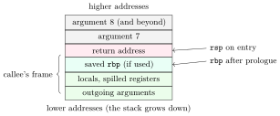

The <strong>instruction set architecture</strong> (ISA) is the contract between software and hardware: the instructions, registers, data types, addressing modes, memory model and exception behaviour that a program may rely on. It says <em>what</em> the machine does, not how (pipelines and caches are implementation, invisible to correct programs). This chapter covers instruction formats and their numericals, addressing modes, the register sets OAs ask about (accumulator, x86 general registers), RISC versus CISC with MIPS encoding, and where a function’s arguments actually live.

## 5.1 Instruction formats and machine organisations {#sec-coa-formats}

<div class="nb-proto">

<em><span>Prototypical example for this section:</span> $X = (A+B)(C-D)$ takes $8$ instructions on a stack machine and $3$ on a three-address machine; neither is “better”.</em>

</div>

### 5.1.i Zero to three addresses {#s5-1-i}

An instruction is an opcode plus zero or more operand specifiers. How many operands an arithmetic instruction names explicitly gives the classic organisations:

- <strong>stack</strong> (0-address): operands are popped from an operand stack, the result is pushed (JVM bytecode, x87 floating point);
- <strong>accumulator</strong> (1-address): one operand and the result are implicitly in the accumulator register, the other is named (early machines, 8085, many microcontrollers);
- <strong>register–memory</strong> and <strong>memory–memory</strong> (2- or 3-address): operands may be in memory (x86 is 2-address register–memory, VAX was 3-address memory–memory);
- <strong>load–store</strong> (register–register): only loads and stores touch memory; ALU instructions name three registers (MIPS, RISC-V, ARM).

Each program below was run by a small interpreter that checks $X = 28$ and counts data-memory accesses:

```text {filename="Output of addr-code.py (Python 3.11)"}
organisation               instructions  data-memory accesses
stack (0-address)                 8              5
accumulator (1-address)           7              7
2-address, memory-memory          5             13
3-address, memory-memory          3              9
load-store (RISC)                 8              5
```

<div class="nb nb-remark" id="remark-5-1-1">

<strong>Remark 5.1.1</strong> (What the table says) — Fewer addresses per instruction means more, shorter instructions. Memory–memory formats have the fewest instructions but the most memory traffic ($13$ accesses for the 2-address version, because every intermediate goes back to memory); the load–store program has as many instructions as the stack one but keeps intermediates in registers. That trade (more, simpler instructions; fewer memory accesses) is the RISC bet.

</div>

### 5.1.ii The accumulator and the other CPU registers {#s5-1-ii}

<div class="nb nb-definition" id="definition-5-1-2">

<strong>Definition 5.1.2</strong>. The <strong>accumulator</strong> (AC) is the register that implicitly holds one source operand of ALU instructions and receives their result. Because it is implicit, instructions need only one address field, which made programs shorter when memory was expensive. The other registers every textbook datapath has: <strong>PC</strong> (address of the next instruction), <strong>IR</strong> (the instruction being executed), <strong>MAR</strong> (address sent to memory) and <strong>MBR</strong>/<strong>MDR</strong> (data to or from memory), <strong>SP</strong> (top of the stack), and the <strong>status register</strong> (flags, PSW).

</div>

<div class="nb nb-definition" id="fact-5-1-3">

<strong>Fact 5.1.3</strong> (Flags). $Z$ (result zero), $S$ or $N$ (sign bit of the result), $C$ (carry out of the top bit), $V$ or $O$ (signed overflow, [Section 1.2](../01-data/#sec-coa-signed)); x86 also has $AF$ (carry out of bit 3, for BCD adjustment) and $PF$ (even parity of the low byte of the result). Not every instruction sets flags: on x86, `MOV`, `PUSH`, `POP` and `LEA` set none; `ADD`, `SUB`, `CMP` set all six; `INC` and `DEC` set all except $CF$; `AND`, `OR`, `XOR` clear $CF$ and $OF$. The ALU never knows whether its operands were signed, unsigned or BCD; the program chooses which flag to test.

</div>

## 5.2 Instruction encoding numericals {#sec-coa-opcode}

<div class="nb-proto">

<em><span>Prototypical example for this section:</span> 12-bit instructions with 4-bit addresses: after 13 two-address opcodes, there is room for 48 one-address ones.</em>

</div>

<div class="nb nb-remark" id="algorithm-5-2-1">

<strong>Algorithm 5.2.1</strong> (Expanding opcodes) — A $k$-address instruction of width $w$ with $a$-bit addresses has $w - ka$ opcode bits. Every opcode pattern of the $k$-address format that is <em>not</em> used becomes a prefix (an escape) for the $(k-1)$-address format, which adds $a$ more opcode bits:

$$
\text{capacity}_{k-1} = (\text{capacity}_k - \text{used}_k) \times 2^{a}.
$$

</div>

```text {filename="Output of opcode-expand.py (Python 3.11)"}
12-bit instructions, 4-bit addresses; 13 two-address and 40 one-address:
  2-address: opcode space 16, used 13
  1-address: opcode space 48, used 40
  0-address: opcode space 128, used 128
24-bit word, 32 registers, 64 KB byte-addressable: address 16 bits, register 5 bits
  M-type opcode field 8 bits; 20 M-type opcodes leave 236 x 2^6 = 15104 R-type opcodes
instructions needing [2, 4, 4, 6, 2, 2, 6, 4] bytes:
  variable-length 30 bytes, fixed-length 48 bytes
```

<div class="nb nb-example nb-block" id="example-5-2-2">

<strong>Example 5.2.2</strong> (The three numericals in the output)

(1) $12$-bit words, $4$-bit addresses: 2-address opcodes have $12 - 8 = 4$ bits, so $16$ patterns; $13$ used leaves $3 \times 2^4 = 48$ one-address; $40$ used leaves $8 \times 2^4 = 128$ zero-address instructions. (2) Two formats in a $24$-bit word: a 64 KB byte-addressable memory needs $16$-bit addresses, so an M-type (opcode + address) has $8$ opcode bits; an R-type (opcode + two $5$-bit registers) has $14$. With $20$ M-type opcodes used, the other $236$ patterns each extend by the $16 - 10 = 6$ freed bits: $236 \times 64 = 15104$ R-type opcodes. Read “word”, “byte-addressable” and the register count carefully; most wrong answers come from using the number of words instead of bytes for the address width. (3) With a fixed-length encoding every instruction takes the length of the longest one; variable-length encodings sum the actual sizes.

</div>

## 5.3 Addressing modes {#sec-coa-addrmodes}

<div class="nb-proto">

<em><span>Prototypical example for this section:</span> <code>lw &#36;t0, 32(&#36;s3)</code>: base register plus displacement, the one mode a RISC really needs.</em>

</div>

<div class="nb nb-definition" id="definition-5-3-1">

<strong>Definition 5.3.1</strong>. An <strong>addressing mode</strong> is the rule that turns an operand specifier into the operand, usually by computing an <strong>effective address</strong> (EA). With $[x]$ meaning “contents of $x$”: immediate (operand in the instruction); register ($[R]$); direct or absolute (EA $= A$); memory indirect (EA $= [A]$); register indirect (EA $= [R]$); indexed, base or displacement (EA $= A + [R]$); base + index (EA $= [R_1] + [R_2]$, possibly scaled); PC-relative (EA $= [\text{PC}] + A$, with PC already pointing past the instruction); autoincrement (EA $= [R]$, then $R \leftarrow R + s$) and autodecrement ($R \leftarrow R - s$, then EA $= [R]$), where $s$ is the operand size.

</div>

```text {filename="Output of addrmodes.py (Python 3.11)"}
R1=0x200 R2=0x4; next PC=0x2008
mode               syntax           EA  operand  memory reads
immediate          #0x200            -    0x200  0
register           R1                -    0x200  0
direct (absolute)  0x200         0x200    0x300  1
memory indirect    @0x400        0x200    0x300  2
register indirect  (R1)          0x200    0x300  1
indexed / base     0x100(R1)     0x300     0x55  1
base + index       (R1)+(R2)     0x204     0x77  1
PC-relative        0x18(PC)     0x2020     0x42  1
autoincrement (R1)+ : EA=0x200, operand=0x300, R1 becomes 0x204
autodecrement -(SP) : SP becomes 0xFFC first, EA=0xFFC, operand=0x11
branch at 5120, 4 bytes long, displacement -36: target = 5120 + 4 + (-36) = 5088
```

<div class="nb nb-remark" id="remark-5-3-2">

<strong>Remark 5.3.2</strong> (Traps) — Immediate and register modes make <em>no</em> memory access for the operand; memory indirect makes two (one for the pointer, one for the operand). PC-relative offsets are added to the address of the <em>next</em> instruction ($5120 + 4 - 36 = 5088$), which is why MIPS branch offsets count from PC$+4$. Autodecrement decrements <em>before</em> use and autoincrement increments <em>after</em>: together they are push and pop.

</div>

<div class="nb nb-definition" id="fact-5-3-3">

<strong>Fact 5.3.3</strong> (What each mode is for). Immediate: constants. Register: the fast common case. Direct: global and static variables at fixed addresses. Register indirect: pointers. Displacement: local variables (offset from SP or a frame pointer) and struct fields. Indexed and scaled: arrays. PC-relative: branches and <strong>position-independent code</strong> (code that runs wherever it is loaded, as in shared libraries), because only distances, never absolute addresses, are encoded. Base-register addressing also gives relocation: the OS loads a base register and the program’s addresses are offsets from it. Memory indirect: pointer tables, but it costs an extra access, so RISC ISAs dropped it.

</div>

<div class="nb nb-moral">

An addressing mode is a small address computation the hardware does for you; RISC keeps the ones a compiler uses constantly (register, immediate, base + displacement, PC-relative) and leaves the rest to explicit instructions.

</div>

## 5.4 x86 registers and which MOV is legal {#sec-coa-x86}

<div class="nb-proto">

<em><span>Prototypical example for this section:</span> `MOV SP, AX` is legal; `MOV BL, AL, DL` and `MOV AX, BL` are not.</em>

</div>

<div class="nb nb-definition" id="definition-5-4-1">

<strong>Definition 5.4.1</strong> (The 8086 register set, the vocabulary OAs use). The <strong>general registers</strong> are the <em>data registers</em> AX (accumulator), BX (base), CX (count: loops, shifts, string repeats) and DX (data: I/O ports, the high half of multiply and divide), each also usable as two bytes (AH/AL, …), plus the <em>pointer and index registers</em> SP (stack pointer), BP (base pointer, for stack frames), SI and DI (source and destination index for string operations). The others are special: IP (the program counter), FLAGS, and the segment registers CS, DS, SS, ES. The 32- and 64-bit extensions are EAX/RAX and so on, plus R8–R15 in 64-bit mode.

</div>

The assembler is the final judge of what is legal. Each line below was assembled on its own with GNU `as` in 32-bit Intel syntax:

```bash {filename="x86-mov.sh"}
#!/usr/bin/env bash
# Which x86 MOVs are legal? Ask the GNU assembler (Intel syntax, 32-bit mode).
# Each line is assembled on its own; "ok" or the assembler's error is printed.
tmp=$(mktemp -d)
while IFS= read -r ins; do
  printf '.intel_syntax noprefix\n%s\n' "$ins" > "$tmp/t.s"
  if err=$(as --32 -o "$tmp/t.o" "$tmp/t.s" 2>&1); then
    w=$(echo "$err" | grep -m1 -i warning | sed 's/^.*Warning: //')
    printf '%-26s ok%s\n' "$ins" "${w:+ (warning: $w)}"
  else
    printf '%-26s %s\n' "$ins" "$(echo "$err" | grep -m1 -i error | sed 's/^.*Error: //')"
  fi
done <<'EOF'
mov bl, al
mov sp, ax
mov eax, 0x1234
mov [ebx], ecx
mov ds, ax
mov bl, al, dl
mov bh
mov ax, bl
mov [ebx], [ecx]
mov ds, 0x10
mov cs, ax
mov 5, eax
mov byte ptr [ebx], 300
EOF
rm -rf "$tmp"
```

```text {filename="Output of x86-mov.sh (GNU as 2.42, --32, Intel syntax)"}
mov bl, al                 ok
mov sp, ax                 ok
mov eax, 0x1234            ok
mov [ebx], ecx             ok
mov ds, ax                 ok
mov bl, al, dl             number of operands mismatch for `mov'
mov bh                     number of operands mismatch for `mov'
mov ax, bl                 operand type mismatch for `mov'
mov [ebx], [ecx]           operand size mismatch for `mov'
mov ds, 0x10               operand type mismatch for `mov'
mov cs, ax                 ok
mov 5, eax                 operand type mismatch for `mov'
mov byte ptr [ebx], 300    ok (warning: 0x12c shortened to 0x2c)
```

<div class="nb nb-theorem nb-block" id="theorem-5-4-2">

<strong>Theorem 5.4.2</strong> (The MOV rules)

`MOV dst, src` takes exactly two operands of the <em>same size</em>; at most one may be in memory; an immediate can only be the source; an immediate cannot go into a segment register; and CS cannot be the destination. MOV changes no flags.

</div>

<div class="nb nb-remark" id="remark-5-4-3">

<strong>Remark 5.4.3</strong> (Two lines that need a second look) — `mov cs, ax` assembles: the encoding exists, but the processor raises an invalid-opcode exception when it executes it, so it is not a legal instruction in any useful sense. And `mov [ebx], [ecx]` fails with an “operand size” message, but the real reason is the two memory operands (no x86 MOV encoding has two memory fields); use a register in between, or `MOVS`. The last line shows that an assembler may accept an out-of-range immediate with only a warning: $300$ became $0x2C$.

</div>

## 5.5 RISC, CISC and MIPS encoding {#sec-coa-risc}

<div class="nb-proto">

<em><span>Prototypical example for this section:</span> <code>add &#36;t0, &#36;s1, &#36;s2</code> is `0x02324020`: six fields, every one of them findable by hand.</em>

</div>

| RISC (MIPS, RISC-V, ARM) | CISC (x86, VAX) |
|:--|:--|
| few, simple instructions, most in one cycle | many instructions, some doing a lot (string moves, `ENTER`) |
| fixed-length encoding (32 bits), few formats | variable length (x86: 1 to 15 bytes) |
| load–store: only loads and stores touch memory | ALU instructions can take memory operands |
| few addressing modes | many addressing modes |
| many general registers (32) | fewer registers (8 in 32-bit x86, 16 in x86-64) |
| hardwired control, easy to pipeline | historically microprogrammed; hard to pipeline directly |
| more instructions per program, less work each | fewer instructions, more cycles each |

<div class="nb-caption" id="table-5-1">

<strong>Table 5.1.</strong> The classic contrast. Modern x86 cores decode CISC instructions into RISC-like micro-operations and pipeline those, so the distinction now lives mostly in the encoding.

</div>

### 5.5.i MIPS formats {#s5-5-i}

<figure class="nb-fig"></figure>

```python {filename="mips-encode.py, lines 9–18",linenos=table,linenostart=9}
def enc(line, pc=0):
    op, *a = line.replace(",", " ").replace("(", " ").replace(")", " ").split()
    if op in R:                          # op rs rt rd shamt funct = 6 5 5 5 5 6
        rd, rs, rt = (REG[x] for x in a)
        w = rs << 21 | rt << 16 | rd << 11 | R[op]
        fields = "R  op=0 rs=%d rt=%d rd=%d shamt=0 funct=0x%02X" % (rs, rt, rd, R[op])
    elif op in ("lw", "sw"):              # op rs rt imm16 = 6 5 5 16
        rt, imm, rs = REG[a[0]], int(a[1]), REG[a[2]]
        w = I[op] << 26 | rs << 21 | rt << 16 | (imm & 0xFFFF)
        fields = "I  op=0x%02X rs=%d rt=%d imm=%d" % (I[op], rs, rt, imm)
```

```text {filename="Output of mips-encode.py (Python 3.11)"}
00: 02324020  add $t0, $s1, $s2    R  op=0 rs=17 rt=18 rd=8 shamt=0 funct=0x20
04: 01135022  sub $t2, $t0, $s3    R  op=0 rs=8 rt=19 rd=10 shamt=0 funct=0x22
08: 8E680020  lw $t0, 32($s3)      I  op=0x23 rs=19 rt=8 imm=32
0C: AFA9FFF8  sw $t1, -8($sp)      I  op=0x2B rs=29 rt=9 imm=-8
10: 2210FFFF  addi $s0, $s0, -1    I  op=0x08 rs=16 rt=16 imm=-1
14: 11000001  beq $t0, $zero, 0x1C I  op=0x04 rs=8 rt=0 offset=1 words
18: 08000100  j 0x400              J  op=0x02 addr=0x0000100
GNU as (mips-linux-gnu) agrees on the first five words: True
decode 8E690004: op=0x23 rs=19 rt=9 imm=4  -> lw $t1, 4($s3)
```

<div class="nb nb-example nb-block" id="example-5-5-1">

<strong>Example 5.5.1</strong> (Encoding <code>add &#36;t0, &#36;s1, &#36;s2</code> by hand)

R-format with $\text{op} = 0$, $\text{rs} = \text{\textdollar}s1 = 17$, $\text{rt} = \text{\textdollar}s2 = 18$, $\text{rd} = \text{\textdollar}t0 = 8$, shamt $= 0$, funct $= 0x20$: `000000 10001 10010 01000 00000 100000` $=$ `0x02324020`. The GNU MIPS assembler produced the same words for the first five instructions. In the `beq` at address $0x14$ the target $0x1C$ is encoded as $(0x1C - 0x18)/4 = 1$ word; `j 0x400` stores $0x400/4$ in its $26$-bit field.

</div>

<div class="nb nb-remark" id="remark-5-5-2">

<strong>Remark 5.5.2</strong> (Shifts and rotates) — A logical right shift fills with $0$; an arithmetic right shift copies the sign bit (it divides a signed number by $2$, rounding towards $-\infty$). Left shifts are the same for both. A rotate feeds the bits that fall off one end back in at the other.

</div>

```c {filename="shifts.c"}
#include <stdio.h>
#include <stdint.h>

static void b8(const char *what, uint8_t v) {
    printf("%-22s", what);
    for (int i = 7; i >= 0; i--) putchar('0' + (v >> i & 1));
    printf("  (%4d as int8_t)\n", (int8_t)v);
}

int main(void) {
    uint8_t u = 0xB4;                     /* 1011 0100 */
    int8_t s = (int8_t)0xB4;              /* -76 */
    b8("x", u);
    b8("logical shift left 1", (uint8_t)(u << 1));
    b8("logical shift right 1", u >> 1);  /* unsigned: zero fill */
    b8("arithmetic right 1", (uint8_t)(s >> 1)); /* signed (gcc): sign fill */
    b8("rotate left 1", (uint8_t)(u << 1 | u >> 7));
    b8("rotate right 1", (uint8_t)(u >> 1 | u << 7));
    return 0;
}
```

```text {filename="Output (gcc 13.3, -std=c11, x86-64 Linux)"}
x                     10110100  ( -76 as int8_t)
logical shift left 1  01101000  ( 104 as int8_t)
logical shift right 1 01011010  (  90 as int8_t)
arithmetic right 1    11011010  ( -38 as int8_t)
rotate left 1         01101001  ( 105 as int8_t)
rotate right 1        01011010  (  90 as int8_t)
```

## 5.6 Calling conventions: where the arguments live {#sec-coa-calling}

<div class="nb-proto">

<em><span>Prototypical example for this section:</span> `sum8(1, ..., 8)` on x86-64: six arguments in registers, two on the stack; on 32-bit x86: all eight on the stack.</em>

</div>

```c {filename="args-s.c"}
// flags: -O1 -masm=intel
// Where do arguments live? 8 integer arguments, x86-64 System V ABI.
__attribute__((noipa))   /* keep the call: no inlining or cloning */
long sum8(long a, long b, long c, long d, long e, long f, long g, long h) {
    return a + b + c + d + e + f + g + h;
}
long caller(void) { return sum8(1, 2, 3, 4, 5, 6, 7, 8); }
```

```text {filename="Assembly from gcc -S (gcc 13.3, -std=c11, x86-64 Linux, -O1 -masm=intel)"}
sum8:
    add rdi, rsi
    add rdi, rdx
    add rdi, rcx
    add rdi, r8
    lea rax, [rdi+r9]
    add rax, QWORD PTR [rsp+8]
    add rax, QWORD PTR [rsp+16]
    ret
caller:
    sub rsp, 8
    push    8
    push    7
    mov r9d, 6
    mov r8d, 5
    mov ecx, 4
    mov edx, 3
    mov esi, 2
    mov edi, 1
    call    sum8
    add rsp, 24
    ret
```

```text {filename="Assembly from gcc -S (gcc 13.3, -O1 -m32 -masm=intel)"}
sum8:
    mov eax, DWORD PTR [esp+8]
    add eax, DWORD PTR [esp+4]
    add eax, DWORD PTR [esp+12]
    add eax, DWORD PTR [esp+16]
    add eax, DWORD PTR [esp+20]
    add eax, DWORD PTR [esp+24]
    add eax, DWORD PTR [esp+28]
    add eax, DWORD PTR [esp+32]
    ret
caller:
    sub esp, 12
    push    8
    push    7
    push    6
    push    5
    push    4
    push    3
    push    2
    push    1
    call    sum8
    add esp, 44
    ret
```

<div class="nb nb-definition" id="fact-5-6-1">

<strong>Fact 5.6.1</strong> (The two conventions in the output). <strong>x86-64 System V</strong> (Linux, macOS): the first six integer or pointer arguments go in `rdi, rsi, rdx, rcx, r8, r9`, the first eight floating-point ones in `xmm0`–`xmm7`, the rest on the stack (pushed right to left, so the seventh argument ends up at `[rsp+8]` on entry, just above the return address); the result returns in `rax`. <strong>32-bit cdecl</strong>: every argument on the stack, first argument at `[esp+4]`, caller pops them (`add esp, 44` removes $8$ arguments and $12$ bytes of alignment padding). Windows x64 uses `rcx, rdx, r8, r9`; ARM64 uses `x0`–`x7`; MIPS uses <code>&#36;a0</code>–<code>&#36;a3</code>.

</div>

<figure class="nb-fig"></figure>

<div class="nb nb-definition" id="definition-5-6-2">

<strong>Definition 5.6.2</strong>. A function’s <strong>stack frame</strong> (activation record) holds what does not fit in registers: its return address (pushed by `call`), saved registers, local variables, and arguments it passes on the stack. <strong>Caller-saved</strong> registers (x86-64: `rax, rcx, rdx, rsi, rdi, r8`–`r11`) may be clobbered by a call, so the caller saves them if it needs them; <strong>callee-saved</strong> ones (`rbx, rbp, r12`–`r15`) must be restored by any function that uses them. Each recursive call gets its own frame, which is why locals of a recursive function do not interfere and why deep recursion overflows the stack.

</div>

<div class="nb nb-ques" id="question-5-6-3">

<strong>Question 5.6.3</strong> — “Where are the arguments passed to a function stored?”

</div>

It depends on the ABI, and saying so is the strong answer: in registers first on every modern 64-bit ABI (six integer registers on x86-64 System V, four on Windows x64, eight on ARM64), on the stack beyond that and for large structs; entirely on the stack in 32-bit cdecl. The callee may then spill register arguments into its own frame (at `-O0` gcc always does, which is why debuggers can show them). The return address is always on the stack on x86; MIPS and ARM put it in a link register (<code>&#36;ra</code>, `lr`) and save it only if the function makes further calls.

<div class="nb nb-moral">

Arguments live in registers when the ABI has registers for them, on the stack otherwise; the frame exists for whatever registers cannot hold across a call.

</div>
