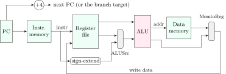
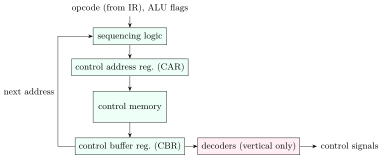

A processor is a <strong>datapath</strong> (registers, ALU, memories and the buses and multiplexers between them) steered by a <strong>control unit</strong> that raises the right control signals at the right time. This chapter describes the instruction cycle in register-transfer notation, the single-cycle and multi-cycle MIPS datapaths with their timing numericals, and the two ways to build control: hardwired and microprogrammed.

## 6.1 The instruction cycle in register-transfer notation {#sec-coa-rtl}

<div class="nb-proto">

<em><span>Prototypical example for this section:</span> fetch in three steps: $\text{MAR} \leftarrow \text{PC}$; then $\text{MBR} \leftarrow M[\text{MAR}]$ and $\text{PC} \leftarrow \text{PC}+1$ together; then $\text{IR} \leftarrow \text{MBR}$.</em>

</div>

<div class="nb nb-definition" id="definition-6-1-1">

<strong>Definition 6.1.1</strong>. <strong>Register-transfer language</strong> (RTL) writes each <strong>micro-operation</strong> as $\text{destination} \leftarrow \text{expression}$. Micro-operations in the same <strong>time step</strong> (clock cycle) happen in parallel and must not need the same bus or unit. The <strong>instruction cycle</strong> is fetch, (indirect,) execute, (interrupt):

- fetch: $T_0$: MAR $\leftarrow$ PC; $T_1$: MBR $\leftarrow M[\text{MAR}]$, PC $\leftarrow$ PC $+ 1$; $T_2$: IR $\leftarrow$ MBR;
- indirect (only for a memory-indirect operand): MAR $\leftarrow$ IR(address); MBR $\leftarrow M[\text{MAR}]$; IR(address) $\leftarrow$ MBR, so that execute finds the effective address in IR as if the mode had been direct;
- execute: depends on the opcode, for example for `ADD X`: MAR $\leftarrow$ IR(address); MBR $\leftarrow M[\text{MAR}]$; AC $\leftarrow$ AC $+$ MBR;
- interrupt: MBR $\leftarrow$ PC; MAR $\leftarrow$ save address (for example the stack pointer) and PC $\leftarrow$ ISR address; $M[\text{MAR}] \leftarrow$ MBR.

</div>

<div class="nb nb-remark" id="remark-6-1-2">

<strong>Remark 6.1.2</strong> (Why fetch takes three steps, not four) — PC $\leftarrow$ PC $+ 1$ uses the incrementer and the memory read uses the memory and MBR; they share nothing, so they go in the same step. Two transfers that both need the single internal bus, by contrast, must be in different steps. This “what can share a step” reasoning is what every RTL counting question tests. Interrupts are checked at the end of an instruction cycle, after execute, so an instruction is never half done when the interrupt cycle starts.

</div>

## 6.2 Single-cycle and multi-cycle datapaths {#sec-coa-datapath}

<div class="nb-proto">

<em><span>Prototypical example for this section:</span> a single-cycle MIPS whose clock must be long enough for `lw`, the slowest instruction, even when it executes `beq`.</em>

</div>

<figure class="nb-fig"></figure>

Every instruction passes through the whole datapath in one clock cycle. The main control is a combinational function of the opcode; deriving each signal from what the instruction must do gives the classic table (X = don’t care), and the timing comparison follows:

```text {filename="Output of control-table.py (Python 3.11)"}
instr    RegWrite   RegDst   ALUSrc  MemRead MemWrite MemtoReg   Branch    ALUOp
R-type          1        1        0        0        0        0        0       10
lw              1        0        1        1        0        1        0       00
sw              0        X        1        0        1        X        0       00
beq             0        X        0        0        0        X        1       01
single-cycle: clock 800 ps (lw), CPI 1    -> 800 ps/instruction
multi-cycle : clock 200 ps, CPI 4.05 -> 810 ps/instruction
(a clock that fit each instruction exactly would average 640 ps)
S0 = T2.I1 + T1.I2 + T2.I2 + T3.I2
S1 = T1.I1 + T1.I2 + T3.I2 + T1.I3 + T2.I3 + T3.I3
S2 = T3.I1 + T2.I2 + T3.I3
S3 = T1.I1 + T2.I1 + T1.I3 + T2.I3
```

<div class="nb nb-example nb-block" id="example-6-2-1">

<strong>Example 6.2.1</strong> (Single-cycle vs multi-cycle)

With latencies of $200$ ps (instruction memory, ALU, data memory) and $100$ ps (register read, register write), `lw` uses all five and needs $800$ ps, so the single-cycle clock is $800$ ps for every instruction. A multi-cycle design clocks at the slowest <em>step</em>, $200$ ps, and lets each instruction take as many steps as it needs (R-type 4, `lw` 5, `sw` 4, `beq` 3): CPI $= 4.05$ for this mix and $810$ ps per instruction, no better, because the $100$ ps steps are padded to $200$. Multi-cycle pays off when instruction lengths vary a lot (multiplies, divides, floating point); the real answer to both is pipelining ([Chapter 7](../07-pipeline/)), which overlaps the steps of different instructions.

</div>

<div class="nb nb-moral">

Single-cycle: CPI $1$, clock set by the slowest instruction. Multi-cycle: short clock, CPI $>1$, units reused across steps. The execution time is CPI $\times$ clock either way.

</div>

## 6.3 Hardwired and microprogrammed control {#sec-coa-microprog}

<div class="nb-proto">

<em><span>Prototypical example for this section:</span> 48 control signals: one bit each in a horizontal microinstruction (61 bits a word), or encoded fields in a vertical one (33 bits).</em>

</div>

### 6.3.i Hardwired control {#s6-3-i}

<div class="nb nb-definition" id="definition-6-3-1">

<strong>Definition 6.3.1</strong>. A <strong>hardwired</strong> control unit is a finite-state machine in logic gates: a step counter produces timing signals $T_1, T_2, \dots$, a decoder turns the opcode into instruction signals $I_1, I_2, \dots$, and each control signal is a sum of products of timing, instruction and status signals.

</div>

The last block of the `control-table.py` output does this for three instructions that each take three steps: for example, $S_2$ is needed by $I_1$ at $T_3$, by $I_2$ at $T_2$ and by $I_3$ at $T_3$, so $S_2 = T_3I_1 + T_2I_2 + T_3I_3$. Hardwired control is fast (a few gate delays) but changing the instruction set means redesigning logic.

### 6.3.ii Microprogrammed control {#s6-3-ii}

<figure class="nb-fig"></figure>

<div class="nb nb-definition" id="definition-6-3-2">

<strong>Definition 6.3.2</strong>. In a <strong>microprogrammed</strong> control unit each step’s control signals are stored as a <strong>microinstruction</strong> (control word) in a <strong>control memory</strong> (a ROM). The <strong>control address register</strong> (CAR) holds the address of the next microinstruction; the word read goes into the <strong>control buffer register</strong> (CBR), whose bits drive the control lines; the <strong>sequencing logic</strong> computes the next CAR value from the next-address field, the condition flags and, at the end of fetch, the opcode (which maps to the first microinstruction of that instruction’s <strong>microroutine</strong>). Reading a microinstruction is executing it.

</div>

<div class="nb nb-definition" id="definition-6-3-3">

<strong>Definition 6.3.3</strong> (Horizontal and vertical microcode). A <strong>horizontal</strong> microinstruction has one bit per control signal: wide, no decoding, and any combination of signals can be raised in one step (maximum parallelism). A <strong>vertical</strong> (encoded) microinstruction groups mutually exclusive signals into fields, each holding a binary code that a decoder expands: narrower words and a smaller control memory, at the cost of decoders (a little slower) and less parallelism (only one signal per group per step). A fully vertical word names a single micro-operation.

</div>

```text {filename="Output of microcode.py (Python 3.11)"}
600 words -> next-address field 10 bits; 7 conditions + 'always' -> 3 bits
horizontal: 48 + 3 + 10 = 61 bits/word, control memory 600 x 61 = 36600 bits
vertical  : groups [10, 7, 14, 9, 5, 3] -> fields [4, 3, 4, 4, 3, 2] = 20 bits
            word 20 + 3 + 10 = 33 bits, control memory 19800 bits (46% smaller)
fully encoded (one micro-op per word): 6 + 3 + 10 = 19 bits/word
120 instructions x 4 + 3 (fetch) = 483 words -> address field 9 bits
```

<div class="nb nb-example nb-block" id="example-6-3-4">

<strong>Example 6.3.4</strong> (Reading the output)

Next-address field: $\lceil \log_2 600 \rceil = 10$ bits. Condition select: $7$ testable conditions plus “always” are $8$ choices, $3$ bits. Horizontal word: $48 + 3 + 10 = 61$ bits. Vertical: a group of $g$ mutually exclusive signals needs $\lceil \log_2 (g+1) \rceil$ bits (the $+1$ encodes “none of them”), so groups of $10, 7, 14, 9, 5, 3$ need $4, 3, 4, 4, 3, 2 = 20$ bits and the word is $33$ bits, a control memory $46\%$ smaller. Some textbook problems omit the “none” code or the “always” condition; read the question’s convention.

</div>

|  | Hardwired | Microprogrammed |
|:--|:--|:--|
| speed | fastest: gates only | a control-memory read per step |
| changing the ISA | redesign the logic | rewrite the microprogram (even in the field, by a microcode update) |
| complex instructions | hard to get right | natural: a longer microroutine |
| typical use | RISC cores, the fast path of every modern CPU | classic CISC; modern x86 uses microcode only for complex or rare instructions |

<div class="nb-caption" id="table-6-1">

<strong>Table 6.1.</strong> The two control styles. “Hardwired for RISC, microprogrammed for CISC” is a historical tendency, not a rule.

</div>

<div class="nb nb-moral">

Microprogramming turns control design into programming a small ROM; horizontal words trade memory for parallelism, vertical words trade parallelism and a decoder delay for memory.

</div>
