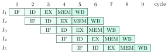
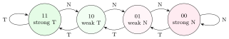

Pipelining overlaps the execution of consecutive instructions the way a laundry overlaps washing one load with drying the previous one. It does not make any single instruction faster; it raises throughput. This chapter covers the timing numericals, the three kinds of hazard with stall and forwarding tables generated by a simulator, branch prediction, precise exceptions, what lies beyond a scalar in-order pipeline, and the reservation-table scheduling of non-linear pipelines.

## 7.1 Pipeline timing {#sec-coa-pipetiming}

<div class="nb-proto">

<em><span>Prototypical example for this section:</span> stages of $80, 60, 20, 50, 120$ ns: the unpipelined latency is $330$ ns, but the pipelined clock is set by the $120$ ns stage.</em>

</div>

### 7.1.i The classic five stages {#s7-1-i}

The textbook RISC pipeline has five stages: <strong>IF</strong> (instruction fetch), <strong>ID</strong> (decode and register read), <strong>EX</strong> (ALU), <strong>MEM</strong> (data memory access), <strong>WB</strong> (register write-back). Pipeline registers between stages hold each instruction’s state. Every MIPS instruction fits this template, which is why “a RISC instruction executes in five stages” is the expected OA answer (real cores use anywhere from about 5 to more than 15).

<figure class="nb-fig"></figure>

<div class="nb nb-theorem nb-block" id="theorem-7-1-1">

<strong>Theorem 7.1.1</strong> (Pipeline timing)

With $k$ stages and clock period $T_p$, $n$ instructions take $(k + n - 1)\,T_p$: $k$ cycles to fill the pipeline for the first, then one per cycle. With unequal stage delays $\tau_1, \dots, \tau_k$ and pipeline-register (latch) overhead $d$, $T_p = \max_i \tau_i + d$. The unpipelined machine takes $\sum_i \tau_i$ per instruction, so

$$
\text{speedup} = \frac{n \sum_i \tau_i}{(k + n - 1)\,T_p}
	\;\xrightarrow{\;n \to \infty \;}\; \frac{\sum_i \tau_i}{T_p} \le k, \qquad
	\text{efficiency} = \frac{\text{speedup}}{k}.
$$

</div>

```text {filename="Output of pipe-timing.py (Python 3.11)"}
stages [80, 60, 20, 50, 120] ns, latch 5 ns
  unpipelined: latency 330 ns; 1000 instructions take 330000 ns
  pipelined  : clock 120 + 5 = 125 ns, latency 5 x 125 = 625 ns
  1000 instructions: (5 + 1000 - 1) x 125 = 125500 ns
  speedup 2.63 (limit 330/125 = 2.64, not 5)
  throughput 8.00 instructions per microsecond
stage times [1, 3, 1, 2], 6 instructions, pipelined units: 12 cycles
  instructions finish in cycles [7, 8, 9, 10, 11, 12]
stage times [1, 3, 1, 2], 6 instructions, non-pipelined units: 22 cycles
  instructions finish in cycles [7, 10, 13, 16, 19, 22]
CPI = 1 + 0.2 x 2 + 0.3 x 0.25 x 1 = 1.475
  speedup over a 5-cycle unpipelined CPU = 5 / 1.475 = 3.39
resolved in stage 2: penalty 1; 60% taken, predict not taken -> 0.6 cycles/branch
resolved in stage 3: penalty 2; 60% taken, predict not taken -> 1.2 cycles/branch
resolved in stage 4: penalty 3; 60% taken, predict not taken -> 1.8 cycles/branch
```

<div class="nb nb-example nb-block" id="example-7-1-2">

<strong>Example 7.1.2</strong> (Reading the output)

The unpipelined <em>latency</em> is the sum, $330$ ns. Pipelined, each instruction takes $5 \times 125 = 625$ ns (longer!), but one finishes every $125$ ns: for $1000$ instructions the speedup is $2.63$, close to its limit $330/125 = 2.64$, nowhere near $5$, because the stages are unbalanced and every one is padded to $125$ ns. Multi-cycle stages: with stages taking $1, 3, 1, 2$ cycles and units that accept a new instruction every cycle, $6$ instructions take $(1+3+1+2) + 5 = 12$ cycles; if the 3-cycle unit cannot accept a new instruction until it is done, it is the bottleneck and the instructions leave every $3$ cycles: $7 + 5 \times 3 = 22$.

</div>

<div class="nb nb-remark" id="remark-7-1-3">

<strong>Remark 7.1.3</strong> (Latency vs throughput) — Pipelining raises throughput and usually <em>raises</em> latency (latch overhead plus padding of short stages). Deeper pipelines shorten the clock but add latch overhead per stage and raise the cost of every stall and mispredicted branch, so there is an optimum depth.

</div>

## 7.2 Hazards and dependences {#sec-coa-hazards-pipe}

<div class="nb-proto">

<em><span>Prototypical example for this section:</span> <code>lw &#36;1, 0(&#36;2)</code> followed by <code>add &#36;3, &#36;1, &#36;4</code>: the loaded value is not there yet when `add` needs it.</em>

</div>

<div class="nb nb-definition" id="definition-7-2-1">

<strong>Definition 7.2.1</strong>. A <strong>hazard</strong> is a situation that prevents the next instruction from executing in its designated cycle. <strong>Structural</strong>: two instructions need the same hardware in the same cycle (one memory port for both IF and MEM). <strong>Data</strong>: an instruction needs a result not yet produced. <strong>Control</strong>: the next instruction’s address is not yet known (branches, jumps, exceptions).

</div>

<div class="nb nb-definition" id="definition-7-2-2">

<strong>Definition 7.2.2</strong> (Dependences). For instructions $i$ before $j$: <strong>RAW</strong> (read after write, true or flow dependence): $j$ reads what $i$ writes, with no write in between. <strong>WAR</strong> (write after read, anti-dependence): $j$ writes what $i$ reads. <strong>WAW</strong> (write after write, output dependence): both write the same location. RAR is not a dependence.

</div>

<div class="nb nb-remark" id="remark-7-2-3">

<strong>Remark 7.2.3</strong> (Dependence vs hazard) — A dependence is a property of the program; a hazard is a property of the program <em>on a particular pipeline</em>. In the classic in-order 5-stage pipeline, registers are read in ID and written in WB, always in program order, so only RAW can cause hazards; WAR and WAW are <strong>name dependences</strong> that matter only when instructions can complete out of order (multi-cycle units, superscalar, out-of-order cores), and <strong>register renaming</strong> removes them by giving every write a fresh physical register. Only RAW is fundamental. The OA phrasing “instruction $j$ writes a register that the earlier $i$ reads” is WAR.

</div>

The dependence finder in the simulator script lists all three kinds for a four-line example (output at the end of the next section).

## 7.3 Stalls and forwarding, cycle by cycle {#sec-coa-forwarding}

<div class="nb-proto">

<em><span>Prototypical example for this section:</span> with forwarding, the only stall left in a 5-stage MIPS is the one cycle after a load whose result is used immediately.</em>

</div>

<div class="nb nb-definition" id="definition-7-3-1">

<strong>Definition 7.3.1</strong>. A <strong>stall</strong> (bubble) holds an instruction in its stage until its operands are available; the hardware that detects this is the <strong>interlock</strong>; a compiler can do the same by inserting NOPs. <strong>Forwarding</strong> (bypassing) routes a result from the EX/MEM or MEM/WB pipeline register straight to the ALU input, without waiting for write-back. A <strong>split-phase</strong> register file writes in the first half of a cycle and reads in the second, so an instruction in ID can read a value written by WB in the same cycle.

</div>

The simulator computes, for each instruction, the cycle in which it enters each stage under three rules: no forwarding (a value can be read the cycle after WB), split phase (read in the WB cycle), and full forwarding (ALU result usable in the next EX, loaded value one cycle later). Its core is the operand constraint:

```python {filename="_pipesim.py, lines 6–18",linenos=table,linenostart=6}
def ready(prog, s, i, mode):
    """Earliest cycle in which instruction i may enter EX (its RAW dependences)."""
    t, srcs = 0, prog[i][2]
    for j in range(i):
        dst, load = prog[j][1], prog[j][3]
        if dst is None or dst not in srcs:
            continue
        if any(prog[m][1] == dst for m in range(j + 1, i)):
            continue                                  # j's value was overwritten
        if mode == "none":  t = max(t, s[j][4] + 2)   # read the cycle after WB
        if mode == "split": t = max(t, s[j][4] + 1)   # read in the WB cycle
        if mode == "fwd":   t = max(t, s[j][3] + 1 if load else s[j][2] + 1)
    return t
```

```text {filename="Output of pipesim.py (Python 3.11)"}
no forwarding, no split-phase register file: 18 cycles, 9 stall cycles
                       1  2  3  4  5  6  7  8  9 10 11 12 13 14 15 16 17 18
lw  $1, 0($2)         IF ID EX ME WB
add $3, $1, $4           IF ID -- -- -- EX ME WB
sub $5, $3, $6              IF -- -- -- ID -- -- -- EX ME WB
sw  $5, 4($2)                           IF -- -- -- ID -- -- -- EX ME WB
or  $7, $8, $9                                      IF -- -- -- ID EX ME WB
no forwarding, write first half / read second half: 15 cycles, 6 stall cycles
                       1  2  3  4  5  6  7  8  9 10 11 12 13 14 15
lw  $1, 0($2)         IF ID EX ME WB
add $3, $1, $4           IF ID -- -- EX ME WB
sub $5, $3, $6              IF -- -- ID -- -- EX ME WB
sw  $5, 4($2)                        IF -- -- ID -- -- EX ME WB
or  $7, $8, $9                                IF -- -- ID EX ME WB
full forwarding: 10 cycles, 1 stall cycle
                       1  2  3  4  5  6  7  8  9 10
lw  $1, 0($2)         IF ID EX ME WB
add $3, $1, $4           IF ID -- EX ME WB
sub $5, $3, $6              IF -- ID EX ME WB
sw  $5, 4($2)                     IF ID EX ME WB
or  $7, $8, $9                       IF ID EX ME WB
full forwarding, 'or' scheduled into the load delay: 9 cycles, 0 stall cycles
                       1  2  3  4  5  6  7  8  9
lw  $1, 0($2)         IF ID EX ME WB
or  $7, $8, $9           IF ID EX ME WB
add $3, $1, $4              IF ID EX ME WB
sub $5, $3, $6                 IF ID EX ME WB
sw  $5, 4($2)                     IF ID EX ME WB
dependences:
  I2 reads r1 written by I1: RAW (true)
  I3 writes r1 written by I1: WAW (output)
  I3 writes r1 read by I2: WAR (anti)
  I4 writes r5 read by I2: WAR (anti)
  I4 reads r1 written by I3: RAW (true)
```

<div class="nb nb-example nb-block" id="example-7-3-2">

<strong>Example 7.3.2</strong> (Counting stalls)

Without forwarding, each RAW on the previous instruction costs $3$ cycles ($2$ with split phase): $9$ or $6$ stall cycles here. With forwarding only the load-use pair stalls, $1$ cycle, and moving the independent `or` into the slot after the load removes even that ($9$ cycles $= 5 + 4$, the ideal for $5$ instructions). In the dependence list, `I4` reads `r1` from `I3`, not `I1`: a RAW dependence is on the most recent writer.

</div>

<div class="nb nb-definition" id="fact-7-3-3">

<strong>Fact 7.3.3</strong> (CPI with stalls). $\text{CPI} = 1 + \text{stall cycles per instruction}$, summing frequency $\times$ penalty over every stall source; the speedup over an unpipelined machine with CPI$_u$ at the same clock is $\text{CPI}_u / \text{CPI}$. In the timing output, $20\%$ branches with a $2$-cycle penalty and $30\%$ loads of which a quarter are followed by a use give $\text{CPI} = 1.475$.

</div>

<div class="nb nb-moral">

Forwarding turns most RAW hazards into nothing; what remains (load-use) the compiler hides by scheduling independent instructions into the gap.

</div>

## 7.4 Control hazards and branch prediction {#sec-coa-branchpred}

<div class="nb-proto">

<em><span>Prototypical example for this section:</span> a loop branch that is taken nine times and then falls through: a 1-bit predictor mispredicts it twice per loop, a 2-bit predictor once.</em>

</div>

### 7.4.i Branch penalties and static schemes {#s7-4-i}

If a branch is resolved in stage $k$, the $k-1$ instructions fetched after it are wrong when it is taken. The options:

- <strong>stall</strong> (freeze) until the branch resolves: $k-1$ cycles for every branch;
- <strong>predict not taken</strong>: keep fetching sequentially and <strong>flush</strong> on a taken branch: pay $k-1$ only for taken branches;
- <strong>predict taken</strong>: needs the target early (from a BTB, below); static compilers often predict backward branches taken and forward ones not taken (loops go backward);
- <strong>delayed branch</strong>: the instruction in the <strong>branch delay slot</strong> always executes; the compiler fills it with an instruction from before the branch that the branch does not depend on, or with a NOP (classic MIPS had one delay slot);
- resolve earlier: MIPS moves the comparison into ID, cutting the penalty to $1$.

The timing output above gives the expected penalty per branch for resolution in stages $2, 3, 4$ with $60\%$ of branches taken and predict-not-taken: $0.6$, $1.2$, $1.8$ cycles.

### 7.4.ii Dynamic prediction {#s7-4-ii}

<figure class="nb-fig"></figure>

<div class="nb nb-definition" id="definition-7-4-1">

<strong>Definition 7.4.1</strong>. A <strong>1-bit predictor</strong> remembers each branch’s last outcome. A <strong>2-bit predictor</strong> keeps a saturating counter (above): it predicts taken in the two upper states, and needs two consecutive surprises to change its prediction. A <strong>branch target buffer</strong> (BTB) is a cache, indexed by the branch’s PC, holding the predicted target, so that a taken branch can redirect fetch in IF, before decode. A <strong>return address stack</strong> predicts the targets of returns. Correlating (two-level) predictors use the recent history of branches as part of the index.

</div>

```python {filename="predictor.py, lines 14–23",linenos=table,linenostart=14}
class OneBit:                       # remember the last outcome
    def __init__(self): self.s = True
    def predict(self): return self.s
    def update(self, taken): self.s = taken

class TwoBit:                       # saturating counter 0..3, taken if >= 2
    def __init__(self): self.c = 3
    def predict(self): return self.c >= 2
    def update(self, taken):
        self.c = min(3, self.c + 1) if taken else max(0, self.c - 1)
```

```text {filename="Output of predictor.py (Python 3.11)"}
stream                 always-T  always-N     1-bit     2-bit
loop TTTN x 5             15/20      5/20     11/20     15/20
alternating TN x 10       10/20     10/20      1/20     10/20
  4-iteration loop: 1-bit 1.98, 2-bit 1.00 mispredictions per loop execution
 10-iteration loop: 1-bit 1.98, 2-bit 1.00 mispredictions per loop execution
100-iteration loop: 1-bit 1.98, 2-bit 1.00 mispredictions per loop execution
```

<div class="nb nb-remark" id="remark-7-4-2">

<strong>Remark 7.4.2</strong> (What the simulation shows) — On a loop branch (taken $n-1$ times, then not taken), a 1-bit predictor mispredicts twice per loop execution: at the exit, and again at the first iteration of the next execution, because it remembers “not taken”. The 2-bit counter only drops from 11 to 10 at the exit and still predicts taken next time: one miss per loop. On an alternating branch the 1-bit predictor is wrong every time ($1/20$) and the 2-bit counter is right half the time; only a history-based predictor learns that pattern. Dynamic prediction reduces branch penalties but cannot remove them: the first encounter of a branch, a target not yet in the BTB, and genuinely data-dependent branches still miss.

</div>

<div class="nb nb-moral">

The branch penalty is (misprediction rate) $\times$ (resolution depth). Prediction attacks the first factor, early resolution and delay slots the second.

</div>

## 7.5 Exceptions and precise interrupts {#sec-coa-precise}

<div class="nb-proto">

<em><span>Prototypical example for this section:</span> a page fault on a load in MEM while the next three instructions are already in the pipeline.</em>

</div>

<div class="nb nb-definition" id="definition-7-5-1">

<strong>Definition 7.5.1</strong>. An exception is <strong>precise</strong> if the saved state looks as though every instruction before the faulting one completed and none after it started; the faulting PC is saved (MIPS: in EPC, with the reason in the Cause register) so the handler can fix the problem and restart the instruction.

</div>

In the 5-stage pipeline the hardware records the exception in the pipeline register, turns the faulting instruction and everything behind it into bubbles, lets the older instructions finish, and starts fetching the handler. Exceptions are taken in program order (an earlier instruction’s exception wins even if a later one faults first in time). Precise exceptions are what make demand paging possible: the OS must be able to re-run the faulting load. Out-of-order cores keep them precise with the reorder buffer, below.

## 7.6 Beyond one instruction per cycle {#sec-coa-ilp}

<div class="nb-proto">

<em><span>Prototypical example for this section:</span> a 4-wide out-of-order core that renames registers and retires in order.</em>

</div>

<div class="nb nb-definition" id="definition-7-6-1">

<strong>Definition 7.6.1</strong>. A <strong>superscalar</strong> processor fetches, decodes and issues several instructions per cycle, using hardware to find independent ones (CPI below 1; IPC above 1). A <strong>VLIW</strong> processor issues one long instruction word holding several operations that the <em>compiler</em> has already scheduled as independent (DSPs such as TI’s C6000 family; Itanium’s EPIC); simpler hardware, but code depends on the exact machine and stalls are the compiler’s problem. An <strong>out-of-order</strong> (dynamically scheduled) processor lets instructions execute as soon as their operands are ready rather than in program order.

</div>

<div class="nb nb-definition" id="fact-7-6-2">

<strong>Fact 7.6.2</strong> (How out-of-order execution stays correct). <strong>Tomasulo’s algorithm</strong>: instructions wait in <strong>reservation stations</strong> with either operand values or tags naming the unit that will produce them; results are broadcast on a common data bus and captured by every waiting station. Tags implement <strong>register renaming</strong>, removing WAR and WAW hazards. A <strong>reorder buffer</strong> (ROB) holds results until instructions <strong>commit</strong> (retire) in program order, so register and memory state change in order: exceptions stay precise and mispredicted branches are undone by discarding younger ROB entries (<strong>speculative execution</strong>).

</div>

<div class="nb nb-remark" id="remark-7-6-3">

<strong>Remark 7.6.3</strong> — Limits: true (RAW) dependences, branch mispredictions and cache misses bound the instruction-level parallelism a program offers; wide issue costs power and complexity quadratically in places (dependence checks, bypass networks). That is why the industry turned to multiple cores ([Chapter 12](../12-parallel/)).

</div>

## 7.7 What does and does not speed up a pipelined RISC {#sec-coa-speedup-what}

<div class="nb-proto">

<em><span>Prototypical example for this section:</span> doubling the caches without slowing the clock helps; disabling forwarding does not.</em>

</div>

Use the iron law ([Section 11.1](../11-perf/#sec-coa-ironlaw)): time $=$ instructions $\times$ CPI $\times$ clock period, with $\text{CPI} = 1 +$ stalls.

- <strong>Helps:</strong> a faster clock (if the stage logic allows it); larger or better caches at the same cycle time (fewer memory stalls); forwarding (fewer data stalls); better branch prediction or earlier branch resolution; compiler scheduling into load and branch delay slots; balancing stage delays.
- <strong>Hurts or does nothing:</strong> disabling forwarding (more stalls); adding stages without shortening the critical stage (more latch overhead and longer branch penalties, same clock); making caches bigger at the price of a slower clock or more cycles per hit; increasing the CPI of arithmetic instructions.
- <strong>Depends:</strong> deeper pipelines shorten the clock but raise stall penalties; the net is positive only while the clock gain beats the extra stall cycles.

<div class="nb nb-moral">

Every pipeline optimisation either shortens the clock or removes stall cycles; check any proposed change against both terms of the iron law.

</div>

## 7.8 Non-linear pipelines and reservation tables {#sec-coa-reservation}

<div class="nb-proto">

<em><span>Prototypical example for this section:</span> a 3-stage pipeline in which the first stage is reused at the end: which initiation intervals avoid collisions?</em>

</div>

<div class="nb nb-definition" id="definition-7-8-1">

<strong>Definition 7.8.1</strong>. A <strong>reservation table</strong> marks which stage each operation uses in each time slot. Two initiations $p$ cycles apart <strong>collide</strong> if some row has two marks $p$ apart: $p$ is a <strong>forbidden latency</strong>. The <strong>collision vector</strong> $C_m \dots C_1$ has $C_p = 1$ for forbidden $p$ ($m$ = largest forbidden latency). From the current state (initially the collision vector), initiating after an allowed latency $p$ (a $0$ bit, or any $p > m$) leads to the state (current $\gg p$) OR (collision vector). Cycles in this state diagram are the collision-free schedules; the <strong>minimum average latency</strong> (MAL) is the smallest average over its simple cycles; a <strong>greedy cycle</strong> always takes the smallest allowed latency.

</div>

```text {filename="Output of reservation.py (Python 3.11)"}
S1: X . . . . X
S2: . X . X . .
S3: . . X . X .
forbidden latencies [2, 5]; collision vector C5..C1 = 10010
  10010 --1--> 11011
  10010 --3--> 10010
  10010 --4--> 10011
  10010 --6+--> 10010
  10011 --3--> 10010
  10011 --4--> 10011
  10011 --6+--> 10010
  11011 --3--> 10011
  11011 --6+--> 10010
  cycle (1, 3, 3): average latency 2.33
  cycle (3,): average latency 3.00
  cycle (1, 3, 6): average latency 3.33
  cycle (1, 6): average latency 3.50
  cycle (3, 4): average latency 3.50
  cycle (4,): average latency 4.00
  cycle (4, 6): average latency 5.00
  cycle (6,): average latency 6.00
greedy from the initial state: latencies [1, 3, 3, 1, 3, 3, 1, 3, 3, 1]
MAL = 2.33; lower bound = max X's in a row = 2
```

<div class="nb nb-example nb-block" id="example-7-8-2">

<strong>Example 7.8.2</strong> (Reading the output)

Row S2 has marks at $1$ and $3$, row S3 at $2$ and $4$: latency $2$ is forbidden; row S1 forbids $5$. Collision vector `10010`. The greedy strategy from the start alternates $1, 3, 3$ and averages $7/3 = 2.33$, which here is also the MAL. No schedule can beat the lower bound “largest number of marks in one row” ($2$), and this one does not reach it; inserting delay stages to change the table is how designers close the gap.

</div>
