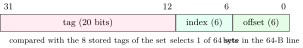

A processor can execute an instruction every fraction of a nanosecond; main memory needs tens of nanoseconds to return a word. The memory hierarchy (registers, caches, DRAM, storage) hides that gap by keeping the data a program is about to use in small, fast memories close to the core. This is the most-asked part of computer organization in OAs and interviews: cache address splits, miss types, write policies, AMAT, and why one loop order is ten times faster than another. Every trace in this chapter was produced by a cache simulator written for the book.

## 9.1 Locality, and why caches work {#sec-coa-locality}

<div class="nb-proto">

<em><span>Prototypical example for this section:</span> a loop summing an array: the loop’s instructions are reused every iteration (temporal locality) and the array elements sit next to each other (spatial locality).</em>

</div>

<div class="nb nb-definition" id="definition-9-1-1">

<strong>Definition 9.1.1</strong>. <strong>Temporal locality</strong>: an item accessed now is likely to be accessed again soon. <strong>Spatial locality</strong>: items near a recently accessed one are likely to be accessed soon. A cache exploits the first by keeping recently used data, and the second by moving data in <strong>blocks</strong> (<strong>lines</strong>) of consecutive bytes, typically $64$. <strong>Hit rate</strong> $h$: fraction of accesses found in the cache; <strong>miss rate</strong> $1-h$; <strong>miss penalty</strong>: extra time to bring the block from the next level.

</div>

<div class="nb nb-ques" id="question-9-1-2">

<strong>Question 9.1.2</strong> — “What determines the high hit rate of a cache?”

</div>

Locality of reference in the program, first of all; a program that touches random addresses over gigabytes defeats any cache. Then the cache’s design: size (capacity misses), associativity (conflict misses), block size (spatial locality, up to the point where fewer, larger blocks start to evict useful data), and the replacement policy ([Section 9.7](#sec-coa-3c)). The cache’s speed or the memory’s speed does not change the hit rate.

<div class="nb nb-moral">

Caches are a bet on locality. Every cache design decision changes which kind of miss you pay for; none helps a program without locality.

</div>

## 9.2 Main memory: SRAM, DRAM, flash and memory organisation {#sec-coa-mainmem}

<div class="nb-proto">

<em><span>Prototypical example for this section:</span> a memory with $16$ address lines and $8$ data lines holds $2^{16}$ bytes, $64$ KB.</em>

</div>

### 9.2.i SRAM and DRAM {#s9-2-i}

<div class="nb nb-definition" id="definition-9-2-1">

<strong>Definition 9.2.1</strong>. An <strong>SRAM</strong> cell is a pair of cross-coupled inverters with two access transistors (six transistors): it holds its bit as long as power is on, reads non-destructively and is fast, but is large. A <strong>DRAM</strong> cell is one transistor and one capacitor: the bit is charge that leaks away, so every row must be <strong>refreshed</strong> periodically, and reading destroys the charge, so it must be written back. DRAM is roughly an order of magnitude denser and cheaper per bit, and slower. Caches are SRAM; main memory is DRAM. When a system needs a large memory, the answer is DRAM, for density and cost per bit.

</div>

<div class="nb nb-remark" id="algorithm-9-2-2">

<strong>Algorithm 9.2.2</strong> (Reading a DRAM cell) — (1) <strong>Precharge</strong> the bit lines to half the supply voltage. (2) Assert one <strong>word line</strong> (row): every cell in that row shares its charge with its bit line. (3) Each bit line moves slightly above or below the precharge level, depending on the stored bit. (4) A <strong>sense amplifier</strong> on each bit line amplifies the small difference to a full $0$ or $1$, which also <em>rewrites</em> the value into the cell (the read was destructive). (5) The column address selects which sense amplifiers’ bits go out. The row stays latched in the sense amplifiers (the <strong>row buffer</strong>), so further reads from the same row skip steps 1–4.

</div>

<div class="nb nb-definition" id="fact-9-2-3">

<strong>Fact 9.2.3</strong> (DRAM organisation). Rows and columns share address pins: the row address is latched first (RAS), then the column address (CAS), halving the pin count. Refresh reads and rewrites every row within the retention period (commonly $64$ ms). Synchronous DRAM (SDRAM, DDR) transfers bursts of consecutive columns, on both clock edges in DDR.

</div>

```text {filename="Output of memchips.py (Python 3.11)"}
16 address lines, 8 data lines: 65536 words x 8 bits = 65536 bytes (64 KB)
20 address lines, 16 data lines: 1048576 words x 16 bits = 2097152 bytes (2048 KB)
12 address lines, 4 data lines: 4096 words x 4 bits = 2048 bytes (2 KB)
8192 x 16 from 256 x 4 chips: 32 rows x 4 columns = 128 chips;
  address 13 bits: low 8 to every chip, high 5 to a 5-to-32 decoder (chip selects)
4096 x 8 from 1024 x 8 chips: 4 rows x 1 columns = 4 chips;
  address 12 bits: low 10 to every chip, high 2 to a 2-to-4 decoder (chip selects)
DRAM 4096 rows x 1024 columns x 8 bits = 32 Mbit: 22 address bits on 12 multiplexed pins
DRAM 8192 rows x 2048 columns x 16 bits = 256 Mbit: 24 address bits on 13 multiplexed pins
refresh 8192 rows every 64 ms: one row every 7.81 us, 50 ns each
  -> busy refreshing 0.64% of the time
```

<div class="nb nb-example nb-block" id="example-9-2-4">

<strong>Example 9.2.4</strong> (The pin and chip numericals)

$k$ address lines and $d$ data lines give $2^k \times d$ bits: $16$ and $8$ give $64$ KB. To build $8\text{K} \times 16$ from $256 \times 4$ chips, put $4$ chips side by side for the width (horizontal expansion) and $32$ such rows for the depth (vertical expansion): $128$ chips; the low $8$ address bits go to every chip and the high $5$ to a 5-to-32 decoder that selects one row of chips. A refresh of $8192$ rows every $64$ ms means one row every $7.81\,\mu$s; at $50$ ns per row the DRAM is busy refreshing $0.64\%$ of the time.

</div>

### 9.2.ii Interleaving {#s9-2-ii}

<div class="nb nb-definition" id="definition-9-2-5">

<strong>Definition 9.2.5</strong>. With $2^m$ memory modules, <strong>low-order interleaving</strong> uses the low $m$ address bits to choose the module, so consecutive words lie in consecutive modules; <strong>high-order interleaving</strong> uses the high $m$ bits, so each module holds one contiguous region.

</div>

```text {filename="Output of interleave.py (Python 3.11)"}
address:       0  1  2  3  4  5  6  7  8  9 10 11 12 13 14 15
low-order  ->  0  1  2  3  0  1  2  3  0  1  2  3  0  1  2  3
high-order ->  0  0  0  0  1  1  1  1  2  2  2  2  3  3  3  3
(low-order: module = address mod 4; high-order: module = address div 4)
block of 4 words: one module 180 ns, 4-way low-order interleaved 60 ns
block of 8 words: one module 360 ns, 4-way low-order interleaved 120 ns
```

Low-order interleaving lets the modules work on consecutive words in parallel: a block of $4$ words needs one access time plus four transfers ($60$ ns) instead of four full accesses ($180$ ns) under the simple model in the script. That is what a cache-line fill wants. High-order interleaving gives no such overlap, but it lets modules be added one region at a time and keeps a failure local. In an MCQ: the <em>low-order</em> bits select the <em>module</em>, the high-order bits the word within it.

### 9.2.iii Flash and EEPROM {#s9-2-iii}

<div class="nb nb-definition" id="fact-9-2-6">

<strong>Fact 9.2.6</strong>. Flash is non-volatile (keeps data without power), built from floating-gate transistors. Reads are fast and random-access; writes can only change $1$s to $0$s, so rewriting requires <em>erasing</em> first, and erasure works on whole blocks (many kilobytes), not bytes. Each block survives a limited number of program/erase cycles, so controllers spread writes (<strong>wear levelling</strong>) and remap blocks (the flash translation layer of an SSD). NOR flash allows byte-addressable reads and execute-in-place (code storage in microcontrollers); NAND flash is denser, read and written in pages (SSDs, SD cards). EEPROM erases byte by byte but is far less dense. So: “flash is volatile”, “flash can overwrite one byte in place” or “flash has unlimited write endurance” are the false statements in such questions.

</div>

## 9.3 Cache organisation and the address split {#sec-coa-cacheorg}

<div class="nb-proto">

<em><span>Prototypical example for this section:</span> a 32 KB, 8-way cache with 64-byte lines splits a 32-bit address into $20 \mid 6 \mid 6$ bits of tag, set index and offset.</em>

</div>

<div class="nb nb-definition" id="definition-9-3-1">

<strong>Definition 9.3.1</strong>. A cache has $L = \text{size}/\text{block}$ lines grouped into $S = L/k$ <strong>sets</strong> of $k$ lines (<strong>$k$-way set associative</strong>). Memory block $j$ may go only into set $j \bmod S$, in any of its $k$ ways. <strong>Direct mapped</strong>: $k = 1$ (block $j$ goes to line $j \bmod L$). <strong>Fully associative</strong>: $S = 1$ (anywhere). The address splits into

$$
\underbrace{\text{tag}}_{\text{rest}} \;\Big|\; \underbrace{\text{index}}_{\log_2 S}
	\;\Big|\; \underbrace{\text{offset}}_{\log_2 \text{block}}.
$$

A lookup reads the $k$ tags of the indexed set, compares all of them in parallel with the address tag ($k$ comparators), and on a match selects that way’s data (a $k$:1 mux) and the byte at the offset. Each line also stores a valid bit (and a dirty bit for write-back, plus replacement state).

</div>

<figure class="nb-fig"></figure>

```text {filename="Output of cache-split.py (Python 3.11)"}
   addr    size   line  ways  lines   sets  tag idx off   tag bits  comparators
A    16     512     16     2     32     16    8   4   4        256  2 x 8 bits
B    32   32768     64     1    512    512   17   9   6       8704  1 x 17 bits
C    32   32768     64     8    512     64   20   6   6      10240  8 x 20 bits
D    32   32768     64   512    512      1   26   0   6      13312  512 x 26 bits
E    48 1048576     64    16  16384   1024   32  10   6     524288  16 x 32 bits
cache C, address 0x12345678: tag 0x12345, set 25, offset 56
direct mapped with 8 lines, block j -> line j mod 8: 0->0, 5->5, 8->0, 13->5, 21->5, 64->0
```

<div class="nb nb-example nb-block" id="example-9-3-2">

<strong>Example 9.3.2</strong> (The OA numerical: number of sets)

Cache A: $512$ B with $16$-byte lines is $32$ lines; $2$-way gives $16$ sets, so $4$ index bits; $4$ offset bits; on a 16-bit machine the tag is $16 - 4 - 4 = 8$ bits. The recipe never changes: lines $=$ size$/$block, sets $=$ lines$/$ways, then take logs. Going from direct mapped (B) to 8-way (C) at the same size moves $3$ bits from index to tag; fully associative (D) has no index at all and needs $512$ comparators, which is why large caches are never fully associative.

</div>

<div class="nb nb-remark" id="remark-9-3-3">

<strong>Remark 9.3.3</strong> (Tag-directory size) — Tag store $=$ lines $\times$ (tag bits $+$ valid $+$ dirty $+$ replacement bits). The table counts tag bits only, as most textbook questions do; read whether the question wants the extra bits included.

</div>

## 9.4 Replacement, and tracing a cache by hand {#sec-coa-replacement}

<div class="nb-proto">

<em><span>Prototypical example for this section:</span> blocks $0, 4, 8$ in a 4-line direct-mapped cache all fight over line $0$.</em>

</div>

<div class="nb nb-definition" id="definition-9-4-1">

<strong>Definition 9.4.1</strong>. When a set is full, the <strong>replacement policy</strong> picks the victim: <strong>LRU</strong> (least recently used; exact LRU needs $\log_2 k!$ bits per set, so real caches use tree pseudo-LRU), <strong>FIFO</strong> (oldest fill), random. Direct-mapped caches have no choice. OPT (evict the block used furthest in the future) is the unreachable lower bound.

</div>

```text {filename="Output of cache-traces.py (Python 3.11)"}
trace 1: 0, 4, 8 collide when direct mapped
  block      direct  2-way LRU   full LRU  full FIFO
      0        miss       miss       miss       miss
      4        miss       miss       miss       miss
      0        miss        hit        hit        hit
      8        miss       miss       miss       miss
      0        miss        hit        hit        hit
      4        miss       miss        hit        hit
      2        miss       miss       miss       miss
      6        miss       miss       miss       miss
      2        miss        hit        hit        hit
      0        miss       miss        hit       miss
  hits         0/10       3/10       5/10       4/10
trace 2: a loop over 5 blocks, one more than the cache holds
  block      direct  2-way LRU   full LRU  full FIFO
      0        miss       miss       miss       miss
      1        miss       miss       miss       miss
      2        miss       miss       miss       miss
      3        miss       miss       miss       miss
      4        miss       miss       miss       miss
      0        miss       miss       miss       miss
      1         hit        hit       miss       miss
      2         hit       miss       miss       miss
      3         hit        hit       miss       miss
      4        miss       miss       miss       miss
  hits         3/10       2/10       0/10       0/10
write policies on W0 W4 W8 R16 W0 W20 R0 W36
  write-back + allocate        hits 5, block reads 3, memory writes 1 (+2 dirty)
  write-through + no-allocate  hits 1, block reads 2, memory writes 6 (+0 dirty)
  write-through + allocate     hits 5, block reads 3, memory writes 6 (+0 dirty)
  write-back + no-allocate     hits 1, block reads 2, memory writes 5 (+1 dirty)
```

<div class="nb nb-remark" id="remark-9-4-2">

<strong>Remark 9.4.2</strong> (Two lessons from the traces) — In trace 1 the direct-mapped cache never hits: $0, 4, 8$ all map to line $0$ and evict one another (<strong>conflict misses</strong>, or “thrashing” of one line) while three lines stay unused. Associativity fixes it. Trace 2 is the counterexample to “associative always beats direct mapped”: a loop over five blocks in a four-block LRU cache evicts each block just before it is needed again, so fully associative LRU (and FIFO) score $0$, while the direct-mapped cache keeps blocks $1, 2, 3$ and hits three times.

</div>

## 9.5 Write policies {#sec-coa-writes}

<div class="nb-proto">

<em><span>Prototypical example for this section:</span> a store that hits in the cache: update memory now (write-through) or when the line is evicted (write-back)?</em>

</div>

<div class="nb nb-definition" id="definition-9-5-1">

<strong>Definition 9.5.1</strong>. On a write <em>hit</em>: <strong>write-through</strong> updates the cache and memory (usually through a <strong>write buffer</strong>, so the processor does not wait); <strong>write-back</strong> updates only the cache and sets the line’s <strong>dirty bit</strong>; the line is written to memory when it is evicted. On a write <em>miss</em>: <strong>write-allocate</strong> fetches the block and then writes it in the cache; <strong>no-write-allocate</strong> (write-around) writes to memory only. The usual pairs are write-back with write-allocate, and write-through with no-write-allocate.

</div>

The policy where the cache is updated but main memory is not (until eviction) is write-back. The same eight operations under the four combinations (from the trace script above): write-back + allocate made $1$ memory write (plus $2$ dirty lines still to write); write-through made $6$.

<div class="nb nb-definition" id="fact-9-5-2">

<strong>Fact 9.5.2</strong> (Average access time with the two policies). With hit ratio $H$, cache time $T_c$, memory time $T_m$ and a fraction $d$ of victims dirty: write-through, no-allocate: $T_{\text{read}} = HT_c + (1-H)(T_m + T_c)$ and every write costs $T_m$ (without a write buffer); write-back, allocate: $T = HT_c + (1-H)\big[d(2T_m + T_c) + (1-d)(T_m + T_c)\big]$, the $2T_m$ being the write of the dirty victim plus the fetch. The output of `amat.py` in the next section evaluates both ($7.0$ and $50$ ns against $8.5$ ns). Conventions vary (whether $T_c$ is added on a miss, whether the victim write overlaps); state yours.

</div>

<div class="nb nb-remark" id="remark-9-5-3">

<strong>Remark 9.5.3</strong> — Write-through keeps memory always up to date, which makes coherence with DMA devices and other cores simple, at the cost of bus traffic on every store. Write-back saves traffic when a line is written many times, and is what every modern L1/L2 uses.

</div>

## 9.6 Average memory access time and multilevel caches {#sec-coa-amat}

<div class="nb-proto">

<em><span>Prototypical example for this section:</span> L1 hit rate $0.62$ and L2 hit rate $0.70$: only $0.38 \times 0.30 = 11.4\%$ of accesses reach DRAM.</em>

</div>

<div class="nb nb-theorem nb-block" id="theorem-9-6-1">

<strong>Theorem 9.6.1</strong> (AMAT)

$\text{AMAT} = t_{\text{hit}} + m \times t_{\text{penalty}}$, applied recursively: $\text{AMAT} = t_1 + m_1\,(t_2 + m_2\,t_m)$ with <em>local</em> miss rates (L2’s misses divided by L2’s accesses, which are L1’s misses). The fraction of all accesses that reach memory is the product of the local miss rates, $m_1 m_2$, also called L2’s <strong>global</strong> miss rate.

</div>

```text {filename="Output of amat.py (Python 3.11)"}
L1 hit 0.62, L2 hit 0.7: accesses reaching memory = 0.38 x 0.30 = 0.114
AMAT = 1 + 0.38 x (10 + 0.30 x 100) = 16.20 cycles
  = sum over the level that serves the access: 16.20 cycles
  levels looked up in parallel instead: 14.68 cycles
1000 accesses, 40 L1 misses, 20 L2 misses:
  L1 miss rate 0.04; L2 local 0.5, global 0.02
CPI = 1.2 + 1.3 refs/instr x 0.03 misses x 80 cycles = 4.32
write-through: read 7.0 ns, write 50 ns
write-back, 30% dirty victims: read or write 8.5 ns
TLB (hit 0.98, walk 100) + caches: 1 + 0.02 x 100 + 16.20 = 19.20 cycles
```

<div class="nb nb-remark" id="remark-9-6-2">

<strong>Remark 9.6.2</strong> (Traps) — Four ways to lose marks on multilevel questions.

- Do not add the hit rates or multiply them: what reaches memory is $(1-h_1)(1-h_2)$, the product of the <em>miss</em> rates.
- A “hit rate of L2” in a question is usually local; if the global rate is given, the L2 term is $m_1 \times (\text{local}) =$ global. With $40$ L1 misses and $20$ L2 misses per $1000$ accesses, L2’s local miss rate is $0.5$ but its global miss rate is $0.02$: L2 looks bad locally because it only sees the hard accesses.
- Hierarchical (look-through) and simultaneous (parallel lookup) access models give different numbers ($16.20$ vs $14.68$ cycles here); the hierarchical one is the default.
- Memory stalls go into CPI as references per instruction $\times$ miss rate $\times$ penalty: $1.2 + 1.3 \times 0.03 \times 80 = 4.32$. A 3% miss rate more than tripled the CPI, which is why caches dominate performance.

</div>

## 9.7 The 3C model: why misses happen {#sec-coa-3c}

<div class="nb-proto">

<em><span>Prototypical example for this section:</span> a working set larger than the cache produces capacity misses that no associativity can remove.</em>

</div>

<div class="nb nb-definition" id="definition-9-7-1">

<strong>Definition 9.7.1</strong>. <strong>Compulsory</strong> (cold) misses: the first access to a block. <strong>Capacity</strong> misses: the block was evicted because the cache cannot hold the program’s working set; they would occur even in a fully associative cache of the same size. <strong>Conflict</strong> (collision) misses: the block was evicted because too many blocks map to its set; a fully associative cache would have hit. (A fourth C, <strong>coherence</strong> misses, comes from invalidations by other cores.)

</div>

```text {filename="Output of three-c.py (Python 3.11)"}
1568 accesses
cache                                compulsory  capacity  conflict  total
 4 KB, 32 B lines, 1-way                    499       167       393   1059
 4 KB, 32 B lines, 4-way                    499       186        30    715
 8 KB, 32 B lines, 1-way                    499        27       405    931
 8 KB, 32 B lines, 4-way                    499        34        25    558
 8 KB, 64 B lines, 4-way                    270        96        40    406
16 KB, 32 B lines, 1-way                    499         0         0    499
```

| Change | Compulsory | Capacity | Conflict |
|:--|:--|:--|:--|
| larger cache | same | fewer | fewer (usually) |
| higher associativity | same | same | fewer |
| larger blocks | fewer (more spatial locality per miss) | more once blocks are too few | more once blocks are too few; and a larger miss penalty |
| prefetching | fewer | fewer (if timely) | can increase (pollution) |

<div class="nb-caption" id="table-9-1">

<strong>Table 9.1.</strong> Effect of design changes on the three kinds of misses.

</div>

<div class="nb nb-example nb-block" id="example-9-7-2">

<strong>Example 9.7.2</strong> (Reading the simulation)

Going from direct mapped to 4-way at the same size removes almost all conflict misses ($393 \to 30$ at 4 KB); doubling the line size halves the compulsory misses of this sequential-heavy trace ($499 \to 270$); only a cache that holds the whole working set (16 KB) removes the capacity misses. The 3C split is a model: because it compares with a fully associative LRU cache, a direct-mapped cache can occasionally beat it and the capacity counts of two designs of equal size need not match exactly.

</div>

## 9.8 Cache-friendly code {#sec-coa-cachecode}

<div class="nb-proto">

<em><span>Prototypical example for this section:</span> summing a $4096 \times 4096$ matrix by columns instead of rows: same arithmetic, more than ten times slower on the machine that built this book.</em>

</div>

### 9.8.i Traversal order, tiling, arrays vs lists {#s9-8-i}

C stores 2-D arrays in <strong>row-major</strong> order: `a[i][j]` and `a[i][j+1]` are adjacent. Looping with `j` innermost uses every byte of each fetched line; looping with `i` innermost jumps a whole row per access.

```text {filename="Output of traversal.py (Python 3.11)"}
row-major   a[i][j], j inner:   4096 misses / 65536 accesses =   6.2%
column-wise a[i][j], i inner:  65536 misses / 65536 accesses = 100.0%
matrix multiply ijk (B walked down columns) :  41992 misses (5.34%)
matrix multiply ikj (all rows)              :   9551 misses (1.21%)
matrix multiply ikj tiled 16 x 16           :   3072 misses (0.39%)
array of 4096 nodes           :  1024 misses for 4096 nodes
linked list, nodes scattered  :  4073 misses for 4096 nodes
```

<div class="nb nb-example nb-block" id="example-9-8-1">

<strong>Example 9.8.1</strong> (What the simulator shows)

Row-major: one miss per $16$ ints ($64$-byte lines), $6.2\%$. Column-wise: every access misses: the column’s $256$ lines map to only $4$ of the $64$ sets (the stride of $1$ KB is a multiple of $16$ lines) and evict each other before the next column could reuse them. Matrix multiply: `ijk` walks `B` down a column in the inner loop ($5.34\%$ misses); `ikj` streams rows of `B` and `C` ($1.21\%$); <strong>tiling</strong> (blocking) the loops into $16 \times 16$ blocks that fit in the cache reuses each block many times ($0.39\%$). An array of $4096$ $16$-byte nodes costs $1024$ misses ($4$ nodes per line); the same nodes scattered on the heap as a linked list cost about one miss per node, and the next address is not known until the current node arrives, so the hardware prefetcher cannot help either.

</div>

The real machine agrees (one run on the 4-core cloud VM that built this book; absolute times vary between runs):

```c {filename="traversal-time.c"}
// flags: -O2
// Sum a 4096 x 4096 int matrix (64 MB) by rows, then by columns; time both.
#define _POSIX_C_SOURCE 200809L
#include <stdio.h>
#include <stdlib.h>
#include <time.h>

#define N 4096
static double now(void) {
    struct timespec t;
    clock_gettime(CLOCK_MONOTONIC, &t);
    return t.tv_sec + t.tv_nsec * 1e-9;
}

int main(void) {
    int *a = malloc(sizeof(int) * N * N);
    for (long i = 0; i < (long)N * N; i++) a[i] = (int)(i & 7);
    long s1 = 0, s2 = 0;
    double t0 = now();
    for (int i = 0; i < N; i++)              /* by rows: stride 4 bytes */
        for (int j = 0; j < N; j++) s1 += a[(long)i * N + j];
    double t1 = now();
    for (int j = 0; j < N; j++)              /* by columns: stride 16 KB */
        for (int i = 0; i < N; i++) s2 += a[(long)i * N + j];
    double t2 = now();
    printf("sums equal: %s\n", s1 == s2 ? "yes" : "no");
    printf("row-major traversal    %6.1f ms\n", (t1 - t0) * 1e3);
    printf("column-major traversal %6.1f ms\n", (t2 - t1) * 1e3);
    printf("ratio %.0fx\n", (t2 - t1) / (t1 - t0));
    free(a);
    return 0;
}
```

```text {filename="Output (gcc 13.3, -std=c11, x86-64 Linux, -O2; one run)"}
sums equal: yes
row-major traversal       7.7 ms
column-major traversal  150.6 ms
ratio 19x
```

<div class="nb nb-remark" id="remark-9-8-2">

<strong>Remark 9.8.2</strong> (Locality questions on real ARM and x86 cores) — Asked “which linear structure is fastest to loop over” on a modern core (a Cortex-A72, say): a contiguous array, for the reasons above plus hardware prefetching of sequential streams. Asked “row-major or column-major for a C 2-D matrix”: row-major, the inner loop over the last index. Asked “how to detect a loop in a linked list”: Floyd’s tortoise and hare (two pointers, $O(1)$ extra space), a question about algorithms rather than caches, but it comes in the same breath.

</div>

### 9.8.ii False sharing {#s9-8-ii}

<div class="nb nb-definition" id="definition-9-8-3">

<strong>Definition 9.8.3</strong>. <strong>False sharing</strong>: two cores write <em>different</em> variables that happen to share a cache line. Coherence works per line, so the line bounces between the cores’ caches on every write even though no data are actually shared.

</div>

```c {filename="false-sharing.c"}
// flags: -O2 -pthread
// Two threads each increment their OWN counter: adjacent vs padded counters.
#define _GNU_SOURCE                  /* pthread_setaffinity_np: pin threads */
#include <sched.h>
#include <pthread.h>
#include <stdio.h>
#include <time.h>

#define ITERS 50000000L
struct { volatile long a, b; } near;                     /* one 64-byte line */
struct { volatile long a; char pad[56]; volatile long b; } far;  /* two lines */

static void pin(pthread_t t, int cpu) {          /* two different cores */
    cpu_set_t set;
    CPU_ZERO(&set);
    CPU_SET(cpu, &set);
    pthread_setaffinity_np(t, sizeof set, &set);
}
static void *inc(void *p) {
    volatile long *c = p;
    for (long i = 0; i < ITERS; i++)
        __atomic_fetch_add(c, 1, __ATOMIC_RELAXED);   /* a locked add on x86 */
    return NULL;
}
static double run(volatile long *x, volatile long *y) {
    struct timespec t0, t1;
    pthread_t p, q;
    clock_gettime(CLOCK_MONOTONIC, &t0);
    pthread_create(&p, NULL, inc, (void *)x);
    pthread_create(&q, NULL, inc, (void *)y);
    pin(p, 0);
    pin(q, 1);
    pthread_join(p, NULL);
    pthread_join(q, NULL);
    clock_gettime(CLOCK_MONOTONIC, &t1);
    return (t1.tv_sec - t0.tv_sec) * 1e3 + (t1.tv_nsec - t0.tv_nsec) * 1e-6;
}
int main(void) {
    printf("&near.b - &near.a = %ld bytes, &far.b - &far.a = %ld bytes\n",
           (long)((char *)&near.b - (char *)&near.a),
           (long)((char *)&far.b - (char *)&far.a));
    double t_near = run(&near.a, &near.b), t_far = run(&far.a, &far.b);
    printf("counters in one cache line : %6.0f ms\n", t_near);
    printf("counters in separate lines : %6.0f ms\n", t_far);
    printf("results %ld %ld %ld %ld\n", near.a, near.b, far.a, far.b);
    return 0;
}
```

```text {filename="Output (gcc 13.3, -std=c11, x86-64 Linux, -O2 -pthread; one run, 4 vCPUs)"}
&near.b - &near.a = 8 bytes, &far.b - &far.a = 64 bytes
counters in one cache line :   1496 ms
counters in separate lines :    324 ms
results 50000000 50000000 50000000 50000000
```

The two threads, pinned to different cores, never touch each other’s counter, yet putting the counters in one line made the run several times slower in this measurement. The fix is padding or alignment to the line size (`alignas(64)` in C11/C++, or per-thread data). The effect’s size depends on the machine; its existence does not.

<div class="nb nb-moral">

Access memory in the order it is laid out, keep the working set small enough to fit (tile it), prefer contiguous arrays to pointer chasing, and never let two threads write the same cache line.

</div>

## 9.9 Caches and virtual memory {#sec-coa-vipt}

<div class="nb-proto">

<em><span>Prototypical example for this section:</span> a 32 KB, 8-way L1 indexed with virtual-address bits that happen to equal the physical ones.</em>

</div>

Paging and the TLB are in the OS book; here is how they meet the cache. Every access needs a translation (the TLB) and a cache lookup. Three ways to combine them:

- <strong>PIPT</strong> (physically indexed, physically tagged): translate first, then look up. Simple and alias-free, but the TLB is on the critical path (used for L2 and L3).
- <strong>VIVT</strong> (virtual cache): look up with the virtual address; fastest, but the same virtual address means different data in different processes (<strong>homonyms</strong>: flush on a context switch or tag lines with an address-space ID), and two virtual addresses may map to the same physical address (<strong>synonyms</strong> or aliases: two copies of one datum).
- <strong>VIPT</strong>: index with virtual-address bits while the TLB translates in parallel, then compare <em>physical</em> tags. If all index and offset bits lie inside the page offset, they are identical in the virtual and physical address and synonyms cannot arise.

```text {filename="Output of vipt.py (Python 3.11)"}
page size 4096 B: page offset = 12 bits (same in VA and PA)
32 KB  8-way: index + offset = log2(4096) = 12 bits -> no synonyms
48 KB 12-way: index + offset = log2(4096) = 12 bits -> no synonyms
64 KB  4-way: index + offset = log2(16384) = 14 bits -> 2 colour bits, synonyms possible
16 KB  1-way: index + offset = log2(16384) = 14 bits -> 2 colour bits, synonyms possible
largest synonym-free VIPT size = page x ways: 32 KB (8-way), 48 KB (12-way)
```

<div class="nb nb-theorem nb-block" id="theorem-9-9-1">

<strong>Theorem 9.9.1</strong> (The VIPT size limit)

A VIPT cache is synonym-free when $\text{size}/\text{associativity} \le \text{page size}$. With $4$ KB pages, that is why L1 caches grew by adding ways (32 KB 8-way, 48 KB 12-way, the latter being this build machine’s L1d size) rather than sets. Otherwise the extra index bits (<strong>colour</strong> bits) must be handled by page colouring in the OS or by alias detection in hardware.

</div>

The access-time arithmetic is additive when translation is serial: the last line of the AMAT output adds a TLB of hit rate $0.98$ and a $100$-cycle walk to get $19.20$ cycles per access.

## 9.10 Cache coherence {#sec-coa-coherence}

<div class="nb-proto">

<em><span>Prototypical example for this section:</span> core A writes $x$ in its cache; core B reads $x$ from its own: who guarantees that B sees the new value?</em>

</div>

<div class="nb nb-definition" id="definition-9-10-1">

<strong>Definition 9.10.1</strong>. A memory system is <strong>coherent</strong> if all processors see the writes to each single location in one order, and a read returns the last write in that order. <strong>Snooping</strong> protocols broadcast misses on a shared bus that every cache watches; <strong>directory</strong> protocols keep, per block, a record of which caches hold it (scales beyond a bus). <strong>Write-invalidate</strong> protocols remove other copies before a write; write-update protocols send the new value to them.

</div>

<div class="nb nb-definition" id="definition-9-10-2">

<strong>Definition 9.10.2</strong> (MSI and MESI). Each line is <strong>M</strong> (modified: the only copy, dirty), <strong>S</strong> (shared: clean, others may have it) or <strong>I</strong> (invalid). MESI adds <strong>E</strong> (exclusive: the only copy, clean): a line read when no other cache has it enters E, and a later write upgrades E to M <em>without a bus transaction</em>, the common private-data case. A write to an S line must broadcast an invalidation (upgrade); a read miss to a line another cache holds in M makes that cache supply or write back the data and drop to S.

</div>

```text {filename="Output of mesi.py (Python 3.11)"}
MSI :   op      A  B  C   bus transaction
        A R     S  I  I   BusRd
        A W     M  I  I   BusUpgr (invalidate)
        B R     S  S  I   BusRd (others flush/share)
        B W     I  M  I   BusUpgr (invalidate)
        C R     I  S  S   BusRd (others flush/share)
        A R     S  S  S   BusRd (others flush/share)
  bus transactions: 6
MESI:   op      A  B  C   bus transaction
        A R     E  I  I   BusRd
        A W     M  I  I   - (E -> M silently)
        B R     S  S  I   BusRd (others flush/share)
        B W     I  M  I   BusUpgr (invalidate)
        C R     I  S  S   BusRd (others flush/share)
        A R     S  S  S   BusRd (others flush/share)
  bus transactions: 5
```

The first two operations show the difference: core A reads then writes a line nobody else has; MSI needs a read and an upgrade on the bus, MESI only the read. The sequence then shows invalidation on B’s write and M $\to$ S downgrades on later reads.

<div class="nb nb-remark" id="remark-9-10-3">

<strong>Remark 9.10.3</strong> (DMA and coherence) — A DMA engine writing to memory makes cached copies stale, and a DMA read of memory can miss dirty data still in a write-back cache. Either the DMA is coherent (it snoops, as on most PCs), or software must <em>clean</em> (write back) the cache lines before a DMA read and <em>invalidate</em> them after a DMA write, as on many embedded SoCs ([Chapter 13](../13-embedded/)).

</div>

<div class="nb nb-moral">

Coherence is per cache line: invalidate other copies before writing, and remember that unrelated data in the same line pay the same price.

</div>
