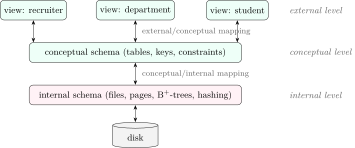
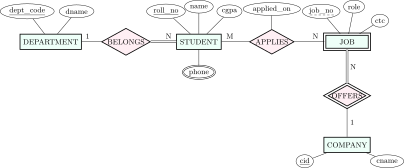

<div class="nb nb-remark">

<strong>Remark</strong> (How to read the SQL in this book) — Every query is a real file in `chapters/dbms/code/`. The script `code/build.sh` runs each one on SQLite 3.45.1 (through Python’s `sqlite3`) and on PostgreSQL 16.14 (a throwaway cluster), and the grey box under the query is the result it printed. When the two databases agree the box says “identical”; when they disagree (an error message, a dialect feature) both boxes are shown, because the disagreement is the lesson. Three display rules of the runner: `NULL` is printed as `NULL` (`psql` prints an empty cell); numbers lose trailing zeros, so `90000.00` and `90000.0` both print as `90000`; column names are lower-cased (PostgreSQL folds unquoted names to lower case, SQLite keeps what you typed). MySQL is not installed here; where it is known to behave differently the text says so, without a box. Every key count, closure, schedule verdict, B$^+$-tree and cost number comes from a Python script in the same folder, also shown with its real output.

</div>

<strong>Sources.</strong> The material follows the standard textbooks: Elmasri and Navathe, <em>Fundamentals of Database Systems</em>, 7th ed. (ER model and mapping, normalization, transactions, recovery, indexing); Silberschatz, Korth and Sudarshan, <em>Database System Concepts</em>, 7th ed. (relational algebra and calculus, SQL, storage, B$^+$-trees, hashing, query processing, concurrency, ARIES); and the cost models and query examples in the style of Ramakrishnan and Gehrke, <em>Database Management Systems</em>. The coverage was checked against the GO Classes DBMS lecture series (Deepak Poonia), which is built on the first two books. Engine behaviour is what SQLite 3.45.1 and PostgreSQL 16.14 actually did.

## 1.1 Why a DBMS, and the three-schema architecture {#sec-dbms-why}

<div class="nb-proto">

<em><span>Prototypical example for this section:</span> a placement portal: students, departments, companies, job openings and applications, used by the placement cell, the departments and the recruiters at the same time.</em>

</div>

### 1.1.i What goes wrong with plain files {#s1-1-i}

Suppose the placement cell keeps one CSV per company with the applicants’ names, CGPAs and phone numbers. Within a week:

- <strong>Redundancy and inconsistency</strong>: a student’s CGPA is copied into twenty files; the registrar updates it in one, and nineteen are now wrong.
- <strong>Ad hoc access is hard</strong>: “students with CGPA above 8 who applied to no company” needs a new program.
- <strong>Integrity</strong> rules (CGPA between 0 and 10, every applicant is a real student) live in application code, scattered and unenforced.
- <strong>Atomicity</strong>: a crash halfway through “withdraw the application from company A, add it to company B” leaves the student in neither or in both.
- <strong>Concurrent access</strong>: two coordinators updating the same file lose each other’s edits.
- <strong>Security</strong>: a recruiter who should see only their applicants can read the file.

A <strong>database management system</strong> (DBMS) is the software that stores the data once, describes it with a schema, answers declarative queries, enforces constraints, and runs <em>transactions</em> that are atomic, isolated and durable in the face of crashes and concurrency. Each bullet above is a chapter of this book.

### 1.1.ii Data models, schema and instance {#s1-1-ii}

Design runs in four steps: <strong>requirements analysis</strong>, <strong>conceptual design</strong> (an ER diagram, [Section 1.2](#sec-dbms-er)), <strong>logical design</strong> (tables, [Section 1.3](#sec-dbms-mapping), refined by normalization, [Chapter 6](../06-normalization/)) and <strong>physical design</strong> (indexes, file organization, partitioning, [Chapter 10](../10-storage/)).

<div class="nb nb-definition" id="definition-1-1-1">

<strong>Definition 1.1.1</strong>. A <strong>data model</strong> is a collection of concepts for describing data, relationships and constraints: the <strong>relational</strong> model (tables), the <strong>entity–relationship</strong> model (a design notation), the semi-structured models (JSON, XML documents), the older <strong>hierarchical</strong> and <strong>network</strong> models, and the object model. The <strong>schema</strong> is the description of the database (“`student` has a roll number, a name and a CGPA”); it changes rarely. The <strong>instance</strong> (or state) is the data in it at one moment; it changes with every insert.

</div>

### 1.1.iii Three levels and data independence {#s1-1-iii}

The ANSI/SPARC <strong>three-schema architecture</strong> separates three descriptions of the same data:

- the <strong>external</strong> level: one <strong>view</strong> per class of user (a recruiter sees applicants to their own jobs, without phone numbers);
- the <strong>conceptual</strong> (logical) level: all entities, attributes, relationships and constraints of the whole database, independent of storage;
- the <strong>internal</strong> (physical) level: files, record layouts, indexes, compression.

<figure class="nb-fig"></figure>

<div class="nb nb-definition" id="definition-1-1-2">

<strong>Definition 1.1.2</strong>. <strong>Logical data independence</strong>: the conceptual schema can change (add a column, split a table) without rewriting external views or the programs that use them; only the external/conceptual mapping changes. <strong>Physical data independence</strong>: the internal schema can change (add an index, move a table to SSD, change the file organization) without changing the conceptual schema or any query.

</div>

<div class="nb nb-remark" id="remark-1-1-3">

<strong>Remark 1.1.3</strong> (Which one is easier?) — Physical independence is the one every relational system delivers: `CREATE INDEX` never breaks a query. Logical independence is harder, because programs depend on the logical structure: dropping a column breaks every query that names it, and only views that re-create the old shape save you.

</div>

### 1.1.iv Inside a DBMS, and the four families of SQL statements {#s1-1-iv}

A query passes through the <strong>query processor</strong> (parser, rewriter, optimizer, executor, [Chapter 11](../11-query/)) and touches data through the <strong>storage manager</strong>: the <strong>buffer manager</strong> that caches disk pages in memory, the file and index manager ([Chapter 10](../10-storage/)), the <strong>transaction manager</strong> with its lock manager ([Chapter 8](../08-concurrency/)) and the <strong>recovery manager</strong> with its log ([Chapter 9](../09-recovery/)). The <strong>catalog</strong> (data dictionary) stores the schema itself as tables.

<div class="nb nb-definition" id="fact-1-1-4">

<strong>Fact 1.1.4</strong> (SQL statement families). <strong>DDL</strong> (definition): `CREATE`, `ALTER`, `DROP`, `TRUNCATE`, `RENAME`. <strong>DML</strong> (manipulation): `SELECT`, `INSERT`, `UPDATE`, `DELETE`, `MERGE`. <strong>DCL</strong> (control): `GRANT`, `REVOKE`. <strong>TCL</strong> (transaction control): `COMMIT`, `ROLLBACK`, `SAVEPOINT`, `SET TRANSACTION`. Some texts put `SELECT` alone in a fifth family, DQL.

</div>

<div class="nb nb-moral">

A DBMS exists to keep one copy of the data correct under concurrent use and crashes, and to let the storage change without the queries noticing.

</div>

## 1.2 The entity–relationship model {#sec-dbms-er}

<div class="nb-proto">

<em><span>Prototypical example for this section:</span> the ER diagram of the placement portal in [Figure 1.1](#figure-1-1).</em>

</div>

### 1.2.i Entities, attributes and relationships {#s1-2-i}

<div class="nb nb-definition" id="definition-1-2-1">

<strong>Definition 1.2.1</strong>. An <strong>entity</strong> is a thing with independent existence (a student); an <strong>entity set</strong> (entity type) is all entities of one kind, drawn as a rectangle. <strong>Attributes</strong> (ovals) describe entities: <strong>simple</strong> or <strong>composite</strong> (`name` = first + last), <strong>single-valued</strong> or <strong>multivalued</strong> (a student’s phone numbers, double oval), <strong>stored</strong> or <strong>derived</strong> (age from date of birth, dashed oval). A <strong>key attribute</strong> (underlined) identifies each entity uniquely. A <strong>relationship set</strong> (diamond) associates entities; its <strong>degree</strong> is the number of entity sets it connects (binary, ternary, …). Relationships can have attributes of their own (the date of an application).

</div>

<div class="nb nb-definition" id="definition-1-2-2">

<strong>Definition 1.2.2</strong>. The <strong>cardinality ratio</strong> of a binary relationship is the maximum number of relationship instances an entity can take part in: 1:1, 1:N or M:N. <strong>Participation</strong> is the minimum: <strong>total</strong> (every entity must take part; double line, also called existence dependency) or <strong>partial</strong> (single line).

</div>

<figure class="nb-fig"></figure>

<div class="nb-caption" id="figure-1-1">

<strong>Figure 1.1.</strong> The placement portal in Chen notation. Double rectangle: weak entity; double diamond: identifying relationship; double line: total participation; double oval: multivalued attribute; dashed underline: partial key.

</div>

Reading [Figure 1.1](#figure-1-1) (`BELONGS` is `BELONGS_TO`): every student belongs to exactly one department (N side, total participation), a department may have no students yet (partial). Students and jobs are M:N through `APPLIES`, which carries `applied_on`: the date belongs to the pair, not to either side.

### 1.2.ii Weak entities {#s1-2-ii}

<div class="nb nb-definition" id="definition-1-2-3">

<strong>Definition 1.2.3</strong>. A <strong>weak entity set</strong> has no key of its own; it is identified by its <strong>owner</strong> (identifying) entity set through an <strong>identifying relationship</strong>, plus a <strong>partial key</strong> (discriminator). A weak entity always has total participation in the identifying relationship, and the relationship is 1:N from owner to weak entity.

</div>

`JOB` is weak: job number 1 exists at every company, so (`cid`, `job_no`) is the key. The identifying relationship is sometimes called a <strong>strong</strong> relationship (the child’s key contains the parent’s key); an ordinary one, where the child’s key does not contain the parent’s, is <strong>non-identifying</strong>. Deleting a company must delete its jobs: a weak entity cannot outlive its owner.

<div class="nb nb-remark" id="remark-1-2-4">

<strong>Remark 1.2.4</strong> (Weak is not “has a foreign key”) — Every student has a department, yet `STUDENT` is strong: `roll_no` identifies a student without the department. An entity is weak only when its own attributes cannot identify it.

</div>

### 1.2.iii Specialization, generalization and aggregation {#s1-2-iii}

<figure class="nb-fig"></figure>

<div class="nb nb-definition" id="definition-1-2-5">

<strong>Definition 1.2.5</strong>. <strong>Specialization</strong> defines subclasses of an entity set (top-down); <strong>generalization</strong> finds a common superclass of several (bottom-up). Subclasses inherit the superclass’s attributes and relationships. Two independent constraints: <strong>disjoint</strong> (an entity is in at most one subclass) vs <strong>overlapping</strong>, and <strong>total</strong> (every superclass entity is in some subclass) vs <strong>partial</strong>. <strong>Aggregation</strong> treats a relationship as an entity so that it can take part in another relationship (an <em>interview</em> relationship attached to the `APPLIES` pair).

</div>

<div class="nb nb-remark" id="remark-1-2-6">

<strong>Remark 1.2.6</strong> (A ternary is not three binaries) — `SUPPLIES(supplier, part, project)` records which supplier supplies which part <em>to which project</em>. The three binaries `CAN_SUPPLY(supplier, part)`, `USES(project, part)`, `SUPPLIES_TO(supplier, project)` lose that: supplier S supplies part P (to someone), project J uses P (from someone), S supplies J (something) does not imply S supplies P to J. Use a ternary when the fact is about all three at once.

</div>

<div class="nb nb-moral">

Cardinality is the maximum, participation the minimum; a weak entity borrows its owner’s key; a relationship attribute belongs to the pair.

</div>

## 1.3 Mapping ER to relations {#sec-dbms-mapping}

<div class="nb-proto">

<em><span>Prototypical example for this section:</span> turning [Figure 1.1](#figure-1-1) into six `CREATE TABLE` statements.</em>

</div>

<div class="nb nb-remark" id="algorithm-1-3-1">

<strong>Algorithm 1.3.1</strong> (ER-to-relational mapping, after Elmasri–Navathe) — Apply the rules in this order.

1. <strong>Strong entity</strong> $E$: a table with $E$’s simple attributes (composite ones flattened into their parts, derived ones dropped); its key is the primary key.
2. <strong>Weak entity</strong> $W$ with owner $E$: a table with $W$’s attributes plus $E$’s key as a foreign key; primary key = owner’s key + partial key; `ON DELETE CASCADE`.
3. <strong>Binary 1:1</strong>: put the key of one side as a foreign key in the other, preferably in the side with total participation (no `NULL`s); add `UNIQUE`. If both sides are total, the two entities and the relationship can be merged into one table.
4. <strong>Binary 1:N</strong>: put the key of the “1” side as a foreign key in the “N” side, with the relationship’s attributes. Total participation of the N side becomes `NOT NULL`.
5. <strong>Binary M:N</strong>: a new table holding both keys (together the primary key) and the relationship’s attributes.
6. <strong>Multivalued attribute</strong>: a new table (owner key, value), both in the key.
7. <strong>$n$-ary relationship</strong>: a new table with the $n$ keys; the primary key is the keys of the sides that are “many”.
8. <strong>Specialization</strong>: one table per class (subclass key = superclass key, a foreign key), or one table per subclass only (needs total + disjoint), or a single table with a type column and nullable subclass columns.

</div>

```sql {filename="c01-mapping.sql"}
-- The placement-portal ER diagram mapped to tables.
CREATE TABLE department (                 -- strong entity
    dept_code  CHAR(2) PRIMARY KEY,
    dname      VARCHAR(40) NOT NULL UNIQUE
);
CREATE TABLE student (                    -- N side of BELONGS_TO
    roll_no    CHAR(8) PRIMARY KEY,
    name       VARCHAR(40) NOT NULL,
    cgpa       NUMERIC(4,2) CHECK (cgpa BETWEEN 0 AND 10),
    dept_code  CHAR(2) NOT NULL REFERENCES department -- total particip.
);
CREATE TABLE student_phone (              -- multivalued attribute {phone}
    roll_no    CHAR(8) REFERENCES student ON DELETE CASCADE,
    phone      VARCHAR(15),
    PRIMARY KEY (roll_no, phone)
);
CREATE TABLE company (
    cid        INTEGER PRIMARY KEY,
    cname      VARCHAR(40) NOT NULL
);
CREATE TABLE job (                        -- weak entity, owner COMPANY
    cid        INTEGER REFERENCES company ON DELETE CASCADE,
    job_no     INTEGER,                    -- partial key
    role       VARCHAR(30),
    ctc_lpa    INTEGER,
    PRIMARY KEY (cid, job_no)
);
CREATE TABLE application (                -- M:N relationship APPLIES
    roll_no    CHAR(8) REFERENCES student,
    cid        INTEGER,
    job_no     INTEGER,
    applied_on DATE,
    PRIMARY KEY (roll_no, cid, job_no),
    FOREIGN KEY (cid, job_no) REFERENCES job ON DELETE CASCADE
);
INSERT INTO department VALUES ('CS', 'Computer Science'),
                              ('EE', 'Electrical');
INSERT INTO student VALUES ('CS21B001', 'Asha', 9.10, 'CS'),
                           ('EE21B007', 'Ravi', 8.40, 'EE');
INSERT INTO company VALUES (1, 'Quantix'), (2, 'Bharat Grid');
INSERT INTO job VALUES (1, 1, 'SDE', 40), (1, 2, 'Quant', 60),
                       (2, 1, 'Analyst', 18);
INSERT INTO application VALUES ('CS21B001', 1, 1, '2026-08-01'),
    ('CS21B001', 1, 2, '2026-08-02'), ('EE21B007', 2, 1, '2026-08-03');

-- a student in a department that does not exist
INSERT INTO student VALUES ('ME21B003', 'Kiran', 7.9, 'ME');

-- an application for a job that does not exist
INSERT INTO application VALUES ('EE21B007', 2, 9, '2026-08-04');

-- deleting company 1 cascades to its jobs and to their applications
DELETE FROM company WHERE cid = 1;
SELECT (SELECT COUNT(*) FROM job) AS jobs_left,
       (SELECT COUNT(*) FROM application) AS applications_left;
```

```text {filename="Result on SQLite 3.45.1"}
-- a student in a department that does not exist
ERROR: FOREIGN KEY constraint failed

-- an application for a job that does not exist
ERROR: FOREIGN KEY constraint failed

 jobs_left | applications_left
-----------+-------------------
         1 |                 1
(1 row)
```

```text {filename="Result on PostgreSQL 16.14"}
-- a student in a department that does not exist
ERROR: insert or update on table "student" violates foreign key constraint
  "student_dept_code_fkey"

-- an application for a job that does not exist
ERROR: insert or update on table "application" violates foreign key constraint
  "application_cid_job_no_fkey"

 jobs_left | applications_left
-----------+-------------------
         1 |                 1
(1 row)
```

Both engines reject the orphan rows and both cascade the delete through two levels (company $\to$ job $\to$ application); only the error wording differs.

<div class="nb nb-remark" id="remark-1-3-2">

<strong>Remark 1.3.2</strong> (SQLite does not check foreign keys unless asked) — The runner opens every SQLite connection with `PRAGMA foreign_keys = ON`. Without it, SQLite parses `REFERENCES` and then ignores it, so both bad inserts would succeed. The pragma is per connection, so it must be issued every time.

</div>

<div class="nb nb-remark" id="remark-1-3-3">

<strong>Remark 1.3.3</strong> (Why 1:N never merges into one table) — Even with total participation on both sides, merging `DEPARTMENT` into `STUDENT` repeats `dname` for every student of the department: the key is `roll_no` and `dept_code`$\to$`dname` is a dependency on a non-key, a 3NF violation ([Chapter 6](../06-normalization/)). A 1:1 merge has no such repetition, which is why only 1:1 with total participation on both sides collapses to one table. A multivalued attribute is mapped exactly like a weak entity whose only attribute is the value.

</div>

<div class="nb nb-example nb-block" id="example-1-3-4">

<strong>Example 1.3.4</strong> (Minimum number of tables)

A favourite numerical: “entity sets $A$ and $B$, relationship $R$; what is the minimum number of tables?” Answer by the rules: M:N needs $3$ tables; 1:N needs $2$ (the key of the 1 side goes into the N side); 1:1 needs $2$, or $1$ if participation is total on both sides; each multivalued attribute adds one table. [Figure 1.1](#figure-1-1) has five entity sets/relationship tables that cannot be merged (department, student, company, job, application) plus one for the multivalued phone: $6$.

</div>

<div class="nb nb-moral">

The “many” side carries the foreign key; M:N and multivalued attributes always get a table of their own.

</div>

## 1.4 The relational model and keys {#sec-dbms-keys}

<div class="nb-proto">

<em><span>Prototypical example for this section:</span> `R(A,B,C,D,E)` with candidate keys `AB` and `BC`: how many super keys?</em>

</div>

### 1.4.i Relations {#s1-4-i}

<div class="nb nb-definition" id="definition-1-4-1">

<strong>Definition 1.4.1</strong>. A <strong>relation schema</strong> $R(A_1,\dots,A_n)$ is a name and a list of attributes, each with a <strong>domain</strong> of atomic values. A <strong>relation</strong> (instance) is a <em>set</em> of tuples, each a value for every attribute. The <strong>degree</strong> (arity) is $n$; the <strong>cardinality</strong> is the number of tuples.

</div>

<div class="nb nb-remark" id="remark-1-4-2">

<strong>Remark 1.4.2</strong> (Tables are not relations) — A relation is a set: no duplicate tuples and no order of rows. An SQL table is a <em>multiset</em> (bag): without a key it can hold the same row twice, and a query returns duplicates unless you write `DISTINCT`. Neither has a guaranteed row order without `ORDER BY`. Relational algebra ([Chapter 2](../02-algebra/)) is set-based; SQL is bag-based; this mismatch is behind half the “how many rows” questions.

</div>

### 1.4.ii Integrity constraints {#s1-4-ii}

<div class="nb nb-definition" id="definition-1-4-3">

<strong>Definition 1.4.3</strong>. <strong>Domain constraint</strong>: every value comes from the attribute’s domain (`CHECK (cgpa BETWEEN 0 AND 10)`). <strong>Key constraint</strong>: no two tuples agree on a key. <strong>Entity integrity</strong>: no primary-key attribute is `NULL`. <strong>Referential integrity</strong>: a foreign-key value is either `NULL` or equal to the key of some tuple of the referenced relation.

</div>

| Constraint | Applies to | Violated by |
|:--|:--|:--|
| Domain | one attribute | insert/update of a bad value |
| Key (uniqueness) | every candidate key | insert/update creating a duplicate |
| Entity integrity | primary key | a `NULL` in any primary-key attribute |
| Referential | foreign key $\to$ candidate key, two tables or one | insert/update in the child; delete/update in the parent |
| Functional dependency | two sets of attributes | any change that makes two rows agree on the left side but not the right ([Chapter 6](../06-normalization/)) |

A foreign key may be `NULL` (unless declared `NOT NULL`), may have several attributes, and may refer to its own table (`employee.manager_id` references `employee.emp_id`). It must refer to a candidate key (in SQL: a `PRIMARY KEY` or `UNIQUE` column set), not to an arbitrary column. Deleting a row of the <em>child</em> (referencing) table can never violate referential integrity, and inserting into the <em>parent</em> cannot either; the dangerous operations are inserting or updating a child row and deleting or updating a parent row. When a referenced row is deleted or its key updated, the foreign key’s action decides what happens: `NO ACTION` / `RESTRICT` (reject; the default), `CASCADE` (delete or update the referencing rows too), `SET NULL`, `SET DEFAULT`. Inserting into the referencing table can only be rejected, never cascaded.

### 1.4.iii Keys {#s1-4-iii}

<div class="nb nb-definition" id="definition-1-4-4">

<strong>Definition 1.4.4</strong>. A <strong>super key</strong> is a set of attributes whose values identify every tuple uniquely. A <strong>candidate key</strong> is a minimal super key: no proper subset is a super key. The <strong>primary key</strong> is the candidate key the designer picks (not `NULL`); the others are <strong>alternate keys</strong> (declare them `UNIQUE NOT NULL`). A <strong>foreign key</strong> is a set of attributes that refers to a candidate key of another (or the same) relation. A <strong>composite key</strong> has more than one attribute; a <strong>surrogate key</strong> is a system-generated identifier (an auto-increment id) used instead of a <strong>natural key</strong> (roll number, PAN).

</div>

<div class="nb nb-remark" id="remark-1-4-5">

<strong>Remark 1.4.5</strong> (Key-ness is a property of the schema, not of today’s data) — “In this instance no two students share a name” does not make `name` a key. An instance can only <em>refute</em> a key (two rows agree on it); keys come from the meaning of the data (or, formally, from functional dependencies, [Chapter 6](../06-normalization/)).

</div>

### 1.4.iv Counting super keys {#s1-4-iv}

Every super key contains some candidate key, and every superset of a super key is a super key. So with $n$ attributes:

- one candidate key of size $k$: the other $n-k$ attributes are free, giving $2^{n-k}$ super keys;
- candidate keys $K_1,\dots,K_m$: count the union of the sets “supersets of $K_i$” by inclusion–exclusion. Supersets of both $K_i$ and $K_j$ are supersets of $K_i\cup K_j$:

  $$
  \#\text{super keys} = \sum_{\emptyset \ne S\subseteq \{1,\dots,m\}} (-1)^{|S|+1}\,
  	2^{\,n-|K_S|}, \qquad K_S=\textstyle \bigcup_{i\in S}K_i.
  $$

<div class="nb nb-example nb-block" id="example-1-4-6">

<strong>Example 1.4.6</strong> (The prototype)

$R(A,B,C,D,E)$, candidate keys $AB$ and $BC$: $2^{5-2} + 2^{5-2} - 2^{5-3} = 8 + 8 - 4 = 12$, the $4$ subtracted being the supersets of $ABC$, counted twice. With keys $A$ and $B$ instead: $16+16-8 = 24$.

</div>

The script checks the formula against brute force over all $2^n$ subsets:

```python {filename="c01-superkeys.py"}
# Count super keys two ways: brute force over all 2^n attribute subsets, and the
# inclusion-exclusion formula over the candidate keys.
from itertools import combinations


def brute(attrs, keys):
    n = 0
    for r in range(1, len(attrs) + 1):
        for s in combinations(attrs, r):
            if any(set(k) <= set(s) for k in keys):
                n += 1
    return n


def formula(attrs, keys):
    # |union of "supersets of K_i"| = sum over nonempty subsets S of keys of
    # (-1)^(|S|+1) * 2^(n - |union of S|)
    total, n = 0, len(attrs)
    for r in range(1, len(keys) + 1):
        for group in combinations(keys, r):
            u = set().union(*map(set, group))
            total += (-1) ** (r + 1) * 2 ** (n - len(u))
    return total


cases = [
    ("ABCDE", ["A"]),
    ("ABCDE", ["AB"]),
    ("ABCDE", ["AB", "BC"]),
    ("ABCDE", ["A", "B"]),
    ("ABCDE", ["AB", "CD"]),
    ("ABCDEF", ["AB", "BC", "CA"]),
    ("ABCD", ["A", "BC", "CD"]),
]
print("relation  candidate keys   brute  formula")
for attrs, keys in cases:
    b, f = brute(attrs, keys), formula(attrs, keys)
    print(f"R({attrs:<6}) {', '.join(keys):<15} {b:6} {f:8}")
```

```text {filename="Output (Python 3.11)"}
relation  candidate keys   brute  formula
R(ABCDE ) A                   16       16
R(ABCDE ) AB                   8        8
R(ABCDE ) AB, BC              12       12
R(ABCDE ) A, B                24       24
R(ABCDE ) AB, CD              14       14
R(ABCDEF) AB, BC, CA          32       32
R(ABCD  ) A, BC, CD           11       11
```

<div class="nb nb-remark" id="remark-1-4-7">

<strong>Remark 1.4.7</strong> (Traps in key counting) — The empty set is never a super key (unless the relation can have at most one tuple), so brute force starts at size $1$. Candidate keys are <em>minimal</em>: if a question lists $A$ and $AB$ as “candidate keys”, $AB$ is not one. And when the keys overlap (the $AB$, $BC$, $CA$ row), forgetting the higher-order terms of inclusion–exclusion is the usual mistake: the answer $32$ needs the $+2^{6-3}$ triple term.

</div>

### 1.4.v The largest possible number of candidate keys {#s1-4-v}

No candidate key contains another, so the candidate keys of $R(A_1,\dots,A_n)$ form an <strong>antichain</strong> of subsets. Any antichain can occur: declare $K_i \to R$ for each set $K_i$, and the candidate keys are exactly the $K_i$. By Sperner’s theorem the largest antichain is all subsets of size $\lfloor n/2\rfloor$, so the answer is $\binom{n}{\lfloor n/2\rfloor}$; the maximum number of super keys is $2^n-1$ (every single attribute a key).

<div class="nb nb-example nb-block" id="example-1-4-8">

<strong>Example 1.4.8</strong> (A key is known)

$n=8$ and $A_1A_2A_3$ is known to be a candidate key. Every other key must be incomparable with it. Among the $\binom84=70$ four-attribute sets, exactly $5$ contain $A_1A_2A_3$; drop them and add $A_1A_2A_3$ itself: $70-5+1=66$.

</div>

The script computes the largest antichain exactly (Dilworth’s theorem: it equals the number of sets minus a maximum matching in the “proper subset” graph) instead of trusting the argument:

```python {filename="c01-maxkeys.py"}
# The largest possible number of candidate keys of R(A1..An).
# Candidate keys form an antichain (no key contains another), so the question
# is the largest antichain of subsets of an n-set. Computed exactly with
# Dilworth's theorem: max antichain = (number of sets) - (maximum matching in
# the "proper subset" graph).
from math import comb


def max_antichain(sets):
    sets = list(sets)
    idx = {s: i for i, s in enumerate(sets)}
    adj = [[idx[t] for t in sets if s & t == s and s != t] for s in sets]
    match = [-1] * len(sets)          # right vertex -> left vertex

    def augment(u, seen):
        for v in adj[u]:
            if not seen[v]:
                seen[v] = True
                if match[v] == -1 or augment(match[v], seen):
                    match[v] = u
                    return True
        return False

    m = sum(augment(u, [False] * len(sets)) for u in range(len(sets)))
    return len(sets) - m


print(" n  largest antichain  C(n, n//2)")
for n in range(1, 9):
    all_sets = range(1, 2 ** n)       # nonempty subsets as bitmasks
    print(f"{n:2} {max_antichain(all_sets):18} {comb(n, n // 2):11}")

# If a 3-attribute set K is a candidate key, every other key is incomparable
# with K: drop K's subsets and supersets, then add K back.
n, K = 8, 0b111
rest = [s for s in range(1, 2 ** n) if s & K != s and s & K != K]
best = max_antichain(rest) + 1
print(f"n = 8, A1A2A3 is a key: at most {best} candidate keys"
      f" (C(8,4) - 5 + 1 = {comb(8, 4) - 5 + 1})")
```

```text {filename="Output (Python 3.11)"}
 n  largest antichain  C(n, n//2)
 1                  1           1
 2                  2           2
 3                  3           3
 4                  6           6
 5                 10          10
 6                 20          20
 7                 35          35
 8                 70          70
n = 8, A1A2A3 is a key: at most 66 candidate keys (C(8,4) - 5 + 1 = 66)
```

<div class="nb nb-moral">

Super keys are upward closed: count supersets of each candidate key and correct for overlaps with inclusion–exclusion.

</div>
