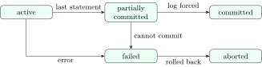
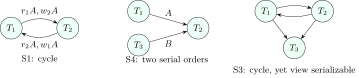
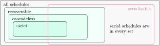

## 7.1 Transactions and ACID {#sec-dbms-acid}

<div class="nb-proto">

<em><span>Prototypical example for this section:</span> a bank transfer: debit account 1, credit account 2, and never only one of the two.</em>

</div>

<div class="nb nb-definition" id="definition-7-1-1">

<strong>Definition 7.1.1</strong>. A <strong>transaction</strong> is a sequence of reads and writes (plus computation) that the DBMS treats as one logical unit of work: it ends with <strong>commit</strong> (make all its effects permanent) or <strong>abort</strong>/<strong>rollback</strong> (undo all of them). In SQL it starts with `BEGIN` (or implicitly with the first statement) and ends with `COMMIT` or `ROLLBACK`; outside an explicit block, each statement is its own transaction (<strong>autocommit</strong>).

</div>

<div class="nb nb-definition" id="definition-7-1-2">

<strong>Definition 7.1.2</strong> (ACID). The four guarantees a DBMS gives every transaction:

- <strong>Atomicity</strong>: all or nothing. A crash or an error leaves no partial effects. Provided by the recovery manager (undo log, [Chapter 9](../09-recovery/)).
- <strong>Consistency</strong>: a transaction run alone takes the database from one consistent state (all constraints and business rules hold) to another. Provided by the application’s logic plus the DBMS’s constraints.
- <strong>Isolation</strong>: concurrent transactions do not see each other’s intermediate states; ideally the result equals some serial execution. Provided by concurrency control ([Chapter 8](../08-concurrency/)).
- <strong>Durability</strong>: once committed, effects survive crashes. Provided by the write-ahead log forced to stable storage at commit ([Chapter 9](../09-recovery/)).

</div>

<div class="nb nb-remark" id="remark-7-1-3">

<strong>Remark 7.1.3</strong> (What breaks each property) — Atomicity: a power cut between the debit and the credit. Consistency: a transfer that debits without checking the balance (no `CHECK` constraint). Isolation: two transfers reading the same old balance and both writing (the lost update). Durability: acknowledging a commit before the log reached the disk. “Consistency” in ACID is not the “C” of the CAP theorem, which means linearizable replicas ([Chapter 12](../12-beyond/)). Statements like “a transaction may commit partially”, “isolation means transactions run one after another” or “durability means data is replicated” are the wrong options in a “which of these define a transaction incorrectly” question.

</div>

### 7.1.i Atomicity in practice: errors inside a transaction {#s7-1-i}

```sql {filename="c07-atomicity.sql"}
CREATE TABLE account (id INTEGER PRIMARY KEY,
                      balance INTEGER CHECK (balance >= 0));
INSERT INTO account VALUES (1, 500), (2, 100);

-- T: debit 1, then a statement that fails, then credit 2, then COMMIT
BEGIN;
UPDATE account SET balance = balance - 200 WHERE id = 1;
-- E1 the failing statement
INSERT INTO account VALUES (1, 0);
-- E2 the next statement in the same transaction
UPDATE account SET balance = balance + 200 WHERE id = 2;
COMMIT;
-- Q1 what was committed?
SELECT id, balance FROM account ORDER BY id;

-- an explicit ROLLBACK undoes everything since BEGIN, in both engines
BEGIN;
UPDATE account SET balance = 0;
ROLLBACK;
-- Q2 after ROLLBACK
SELECT SUM(balance) AS total FROM account;
```

```text {filename="Result on SQLite 3.45.1"}
-- E1 the failing statement
ERROR: UNIQUE constraint failed: account.id

-- Q1 what was committed?
 id | balance
----+---------
  1 |     300
  2 |     300
(2 rows)

-- Q2 after ROLLBACK
 total
-------
   600
(1 row)
```

```text {filename="Result on PostgreSQL 16.14"}
-- E1 the failing statement
ERROR: duplicate key value violates unique constraint "account_pkey"

-- E2 the next statement in the same transaction
ERROR: current transaction is aborted, commands ignored until end of
  transaction block

-- Q1 what was committed?
 id | balance
----+---------
  1 |     500
  2 |     100
(2 rows)

-- Q2 after ROLLBACK
 total
-------
   600
(1 row)
```

<div class="nb nb-remark" id="remark-7-1-4">

<strong>Remark 7.1.4</strong> (Engines differ on a failed statement) — In PostgreSQL an error inside a transaction block aborts the whole transaction: every further statement is refused (E2) and the final `COMMIT` actually rolls back, so the debit is undone. SQLite (like MySQL and SQL Server by default) undoes only the failed <em>statement</em> and leaves the transaction open; the `COMMIT` then commits the debit and the credit, here giving the intended result by luck. The application must check every statement’s error and roll back itself. `SAVEPOINT s` / `ROLLBACK TO s` gives partial rollback in both engines.

</div>

### 7.1.ii Transaction states {#s7-1-ii}

<figure class="nb-fig"></figure>

A <strong>partially committed</strong> transaction has executed its last statement but its commit record is not yet on stable storage; a crash now still aborts it. After an abort the system may <em>restart</em> the transaction (if the failure was external, such as a deadlock) or <em>kill</em> it (a logic error).

<div class="nb nb-moral">

Atomicity and durability come from the log, isolation from concurrency control, consistency from constraints and correct transactions.

</div>

## 7.2 Schedules and serializability {#sec-dbms-serial}

<div class="nb-proto">

<em><span>Prototypical example for this section:</span> `r1(A) r2(A) w1(A) w2(A)`: two deposits read the same balance and one is lost.</em>

</div>

<div class="nb nb-definition" id="definition-7-2-1">

<strong>Definition 7.2.1</strong>. A <strong>schedule</strong> is an interleaving of the operations of several transactions that keeps each transaction’s own order. It is <strong>serial</strong> if the transactions run one after another. A schedule is <strong>serializable</strong> if its effect on the database equals that of some serial schedule; since every transaction preserves consistency on its own, a serializable schedule does too. Notation: `r1(A)` is “$T_1$ reads $A$”, `w2(A)` “$T_2$ writes $A$”, `c1`/`a1` commit/abort.

</div>

### 7.2.i Conflict serializability {#s7-2-i}

<div class="nb nb-definition" id="definition-7-2-2">

<strong>Definition 7.2.2</strong>. Two operations <strong>conflict</strong> if they belong to different transactions, access the same item, and at least one is a write (read–write, write–read, write–write). Swapping adjacent non-conflicting operations does not change any outcome. Two schedules are <strong>conflict equivalent</strong> if one can be turned into the other by such swaps, i.e. they order every conflicting pair the same way. A schedule is <strong>conflict serializable</strong> if it is conflict equivalent to a serial schedule.

</div>

<div class="nb nb-theorem nb-block" id="theorem-7-2-3">

<strong>Theorem 7.2.3</strong> (Precedence graph test)

Draw a node per (committed) transaction and an edge $T_i\to T_j$ whenever an operation of $T_i$ conflicts with a <em>later</em> operation of $T_j$. The schedule is conflict serializable iff the graph is acyclic, and then every topological order of the graph is an equivalent serial order.

</div>

The script `lib/sched.py` builds the graph, enumerates topological orders, and checks view serializability by trying all $n!$ serial orders:

```python {filename="c07-serial.py"}
# Conflict and view serializability of example schedules (lib/sched.py).
from sched import (parse, precedence, conflict_serializable,
                   view_serializable)

S = {
    "S1": "r1(A) r2(A) w1(A) w2(A) c1 c2",
    "S2": "r1(A) w1(A) r2(A) w2(A) r1(B) w1(B) r2(B) w2(B) c1 c2",
    "S3": "r1(A) w2(A) w1(A) w3(A) c1 c2 c3",
    "S4": "w1(A) w3(B) r2(A) r2(B) c1 c2 c3",
    "S5": "r1(A) w2(A) c2 w1(A) a1",
}


def fmt(orders):
    return " or ".join("".join(f"T{t}" for t in o) for o in orders) or "-"


for name, text in S.items():
    ops = parse(text)
    edges = ", ".join(f"T{a}->T{b}" for a, b in precedence(ops)) or "none"
    cs, vs = conflict_serializable(ops), view_serializable(ops)
    print(f"{name}: {text}")
    print(f"    edges {edges}")
    print(f"    conflict serializable: {fmt(cs):17}"
          f" view serializable: {fmt(vs)}")
```

```text {filename="Output (Python 3.11)"}
S1: r1(A) r2(A) w1(A) w2(A) c1 c2
    edges T1->T2, T2->T1
    conflict serializable: -                 view serializable: -
S2: r1(A) w1(A) r2(A) w2(A) r1(B) w1(B) r2(B) w2(B) c1 c2
    edges T1->T2
    conflict serializable: T1T2              view serializable: T1T2
S3: r1(A) w2(A) w1(A) w3(A) c1 c2 c3
    edges T1->T2, T1->T3, T2->T1, T2->T3
    conflict serializable: -                 view serializable: T1T2T3
S4: w1(A) w3(B) r2(A) r2(B) c1 c2 c3
    edges T1->T2, T3->T2
    conflict serializable: T1T3T2 or T3T1T2  view serializable: T1T3T2 or T3T1T2
S5: r1(A) w2(A) c2 w1(A) a1
    edges none
    conflict serializable: T2                view serializable: T2
```

<figure class="nb-fig"></figure>

<div class="nb nb-example nb-block" id="example-7-2-4">

<strong>Example 7.2.4</strong> (Reading the verdicts)

S1 is the lost update: $T_1$ reads $A$ before $T_2$ writes it ($T_1\to T_2$) and $T_2$ reads $A$ before $T_1$ writes it ($T_2\to T_1$); no serial order explains it. S2 has all conflicts in the direction $T_1\to T_2$. S4’s graph has two sources, so both $T_1T_3T_2$ and $T_3T_1T_2$ are equivalent serial schedules. In S5, $T_1$ aborts, so only the committed projection ($T_2$ alone) is judged.

</div>

### 7.2.ii View serializability {#s7-2-ii}

<div class="nb nb-definition" id="definition-7-2-5">

<strong>Definition 7.2.5</strong>. Two schedules are <strong>view equivalent</strong> if (1) each read reads the initial value in both, or the value written by the same write in both (same <strong>reads-from</strong>), and (2) the final write of each item is by the same transaction in both. A schedule is <strong>view serializable</strong> if it is view equivalent to a serial schedule.

</div>

<div class="nb nb-theorem nb-block" id="theorem-7-2-6">

<strong>Theorem 7.2.6</strong>

Conflict serializable $\Rightarrow$ view serializable $\Rightarrow$ serializable, and both inclusions are strict. A view-serializable schedule that is not conflict serializable always contains a <strong>blind write</strong> (a write of an item the transaction has not read). Testing conflict serializability is polynomial (cycle detection); testing view serializability is NP-complete.

</div>

S3 is the standard example: $w_2(A)$ and $w_1(A)$ are blind writes whose values nobody reads before $T_3$ overwrites everything, so the serial order $T_1T_2T_3$ gives the same reads and the same final write, although the conflict graph has the cycle $T_1\rightleftarrows T_2$. Schedules that are serializable only because of the computation (for example two increments, which commute) are serializable but not view serializable; the read/write model cannot see that, and no practical scheduler tries.

<div class="nb nb-moral">

Draw the precedence graph: no cycle means conflict serializable, and its topological orders are the equivalent serial schedules.

</div>

## 7.3 Recoverability {#sec-dbms-recoverable}

<div class="nb-proto">

<em><span>Prototypical example for this section:</span> $T_2$ reads $A$ written by $T_1$, commits, and then $T_1$ aborts.</em>

</div>

<div class="nb nb-definition" id="definition-7-3-1">

<strong>Definition 7.3.1</strong>. $T_j$ <strong>reads from</strong> $T_i$ if it reads a value $T_i$ wrote and nobody overwrote in between. A schedule is

- <strong>recoverable</strong> if whenever $T_j$ reads from $T_i$, $T_i$ commits before $T_j$ commits (otherwise an abort of $T_i$ would require undoing a committed $T_j$, which durability forbids);
- <strong>cascadeless</strong> (avoids cascading rollback) if every read is of a committed value: no dirty reads, so an abort never forces other aborts;
- <strong>strict</strong> if no transaction reads <em>or writes</em> an item until the last transaction that wrote it has committed or aborted; then undo can simply restore the before-image.

Strict $\subset$ cascadeless $\subset$ recoverable.

</div>

<figure class="nb-fig"></figure>

```python {filename="c07-recover.py"}
# Recoverable, cascadeless, strict (lib/sched.py).
from sched import parse, recoverability

R = [
    "w1(A) r2(A) c2 c1",
    "w1(A) r2(A) c1 c2",
    "w1(A) r2(A) w2(B) a1 a2",
    "w1(A) w2(A) c1 c2",
    "w1(A) c1 r2(A) w2(A) c2",
    "r1(A) r2(A) w1(A) c1 w2(A) c2",
]
for text in R:
    print(f"{text:32} {recoverability(parse(text))}")
```

```text {filename="Output (Python 3.11)"}
w1(A) r2(A) c2 c1                not recoverable
w1(A) r2(A) c1 c2                recoverable
w1(A) r2(A) w2(B) a1 a2          recoverable
w1(A) w2(A) c1 c2                cascadeless
w1(A) c1 r2(A) w2(A) c2          strict
r1(A) r2(A) w1(A) c1 w2(A) c2    strict
```

<div class="nb nb-example nb-block" id="example-7-3-2">

<strong>Example 7.3.2</strong> (Reading the verdicts)

Row 1: $T_2$ read $T_1$’s dirty $A$ and committed first: not recoverable. Row 2: same read, but $T_1$ commits first: recoverable, not cascadeless. Row 3: $T_1$ aborts after $T_2$ read its value, so $T_2$ must abort too (cascading rollback); legal because $T_2$ had not committed. Row 4: no dirty read, but $T_2$ overwrites uncommitted $A$: cascadeless, not strict. The last row is strict yet it is the lost update (not serializable): recoverability and serializability are independent properties.

</div>

<div class="nb nb-moral">

Recoverable: commit after those you read from. Cascadeless: read only committed data. Strict: touch nothing dirty. Strict 2PL gives all three plus serializability.

</div>

## 7.4 Counting schedules {#sec-dbms-count}

<div class="nb-proto">

<em><span>Prototypical example for this section:</span> how many interleavings of two four-operation transactions are conflict serializable?</em>

</div>

<div class="nb nb-definition" id="fact-7-4-1">

<strong>Fact 7.4.1</strong>. $n$ transactions have $n!$ serial schedules. Transactions with $n_1,\dots,n_k$ operations have $\frac{(n_1+\dots+n_k)!}{n_1!\cdots n_k!}$ schedules (choose the positions of each transaction’s operations; their internal order is fixed); for two, $\binom{n_1+n_2}{n_1}$.

</div>

To count the schedules that are conflict equivalent to a given serial order, count the interleavings that respect every conflicting pair in that order; for small cases enumerate all interleavings (the full script also counts them with the multinomial formula):

```python {filename="c07-count.py, lines 31–43",linenos=table,linenostart=31}
T1 = parse("r1(A) w1(A) r1(B) w1(B)")
T2 = parse("r2(A) w2(A) r2(B) w2(B)")
all_s = list(interleavings([T1, T2]))
count = {}
for s in all_s:
    for order in conflict_serializable(s):
        count["".join(f"T{t}" for t in order)] = \
            count.get("".join(f"T{t}" for t in order), 0) + 1
cs = sum(1 for s in all_s if conflict_serializable(s))
print("T1 = r1(A) w1(A) r1(B) w1(B), T2 = r2(A) w2(A) r2(B) w2(B)")
print(f"   {len(all_s)} interleavings, {cs} conflict serializable:")
print("   " + ", ".join(f"{v} equivalent to {k}"
                       for k, v in sorted(count.items())))
```

```text {filename="Output (Python 3.11)"}
interleavings of (n1, n2) ops: C(n1+n2, n1)
   (2, 2): 6
   (3, 3): 20
   (4, 4): 70
   (2, 3): 10
   three txns (2, 2, 2): 90 | serial schedules of n txns: n!, e.g. 3! = 6
T1 = r1(A) w1(A) r1(B) w1(B), T2 = r2(A) w2(A) r2(B) w2(B)
   70 interleavings, 12 conflict serializable:
   6 equivalent to T1T2, 6 equivalent to T2T1
T1 = r1(A) w1(B), T2 = r2(B) w2(A): 2 of 6 conflict serializable
   cycle: r1(A) r2(B) w1(B) w2(A)
   cycle: r1(A) r2(B) w2(A) w1(B)
   cycle: r2(B) r1(A) w1(B) w2(A)
   cycle: r2(B) r1(A) w2(A) w1(B)
```

<div class="nb nb-example nb-block" id="example-7-4-2">

<strong>Example 7.4.2</strong> (Reading the counts)

Two transactions $r(A)\,w(A)\,r(B)\,w(B)$ have $70$ interleavings; only $12$ are conflict serializable, $6$ equivalent to $T_1T_2$ (the last $A$ operation of $T_1$ precedes $r_2(A)$ and the last $B$ operation of $T_1$ precedes $r_2(B)$) and $6$ to $T_2T_1$. For $T_1=r_1(A)\,w_1(B)$ and $T_2=r_2(B)\,w_2(A)$, a schedule is serializable only if it is serial: as soon as both first operations run before both second ones, $r_1(A)<w_2(A)$ and $r_2(B)<w_1(B)$ form a cycle.

</div>

<div class="nb nb-moral">

Count interleavings with multinomials; count serializable ones by fixing the order of every conflicting pair (or by enumeration, which is what the exam’s small cases allow).

</div>
