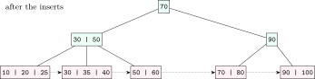

## 10.1 Disks, blocks and records {#sec-dbms-disk}

<div class="nb-proto">

<em><span>Prototypical example for this section:</span> a $2$ KiB block holding $17$ fixed-length records of $120$ bytes.</em>

</div>

### 10.1.i Why the block is the unit of cost {#s10-1-i}

A magnetic disk reads a <strong>sector</strong> only when it passes under the head: an access costs a <strong>seek</strong> (move the arm to the track, milliseconds), a <strong>rotational latency</strong> (wait for the sector, on average half a revolution) and a <strong>transfer</strong> time (the sectors pass under the head). The DBMS reads and writes whole <strong>blocks</strong> (pages) of consecutive sectors; the block size is the DBMS’s choice ($4$–$16$ KiB is typical). Seek and rotation dominate, so <em>the number of block accesses</em> is the cost measure of the rest of this chapter and the next; sequential access is far cheaper than random access. SSDs have no seek, but random access is still much slower than sequential, and writes happen in pages and erase blocks, so the same reasoning applies with smaller constants. Disk scheduling (SCAN, C-LOOK, …) belongs to the OS book.

<div class="nb nb-definition" id="fact-10-1-1">

<strong>Fact 10.1.1</strong> (Disk formulas). capacity $=$ surfaces $\times$ tracks per surface $\times$ sectors per track $\times$ sector size; one revolution takes $60/\text{rpm}$ seconds; average rotational latency $=$ half a revolution; transfer time of $k$ sectors $= k/(\text{sectors per track})$ revolutions; access time $=$ seek $+$ latency $+$ transfer. A CHS address $\langle c,h,s\rangle$ (counted from $0$) is LBA $(c\cdot H+h)\cdot S+s$ for $H$ heads and $S$ sectors per track; back with division and remainder.

</div>

### 10.1.ii Records in blocks {#s10-1-ii}

<div class="nb nb-definition" id="definition-10-1-2">

<strong>Definition 10.1.2</strong>. The <strong>blocking factor</strong> is $\mathit{bfr}=\lfloor B/R\rfloor$ records per block for fixed-length records of $R$ bytes in blocks of $B$ bytes, when records may not cross block boundaries (<strong>unspanned</strong>, the default). A file of $r$ records needs $b=\lceil r/\mathit{bfr}\rceil$ blocks. With <strong>spanned</strong> records (allowed to continue in the next block, needed when $R>B$), no space is wasted: $b=\lceil r R/(B-\text{header})\rceil$. Variable-length records are stored in <strong>slotted pages</strong>: a header with an array of (offset, length) slots growing from the front and the records growing from the back, so records can move within the page while their record id (page, slot) stays fixed.

</div>

The script below does every numerical of this chapter’s first half; read its output with the definitions that follow.

```python {filename="c10-numericals.py, lines 21–46",linenos=table,linenostart=21}
print()
r, R, B, V, P = 50_000, 120, 2048, 10, 6     # records, record, block, key, ptr
bfr = B // R
b = ceil(r / bfr)
print(f"File: r={r} records of R={R} B, block B={B} B,"
      f" key V={V} B, pointer P={P} B")
print(f"   bfr = floor(B/R) = {bfr} (unspanned), blocks b = ceil(r/bfr) = {b}")
print(f"   linear search: {b // 2} block reads on average for a key, {b} worst")
print(f"   sorted file, binary search: ceil(log2 b) = {ceil(log2(b))}")

e = V + P
bfri = B // e
ib = ceil(b / bfri)
print(f"Primary (sparse) index: one entry per block, {e} B per entry, "
      f"{bfri} per block")
print(f"   {b} entries -> {ib} index blocks; binary search "
      f"{ceil(log2(ib))} + 1 data block = {ceil(log2(ib)) + 1}")
sb = ceil(r / bfri)
print(f"Secondary (dense) index on a key: {r} entries -> {sb} index blocks;")
print(f"   binary search {ceil(log2(sb))} + 1 = {ceil(log2(sb)) + 1}")
levels, n = 0, sb
while n > 1:
    n = ceil(n / bfri)
    levels += 1
print(f"Multilevel index (fan-out {bfri}) on the dense index:"
      f" {levels + 1} levels + 1 data block = {levels + 2}")
```

```text {filename="Output (Python 3.11)"}
Disk: 4 surfaces, 10000 tracks/surface, 400 sectors/track,
      512 B/sector, 7200 rpm, average seek 5 ms
   capacity = 8192000000 B = 7.63 GiB
   rotation = 8.333 ms, avg rotational latency = 4.167 ms
   transfer one 4 KiB block = 0.167 ms; random block access = 9.333 ms
CHS -> LBA with 4 heads, 400 sectors/track (sectors numbered from 0):
   <3,2,17> -> 5617
   LBA 10000 -> <6,1,0>

File: r=50000 records of R=120 B, block B=2048 B, key V=10 B, pointer P=6 B
   bfr = floor(B/R) = 17 (unspanned), blocks b = ceil(r/bfr) = 2942
   linear search: 1471 block reads on average for a key, 2942 worst
   sorted file, binary search: ceil(log2 b) = 12
Primary (sparse) index: one entry per block, 16 B per entry, 128 per block
   2942 entries -> 23 index blocks; binary search 5 + 1 data block = 6
Secondary (dense) index on a key: 50000 entries -> 391 index blocks;
   binary search 9 + 1 = 10
Multilevel index (fan-out 128) on the dense index: 3 levels + 1 data block = 4

Block 2048 B, key 10 B, block pointer 6 B, record pointer 7 B:
   B+-tree internal order p = 128 (max 128 children, 127 keys)
   B+-tree leaf: max 120 (key, record pointer) pairs + next-leaf pointer
   B-tree order p = 89 (every node holds keys with record pointers)
   B+-tree with 2 levels: at most 15,360 keys, at least 120 keys
   B+-tree with 3 levels: at most 1,966,080 keys, at least 7,680 keys
   B+-tree with 4 levels: at most 251,658,240 keys, at least 491,520 keys
   levels needed for 10 million keys: 4
```

<div class="nb nb-moral">

Count block accesses, not comparisons: one random block read costs as much as millions of comparisons in memory.

</div>

## 10.2 File organizations and single-level indexes {#sec-dbms-files}

<div class="nb-proto">

<em><span>Prototypical example for this section:</span> the index at the back of a textbook: sorted by topic, pointing to pages that are not sorted by topic.</em>

</div>

### 10.2.i Heap, sorted and hashed files {#s10-2-i}

| Operation ($b$ blocks) | Heap (unordered) | Sorted on the key | Hashed on the key |
|:--|:--|:--|:--|
| scan all | $b$ | $b$ | about $1.25\,b$ (buckets partly empty) |
| equality on the key | $b/2$ average, $b$ if absent | $\lceil \log_2 b\rceil$ (binary search) | about $1$ |
| range on the key | $b$ | $\log_2 b$ + matching blocks | $b$ (hashing destroys order) |
| insert | $1$ read $+$ $1$ write (append) | search $+$ shift: about $b$ | about $2$ |

### 10.2.ii Primary, clustering and secondary indexes {#s10-2-ii}

<div class="nb nb-definition" id="definition-10-2-1">

<strong>Definition 10.2.1</strong>. An <strong>index</strong> on a <strong>search key</strong> is a file of entries (key value, pointer) sorted on the key. It is

- <strong>dense</strong> if it has an entry for every search-key value (every record, for a key), and <strong>sparse</strong> if it has entries for only some (one per block);
- a <strong>primary index</strong> if the data file is sorted on the search key and the key is a candidate key: sparse, one entry per data block (the block’s first key, its <strong>anchor</strong>);
- a <strong>clustering index</strong> if the data file is sorted on a <em>non-key</em> field: one entry per distinct value, pointing to the first block holding it;
- a <strong>secondary index</strong> if it is on any field the file is <em>not</em> sorted by: necessarily dense. On a non-key field it points, per value, to a block of record pointers (an extra level of indirection).

A file can have at most one primary or clustering index (it can be sorted only one way) and any number of secondary indexes. The index at the back of a book is a secondary index: the book is not sorted by topic.

</div>

<div class="nb nb-example nb-block" id="example-10-2-2">

<strong>Example 10.2.2</strong> (Reading the numbers)

$50000$ records of $120$ B in $2048$ B blocks: $17$ per block, $2942$ blocks. Linear search reads $1471$ blocks on average; binary search on the sorted file $12$. A primary index has one $16$-byte entry per data block, $128$ per index block, so $23$ index blocks: $\lceil \log_2 23\rceil+1=6$ accesses. A dense secondary index needs $50000$ entries, $391$ blocks, $9+1=10$ accesses; still far better than $1471$.

</div>

### 10.2.iii Multilevel indexes {#s10-2-iii}

An index is itself a sorted file, so index it again: a sparse index on the first level, then on the second, until the top level fits in one block. With <strong>fan-out</strong> $f$ (entries per index block), $t$ levels cover $f^t$ first-level blocks, and a search costs one block per level plus one data block: $4$ accesses for the $391$-block dense index above ($391\to4\to1$). A static multilevel index over a sorted file is <strong>ISAM</strong>; it degrades with overflow chains under inserts, which is what B$^+$-trees fix.

<div class="nb nb-moral">

Sparse needs a sorted file; dense works on anything. One sort order per file means one primary or clustering index; everything else is secondary.

</div>

## 10.3 B-trees and B$^+$-trees {#sec-dbms-btree}

<div class="nb-proto">

<em><span>Prototypical example for this section:</span> a B$^+$-tree of order $4$ built from $10,20,\dots,100,25,35$.</em>

</div>

### 10.3.i Structure {#s10-3-i}

<div class="nb nb-definition" id="definition-10-3-1">

<strong>Definition 10.3.1</strong>. A <strong>B$^+$-tree</strong> of order $p$ is a balanced search tree in which every node is a disk block:

- an internal node has at most $p$ children and $p-1$ keys; every non-root internal node has at least $\lceil p/2\rceil$ children; the root has at least $2$ (unless it is a leaf);
- all keys with their record pointers are in the <strong>leaves</strong>, which are at one depth and are chained left to right by a next-leaf pointer; each non-root leaf holds between $\lceil (p-1)/2\rceil$ and $p-1$ keys (textbooks differ by one here: say which convention you use);
- internal keys are only <strong>separators</strong>: the subtree left of key $k$ holds keys $<k$, the subtree right of it keys $\ge k$.

A <strong>B-tree</strong> differs in two ways: every key appears exactly once, in some node, with its record pointer (internal nodes included), and there is no leaf chain.

</div>

<div class="nb nb-definition" id="fact-10-3-2">

<strong>Fact 10.3.2</strong> (Node-size inequalities). With block size $B$, key size $K$, block (tree) pointer $P_b$ and record pointer $P_r$: B$^+$-tree internal node $p\,P_b+(p-1)K\le B$; B$^+$-tree leaf $n\,(K+P_r)+P_b\le B$ for $n$ entries; B-tree node $p\,P_b+(p-1)(K+P_r)\le B$. Take the largest integer that fits. B$^+$-tree internal nodes carry no record pointers, so their fan-out is larger and the tree is shallower than a B-tree on the same block.

</div>

```python {filename="c10-numericals.py, lines 48–66",linenos=table,linenostart=48}
print()
K, Pb, Pr = 10, 6, 7                    # key, block ptr, record ptr
p = (B + K) // (Pb + K)                      # p*Pb + (p-1)*K <= B
pl = (B - Pb) // (K + Pr)                    # pl*(K+Pr) + Pb <= B
pt = (B + K + Pr) // (Pb + K + Pr)           # B-tree: p*Pb + (p-1)*(K+Pr) <= B
print(f"Block {B} B, key {K} B, block pointer {Pb} B, record pointer {Pr} B:")
print(f"   B+-tree internal order p = {p} (max {p} children, {p - 1} keys)")
print(f"   B+-tree leaf: max {pl} (key, record pointer) pairs"
      " + next-leaf pointer")
print(f"   B-tree order p = {pt} (every node holds keys with record pointers)")
for h in (1, 2, 3):                     # h = levels below the root
    mx = pl * p ** h
    mn = 2 * ceil(p / 2) ** (h - 1) * ceil(pl / 2)
    print(f"   B+-tree with {h + 1} levels: at most {mx:,} keys,"
          f" at least {mn:,} keys")
need = 1
while pl * p ** (need - 1) < 10**7:
    need += 1
print(f"   levels needed for 10 million keys: {need}")
```

The last block of the output above gives $p=128$ for internal nodes, $120$ entries per leaf and B-tree order $89$; four levels hold up to $120\cdot128^3\approx2.5\times10^8$ keys, so ten million keys need four levels and any lookup costs four index blocks plus the data block.

<div class="nb nb-theorem nb-block" id="theorem-10-3-3">

<strong>Theorem 10.3.3</strong> (Height bounds)

Let a B$^+$-tree have $h$ levels below the root, maximum fan-out $p$, at most $L$ keys per leaf and at least $l$ keys per non-root leaf. Then the number of keys $n$ satisfies $2\lceil p/2\rceil^{h-1}\,l \le n\le p^h L$ (for $h\ge1$), so the height is $\Theta(\log_{p} n)$. Every search, successful or not, costs exactly $h+1$ node reads: it always ends in a leaf, because internal keys are only separators (and may even be stale after deletions). In any B or B$^+$-tree, the number of leaves is one more than the number of keys in internal nodes.

</div>

### 10.3.ii Insertion and deletion, traced {#s10-3-ii}

<div class="nb nb-remark" id="algorithm-10-3-4">

<strong>Algorithm 10.3.4</strong> (Insertion) — Find the leaf and insert in key order. If it overflows ($p$ keys), split it: the left half keeps $\lceil p/2\rceil$ keys, and the first key of the right half is <em>copied</em> up into the parent. If the parent overflows, split it too, but <em>move</em> its middle key up (it does not stay below). A split of the root makes a new root: the tree grows at the top, which is why all leaves stay at the same depth.

</div>

<div class="nb nb-remark" id="algorithm-10-3-5">

<strong>Algorithm 10.3.5</strong> (Deletion) — Remove the key from its leaf. If the leaf underflows, <strong>borrow</strong> a key from an adjacent sibling that has more than the minimum (and fix the separator in the parent), or else <strong>merge</strong> with a sibling and delete the separator from the parent, which may underflow in turn (internal borrows rotate a key through the parent; internal merges pull the separator down). If the root loses its last key, its only child becomes the root and the tree gets shorter.

</div>

`lib/bptree.py` implements exactly these rules and logs each action:

```python {filename="c10-bptree.py"}
# Build a B+-tree of order p = 4 (max 3 keys per node) and show every step
# that changes the shape of the tree.
from bptree import BPlusTree

t = BPlusTree(4)


def op(kind, key):
    t.log.clear()
    (t.insert if kind == "insert" else t.delete)(key)
    assert t.leaves() == sorted(t.leaves())    # leaf chain stays sorted
    if not t.log:
        print(f"{kind} {key}: fits, no restructuring")
        return
    print(f"{kind} {key}:")
    for event in t.log:
        print("    " + event)
    for line in t.levels():
        print("        " + line)


for k in [10, 20, 30, 40, 50, 60, 70, 80, 90, 100, 25, 35]:
    op("insert", k)
print("final tree after the inserts:")
for line in t.levels():
    print("        " + line)
for k in [100, 25, 20, 35]:
    op("delete", k)
print("leaf chain:", t.leaves())
```

```text {filename="Output (Python 3.11)"}
insert 10: fits, no restructuring
insert 20: fits, no restructuring
insert 30: fits, no restructuring
insert 40:
    split leaf -> [10, 20] [30, 40], copy up 30
    new root [30]
        [30]
        [10 20]  [30 40]
insert 50: fits, no restructuring
insert 60:
    split leaf -> [30, 40] [50, 60], copy up 50
        [30 50]
        [10 20]  [30 40]  [50 60]
insert 70: fits, no restructuring
insert 80:
    split leaf -> [50, 60] [70, 80], copy up 70
        [30 50 70]
        [10 20]  [30 40]  [50 60]  [70 80]
insert 90: fits, no restructuring
insert 100:
    split leaf -> [70, 80] [90, 100], copy up 90
    split internal -> [30, 50] [90], move up 70
    new root [70]
        [70]
        [30 50]  [90]
        [10 20]  [30 40]  [50 60]  [70 80]  [90 100]
insert 25: fits, no restructuring
insert 35: fits, no restructuring
final tree after the inserts:
        [70]
        [30 50]  [90]
        [10 20 25]  [30 35 40]  [50 60]  [70 80]  [90 100]
delete 100:
    merge -> [70, 80, 90], separator 90 removed
    borrow from left, separator 50
        [50]
        [30]  [70]
        [10 20 25]  [30 35 40]  [50 60]  [70 80 90]
delete 25: fits, no restructuring
delete 20:
    borrow from right, separator 35
        [50]
        [35]  [70]
        [10 30]  [35 40]  [50 60]  [70 80 90]
delete 35:
    merge -> [10, 30, 40], separator 35 removed
    merge -> [50, 70], separator 50 removed
    root emptied: height shrinks
        [50 70]
        [10 30 40]  [50 60]  [70 80 90]
leaf chain: [10, 30, 40, 50, 60, 70, 80, 90]
```

<figure class="nb-fig"></figure>

<figure class="nb-fig"></figure>

<div class="nb nb-example nb-block" id="example-10-3-6">

<strong>Example 10.3.6</strong> (Reading the trace)

Inserting $40$ overflows the only leaf $[10,20,30,40]$: it splits into $[10,20]$ and $[30,40]$, and $30$ is copied up into a new root. Inserting $100$ splits the leaf $[70,80,90,100]$, copying $90$ up; the root $[30,50,70,90]$ now has four keys and splits, moving $70$ up into a new root: height $3$. Deleting $100$ leaves $[90]$ below the minimum of $2$; its sibling $[70,80]$ has no key to spare, so they merge, the internal node $[90]$ loses its only key and borrows through the root from $[30,50]$ ($50$ goes up, $70$ comes down). Deleting $20$ borrows $30$ from the right leaf. Deleting $35$ causes a leaf merge, then an internal merge, and the empty root disappears: the tree shrinks to two levels.

</div>

<div class="nb nb-remark" id="remark-10-3-7">

<strong>Remark 10.3.7</strong> (Exam conventions) — The order may be defined as the maximum number of children (as here), the maximum number of keys, or the minimum number of children (Knuth vs. Bayer–McCreight); split points may be left- or right-biased when the count is odd. Every answer is right under <em>some</em> convention, so state yours, and keep it for the whole question.

</div>

<div class="nb nb-moral">

B$^+$-trees keep all data in a chained, sorted leaf level under a fat, shallow index: equality searches cost the height, range scans follow the leaf chain.

</div>

## 10.4 Hash indexes {#sec-dbms-hash}

<div class="nb-proto">

<em><span>Prototypical example for this section:</span> extendible hashing doubling its directory instead of rehashing the whole file.</em>

</div>

<div class="nb nb-definition" id="definition-10-4-1">

<strong>Definition 10.4.1</strong>. <strong>Static hashing</strong> maps a key to one of $N$ buckets with $h(k)\bmod N$; a full bucket gets an overflow chain, and as the file grows the chains make lookups slow, while rehashing everything is expensive. <strong>Extendible hashing</strong> keeps a <strong>directory</strong> of $2^d$ pointers indexed by the last $d$ bits of $h(k)$ (the <strong>global depth</strong>); each bucket has a <strong>local depth</strong> $d'\le d$, and $2^{d-d'}$ directory entries point to it. When a bucket overflows: if $d'<d$, split it into two buckets of depth $d'+1$ and repoint half of its entries; if $d'=d$, first double the directory ($d+1$), then split. <strong>Linear hashing</strong> has no directory: buckets are split one at a time in round-robin order (a split pointer moves through the file) whenever the load exceeds a threshold, using $h_i(k)=h(k)\bmod 2^iN$ and $h_{i+1}$ for buckets already split in this round; overflow chains are temporary.

</div>

```python {filename="c10-exthash.py, lines 26–51",linenos=table,linenostart=26}
def insert(k):
    global gd, directory
    events = []
    while True:
        b = directory[k % (1 << gd)]
        if len(b.keys) < CAP:
            b.keys.append(k)
            break
        if b.depth == gd:                       # no spare bit: double directory
            directory = directory + directory
            gd += 1
            events.append(f"double directory to global depth {gd}")
        b.depth += 1                            # split on the next bit
        new = Bucket(b.depth)
        bit = 1 << (b.depth - 1)
        old, b.keys = b.keys, []
        for x in old:
            (new if x & bit else b).keys.append(x)
        for j in range(len(directory)):
            if directory[j] is b and j & bit:
                directory[j] = new
        events.append(f"split bucket on bit {b.depth - 1}")
    if events:
        show(f"insert {k:2} ({k:05b}): " + "; ".join(events))
    else:
        print(f"insert {k:2} ({k:05b}): fits")
```

```text {filename="Output (Python 3.11)"}
insert  4 (00100): fits
insert  9 (01001): fits
insert 12 (01100): fits
insert  5 (00101): fits
insert  6 (00110): double directory to global depth 2; split bucket on bit 1
    00           local depth 2: [4, 12]
    01,11        local depth 1: [5, 9]
    10           local depth 2: [6]
insert  7 (00111): split bucket on bit 1
    00           local depth 2: [4, 12]
    01           local depth 2: [5, 9]
    10           local depth 2: [6]
    11           local depth 2: [7]
insert  8 (01000): double directory to global depth 3; split bucket on bit 2
    000          local depth 3: [8]
    001,101      local depth 2: [5, 9]
    010,110      local depth 2: [6]
    011,111      local depth 2: [7]
    100          local depth 3: [4, 12]
```

Inserting $6$ overflows bucket $0$ whose local depth equals the global depth, so the directory doubles (entries $01$ and $11$ still share the old bucket of depth $1$) and the bucket splits on bit $1$. Inserting $7$ overflows that shared bucket, which has local depth $1<2$: it splits without touching the directory size. Inserting $8$ doubles again.

<div class="nb nb-definition" id="fact-10-4-2">

<strong>Fact 10.4.2</strong>. A hash index answers equality in about one or two block reads but cannot answer range queries or `ORDER BY`, and many identical keys (skew) defeat it: no split can separate equal hash values. That is why B$^+$-trees are the default index everywhere and hash indexes are the exception (PostgreSQL has `USING HASH`; in-memory hash tables are used heavily inside hash joins, [Chapter 11](../11-query/)).

</div>

## 10.5 Indexes in practice: clustering, covering, composite {#sec-dbms-index-sql}

<div class="nb-proto">

<em><span>Prototypical example for this section:</span> an index on `(dept, city)` that helps `WHERE dept = 7` but not, as a seek, `WHERE city = 'city7'`.</em>

</div>

<div class="nb nb-definition" id="definition-10-5-1">

<strong>Definition 10.5.1</strong>. A <strong>clustered index</strong> stores (or orders) the table rows themselves in index order: InnoDB and SQL Server tables are clustered on their primary key, so a primary-key range is a sequential read; every other (<strong>non-clustered</strong>, secondary) index stores the key plus a row locator (the primary key in InnoDB, a row id elsewhere) and needs an extra lookup per row. A table has at most one clustered index. PostgreSQL tables are heaps; `CLUSTER` reorders once but is not maintained. A <strong>covering index</strong> contains every column a query needs, so the table is never touched (an <strong>index-only scan</strong>); PostgreSQL and SQL Server can add non-key columns with `INCLUDE (...)`.

</div>

<div class="nb nb-theorem nb-block" id="theorem-10-5-2">

<strong>Theorem 10.5.2</strong> (The left-prefix rule)

A B$^+$-tree on $(a,b,c)$ is sorted by $a$, then $b$ within $a$, then $c$. It supports seeks for conditions on a <em>prefix</em> of the columns: $a$; $a,b$; $a,b,c$; equality on $a$ with a range on $b$. A condition on $b$ alone has no prefix, so it cannot seek; the engine may still scan the whole (smaller) index or use a <strong>skip scan</strong> (one seek per distinct $a$) when $a$ has few values. Column order should therefore follow the queries: equality columns first, then the range column.

</div>

SQLite after `ANALYZE` (each `dept` has $400$ rows, `city` $300$ values):

```sql {filename="c10-explain-lite.sql"}
CREATE TABLE emp (id INTEGER PRIMARY KEY, dept INTEGER, city TEXT,
                  salary INTEGER, notes TEXT);
INSERT INTO emp
  WITH RECURSIVE n(i) AS (SELECT 1 UNION ALL SELECT i + 1 FROM n
                          WHERE i < 20000)
  SELECT i, i % 50, 'city' || (i % 300), 1000 + (i * 37) % 9000, 'x'
  FROM n;
CREATE INDEX idx_dept_city ON emp (dept, city);
ANALYZE;

-- Q1 equality on the leading column: index search
EXPLAIN QUERY PLAN SELECT * FROM emp WHERE dept = 7;
-- Q2 both columns of the composite index
EXPLAIN QUERY PLAN SELECT * FROM emp WHERE dept = 7 AND city = 'city7';
-- Q3 only the second column: no left prefix (but see the skip-scan)
EXPLAIN QUERY PLAN SELECT * FROM emp WHERE city = 'city7';
-- Q4 every needed column is in the index: covering index
EXPLAIN QUERY PLAN SELECT city FROM emp WHERE dept = 7;
-- Q5 a function of the column hides it from the index
EXPLAIN QUERY PLAN SELECT * FROM emp WHERE dept + 0 = 7;
```

```text {filename="Result on SQLite 3.45.1"}
-- Q1 equality on the leading column: index search
 query plan
-----------------------------------------------
 SEARCH emp USING INDEX idx_dept_city (dept=?)
(1 row)

-- Q2 both columns of the composite index
 query plan
----------------------------------------------------------
 SEARCH emp USING INDEX idx_dept_city (dept=? AND city=?)
(1 row)

-- Q3 only the second column: no left prefix (but see the skip-scan)
 query plan
-------------------------------------------------------------
 SEARCH emp USING INDEX idx_dept_city (ANY(dept) AND city=?)
(1 row)

-- Q4 every needed column is in the index: covering index
 query plan
--------------------------------------------------------
 SEARCH emp USING COVERING INDEX idx_dept_city (dept=?)
(1 row)

-- Q5 a function of the column hides it from the index
 query plan
------------
 SCAN emp
(1 row)
```

The same table on PostgreSQL:

```sql {filename="c10-explain-postgres.sql"}
CREATE TABLE emp (id INTEGER PRIMARY KEY, dept INTEGER, city TEXT,
                  salary INTEGER, notes TEXT);
INSERT INTO emp
  SELECT i, i % 50, 'city' || (i % 300), 1000 + (i * 37) % 9000, 'x'
  FROM generate_series(1, 20000) AS i;
CREATE INDEX idx_dept_city ON emp (dept, city);
VACUUM ANALYZE emp;

-- Q1 2 rows out of 20000: index scan
EXPLAIN (COSTS OFF) SELECT * FROM emp WHERE dept = 7 AND city = 'city7';
-- Q2 only the second column: no seek, but the whole index is scanned
EXPLAIN (COSTS OFF) SELECT * FROM emp WHERE city = 'city7';
-- Q3 all needed columns are in the index: index-only scan
EXPLAIN (COSTS OFF) SELECT city FROM emp WHERE dept = 7 AND city = 'city7';
-- Q4 400 rows (2%): bitmap scan, pages fetched in physical order
EXPLAIN (COSTS OFF) SELECT * FROM emp WHERE dept = 7;
-- Q5 most rows qualify: the index is not worth it
EXPLAIN (COSTS OFF) SELECT * FROM emp WHERE dept > 2;
```

```text {filename="Result on PostgreSQL 16.14"}
-- Q1 2 rows out of 20000: index scan
 query plan
-------------------------------------------------------
 Index Scan using idx_dept_city on emp
   Index Cond: ((dept = 7) AND (city = 'city7'::text))
(2 rows)

-- Q2 only the second column: no seek, but the whole index is scanned
 query plan
--------------------------------------------
 Bitmap Heap Scan on emp
   Recheck Cond: (city = 'city7'::text)
   ->  Bitmap Index Scan on idx_dept_city
         Index Cond: (city = 'city7'::text)
(4 rows)

-- Q3 all needed columns are in the index: index-only scan
 query plan
-------------------------------------------------------
 Index Only Scan using idx_dept_city on emp
   Index Cond: ((dept = 7) AND (city = 'city7'::text))
(2 rows)

-- Q4 400 rows (2%): bitmap scan, pages fetched in physical order
 query plan
------------------------------------------
 Bitmap Heap Scan on emp
   Recheck Cond: (dept = 7)
   ->  Bitmap Index Scan on idx_dept_city
         Index Cond: (dept = 7)
(4 rows)

-- Q5 most rows qualify: the index is not worth it
 query plan
----------------------
 Seq Scan on emp
   Filter: (dept > 2)
(2 rows)
```

<div class="nb nb-example nb-block" id="example-10-5-3">

<strong>Example 10.5.3</strong> (Reading the plans)

Seeks on a prefix appear as `SEARCH ... USING INDEX (dept=?)` in SQLite and `Index Scan` with an `Index Cond` in PostgreSQL. For `city` alone, SQLite’s statistics show only $50$ departments, so it chooses a skip-scan (`ANY(dept)`), and PostgreSQL scans the whole index in a bitmap: neither can seek on `city`. Selecting only indexed columns gives `COVERING INDEX` / `Index Only Scan`. For $400$ of $20000$ rows PostgreSQL uses a <strong>bitmap scan</strong>: collect the matching row ids from the index, sort them by page, and read each heap page once. When most rows qualify (`dept > 2`) a sequential scan is cheaper than any index, and wrapping the column in an expression (`dept + 0`) hides it from the index entirely.

</div>

<div class="nb nb-remark" id="remark-10-5-4">

<strong>Remark 10.5.4</strong> (When an index does not help, or hurts) — Low selectivity (most rows match), tiny tables, functions or implicit casts on the indexed column (`WHERE LOWER(name) = ...` needs an expression index), leading wildcards (`LIKE '%x'`), `OR` across different columns (unless the engine combines bitmaps), and write-heavy tables, where every extra index costs on every insert. Indexing a column with two values (gender) is usually useless for reads.

</div>

<div class="nb nb-moral">

Put equality columns first in a composite index, make hot queries covering, and read `EXPLAIN` instead of guessing.

</div>
