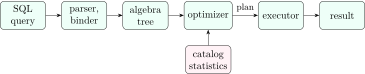

## 11.1 From SQL to a plan {#sec-dbms-qp}

<div class="nb-proto">

<em><span>Prototypical example for this section:</span> `SELECT e.id FROM emp e JOIN dept d ON ... WHERE d.region = 3`: four correct plans, one cheapest.</em>

</div>

<figure class="nb-fig"></figure>

The parser checks syntax and resolves names against the catalog; the query becomes a relational-algebra tree; the optimizer chooses among equivalent trees ([Section 2.5](../02-algebra/#sec-dbms-ra-equiv)) and, for each operator, an <em>algorithm</em> (which index, which join method), estimating costs from statistics; the executor runs the chosen <strong>plan</strong>.

<div class="nb nb-definition" id="definition-11-1-1">

<strong>Definition 11.1.1</strong>. In the <strong>iterator</strong> (Volcano) model each operator implements `open()`, `next()` (return one tuple) and `close()`, and pulls tuples from its children on demand. <strong>Pipelining</strong> passes each tuple up as soon as it is produced; an operator that needs all its input first (sort, hash-table build, aggregation without a sorted input) <strong>blocks</strong> the pipeline, and an intermediate result that is written out in full is <strong>materialized</strong>.

</div>

<div class="nb nb-definition" id="fact-11-1-2">

<strong>Fact 11.1.2</strong> (The cost model). Cost is measured in block transfers and seeks (a seek is a random access, a transfer reads one block): $t_T\cdot \text{transfers}+t_S\cdot \text{seeks}$. CPU cost and the final write of the result are usually ignored, and the worst case assumes one buffer block per input unless $M$ blocks of memory are given. Statistics used: $n_r$ (tuples), $b_r$ (blocks), $V(A,r)$ (distinct values of $A$), min/max, histograms.

</div>

## 11.2 Selection, sorting and joins {#sec-dbms-joins-algo}

<div class="nb-proto">

<em><span>Prototypical example for this section:</span> joining $6000$ employees ($150$ blocks) with $12000$ assignments ($500$ blocks).</em>

</div>

### 11.2.i Selection {#s11-2-i}

A linear scan costs $b_r$ (half on average for equality on a key). Binary search on a file sorted by $A$ costs about $\lceil \log_2 b_r\rceil$ plus the blocks of matches. A B$^+$-tree primary (clustered) index: $h$ (the height) plus the blocks holding the matches, contiguous for a range. A secondary index: $h$ plus up to <em>one block per matching record</em>, which is why it loses to a scan when many rows match. A conjunction can use one index and filter, or intersect row-id sets from several indexes (bitmap `AND`); a disjunction needs every disjunct indexed (bitmap `OR`), else a scan.

### 11.2.ii External merge sort {#s11-2-ii}

<div class="nb nb-remark" id="algorithm-11-2-1">

<strong>Algorithm 11.2.1</strong> (External merge sort with $M$ buffer blocks) — Pass $0$: read $M$ blocks at a time, sort them in memory, write a sorted <strong>run</strong>: $\lceil b/M\rceil$ runs. Each merge pass merges $M-1$ runs at a time (one output buffer), so $\lceil \log_{M-1}\lceil b/M\rceil \rceil$ passes are needed. Every pass reads and writes all $b$ blocks, except that the final output is not written:

$$
\text{transfers}=b\,\big(2\lceil \log_{M-1}(b/M)\rceil+1\big).
$$

</div>

The script simulates the sort block by block, checks that the output is sorted, and compares its transfer count with the formula:

```text {filename="Output (Python 3.11)"}
b =  150, M = 25:   6 runs, 1 merge passes,   450 transfers (formula 450)
b =  500, M = 25:  20 runs, 1 merge passes,  1500 transfers (formula 1500)
b = 1000, M =  5: 200 runs, 4 merge passes,  9000 transfers (formula 9000)
b =   64, M =  3:  22 runs, 5 merge passes,   704 transfers (formula 704)
```

Two passes ($0$ and one merge) are enough whenever $b\le M(M-1)$: with $M=25$ that is $600$ blocks, and with $M=1024$ pages of $8$ KB ($8$ MB of memory) about $8$ GB. That is why real sorts almost never need more than one merge pass.

### 11.2.iii Join algorithms {#s11-2-iii}

<div class="nb nb-definition" id="definition-11-2-2">

<strong>Definition 11.2.2</strong>. For $r\bowtie_\theta s$ with $r$ the <strong>outer</strong> (left) input:

- <strong>nested-loop join</strong>: for each tuple of $r$, scan all of $s$; works for any $\theta$;
- <strong>block nested-loop join</strong>: for each <em>block</em> (or chunk of $M-2$ blocks) of $r$, scan $s$ once and match all pairs in memory;
- <strong>indexed nested-loop join</strong>: for each tuple of $r$, look up the matching tuples of $s$ in an index on the join attribute (equality or range);
- <strong>sort-merge join</strong>: sort both inputs on the join attribute and merge them (equijoins; duplicates of a value on both sides need all pairs);
- <strong>hash join</strong>: partition both inputs with the same hash function on the join attribute, then for each partition build an in-memory hash table on the smaller input’s partition (the <strong>build</strong> input) and probe it with the other’s (equijoins only).

</div>

```python {filename="c11-joincost.py, lines 16–41",linenos=table,linenostart=16}
print(f"r: {nr} tuples in {br} blocks; s: {ns} tuples in {bs} blocks; M = {M}")
row("nested loop, r outer", nr * bs + br, nr + br)
row("nested loop, s outer", ns * br + bs, ns + bs)
row("nested loop, both fit in memory", br + bs, 2)
row("block nested loop, r outer, 2 buffers", br * bs + br, 2 * br)
row("block nested loop, s outer, 2 buffers", bs * br + bs, 2 * bs)
chunks = ceil(br / (M - 2))
row(f"block nested loop, r outer, M = {M}", chunks * bs + br, 2 * chunks)
row(f"index nested loop, B+-tree on s, h={h}", br + nr * (h + 1),
    br + nr * (h + 1))


def sort_cost(b):
    runs = ceil(b / M)
    passes = ceil(log(runs, M - 1)) if runs > 1 else 0
    return b * (2 * passes + 1), runs, passes        # final pass not written


sr, runs_r, pr_ = sort_cost(br)
ss, runs_s, ps_ = sort_cost(bs)
print(f"  sort r: {runs_r} runs, {pr_} merge pass(es), {sr} transfers")
print(f"  sort s: {runs_s} runs, {ps_} merge pass(es), {ss} transfers")
row("sort-merge join (both unsorted)", sr + ss + br + bs)
row("sort-merge join (both already sorted)", br + bs, 2)
print(f"  hash join, build on r: needs M > sqrt(br) = {br ** 0.5:.1f}")
row("hash join (no recursive partitioning)", 3 * (br + bs))
```

```text {filename="Output (Python 3.11)"}
r: 6000 tuples in 150 blocks; s: 12000 tuples in 500 blocks; M = 25
  nested loop, r outer                 3,000,150 transfers   6,150 seeks
  nested loop, s outer                 1,800,500 transfers  12,500 seeks
  nested loop, both fit in memory            650 transfers       2 seeks
  block nested loop, r outer, 2 buffers    75,150 transfers     300 seeks
  block nested loop, s outer, 2 buffers    75,500 transfers   1,000 seeks
  block nested loop, r outer, M = 25       3,650 transfers      14 seeks
  index nested loop, B+-tree on s, h=3    24,150 transfers  24,150 seeks
  sort r: 6 runs, 1 merge pass(es), 450 transfers
  sort s: 20 runs, 1 merge pass(es), 1500 transfers
  sort-merge join (both unsorted)          2,600 transfers 
  sort-merge join (both already sorted)       650 transfers       2 seeks
  hash join, build on r: needs M > sqrt(br) = 12.2
  hash join (no recursive partitioning)     1,950 transfers 
join orders of n relations:  left-deep n!   all trees (2(n-1))!/(n-1)!
  n = 2:      2            2
  n = 3:      6           12
  n = 4:     24          120
  n = 5:    120         1680
  n = 6:    720        30240
```

<div class="nb nb-theorem nb-block" id="theorem-11-2-3">

<strong>Theorem 11.2.3</strong> (Costs in block transfers)

Nested loop: $n_r\,b_s+b_r$ ($n_r+b_r$ seeks); if both fit in memory, $b_r+b_s$. Block nested loop: $b_r\,b_s+b_r$ with one block per input, and $\lceil b_r/(M-2)\rceil \,b_s+b_r$ with $M$ buffers. Indexed nested loop: $b_r+n_r\,c$, where $c$ is the cost of one index lookup ($h+1$ for a B$^+$-tree with one match). Sort-merge: sorting costs plus $b_r+b_s$. Hash join: $3(b_r+b_s)$ when the build input’s partitions fit in memory, roughly $M>\sqrt{b_{\text{build}}}$; otherwise partitions are partitioned again.

</div>

<div class="nb nb-example nb-block" id="example-11-2-4">

<strong>Example 11.2.4</strong> (Reading the table)

Tuple-at-a-time nested loop costs three million transfers with the small relation outside; putting the <em>larger</em> relation outside lowers transfers ($n_s b_r$ is smaller here) but not seeks. Block nested loop with $2$ buffers is $\approx75000$; with $M=25$ it drops to $3650$, because $s$ is scanned once per $23$-block chunk of $r$ ($7$ times). Make the smaller relation the outer one in block nested loop. Indexed nested loop pays a random lookup per outer tuple: $24150$, worse than a scan-based join here, better when $r$ is small or selective. Sort-merge ($2600$) and hash join ($1950$) read each input a small constant number of times; that is why they dominate large equijoins.

</div>

<div class="nb nb-definition" id="fact-11-2-5">

<strong>Fact 11.2.5</strong> (Other operators). Duplicate elimination, `GROUP BY` and set operations are implemented by sorting (equal values become adjacent) or by hashing (equal values land in the same bucket), with the same costs as a sort or a hash partitioning. Projection without `DISTINCT` is free during a scan. Only nested loops can evaluate arbitrary non-equality join conditions.

</div>

<div class="nb nb-moral">

Block nested loop with the smaller relation outside, hash join for big equijoins, sort-merge when the inputs are already sorted, index nested loop when the outer side is small.

</div>

## 11.3 Choosing the plan {#sec-dbms-optimizer}

<div class="nb-proto">

<em><span>Prototypical example for this section:</span> estimating that `salary < 1500` keeps about $1122$ of $20000$ rows.</em>

</div>

### 11.3.i Heuristics {#s11-3-i}

Before costing, every optimizer applies the equivalences that are almost always profitable: perform selections as early as possible (they shrink inputs), project away unneeded attributes early, replace a selection over a Cartesian product by a join, and avoid Cartesian products in the join order unless a relation is tiny.

### 11.3.ii Cost-based optimization {#s11-3-ii}

<div class="nb nb-definition" id="fact-11-3-1">

<strong>Fact 11.3.1</strong> (Selectivity estimates, assuming uniformity and independence). Estimated output sizes, from the catalog statistics:

- $\sigma_{A=v}(r)$: $n_r/V(A,r)$ tuples (or the histogram/most-common-value frequency).
- $\sigma_{A\le v}(r)$: $n_r\cdot \frac{v-\min(A)}{\max(A)-\min(A)}$.
- conjunction: multiply the selectivities; disjunction: $1-\prod_i(1-s_i)$; negation: $1-s$.
- $r\bowtie_A s$: $\frac{n_r n_s}{\max(V(A,r),V(A,s))}$; if $A$ is a key of $s$ and a foreign key in $r$, exactly $n_r$; with no common attribute, $n_r n_s$.

</div>

Errors multiply through a plan: the independence assumption is wrong for correlated columns (city and pin code), which is why systems add multi-column statistics.

<div class="nb nb-definition" id="fact-11-3-2">

<strong>Fact 11.3.2</strong> (Join ordering). There are $n!$ left-deep join orders of $n$ relations and $(2(n-1))!/(n-1)!$ join trees of any shape (the last block of the output above: $30240$ for six relations). System R-style optimizers use dynamic programming over subsets of relations, keeping the cheapest plan for each subset (and each “interesting” sort order), usually restricted to left-deep trees so that the inner input can be an index or a hash table; it explores $2^n$ subsets instead of $n!$ orders. Beyond roughly a dozen relations, PostgreSQL switches to a genetic search.

</div>

### 11.3.iii Reading EXPLAIN {#s11-3-iii}

```sql {filename="c11-explain.sql"}
CREATE TABLE dept (id INTEGER PRIMARY KEY, region INTEGER);
CREATE TABLE emp (id INTEGER PRIMARY KEY, dept_id INTEGER, salary INTEGER);
INSERT INTO dept SELECT i, i % 10 FROM generate_series(1, 200) i;
INSERT INTO emp SELECT i, 1 + i % 200, 1000 + (i * 37) % 9000
  FROM generate_series(1, 20000) i;
ANALYZE dept;
ANALYZE emp;

-- Q1 estimated rows vs actual rows, with the planner's cost units
EXPLAIN (ANALYZE, TIMING OFF, SUMMARY OFF)
SELECT * FROM emp WHERE salary < 1500;

-- Q2 the join the optimizer picks
EXPLAIN (COSTS OFF)
SELECT e.id FROM emp e JOIN dept d ON e.dept_id = d.id WHERE d.region = 3;

SET enable_hashjoin = off;
SET enable_nestloop = off;
-- Q3 hash join and nested loop disabled: sort-merge join
EXPLAIN (COSTS OFF)
SELECT e.id FROM emp e JOIN dept d ON e.dept_id = d.id WHERE d.region = 3;

SET enable_nestloop = on;
SET enable_mergejoin = off;
-- Q4 only nested loop allowed: it probes the primary-key index of dept
EXPLAIN (COSTS OFF)
SELECT e.id FROM emp e JOIN dept d ON e.dept_id = d.id WHERE d.region = 3;
```

```text {filename="Result on PostgreSQL 16.14"}
-- Q1 estimated rows vs actual rows, with the planner's cost units
 query plan
------------------------------------------------------------------------------
 Seq Scan on emp  (cost=0.00..359.00 rows=1122 width=12) (actual rows=1121 loops=1)
   Filter: (salary < 1500)
   Rows Removed by Filter: 18879
(3 rows)

-- Q2 the join the optimizer picks
 query plan
------------------------------------
 Hash Join
   Hash Cond: (e.dept_id = d.id)
   ->  Seq Scan on emp e
   ->  Hash
         ->  Seq Scan on dept d
               Filter: (region = 3)
(6 rows)

-- Q3 hash join and nested loop disabled: sort-merge join
 query plan
------------------------------------
 Merge Join
   Merge Cond: (e.dept_id = d.id)
   ->  Sort
         Sort Key: e.dept_id
         ->  Seq Scan on emp e
   ->  Sort
         Sort Key: d.id
         ->  Seq Scan on dept d
               Filter: (region = 3)
(9 rows)

-- Q4 only nested loop allowed: it probes the primary-key index of dept
 query plan
--------------------------------------------------
 Nested Loop
   ->  Seq Scan on emp e
   ->  Memoize
         Cache Key: e.dept_id
         Cache Mode: logical
         ->  Index Scan using dept_pkey on dept d
               Index Cond: (id = e.dept_id)
               Filter: (region = 3)
(8 rows)
```

<div class="nb nb-example nb-block" id="example-11-3-3">

<strong>Example 11.3.3</strong> (Reading the plans)

Q1 prints the planner’s estimate (`rows=1122`, from the column’s histogram) beside the actual count ($1121$): a good estimate. Costs are in arbitrary units (sequential page reads $=1$); the first number is the start-up cost, the second the total. In Q2 the optimizer filters `dept` to the $20$ departments of region $3$, builds a hash table on them (the small build input) and probes it with every employee. Forbidding hash joins and nested loops gives the sort-merge plan with two explicit `Sort` nodes (Q3); allowing only nested loops gives an indexed nested-loop join that probes `dept_pkey` once per employee, with a `Memoize` cache in front because many employees share a department (Q4). The `enable_*` switches exist for experiments like this one, not for production.

</div>

<div class="nb nb-remark" id="remark-11-3-4">

<strong>Remark 11.3.4</strong> (What to look for in a real plan) — Estimated versus actual rows (a large mismatch means stale or missing statistics: run `ANALYZE`); sequential scans on large tables with selective predicates (missing index); nested loops over large inputs (often a bad estimate); sorts that spill to disk (`work_mem`); `Rows Removed by Filter` much larger than the output. In MySQL the equivalent is `EXPLAIN ANALYZE` (8.0.18+) or `EXPLAIN FORMAT=TREE`; in SQLite, `EXPLAIN QUERY PLAN`.

</div>

<div class="nb nb-moral">

The optimizer is only as good as its row estimates; read `EXPLAIN ANALYZE`, compare estimated and actual rows, and fix statistics or indexes before rewriting queries.

</div>
