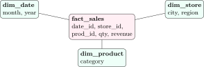
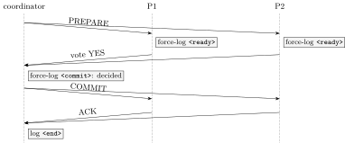

System-design rounds rarely ask for a precedence graph; they ask “SQL or NoSQL, and why?”, “how would you shard this?”, “what happens if the coordinator dies?”. This chapter gives the vocabulary and the trade-offs at the depth those questions need.

## 12.1 OLTP, OLAP and the star schema {#sec-dbms-olap}

<div class="nb-proto">

<em><span>Prototypical example for this section:</span> a retail chain’s sales: thousands of small orders per second, and a monthly report that scans all of them.</em>

</div>

|  | OLTP (transactions) | OLAP (analytics) |
|:--|:--|:--|
| workload | many short reads/writes of few rows | few long queries over millions of rows |
| schema | normalized (3NF/BCNF) | denormalized star or snowflake |
| storage | row store, B$^+$-tree indexes | column store, compression, partitioning |
| measure | transactions per second, latency | query time, scan throughput |
| examples | PostgreSQL, MySQL, Oracle as order databases | data warehouses: Redshift, BigQuery, Snowflake, ClickHouse |

<div class="nb nb-definition" id="definition-12-1-1">

<strong>Definition 12.1.1</strong>. A <strong>data warehouse</strong> integrates data from operational systems (via <strong>ETL</strong>/<strong>ELT</strong>: extract, transform, load) for analysis. Its <strong>star schema</strong> has one <strong>fact table</strong> (one row per event, with numeric <strong>measures</strong> and foreign keys) surrounded by <strong>dimension tables</strong> (who, what, where, when), which are denormalized; a <strong>snowflake schema</strong> normalizes the dimensions into sub-dimensions (city $\to$ region). OLAP operations: <strong>roll-up</strong> (aggregate to a coarser level), <strong>drill-down</strong>, <strong>slice</strong> (fix one dimension), <strong>dice</strong> (sub-cube), <strong>pivot</strong>.

</div>

<figure class="nb-fig"></figure>

```sql {filename="c12-star.sql"}
-- a tiny star schema: one fact table, three dimensions
CREATE TABLE dim_date (date_id INTEGER PRIMARY KEY, month TEXT,
                       year INTEGER);
CREATE TABLE dim_store (store_id INTEGER PRIMARY KEY, city TEXT,
                        region TEXT);
CREATE TABLE dim_product (prod_id INTEGER PRIMARY KEY, category TEXT);
CREATE TABLE fact_sales (date_id INTEGER REFERENCES dim_date,
                         store_id INTEGER REFERENCES dim_store,
                         prod_id INTEGER REFERENCES dim_product,
                         qty INTEGER, revenue INTEGER);
INSERT INTO dim_date VALUES (1, '2026-01', 2026), (2, '2026-02', 2026);
INSERT INTO dim_store VALUES (1, 'Pune', 'West'), (2, 'Mumbai', 'West'),
                             (3, 'Chennai', 'South');
INSERT INTO dim_product VALUES (1, 'Electronics'), (2, 'Home');
INSERT INTO fact_sales VALUES (1, 1, 1, 2, 40000), (1, 2, 2, 5, 7500),
  (1, 3, 1, 1, 22000), (2, 1, 2, 3, 4500), (2, 2, 1, 1, 18000),
  (2, 3, 2, 4, 6000);

-- Q1 revenue by region and category, with subtotals (ROLLUP)
SELECT COALESCE(s.region, 'ALL') AS region,
       COALESCE(p.category, 'ALL') AS category, SUM(f.revenue) AS revenue
FROM fact_sales f JOIN dim_store s ON s.store_id = f.store_id
                  JOIN dim_product p ON p.prod_id = f.prod_id
GROUP BY ROLLUP (s.region, p.category)
ORDER BY s.region NULLS LAST, p.category NULLS LAST;
```

```text {filename="Result on PostgreSQL 16.14"}
 region |   category  | revenue
--------+-------------+---------
 South  | Electronics |   22000
 South  | Home        |    6000
 South  | ALL         |   28000
 West   | Electronics |   58000
 West   | Home        |   12000
 West   | ALL         |   70000
 ALL    | ALL         |   98000
(7 rows)
```

`GROUP BY ROLLUP (region, category)` computes the groups $(\text{region},\text{category})$, $(\text{region})$ and $()$ in one pass; `CUBE` adds every combination, `GROUPING SETS` lists them explicitly (PostgreSQL, Oracle, SQL Server, MySQL’s `WITH ROLLUP`; not SQLite). Column stores win on such queries because they read only the referenced columns and compress runs of equal values.

<div class="nb nb-moral">

OLTP: normalized rows, indexes, short transactions. OLAP: denormalized star, columns, scans and aggregates.

</div>

## 12.2 NoSQL families {#sec-dbms-nosql}

<div class="nb-proto">

<em><span>Prototypical example for this section:</span> a shopping cart kept in a key-value store, a product catalogue in a document store, a social graph in a graph database.</em>

</div>

| Family | Data model and access | Good for | Examples |
|:--|:--|:--|:--|
| key-value | opaque value by key: `get`/`put`/`delete` | caches, sessions, carts, counters, rate limits | Redis, Memcached, Amazon DynamoDB, Riak, etcd |
| document | JSON-like documents, query by fields, secondary indexes | catalogues, user profiles, content with varying fields | MongoDB, Couchbase, Firestore |
| wide-column | rows of sparse column families, partitioned by key, sorted within a partition | huge write rates, time series, event logs | Apache Cassandra, HBase, Google Bigtable, ScyllaDB |
| graph | nodes and edges with properties, traversals | social networks, recommendations, fraud rings | Neo4j, Amazon Neptune |
| search | inverted index over text | full-text search, logs | Elasticsearch, OpenSearch |

<div class="nb nb-definition" id="fact-12-2-1">

<strong>Fact 12.2.1</strong> (What NoSQL systems usually give up, and gain). They usually drop joins, multi-record ACID transactions (or limit them to one partition or document), a fixed schema and a general query optimizer, and gain horizontal scaling by partitioning, high write throughput, flexible records and tunable consistency. The lines have blurred: MongoDB has multi-document transactions, PostgreSQL stores and indexes JSON (`jsonb`), and “NewSQL” systems (Google Spanner, CockroachDB) give SQL and serializable transactions on sharded data.

</div>

<div class="nb nb-remark" id="remark-12-2-2">

<strong>Remark 12.2.2</strong> (When not to use NoSQL) — Avoid a non-relational store when the data is highly relational and queried in unpredictable ways (ad hoc joins, reporting), when multi-entity invariants need ACID transactions (money transfers, inventory, bookings), when strong consistency is required everywhere, or when the data fits comfortably on one well-indexed relational server; that last case covers most applications. Choose NoSQL for a known, simple access pattern at a scale or write rate one server cannot handle, or for data whose shape is genuinely schemaless.

</div>

<div class="nb nb-moral">

Pick the store by access pattern: key lookups, documents, wide partitions or traversals; keep relational for joins, ad hoc queries and transactions.

</div>

## 12.3 Replication, sharding and consistent hashing {#sec-dbms-scale}

<div class="nb-proto">

<em><span>Prototypical example for this section:</span> a users table that has outgrown one machine.</em>

</div>

<div class="nb nb-definition" id="definition-12-3-1">

<strong>Definition 12.3.1</strong>. <strong>Replication</strong> keeps copies of the same data on several nodes, for availability and read scaling. <strong>Leader–follower</strong> (primary–replica): writes go to the leader, which ships its log to followers; <strong>synchronous</strong> replication waits for followers before acknowledging a commit (no loss on failover, slower), <strong>asynchronous</strong> does not (fast, but recent commits can be lost and followers lag). <strong>Multi-leader</strong> and <strong>leaderless</strong> (Dynamo-style) replication accept writes on several nodes and must resolve conflicts (last-writer-wins, version vectors, CRDTs). <strong>Sharding</strong> (horizontal partitioning) splits the data itself: each shard holds a subset of rows, chosen by a <strong>shard key</strong> by range or by hash. Replication and sharding are combined: each shard is replicated.

</div>

<div class="nb nb-remark" id="remark-12-3-2">

<strong>Remark 12.3.2</strong> (The usual costs) — Replica lag breaks <strong>read-your-writes</strong> (a user does not see their own update when the read hits a lagging replica) and <strong>monotonic reads</strong> (two reads go back in time); fix by reading one’s own data from the leader or pinning a session to a replica. Sharding breaks cross-shard joins, unique constraints and transactions, and a bad shard key creates <strong>hot spots</strong> (a celebrity’s user id, a timestamp range that receives all new writes). Range sharding keeps range scans local but invites hot spots; hash sharding spreads load but scatters range queries to every shard.

</div>

With $N$ shards chosen as $h(k)\bmod N$, adding a shard remaps almost every key. <strong>Consistent hashing</strong> places servers (many <strong>virtual nodes</strong> each) and keys on one hash ring and gives each key to the next server clockwise, so a new server takes over only its own arcs. The script measures it on $20000$ keys, and also checks the quorum rule of leaderless replication by enumerating all quorums:

```text {filename="Output (Python 3.11)"}
hash mod N        : 79.4% move; per node [3996, 3956, 3944, 4081, 4023]
consistent hashing: 19.8% move; per node [4050, 3468, 4564, 3967, 3951]
ideal: 1/5 = 20.0% move (only the new node's share)
N=3 R=2 W=2: R+W=4 > N; every read quorum meets every write quorum: True
N=3 R=1 W=2: R+W=3 <= N; every read quorum meets every write quorum: False
N=5 R=3 W=3: R+W=6 > N; every read quorum meets every write quorum: True
N=5 R=2 W=3: R+W=5 <= N; every read quorum meets every write quorum: False
N=5 R=1 W=5: R+W=6 > N; every read quorum meets every write quorum: True
```

<div class="nb nb-definition" id="fact-12-3-3">

<strong>Fact 12.3.3</strong> (Quorums). With $N$ replicas, a write waits for $W$ acknowledgements and a read asks $R$ replicas. If $R+W>N$, every read quorum overlaps every write quorum, so some replica in the read has the latest acknowledged write (version numbers pick it). $R+W\le N$ allows stale reads in exchange for latency. Common choices: $N=3$, $R=W=2$.

</div>

<div class="nb nb-moral">

Replicate for availability and reads, shard for size and writes; use consistent hashing so that growing the cluster moves about $1/n$ of the data, not all of it.

</div>

## 12.4 CAP, PACELC, BASE and consistency models {#sec-dbms-cap}

<div class="nb-proto">

<em><span>Prototypical example for this section:</span> a network partition separates two data centres: refuse writes, or accept them on both sides and reconcile later?</em>

</div>

<div class="nb nb-theorem nb-block" id="theorem-12-4-1">

<strong>Theorem 12.4.1</strong> (CAP, informally)

A distributed store cannot provide all three of <strong>consistency</strong> (linearizability: every read sees the latest completed write, as if there were one copy), <strong>availability</strong> (every request to a non-failed node gets a non-error answer) and <strong>partition tolerance</strong> (it keeps working when messages between nodes are lost). Since partitions happen, the real choice is during a partition: stay consistent and refuse some requests (<strong>CP</strong>: HBase, etcd/ZooKeeper, Spanner) or stay available and risk stale or conflicting data (<strong>AP</strong>: Cassandra and Dynamo-style stores in their default settings).

</div>

<div class="nb nb-definition" id="definition-12-4-2">

<strong>Definition 12.4.2</strong>. <strong>PACELC</strong> completes CAP: if there is a <strong>P</strong>artition, choose <strong>A</strong>vailability or <strong>C</strong>onsistency; <strong>E</strong>lse, choose <strong>L</strong>atency or <strong>C</strong>onsistency (synchronous replication costs latency even without failures). <strong>BASE</strong> (basically available, soft state, eventually consistent) describes the AP style, as opposed to ACID. Consistency models, strongest first: <strong>linearizable</strong> (real-time order), <strong>sequential</strong> (one total order respecting each client’s order), <strong>causal</strong> (causally related operations are seen in order by everyone), <strong>eventual</strong> (replicas converge if writes stop), with session guarantees such as read-your-writes in between.

</div>

<div class="nb nb-remark" id="remark-12-4-3">

<strong>Remark 12.4.3</strong> (Two different C’s) — ACID’s consistency is about integrity constraints within one database; CAP’s is about replicas agreeing (linearizability). An interviewer who asks “is your system consistent?” usually means the second.

</div>

## 12.5 Distributed transactions: two-phase commit {#sec-dbms-2pc}

<div class="nb-proto">

<em><span>Prototypical example for this section:</span> an order that debits a wallet on one shard and reserves stock on another.</em>

</div>

<figure class="nb-fig"></figure>

<div class="nb nb-remark" id="algorithm-12-5-1">

<strong>Algorithm 12.5.1</strong> (Two-phase commit (2PC)) — <strong>Phase 1 (voting)</strong>: the coordinator sends PREPARE; each participant either force-writes a `<ready>` record (it can now commit even after a crash) and votes YES, or votes NO and aborts locally. <strong>Phase 2 (decision)</strong>: if all voted YES the coordinator force-logs `<commit>`, otherwise `<abort>`, and sends the decision; participants apply it and acknowledge. The decision is made the moment the coordinator’s decision record is on disk.

</div>

```python {filename="c12-2pc.py, lines 5–20",linenos=table,linenostart=5}
def two_pc(votes, crash=None):
    """votes: each participant's vote; crash: when the coordinator dies."""
    log = ["coordinator: PREPARE -> all"]
    for i, v in enumerate(votes, 1):
        log.append(f"P{i}: " + ("force-log <ready>, vote YES" if v
                                else "vote NO, abort"))
    if crash == "after prepare":
        log.append("coordinator crashes before deciding")
        state = ["BLOCKED" if v else "aborted" for v in votes]
        return log, state
    decision = "COMMIT" if all(votes) else "ABORT"
    log.append(f"coordinator: force-log <{decision.lower()}>, send {decision}")
    if crash == "after decision":
        log.append("coordinator crashes; on restart it re-sends the decision")
    return log, [decision.lower() + "ted" if decision == "COMMIT" else "aborted"
                 for _ in votes]
```

```text {filename="Output (Python 3.11)"}
votes ['YES', 'YES', 'YES'], crash: None
   coordinator: PREPARE -> all
   P1: force-log <ready>, vote YES
   P2: force-log <ready>, vote YES
   P3: force-log <ready>, vote YES
   coordinator: force-log <commit>, send COMMIT
   outcome: P1 committed; P2 committed; P3 committed
votes ['YES', 'NO', 'YES'], crash: None
   coordinator: PREPARE -> all
   P1: force-log <ready>, vote YES
   P2: vote NO, abort
   P3: force-log <ready>, vote YES
   coordinator: force-log <abort>, send ABORT
   outcome: P1 aborted; P2 aborted; P3 aborted
votes ['YES', 'YES', 'YES'], crash: after prepare
   coordinator: PREPARE -> all
   P1: force-log <ready>, vote YES
   P2: force-log <ready>, vote YES
   P3: force-log <ready>, vote YES
   coordinator crashes before deciding
   outcome: P1 BLOCKED; P2 BLOCKED; P3 BLOCKED
votes ['YES', 'YES', 'YES'], crash: after decision
   coordinator: PREPARE -> all
   P1: force-log <ready>, vote YES
   P2: force-log <ready>, vote YES
   P3: force-log <ready>, vote YES
   coordinator: force-log <commit>, send COMMIT
   coordinator crashes; on restart it re-sends the decision
   outcome: P1 committed; P2 committed; P3 committed
(BLOCKED: voted YES, so it may neither commit nor abort on its own)
```

<div class="nb nb-definition" id="fact-12-5-2">

<strong>Fact 12.5.2</strong> (The blocking problem, and the alternatives). A participant that voted YES has given up the right to decide alone: if the coordinator crashes before the decision reaches it, it must wait (holding its locks) until the coordinator recovers, since the others may have committed or aborted. <strong>Three-phase commit</strong> adds a pre-commit phase so that, with bounded message delays and no partitions, participants can elect a new coordinator and finish without blocking; it is not safe under network partitions and is rarely used. Modern systems make the coordinator itself fault-tolerant by replicating its state with a consensus protocol (Paxos, Raft), as Spanner does, or avoid distributed transactions with <strong>sagas</strong>: a sequence of local transactions, each with a <strong>compensating transaction</strong> that undoes it if a later step fails (eventual, not isolated). Idempotency keys and the <strong>outbox</strong> pattern make retries safe.

</div>

<div class="nb nb-moral">

2PC is atomic but blocking; in practice, replicate the coordinator or use sagas with compensations.

</div>

## 12.6 Practical database engineering {#sec-dbms-practical}

<div class="nb-proto">

<em><span>Prototypical example for this section:</span> a page that lists 200 posts with their authors and sends 201 queries.</em>

</div>

### 12.6.i The N+1 query problem and ORMs {#s12-6-i}

An <strong>ORM</strong> (Hibernate/JPA, Django ORM, SQLAlchemy, ActiveRecord) maps rows to objects. Its default lazy loading fetches a related object the first time it is touched, so a loop over $N$ parents issues $1+N$ queries:

```python {filename="c12-nplus1.py, lines 17–41",linenos=table,linenostart=17}
# lazy loading: 1 query for the posts, then 1 per post for its author
count[0] = 0
posts = db.execute("SELECT id, author_id, title FROM post").fetchall()
pairs = []
for pid, aid, title in posts:
    name = db.execute("SELECT name FROM author WHERE id = ?",
                      (aid,)).fetchone()[0]
    pairs.append((title, name))
print(f"N+1 pattern: {count[0]} statements for {len(pairs)} rows")

# eager loading: one join
count[0] = 0
pairs2 = db.execute("""SELECT p.title, a.name FROM post p
                       JOIN author a ON a.id = p.author_id""").fetchall()
print(f"one JOIN:    {count[0]} statement  for {len(pairs2)} rows;"
      f" same result: {sorted(pairs) == sorted(pairs2)}")

# batch loading (what ORMs call prefetch / IN-loading): 2 statements
count[0] = 0
ids = sorted({aid for _, aid, _ in posts})
marks = ",".join("?" * len(ids))
names = dict(db.execute(f"SELECT id, name FROM author WHERE id IN ({marks})",
                        ids))
print(f"prefetch:    {count[0]} statement  (after the posts query)"
      f" for {len(names)} authors")
```

```text {filename="Output (Python 3.11)"}
N+1 pattern: 201 statements for 200 rows
one JOIN:    1 statement  for 200 rows; same result: True
prefetch:    1 statement  (after the posts query) for 50 authors
```

The fix is to ask for the related rows up front: a join (`select_related`, `JOIN FETCH`) or one batched `IN` query per relation (`prefetch_related`, batch fetching). Each round trip costs network latency and parsing, typically far more than the work inside the database. ORMs remove boilerplate and SQL injection risks (they always parameterize) and make simple CRUD fast to write; their costs are hidden queries, inefficient generated SQL for reporting queries, and the temptation to do in application loops what the database does in one statement. Log the generated SQL and count queries per request.

### 12.6.ii Connection pools {#s12-6-ii}

Opening a database connection costs a TCP (and often TLS) handshake, authentication and, in PostgreSQL, a new server process with its own memory. A <strong>connection pool</strong> keeps a fixed set of open connections and lends them to requests. Pool size should match what the database can run concurrently (on the order of the number of cores and disks, not the number of users); more connections only add contention. External poolers (PgBouncer) multiplex many client connections onto few server ones; in transaction-pooling mode session state (temporary tables, `SET` variables, prepared statements) does not survive between transactions.

### 12.6.iii Normalization, denormalization and caching {#s12-6-iii}

Denormalize (store a derived or duplicated value) only for a measured read bottleneck, and make one place responsible for keeping copies in sync: a trigger, a materialized view, or an asynchronous job that tolerates staleness. Typical cases: a `comment_count` column, a precomputed feed, a reporting copy in a warehouse. A cache in front of the database (<strong>cache-aside</strong>: read the cache, on a miss read the database and fill the cache; on a write update the database and invalidate the cache key) is denormalization in memory, with the same consistency questions.

| Choose a relational database when | Choose a NoSQL store when |
|:--|:--|
| data has many relationships and ad hoc queries | access is by key or a few known patterns |
| invariants span several rows or tables (money, inventory) | each request touches one item or partition |
| strong consistency and transactions are required | availability and latency matter more than immediate consistency |
| the data fits on one primary plus replicas | write volume or data size needs many machines |

<div class="nb nb-moral">

Count round trips, pool connections, denormalize only with a sync plan, and justify SQL versus NoSQL by access pattern, consistency need and scale.

</div>
