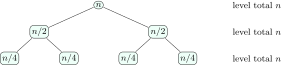

Every other chapter of this book states costs like “$O(\log n)$ expected” or “$O(1)$ amortized”. This chapter makes those words precise, because interviewers attack exactly the adjectives: <em>expected</em> over what, <em>amortized</em> over which sequence, $O(\cdot)$ of <em>what</em> input size.

<div class="nb nb-remark">

<strong>Remark</strong> (How to read the code) — Every listing in this book is a complete program. It was compiled with MinGW g++ 6.3.0, `-std=c++14 -O2` and run; the box under it is what it actually printed. The scripts live in `chapters/dsa/code/` and `build.sh` rebuilds every output.

</div>

## 1.1 Asymptotic notation {#sec-dsa-asym}

<div class="nb-proto">

<em><span>Prototypical example for this section:</span> “Is $n^2 + 100n = O(n^2)$? Is it $O(n^3)$? Is it $\Theta(n^3)$?”</em>

</div>

We measure the running time $T(n)$ of an algorithm as a function of the input size $n$ (number of elements, number of bits, number of vertices plus edges) and compare growth rates, ignoring constant factors and small inputs.

<div class="nb nb-definition" id="definition-1-1-1">

<strong>Definition 1.1.1</strong>. For functions $f, g \colon \mathbb N \to \mathbb R_{\ge 0}$:

- $f = O(g)$ (<strong>big-O</strong>, an upper bound) if there are $c > 0$ and $n_0$ with $f(n) \le c\,g(n)$ for all $n \ge n_0$;
- $f = \Omega(g)$ (<strong>big-Omega</strong>, a lower bound) if there are $c > 0$ and $n_0$ with $f(n) \ge c\,g(n)$ for all $n \ge n_0$;
- $f = \Theta(g)$ (<strong>big-Theta</strong>, a tight bound) if both hold;
- $f = o(g)$ (<strong>little-o</strong>) if $f(n)/g(n) \to 0$, and $f = \omega(g)$ if $f(n)/g(n) \to \infty$: strict versions of $O$ and $\Omega$.

</div>

So $n^2 + 100n$ is $O(n^2)$ (take $c = 2$, $n_0 = 100$), also $O(n^3)$ (big-O is only an upper bound), $\Theta(n^2)$, but <em>not</em> $\Theta(n^3)$ and not $o(n^2)$.

<div class="nb nb-definition" id="fact-1-1-2">

<strong>Fact 1.1.2</strong> (Limit test). If $L = \lim_{n\to \infty} f(n)/g(n)$ exists, then $L = 0$ means $f = o(g)$, $0 < L < \infty$ means $f = \Theta(g)$, and $L = \infty$ means $f = \omega(g)$.

</div>

<div class="nb nb-definition" id="fact-1-1-3">

<strong>Fact 1.1.3</strong> (The growth ladder). For any constants $a > 1$, $b > 0$, $\varepsilon > 0$:

$$
\begin{gather*}
		1 \;\prec \; \log \log n \;\prec \; \log n \;\prec \; (\log n)^b \;\prec \; n^{\varepsilon}
		\;\prec \; n \;\prec \; n\log n \\
		\prec \; n^2 \;\prec \; n^3 \;\prec \; a^n \;\prec \; n! \;\prec \; n^n,
	\end{gather*}
$$

where $f \prec g$ means $f = o(g)$. Every polylogarithm is beaten by every polynomial and every polynomial by every exponential.

</div>

<div class="nb nb-remark" id="remark-1-1-4">

<strong>Remark 1.1.4</strong> (Traps that OAs set) —

- The base of a logarithm does not matter inside $O$: $\log_2 n = \log_{10} n \cdot \log_2 10$. The base of an <em>exponential</em> does: $2^n = o(3^n)$, and $4^n = (2^n)^2$ is not $O(2^n)$.
- $\log(n!) = \Theta(n \log n)$ (Stirling), so “sorting is $\log(n!)$” and “sorting is $n \log n$” are the same statement.
- $2^{n+1} = O(2^n)$ but $2^{2n} \ne O(2^n)$.
- $\sum_{i=1}^n i^k = \Theta(n^{k+1})$, $\sum_{i=1}^n 1/i = \ln n + O(1)$ (harmonic), $\sum_{i=0}^{\log n} 2^i = \Theta(n)$ (a geometric sum is dominated by its largest term).

</div>

### 1.1.i Best, worst and average case {#s1-1-i}

<div class="nb nb-definition" id="definition-1-1-5">

<strong>Definition 1.1.5</strong>. The <strong>worst-case</strong> time is the maximum of $T$ over all inputs of size $n$; the <strong>best case</strong> is the minimum; the <strong>average case</strong> is the expectation over an assumed <em>distribution of inputs</em>. An <strong>expected</strong> running time of a <em>randomized</em> algorithm is the expectation over the algorithm’s own coin flips, for the worst input.

</div>

<div class="nb nb-remark" id="remark-1-1-6">

<strong>Remark 1.1.6</strong> (Two different averages) — “Quicksort with the last element as pivot is $O(n\log n)$ on average” assumes the input is a random permutation; an adversary who sends sorted data gets $\Theta(n^2)$. “Randomized quicksort is $O(n \log n)$ expected” holds for <em>every</em> input, because the randomness is inside the algorithm. Interviewers love this distinction ([Section 13.4](../13-sorting/#sec-dsa-quick)).

</div>

<div class="nb nb-remark" id="remark-1-1-7">

<strong>Remark 1.1.7</strong> ($O$ is not “worst case”) — $O$, $\Omega$ and $\Theta$ are statements about functions; best/worst/average are statements about <em>which</em> function. “The worst case of insertion sort is $\Theta(n^2)$ and its best case is $\Theta(n)$” is precise. “Insertion sort is $\Omega(n)$” is true but says less.

</div>

<div class="nb nb-moral">

Say which case (worst, average under which distribution, expected over which coins) before you say which bound.

</div>

## 1.2 Counting loops {#sec-dsa-loops}

<div class="nb-proto">

<em><span>Prototypical example for this section:</span> `for (i = 1; i < n; i *= 2)` runs $\log_2 n$ times.</em>

</div>

Most “what is the time complexity of this snippet” questions reduce to summing the number of iterations of the innermost statement. The program below counts six classic shapes for $n = 1024$ and prints the formula next to each count.

```cpp {filename="loops.cpp"}
// How many times does the innermost statement run? Count it, then compare with the formula.
#include <cmath>
#include <cstdio>

int main() {
    const long n = 1024;
    long a = 0, b = 0, c = 0, d = 0, e = 0, f = 0;
    for (long i = 1; i < n; i *= 2) a++;                        // (a) doubling
    for (long i = 0; i < n; i++)                               // (b) triangle
        for (long j = 0; j < i; j++) b++;
    for (long i = 1; i <= n; i++)                              // (c) harmonic
        for (long j = i; j <= n; j += i) c++;
    for (long i = 1; i * i <= n; i++) d++;                      // (d) square root
    for (long i = 0; i < n; i++)                               // (e) halving inside
        for (long j = n; j > 0; j /= 2) e++;
    for (long i = n; i > 0; i /= 2)                             // (f) geometric
        for (long j = 0; j < i; j++) f++;
    std::printf("n = %ld\n", n);
    std::printf("(a) i*=2          : %6ld   log2 n        = %.0f\n", a, std::log2(n));
    std::printf("(b) j < i         : %6ld   n(n-1)/2      = %ld\n", b, n * (n - 1) / 2);
    std::printf("(c) j += i        : %6ld   n ln n        = %.0f\n", c, n * std::log(n));
    std::printf("(d) i*i <= n      : %6ld   sqrt n        = %.0f\n", d, std::sqrt(n));
    std::printf("(e) j /= 2 inside : %6ld   n(log2 n + 1) = %.0f\n", e, n * (std::log2(n) + 1));
    std::printf("(f) i /= 2 outside: %6ld   2n - 1        = %ld\n", f, 2 * n - 1);
}
```

```text {filename="Output of loops.cpp"}
n = 1024
(a) i*=2          :     10   log2 n        = 10
(b) j < i         : 523776   n(n-1)/2      = 523776
(c) j += i        :   7262   n ln n        = 7098
(d) i*i <= n      :     32   sqrt n        = 32
(e) j /= 2 inside :  11264   n(log2 n + 1) = 11264
(f) i /= 2 outside:   2047   2n - 1        = 2047
```

<div class="nb nb-example nb-block" id="example-1-2-1">

<strong>Example 1.2.1</strong> (Reading the six loops)

1. The loop variable doubles, so it reaches $n$ after $\log_2 n$ steps: $\Theta(\log n)$.
2. $\sum_{i=0}^{n-1} i = n(n-1)/2$: $\Theta(n^2)$.
3. For each $i$, $j$ runs over the multiples of $i$: $\sum_{i=1}^n \lfloor n/i \rfloor \approx n \ln n$, so $\Theta(n \log n)$. The count $7262$ is a little above $n \ln n = 7098$ because $\sum 1/i = \ln n + 0.577\ldots$
4. $\Theta(\sqrt n)$.
5. Independent loops multiply: $n \cdot (\log_2 n + 1)$, $\Theta(n \log n)$.
6. Dependent loops add: $n + n/2 + n/4 + \cdots < 2n$, so $\Theta(n)$, <em>not</em> $n \log n$. This is the most common wrong answer in OAs, and it is the reason build-heap is linear ([Section 8.3](../08-heaps/#sec-dsa-buildheap)).

</div>

<div class="nb nb-remark" id="remark-1-2-2">

<strong>Remark 1.2.2</strong> (Loops whose bound changes) — `for (i = 2; i < n; i = i * i)` runs $\Theta(\log \log n)$ times ($i = 2, 4, 16, 256, \ldots$). `while (n > 1) n = n / 3;` runs $\log_3 n$ times. A loop whose variable is <em>decremented</em> inside the body by a varying amount must be summed explicitly.

</div>

## 1.3 Space complexity {#s1-3}

<div class="nb nb-definition" id="definition-1-3-1">

<strong>Definition 1.3.1</strong>. The <strong>space complexity</strong> is the extra memory an algorithm uses beyond its input (<strong>auxiliary space</strong>), including the <strong>call stack</strong>: a recursion of depth $d$ uses $\Theta(d)$ stack frames.

</div>

<div class="nb nb-example nb-block" id="example-1-3-2">

<strong>Example 1.3.2</strong>

Recursive binary search uses $\Theta(\log n)$ stack; the iterative version uses $\Theta(1)$. Merge sort on an array uses $\Theta(n)$ for the buffer plus $\Theta(\log n)$ for the stack. Quicksort is “in place” but its stack is $\Theta(n)$ in the worst case, unless it recurses on the smaller part and loops on the larger, which bounds the stack by $\Theta(\log n)$.

</div>

<div class="nb nb-remark" id="remark-1-3-3">

<strong>Remark 1.3.3</strong> — A function that allocates an $n \times n$ table needs $\Theta(n^2)$ memory even if it runs in $\Theta(n^2)$ time; memory, not time, is often what fails first (a $10^5 \times 10^5$ table of `int` is $40$ GB).

</div>

## 1.4 Amortized analysis {#sec-dsa-amortized}

<div class="nb-proto">

<em><span>Prototypical example for this section:</span> `std::vector::push_back`: occasionally $\Theta(n)$, yet $O(1)$ “on average” over any sequence, with no randomness involved.</em>

</div>

<div class="nb nb-definition" id="definition-1-4-1">

<strong>Definition 1.4.1</strong>. An operation has <strong>amortized</strong> cost $a$ if <em>every</em> sequence of $m$ operations starting from the empty structure costs at most $m \cdot a$ in total. It is a worst-case guarantee about sequences, not an average over random inputs.

</div>

The dynamic array ([Section 3.2](../03-arrays/#sec-dsa-dynarray)) doubles its capacity when it is full and copies every element. The program counts the copies:

```cpp {filename="dynarray.cpp"}
// A dynamic array that doubles: count the element copies caused by n push_backs.
#include <cstdio>
#include <vector>

int main() {
    long cap = 1, size = 0, copies = 0;
    std::printf("%8s %10s %8s\n", "n", "copies", "copies/n");
    for (long n = 1; n <= 1000000; ++n) {
        if (size == cap) { copies += size; cap *= 2; }   // grow: copy everything
        ++size;
        if (n == 10 || n == 100 || n == 1000 || n == 1025 || n == 1000000)
            std::printf("%8ld %10ld %8.3f\n", n, copies, (double)copies / n);
    }
    // What does this standard library actually do?
    std::vector<int> v;
    std::size_t last = v.capacity();
    std::printf("std::vector capacities:");
    for (int i = 0; i < 100; ++i) {
        v.push_back(i);
        if (v.capacity() != last) { last = v.capacity(); std::printf(" %u", (unsigned)last); }
    }
    std::printf("\n");
}
```

```text {filename="Output of dynarray.cpp"}
       n     copies copies/n
      10         15    1.500
     100        127    1.270
    1000       1023    1.023
    1025       2047    1.997
 1000000    1048575    1.049
std::vector capacities: 1 2 4 8 16 32 64 128
```

The ratio copies$/n$ stays below $2$: right after a doubling at $n = 1025$ it is $2047/1025 \approx 2$, and it falls back towards $1$ until the next doubling. The last line shows that this standard library (libstdc++) grows by a factor of $2$ too.

There are three standard ways to prove such bounds.

1. <strong>Aggregate method</strong>: bound the total directly. Copies happen at sizes $1, 2, 4, \ldots, 2^k < n$, so they total $< 2n$; with the $n$ writes, $< 3n$ for $n$ pushes: $O(1)$ each.
2. <strong>Accounting (banker’s) method</strong>: charge each push $3$ units; $1$ pays for the write and $2$ are saved on the element. When the array doubles from $k$ to $2k$, the $k/2$ elements pushed since the last doubling have saved $k$ units, exactly enough to copy all $k$ elements.
3. <strong>Potential method</strong>: define a potential $\Phi \ge 0$ of the state (here $\Phi = 2\cdot \text{size} - \text{capacity}$) and show that actual cost $+ \Delta \Phi$ is $O(1)$ for every operation.

<div class="nb nb-remark" id="remark-1-4-2">

<strong>Remark 1.4.2</strong> (Why the factor must be multiplicative) — Growing by a constant ($+10$ slots each time) makes the copies total $10 + 20 + 30 + \cdots \approx n^2/20$: $\Theta(n)$ amortized per push. Any factor $> 1$ (MSVC uses $1.5$) gives $O(1)$ amortized; smaller factors waste less memory but copy more often. Shrinking must use a gap (halve when a quarter full), or alternating push/pop at the boundary costs $\Theta(n)$ each.

</div>

<div class="nb nb-moral">

Amortized $O(1)$ is a worst-case bound on the total of any sequence; expected $O(1)$ is an average over randomness. Hash tables are both ([Chapter 9](../09-hashing/)).

</div>

## 1.5 Recurrences {#sec-dsa-recurrences}

<div class="nb-proto">

<em><span>Prototypical example for this section:</span> merge sort: $T(n) = 2T(n/2) + \Theta(n)$, so $T(n) = \Theta(n \log n)$.</em>

</div>

A recursive algorithm’s time satisfies a <strong>recurrence</strong>. Three tools solve them.

### 1.5.i Recursion tree {#s1-5-i}

Draw the calls as a tree, write the non-recursive work at each node and add level by level. For $T(n) = 2T(n/2) + n$:

<figure class="nb-fig"></figure>

Each of the $\log_2 n$ levels costs $n$, so $T(n) = \Theta(n\log n)$. If instead the level totals shrink geometrically (as in $T(n) = T(n/2) + n$: $n + n/2 + \cdots$), the root dominates and $T(n) = \Theta(n)$; if they grow geometrically, the leaves dominate.

### 1.5.ii The Master theorem {#s1-5-ii}

<div class="nb nb-theorem nb-block" id="theorem-1-5-1">

<strong>Theorem 1.5.1</strong> (Master theorem)

Let $T(n) = a\,T(n/b) + f(n)$ with constants $a \ge 1$, $b > 1$, and let $c^* = \log_b a$ (the leaves contribute $\Theta(n^{c^*})$).

1. If $f(n) = O(n^{c^* - \varepsilon})$ for some $\varepsilon > 0$, then $T(n) = \Theta(n^{c^*})$ (leaves dominate).
2. If $f(n) = \Theta(n^{c^*} \log^k n)$ with $k \ge 0$, then $T(n) = \Theta(n^{c^*} \log^{k+1} n)$ (every level equal).
3. If $f(n) = \Omega(n^{c^* + \varepsilon})$ and $a f(n/b) \le c f(n)$ for some $c < 1$ (regularity), then $T(n) = \Theta(f(n))$ (root dominates).

</div>

The program `recurrences.cpp` evaluates seven recurrences exactly (with $T(1) = 1$) for $n = 2^{10}, 2^{15}, 2^{20}$ and divides by the predicted growth. A ratio that settles to a constant confirms the prediction.

```text {filename="Output of recurrences.cpp"}
T(n) =           claim         n=2^10    n=2^15    n=2^20
2T(n/2)+n        n log n        1.100     1.067     1.050
T(n/2)+1         log n          1.100     1.067     1.050
2T(n/2)+1        n              1.999     2.000     2.000
4T(n/2)+n        n^2            1.999     2.000     2.000
3T(n/2)+n        n^1.585        2.965     2.995     2.999
T(n/2)+n         n              1.999     2.000     2.000
2T(n/2)+n log n  n log^2 n      0.560     0.538     0.527
```

<div class="nb nb-example nb-block" id="example-1-5-2">

<strong>Example 1.5.2</strong> (Reading the table)

- $2T(n/2) + n$: $c^* = 1$, $f = n$: case 2, $\Theta(n \log n)$ (merge sort). The ratio tends to $1$ slowly because $T(n) = n\log_2 n + n$ exactly.
- $T(n/2) + 1$: $c^* = 0$, case 2, $\Theta(\log n)$ (binary search).
- $2T(n/2) + 1$: $c^* = 1 > 0$, case 1, $\Theta(n)$ (tree traversal, finding a maximum by divide and conquer).
- $4T(n/2) + n$: $c^* = 2$, case 1, $\Theta(n^2)$. $3T(n/2) + n$: $c^* = \log_2 3 \approx 1.585$, case 1 (Karatsuba).
- $T(n/2) + n$: $c^* = 0$, case 3, $\Theta(n)$ (quickselect on average).
- $2T(n/2) + n \log n$: case 2 with $k = 1$, $\Theta(n \log^2 n)$.

</div>

<div class="nb nb-remark" id="remark-1-5-3">

<strong>Remark 1.5.3</strong> (When the Master theorem does not apply) — It needs subproblems of <em>equal</em> size $n/b$ and a constant $a$. It does not solve

- $T(n) = T(n-1) + n$ (subtract, not divide): unroll it, $\Theta(n^2)$ (worst-case quicksort, selection sort);
- $T(n) = 2T(n-1) + 1$: $\Theta(2^n)$ (Tower of Hanoi, $2^n - 1$ moves);
- $T(n) = T(n/3) + T(2n/3) + n$: unequal parts; the recursion tree has levels of cost $n$ and depth $\log_{3/2} n$, so $\Theta(n \log n)$;
- $T(n) = 2T(\sqrt n) + \log n$: substitute $n = 2^m$, $S(m) = 2S(m/2) + m$, so $\Theta(\log n \log \log n)$;
- $T(n) = 2T(n/2) + n/\log n$: falls in the gap between cases 1 and 2; the answer is $\Theta(n \log \log n)$ (the Akra–Bazzi method handles such cases).

</div>

### 1.5.iii Substitution {#s1-5-iii}

Guess the answer and prove it by induction. To show $T(n) = 2T(n/2) + n \le c\,n\log_2 n$: assume it for $n/2$; then $T(n) \le 2c(n/2)\log_2(n/2) + n = c\,n\log_2 n - cn + n \le c\,n\log_2 n$ for $c \ge 1$. The classic trap: “proving” $T(n) = O(n)$ by showing $T(n) \le cn + n$; the inductive hypothesis must be reproduced <em>exactly</em>, and $cn + n \not \le cn$.

<div class="nb nb-moral">

Compare $f(n)$ with $n^{\log_b a}$: whichever is polynomially larger wins; if they tie, add a $\log$.

</div>

## 1.6 Input size, pseudo-polynomial time and lower bounds {#sec-dsa-pseudopoly}

<div class="nb-proto">

<em><span>Prototypical example for this section:</span> trial-division primality testing in $O(\sqrt N)$ is <em>exponential</em> in the input size.</em>

</div>

<div class="nb nb-definition" id="definition-1-6-1">

<strong>Definition 1.6.1</strong>. The input size of a number $N$ is its length, $\Theta(\log N)$ bits, not its value. An algorithm is <strong>pseudo-polynomial</strong> if it is polynomial in the <em>values</em> of the numbers but not in their lengths.

</div>

<div class="nb nb-example nb-block" id="example-1-6-2">

<strong>Example 1.6.2</strong>

Testing primality by trial division takes $O(\sqrt N) = O(2^{(\log_2 N)/2})$ steps: exponential in the number of bits. The 0/1 knapsack DP runs in $O(nW)$ for capacity $W$ ([Section 15.3](../15-dp/#sec-dsa-knapsack)): polynomial in $W$, exponential in $\log W$. That is why knapsack is NP-hard and still has a “polynomial-looking” DP.

</div>

<div class="nb nb-theorem nb-block" id="theorem-1-6-3">

<strong>Theorem 1.6.3</strong> (Comparison sorting needs $\Omega(n \log n)$ comparisons)

Any algorithm that sorts by comparing pairs of elements makes $\Omega(n\log n)$ comparisons in the worst case (and on average).

</div>

<div class="nb nb-proof">

<em>Proof.</em> Model the algorithm as a binary <strong>decision tree</strong>: each internal node is a comparison, each leaf an output order. All $n!$ orders must be reachable, so the tree has at least $n!$ leaves and height at least $\log_2(n!) = \Theta(n\log n)$. The average depth of the leaves is also $\Omega(\log n!)$.

</div>

Counting, radix and bucket sort beat the bound because they do not only compare: they use the keys as array indices ([Section 13.7](../13-sorting/#sec-dsa-noncomp)). Similar arguments give $\Omega(\log n)$ for searching a sorted array by comparisons and $\Omega(n \log n)$ for element distinctness.

## 1.7 What $O$ hides {#s1-7}

<div class="nb nb-remark" id="remark-1-7-1">

<strong>Remark 1.7.1</strong> (Constants and memory are real) — Big-O drops constant factors, but machines do not. A cache miss costs on the order of a hundred times a cache hit, so

- a linear scan of an array beats a theoretically equal scan of a linked list several times over ([Section 4.2](../04-lists/#sec-dsa-list-vs-array));
- quicksort beats heap sort although both are $O(n \log n)$: partitioning reads memory sequentially, heap sort jumps from $i$ to $2i+1$;
- for small $n$ (below about $16$ to $32$), insertion sort beats every $O(n\log n)$ sort, which is why library sorts switch to it for small ranges ([Section 13.6](../13-sorting/#sec-dsa-introsort)).

</div>

<div class="nb nb-definition" id="fact-1-7-2">

<strong>Fact 1.7.2</strong> (Rough capacity of $10^8$ simple operations per second). The usual rule of thumb for a $1$-second limit: $n \le 10$ allows $O(n!)$, $n \le 20$ allows $O(2^n)$, $n \le 500$ allows $O(n^3)$, $n \le 5000$ allows $O(n^2)$, $n \le 10^6$ allows $O(n \log n)$, and $n \le 10^8$ needs $O(n)$. It is a rule of thumb, not a law; it is exactly how OA constraints hint at the intended complexity.

</div>

## 1.8 A few harder problems to think about {#sec-dsa-complexity-problems}

<div class="nb nb-problem nb-block" id="problem-1a">

<strong>Problem 1A</strong> (Loop count)

What is the complexity of `for (i = 1; i <= n; i++) for (j = 1; j <= i * i; j += i) x++;`?

<details class="nb-hint">
<summary>Hint</summary>

For a fixed $i$ the inner loop runs over $j = 1, 1+i, 1+2i, \ldots \le i^2$.

</details>

<details class="nb-sol">
<summary>Solution</summary>

For each $i$ the inner loop runs about $i$ times ($i^2/i$), so the total is $\sum_{i=1}^n i = \Theta(n^2)$.

</details>

</div>

<div class="nb nb-problem nb-block" id="problem-1b">

<strong>Problem 1B</strong> (Master theorem drill)

Solve: (a) $T(n) = 8T(n/2) + n^2$; (b) $T(n) = 7T(n/2) + n^2$; (c) $T(n) = 2T(n/4) + \sqrt n$; (d) $T(n) = T(n/2) + n^2$; (e) $T(n) = 16T(n/4) + n^2 \log n$.

<details class="nb-hint">
<summary>Hint</summary>

Compute $\log_b a$ first: $3$, $\log_2 7$, $1/2$, $0$, $2$.

</details>

<details class="nb-sol">
<summary>Solution</summary>

(a) $\Theta(n^3)$ (case 1; naive matrix multiplication by blocks). (b) $\Theta(n^{\log_2 7}) = \Theta(n^{2.81})$ (Strassen). (c) $\log_4 2 = 1/2$ equals the exponent of $\sqrt n$: case 2, $\Theta(\sqrt n \log n)$. (d) case 3, $\Theta(n^2)$. (e) case 2 with $k = 1$: $\Theta(n^2\log^2 n)$.

</details>

</div>

<div class="nb nb-problem nb-block" id="problem-1c">

<strong>Problem 1C</strong> 🌶🌶 (Which is bigger?)

Order by growth: $n^{\log n}$, $(\log n)^n$, $2^{\sqrt n}$, $n^{100}$, $n!$.

<details class="nb-hint">
<summary>Hint</summary>

Take logarithms of each: $\log^2 n$, $n \log \log n$, $\sqrt n$, $100\log n$, $n\log n$.

</details>

<details class="nb-sol">
<summary>Solution</summary>

Comparing the logarithms, $100\log n \prec \log^2 n \prec \sqrt n \prec n\log \log n \prec n\log n$, so $n^{100} \prec n^{\log n} \prec 2^{\sqrt n} \prec (\log n)^n \prec n!$.

</details>

</div>

<div class="nb nb-problem nb-block" id="problem-1d">

<strong>Problem 1D</strong> (Shrinking a dynamic array)

A dynamic array doubles when full and halves when it becomes <em>half</em> full. Show a sequence of $m$ operations that costs $\Theta(m n)$. What rule fixes it?

<details class="nb-hint">
<summary>Hint</summary>

Stand exactly at the boundary.

</details>

<details class="nb-sol">
<summary>Solution</summary>

Fill to exactly $n = 2^k$ elements, then alternate push, pop, push, pop. Each push doubles (copying $n$ elements) and each pop halves (copying $n$ again), so every operation costs $\Theta(n)$. Halving only when the array is a quarter full leaves $\Theta(n)$ cheap operations between two resizes, which restores $O(1)$ amortized.

</details>

</div>
