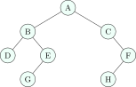

## 6.1 Vocabulary {#sec-dsa-treevocab}

<div class="nb-proto">

<em><span>Prototypical example for this section:</span> a file system: one root folder, every other folder has exactly one parent.</em>

</div>

<div class="nb nb-definition" id="definition-6-1-1">

<strong>Definition 6.1.1</strong>. A <strong>tree</strong> is a connected acyclic graph; a <strong>rooted tree</strong> singles out one vertex, the <strong>root</strong>. Every other node has one <strong>parent</strong>; nodes with no children are <strong>leaves</strong>, the others are <strong>internal</strong>. The <strong>depth</strong> of a node is the number of edges from the root; the <strong>height</strong> of a node is the number of edges on the longest downward path to a leaf; the height of the tree is the height of the root. A tree with $n$ nodes has exactly $n - 1$ edges.

</div>

<div class="nb nb-remark" id="remark-6-1-2">

<strong>Remark 6.1.2</strong> (Conventions differ) — Some books count height in <em>nodes</em> (a single node has height $1$) and some in <em>edges</em> (height $0$). This book counts edges, so an empty tree has height $-1$. In an OA, check which convention the options assume; the formulas below shift by one.

</div>

<div class="nb nb-definition" id="definition-6-1-3">

<strong>Definition 6.1.3</strong>. A <strong>binary tree</strong> is a rooted tree in which every node has at most two children, distinguished as <em>left</em> and <em>right</em>.

- <strong>full</strong> (or proper, or strict): every node has $0$ or $2$ children;
- <strong>perfect</strong>: full, with all leaves at the same depth ($2^{h+1} - 1$ nodes);
- <strong>complete</strong>: every level is full except possibly the last, which is filled from the left (the shape of a binary heap, [Chapter 8](../08-heaps/));
- <strong>balanced</strong>: the heights of the two subtrees of every node differ by a bounded amount (AVL: by at most $1$), so the height is $O(\log n)$;
- <strong>degenerate</strong> (skewed): every internal node has one child; it is a linked list.

</div>

## 6.2 Counting facts {#sec-dsa-treefacts}

<div class="nb-proto">

<em><span>Prototypical example for this section:</span> a full binary tree with $10$ internal nodes has exactly $11$ leaves.</em>

</div>

<div class="nb nb-theorem nb-block" id="theorem-6-2-1">

<strong>Theorem 6.2.1</strong> (Binary tree counts)

1. Level $d$ holds at most $2^d$ nodes; a binary tree of height $h$ has at most $2^{h+1} - 1$ nodes and at least $h + 1$.
2. A binary tree with $n$ nodes has height at least $\lceil \log_2(n + 1) \rceil - 1$; a complete binary tree has height exactly $\lfloor \log_2 n \rfloor$.
3. In any binary tree, if $n_0$, $n_1$, $n_2$ count the nodes with $0$, $1$, $2$ children, then $n_0 = n_2 + 1$. In a full binary tree $n_1 = 0$, so <em>leaves = internal nodes + 1</em> and $n = 2n_2 + 1$ is odd.
4. A binary tree with $n$ nodes has $n + 1$ null child pointers.
5. In a full $k$-ary tree with $I$ internal nodes there are $(k - 1)I + 1$ leaves.

</div>

<div class="nb nb-proof">

<em>Proof.</em> (3) Count edges two ways: $n - 1 = n_1 + 2n_2$ (each edge goes down from its parent) and $n = n_0 + n_1 + n_2$; subtract. (4) There are $2n$ child pointers and $n - 1$ edges. (5) Same counting with $kI$ child slots, all used: $I + L - 1 = kI$.

</div>

## 6.3 Traversals {#sec-dsa-traversals}

<div class="nb-proto">

<em><span>Prototypical example for this section:</span> inorder of a BST lists its keys in sorted order.</em>

</div>

<figure class="nb-fig"></figure>

<div class="nb nb-definition" id="definition-6-3-1">

<strong>Definition 6.3.1</strong>. The three depth-first orders differ only in when the node itself is visited relative to its subtrees: <strong>preorder</strong> (node, left, right), <strong>inorder</strong> (left, node, right), <strong>postorder</strong> (left, right, node). <strong>Level order</strong> visits nodes by depth, left to right, using a queue.

</div>

```cpp {filename="traversals.cpp, lines 10–21"}
void pre(Node* t) { if (t) { std::printf(" %c", t->c); pre(t->l); pre(t->r); } }
void in(Node* t) { if (t) { in(t->l); std::printf(" %c", t->c); in(t->r); } }
void post(Node* t) { if (t) { post(t->l); post(t->r); std::printf(" %c", t->c); } }
void level(Node* t) {
    std::queue<Node*> q; q.push(t);
    while (!q.empty()) {
        Node* x = q.front(); q.pop();
        std::printf(" %c", x->c);
        if (x->l) q.push(x->l);
        if (x->r) q.push(x->r);
    }
}
```

```text {filename="Output of traversals.cpp"}
preorder : A B D E G C F H
inorder  : D B G E A C H F
postorder: D G E B H F C A
level    : A B C D E F G H
rebuilt from pre+in, postorder: D G E B H F C A
```

<div class="nb nb-definition" id="fact-6-3-2">

<strong>Fact 6.3.2</strong> (Costs). Every traversal is $\Theta(n)$ time. The recursive or stack-based ones use $\Theta(h)$ space ($\Theta(\log n)$ balanced, $\Theta(n)$ skewed); level order uses $\Theta(w)$, the maximum width (up to $\approx n/2$ for the last level of a perfect tree).

</div>

<div class="nb nb-remark" id="algorithm-6-3-3">

<strong>Algorithm 6.3.3</strong> (Morris inorder traversal: $O(1)$ extra space) — For the current node $x$: if it has no left child, visit it and go right. Otherwise find its inorder predecessor $p$ (the rightmost node of the left subtree). If `p->right` is null, set it to $x$ (a temporary <strong>thread</strong>) and go left; if it already points to $x$, remove the thread, visit $x$ and go right. Each edge is walked at most a constant number of times: $\Theta(n)$ time, $\Theta(1)$ space, and the tree is restored at the end.

</div>

<div class="nb nb-definition" id="definition-6-3-4">

<strong>Definition 6.3.4</strong>. A <strong>threaded binary tree</strong> permanently stores, in each null right pointer, a link to the inorder successor (and in null left pointers, the predecessor), with a flag bit per pointer telling child from thread. It allows stack-free inorder traversal and uses the $n + 1$ null pointers that would otherwise be wasted.

</div>

## 6.4 Which traversals determine the tree? {#sec-dsa-reconstruct}

<div class="nb-proto">

<em><span>Prototypical example for this section:</span> preorder `A B D E G C F H` plus inorder `D B G E A C H F` rebuild the tree above.</em>

</div>

<div class="nb nb-theorem nb-block" id="theorem-6-4-1">

<strong>Theorem 6.4.1</strong>

For distinct keys, <em>inorder together with any one of preorder, postorder or level order</em> determines the binary tree uniquely. Preorder and postorder together do <em>not</em> (they cannot tell a single left child from a single right child), unless the tree is known to be full. A single traversal never does, except that the preorder (or postorder) alone determines a <em>BST</em>, because its inorder is the sorted order.

</div>

<div class="nb nb-remark" id="algorithm-6-4-2">

<strong>Algorithm 6.4.2</strong> (Rebuild from preorder and inorder) — The first preorder symbol is the root; its position in the inorder sequence splits the inorder into the left and right subtrees, whose sizes split the rest of the preorder. Recurse. With a hash map from key to inorder position it is $\Theta(n)$.

</div>

```cpp {filename="traversals.cpp, lines 23–31"}
// Build from preorder P[pi..] and inorder I[lo..hi]: the first preorder symbol is the root.
Node* build(const std::vector<char>& P, int& pi, const std::map<char, int>& pos, int lo, int hi) {
    if (lo > hi) return nullptr;
    char root = P[pi++];
    int m = pos.at(root);
    Node* l = build(P, pi, pos, lo, m - 1);
    Node* r = build(P, pi, pos, m + 1, hi);
    return mk(root, l, r);
}
```

The last line of the output confirms the rebuilt tree has the original postorder.

<div class="nb nb-example nb-block" id="example-6-4-3">

<strong>Example 6.4.3</strong>

Preorder $1\,2$ and postorder $2\,1$ fit both “$2$ is the left child of $1$” and “$2$ is the right child of $1$”: two different trees.

</div>

## 6.5 How many trees? Catalan numbers {#sec-dsa-catalan}

<div class="nb-proto">

<em><span>Prototypical example for this section:</span> with $3$ nodes there are $5$ binary-tree shapes.</em>

</div>

<div class="nb nb-theorem nb-block" id="theorem-6-5-1">

<strong>Theorem 6.5.1</strong>

The number of structurally different binary trees with $n$ nodes is the <strong>Catalan number</strong>

$$
C_n = \frac{1}{n+1}\binom{2n}{n} = \sum_{i=0}^{n-1} C_i\, C_{n-1-i}, \qquad C_0 = 1,
$$

that is $1, 1, 2, 5, 14, 42, 132, 429, 1430, \ldots$ for $n = 0, 1, 2, \ldots$ The recurrence picks the size $i$ of the left subtree. The same numbers count BSTs on keys $1..n$ (choose the root’s key), stack-producible permutations ([Section 5.6](../05-stacks/#sec-dsa-stackperm)), balanced strings of $n$ pairs of parentheses, full binary trees with $n + 1$ leaves, ways to parenthesise a product of $n + 1$ matrices and triangulations of a convex $(n+2)$-gon.

</div>

The program counts tree shapes by the recurrence and stack permutations by brute force over all $n!$ orders, and compares both with the closed formula:

```text {filename="Output of catalan.cpp"}
 n     shapes   stack perms         n! C(2n,n)/(n+1)
 1          1             1          1            1
 2          2             2          2            2
 3          5             5          6            5
 4         14            14         24           14
 5         42            42        120           42
 6        132           132        720          132
 7        429           429       5040          429
 8       1430          1430      40320         1430
 9       4862          4862     362880         4862
```

<div class="nb nb-remark" id="remark-6-5-2">

<strong>Remark 6.5.2</strong> (Labelled versus unlabelled) — With $n$ <em>distinct labels</em> placed freely on the nodes there are $n!\,C_n$ binary trees (for $n = 3$: $30$). For BSTs the labels are forced by the shape, so there are only $C_n$. The number of <em>rooted ordered</em> trees (any number of children) with $n + 1$ nodes is also $C_n$.

</div>

## 6.6 Expression trees {#sec-dsa-exprtree}

<div class="nb nb-definition" id="definition-6-6-1">

<strong>Definition 6.6.1</strong>. An <strong>expression tree</strong> has operands at the leaves and operators at the internal nodes. Its preorder, inorder (with parentheses around every subtree) and postorder traversals give the prefix, infix and postfix forms. It is built from postfix with a stack: push a leaf for an operand; for an operator, pop two subtrees and push a new node with them as right and left children. Evaluating it is a postorder traversal.

</div>

<div class="nb nb-moral">

Trees are recursive: almost every tree algorithm is “solve the left subtree, solve the right subtree, combine”, in $\Theta(n)$ time and $\Theta(h)$ stack.

</div>

## 6.7 A few harder problems to think about {#s6-7}

<div class="nb nb-problem nb-block" id="problem-6a">

<strong>Problem 6A</strong> (Leaves of a ternary tree)

A full $3$-ary tree has $40$ internal nodes. How many leaves and how many nodes does it have?

<details class="nb-hint">
<summary>Hint</summary>

$L = (k - 1)I + 1$.

</details>

<details class="nb-sol">
<summary>Solution</summary>

$L = 2 \cdot 40 + 1 = 81$ leaves, $121$ nodes.

</details>

</div>

<div class="nb nb-problem nb-block" id="problem-6b">

<strong>Problem 6B</strong> (Rebuild)

A binary tree has postorder `8 4 5 2 6 7 3 1` and inorder `4 8 2 5 1 6 3 7`. Give its preorder.

<details class="nb-hint">
<summary>Hint</summary>

The last postorder symbol is the root.

</details>

<details class="nb-sol">
<summary>Solution</summary>

Root $1$; inorder splits into `4 8 2 5` (left) and `6 3 7` (right). Left part: postorder `8 4 5 2`, root $2$, left `4 8` (root $4$ with right child $8$), right $5$. Right part: postorder `6 7 3`, root $3$ with children $6$ and $7$. Preorder: `1 2 4 8 5 3 6 7`.

</details>

</div>

<div class="nb nb-problem nb-block" id="problem-6c">

<strong>Problem 6C</strong> (Counting)

How many binary trees have $4$ nodes? How many BSTs store the keys $\{10, 20, 30, 40, 50\}$? How many binary trees with $3$ distinct labelled nodes?

<details class="nb-hint">
<summary>Hint</summary>

Catalan numbers; labels multiply by $n!$ unless the order is forced.

</details>

<details class="nb-sol">
<summary>Solution</summary>

$C_4 = 14$; $C_5 = 42$; $3! \cdot C_3 = 30$.

</details>

</div>

<div class="nb nb-problem nb-block" id="problem-6d">

<strong>Problem 6D</strong> (Height bounds)

What are the minimum and maximum heights (in edges) of a binary tree with $100$ nodes? Of a complete binary tree with $100$ nodes?

<details class="nb-hint">
<summary>Hint</summary>

A perfect tree of height $h$ holds $2^{h+1} - 1$ nodes.

</details>

<details class="nb-sol">
<summary>Solution</summary>

Minimum $\lceil \log_2 101 \rceil - 1 = 6$ (height $5$ holds at most $63$); maximum $99$ (a path). A complete tree with $100$ nodes has height exactly $\lfloor \log_2 100 \rfloor = 6$.

</details>

</div>
