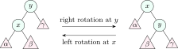

## 7.1 Binary search trees {#sec-dsa-bst}

<div class="nb-proto">

<em><span>Prototypical example for this section:</span> inserting $1, 2, \ldots, 7$ in order builds a path of height $6$, not a tree of height $2$.</em>

</div>

<div class="nb nb-definition" id="definition-7-1-1">

<strong>Definition 7.1.1</strong>. A <strong>binary search tree</strong> (BST) is a binary tree whose keys satisfy, at every node $x$: every key in the left subtree is $< x$ and every key in the right subtree is $> x$ (put duplicates consistently on one side, or keep a count). Equivalently, its inorder traversal is sorted.

</div>

<div class="nb nb-remark" id="remark-7-1-2">

<strong>Remark 7.1.2</strong> (The classic validation bug) — Checking only `left->key < key < right->key` at each node is wrong: a key deep in the left subtree can still exceed an ancestor. Validate with a range $(lo, hi)$ passed down the recursion, or check that the inorder sequence is increasing.

</div>

<div class="nb nb-definition" id="fact-7-1-3">

<strong>Fact 7.1.3</strong> (Operations, all $\Theta(h)$ for height $h$).

- <em>Search</em>: go left if smaller, right if larger.
- <em>Insert</em>: search, then hang the new node where the search fell off.
- <em>Minimum / maximum</em>: leftmost / rightmost node.
- <em>Successor</em> of $x$: the minimum of the right subtree if it exists, otherwise the lowest ancestor of which $x$ lies in the left subtree.
- <em>Delete</em>: a leaf is removed; a node with one child is replaced by that child; a node with two children takes the key of its inorder successor (or predecessor), which has at most one child and is deleted from the right subtree instead.

With $h = \Theta(\log n)$ (balanced, or random insertion order: expected depth about $2\ln n \approx 1.39\log_2 n$) everything is $O(\log n)$; with sorted insertions $h = n - 1$ and everything is $\Theta(n)$.

</div>

```cpp {filename="bst.cpp, lines 12–24"}
Node* erase(Node* t, int k) {
    if (!t) return t;
    if (k < t->key) t->l = erase(t->l, k);
    else if (k > t->key) t->r = erase(t->r, k);
    else if (!t->l || !t->r) { Node* c = t->l ? t->l : t->r; delete t; return c; }  // 0 or 1 child
    else {                                       // 2 children: copy the inorder successor
        Node* s = t->r;
        while (s->l) s = s->l;
        t->key = s->key;
        t->r = erase(t->r, s->key);
    }
    return t;
}
```

```text {filename="Output of bst.cpp"}
built            height 3, preorder: 50 30 20 40 35 45 70 60 65 80
erase 30 (2 ch)  height 3, preorder: 50 35 20 40 45 70 60 65 80
erase 20 (leaf)  height 3, preorder: 50 35 40 45 70 60 65 80
erase 60 (1 ch)  height 3, preorder: 50 35 40 45 70 65 80
1..7 in order    height 6, preorder: 1 2 3 4 5 6 7
```

The tree built from `50 30 70 20 40 60 80 35 45 65` has height $3$. Deleting $30$, which has two children, copies its successor $35$ into it and deletes the old $35$ (a leaf). The last line is the degenerate case: sorted input, height $n - 1$.

<div class="nb nb-remark" id="remark-7-1-4">

<strong>Remark 7.1.4</strong> (Order statistics) — Storing the subtree size in each node lets a BST answer “$k$-th smallest” and “rank of $x$” in $O(h)$. Inorder traversal of a BST is the sort “tree sort”: $O(n \log n)$ if balanced.

</div>

## 7.2 Rotations and AVL trees {#sec-dsa-avl}

<div class="nb-proto">

<em><span>Prototypical example for this section:</span> inserting $10, 20, 30$ makes the root unbalanced; one left rotation fixes it.</em>

</div>

<div class="nb nb-definition" id="definition-7-2-1">

<strong>Definition 7.2.1</strong>. A <strong>rotation</strong> changes the shape of a BST locally without changing its inorder order. A right rotation at $y$ with left child $x$ makes $x$ the subtree root, $y$ its right child, and $x$’s old right subtree $\beta$ the new left subtree of $y$. A left rotation is the mirror image. Each costs $O(1)$.

</div>

<figure class="nb-fig"></figure>

<div class="nb nb-definition" id="definition-7-2-2">

<strong>Definition 7.2.2</strong>. An <strong>AVL tree</strong> is a BST in which, at every node, the heights of the two subtrees differ by at most $1$. The <strong>balance factor</strong> is $h(\text{left}) - h(\text{right}) \in \{-1, 0, 1\}$.

</div>

<div class="nb nb-remark" id="algorithm-7-2-3">

<strong>Algorithm 7.2.3</strong> (AVL insertion) — Insert as in a BST, then walk back up updating heights. At the first node $z$ with balance $\pm 2$, the new key went into one of four places:

- <strong>LL</strong> (left child’s left subtree): one right rotation at $z$;
- <strong>RR</strong>: one left rotation at $z$;
- <strong>LR</strong> (left child’s right subtree): left rotation at the left child, then right rotation at $z$;
- <strong>RL</strong>: right rotation at the right child, then left rotation at $z$.

One single or double rotation restores the height of that subtree, so an insertion makes at most one (single or double) rotation. A deletion may need a rotation at every level: $O(\log n)$ rotations.

</div>

```cpp {filename="avl.cpp, lines 14–24"}
Node* insert(Node* t, int k) {
    if (!t) return new Node(k);
    if (k < t->key) t->l = insert(t->l, k); else t->r = insert(t->r, k);
    fix(t);
    int bal = h(t->l) - h(t->r);
    if (bal > 1 && k < t->l->key) { if (verbose) std::printf("  LL at %d: right rotation\n", t->key); return rotRight(t); }
    if (bal < -1 && k > t->r->key) { if (verbose) std::printf("  RR at %d: left rotation\n", t->key); return rotLeft(t); }
    if (bal > 1) { if (verbose) std::printf("  LR at %d: left at %d, then right\n", t->key, t->l->key); t->l = rotLeft(t->l); return rotRight(t); }
    if (bal < -1) { if (verbose) std::printf("  RL at %d: right at %d, then left\n", t->key, t->r->key); t->r = rotRight(t->r); return rotLeft(t); }
    return t;
}
```

```text {filename="Output of avl.cpp"}
insert 10
  preorder: 10   height 0
insert 20
  preorder: 10 20   height 1
insert 30
  RR at 10: left rotation
  preorder: 20 10 30   height 1
insert 40
  preorder: 20 10 30 40   height 2
insert 50
  RR at 30: left rotation
  preorder: 20 10 40 30 50   height 2
insert 25
  RL at 20: right at 40, then left
  preorder: 30 20 10 25 40 50   height 2
1..1023 inserted in order: AVL height 9 (a plain BST would have height 1022)
min nodes N(h), h = 0..11: 1 2 4 7 12 20 33 54 88 143 232 376
```

The trace shows an RR case when $30$ arrives, another at $30$ when $50$ arrives, and an RL case when $25$ is inserted: $25$ went into the left subtree of $20$’s right child $40$. Inserting $1..1023$ in order gives height $9$, a perfect tree, where the plain BST degenerated to height $1022$.

<div class="nb nb-theorem nb-block" id="theorem-7-2-4">

<strong>Theorem 7.2.4</strong> (AVL height)

An AVL tree of height $h$ has at least $N(h)$ nodes, where $N(0) = 1$, $N(1) = 2$ and $N(h) = N(h-1) + N(h-2) + 1$, so $N(h) = F(h + 3) - 1$ (Fibonacci). Hence $h < 1.4405 \log_2(n + 2) - 0.3277$: an AVL tree is at most about $44\%$ taller than a perfect tree, and search, insert and delete are $O(\log n)$ worst case.

</div>

<div class="nb nb-proof">

<em>Proof.</em> The sparsest AVL tree of height $h$ has a root, one subtree of height $h - 1$ and one of height $h - 2$, each as sparse as possible. The last line of the output above lists $N(h)$; $F(h+3)$ grows like $\varphi^h$, so $h \le \log_\varphi n + O(1) \approx 1.44 \log_2 n$.

</div>

<div class="nb nb-example nb-block" id="example-7-2-5">

<strong>Example 7.2.5</strong> (An OA favourite)

The minimum number of nodes in an AVL tree of height $5$ (edges) is $N(5) = 20$; of height $7$, $54$. The maximum is always $2^{h+1} - 1$. If height is counted in nodes, shift the index by one: “height $6$” then means $N(5) = 20$.

</div>

## 7.3 Red–black trees {#sec-dsa-rb}

<div class="nb-proto">

<em><span>Prototypical example for this section:</span> `std::map`, Java’s `TreeMap` and the Linux CFS scheduler are red–black trees.</em>

</div>

<div class="nb nb-definition" id="definition-7-3-1">

<strong>Definition 7.3.1</strong>. A <strong>red–black tree</strong> is a BST whose nodes are coloured red or black such that: (1) the root is black; (2) the null leaves are black; (3) a red node has no red child; (4) every path from a node down to a null leaf contains the same number of black nodes (its <strong>black height</strong>).

</div>

<div class="nb nb-theorem nb-block" id="theorem-7-3-2">

<strong>Theorem 7.3.2</strong>

A red–black tree with $n$ keys has height at most $2\log_2(n + 1)$.

</div>

<div class="nb nb-proof">

<em>Proof.</em> A subtree with black height $b$ contains at least $2^b - 1$ keys (induction). By property 3, at least half the nodes on any root-to-leaf path are black, so $b \ge h/2$ and $n \ge 2^{h/2} - 1$.

</div>

<div class="nb nb-definition" id="fact-7-3-3">

<strong>Fact 7.3.3</strong> (AVL versus red–black).

- AVL is more strictly balanced ($1.44 \log n$ against $2\log n$), so lookups are slightly faster: good for read-heavy workloads.
- Red–black does fewer rotations: at most $2$ per insertion and at most $3$ per deletion, with recolourings otherwise, against $O(\log n)$ rotations for an AVL deletion. That makes updates cheaper and is why most standard libraries use red–black trees.
- Both give $O(\log n)$ worst-case search, insert, delete, and $O(\log n + k)$ range queries, which hash tables cannot do.

</div>

## 7.4 Other balanced search trees {#s7-4}

<div class="nb nb-definition" id="fact-7-4-1">

<strong>Fact 7.4.1</strong>.

- <strong>Splay tree</strong>: every access rotates the accessed node to the root. No balance information is stored; operations are $O(\log n)$ <em>amortized</em>, and recently used keys become cheap (good for caches). A single operation can cost $\Theta(n)$.
- <strong>Treap</strong>: each node gets a random priority; the tree is a BST by key and a heap by priority. Expected height $O(\log n)$; split and merge are simple, which makes it popular in competitive programming.
- <strong>B-tree</strong> of minimum degree $t$: every node except the root holds between $t - 1$ and $2t - 1$ keys and all leaves are at the same depth, so the height is $O(\log_t n)$. Wide nodes match disk blocks: with $t$ in the hundreds, a billion keys fit in $4$ levels. A <strong>B+-tree</strong> keeps all records in linked leaves and only routing keys inside, which makes range scans sequential; it is the index of almost every database (covered with numericals in the DBMS book).
- <strong>2-3 trees</strong> and <strong>2-3-4 trees</strong> are small B-trees; a red–black tree is a binary encoding of a 2-3-4 tree (a black node with its red children is one B-tree node).

</div>

<div class="nb nb-moral">

A BST is only as good as its height. Balanced trees spend $O(1)$ rotations per update to keep the height $O(\log n)$, and in exchange keep the keys <em>ordered</em>, which a hash table does not.

</div>

## 7.5 A few harder problems to think about {#s7-5}

<div class="nb nb-problem nb-block" id="problem-7a">

<strong>Problem 7A</strong> (Build and delete)

Insert `40 20 60 10 30 50 70 25 35` into an empty BST, then delete $20$. Give the preorder before and after.

<details class="nb-hint">
<summary>Hint</summary>

$20$ has two children; its inorder successor is the minimum of its right subtree.

</details>

<details class="nb-sol">
<summary>Solution</summary>

Before: `40 20 10 30 25 35 60 50 70`. The successor of $20$ is $25$, which replaces it: `40 25 10 30 35 60 50 70`.

</details>

</div>

<div class="nb nb-problem nb-block" id="problem-7b">

<strong>Problem 7B</strong> 🌶🌶 (AVL rotations)

Insert `50 40 30 45 47` into an empty AVL tree. Name each rotation and give the final preorder.

<details class="nb-hint">
<summary>Hint</summary>

$30$ causes an LL case at $50$; $47$ causes an imbalance at $50$ again.

</details>

<details class="nb-sol">
<summary>Solution</summary>

After $30$: LL at $50$, right rotation, root $40$ with children $30$, $50$. $45$ goes to the left of $50$. $47$ goes to the right of $45$, making $50$ unbalanced with the new key in its left child’s right subtree: LR at $50$ (left rotation at $45$, then right rotation at $50$), giving $47$ with children $45$ and $50$. Final preorder: `40 30 47 45 50`.

</details>

</div>

<div class="nb nb-problem nb-block" id="problem-7c">

<strong>Problem 7C</strong> (Height bounds)

What is the maximum height (edges) of an AVL tree with $12$ nodes? Of a red–black tree with $12$ keys, by the $2\log_2(n+1)$ bound?

<details class="nb-hint">
<summary>Hint</summary>

Find the largest $h$ with $N(h) \le 12$.

</details>

<details class="nb-sol">
<summary>Solution</summary>

$N(4) = 12$, so an AVL tree with $12$ nodes can have height $4$, and $N(5) = 20 > 12$ rules out $5$. For red–black, $2\log_2 13 \approx 7.4$, so the bound gives height at most $7$.

</details>

</div>
