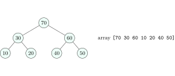

## 8.1 The binary heap {#sec-dsa-heap}

<div class="nb-proto">

<em><span>Prototypical example for this section:</span> an emergency room: the most urgent patient is always served next, whatever the arrival order.</em>

</div>

<div class="nb nb-definition" id="definition-8-1-1">

<strong>Definition 8.1.1</strong>. A <strong>priority queue</strong> supports `insert`, `top` (the maximum, or the minimum) and `extract`. A <strong>binary max-heap</strong> implements it as a <em>complete</em> binary tree in which every node is $\ge$ its children (the <strong>heap property</strong>); a min-heap uses $\le$. The tree is stored level by level in an array, with no pointers.

</div>

<div class="nb nb-definition" id="fact-8-1-2">

<strong>Fact 8.1.2</strong> (Index arithmetic).

|  | 0-based (C++, Java, Python) | 1-based (CLRS, many OA papers) |
|:--|:--|:--|
| parent of $i$ | $\lfloor (i - 1)/2 \rfloor$ | $\lfloor i/2 \rfloor$ |
| left child | $2i + 1$ | $2i$ |
| right child | $2i + 2$ | $2i + 1$ |
| leaves | $\lfloor n/2 \rfloor, \ldots, n - 1$ | $\lfloor n/2 \rfloor + 1, \ldots, n$ |

A heap of $n$ elements has height $\lfloor \log_2 n \rfloor$ and $\lceil n/2 \rceil$ leaves.

</div>

<div class="nb nb-remark" id="remark-8-1-3">

<strong>Remark 8.1.3</strong> (What a heap does <em>not</em> give) — A heap is only partially ordered: the array is not sorted, the second largest is one of the root’s two children, and the minimum of a max-heap is somewhere among the $\lceil n/2 \rceil$ leaves, so finding it is $\Theta(n)$. Searching for an arbitrary key is $\Theta(n)$.

</div>

## 8.2 Insert and extract {#s8-2}

<div class="nb nb-remark" id="algorithm-8-2-1">

<strong>Algorithm 8.2.1</strong> (Sift up and sift down) — <em>Insert</em>: append at the end (the next free slot of the last level), then swap with the parent while larger: <strong>sift up</strong>, $O(\log n)$. <em>Extract-max</em>: save the root, move the last element to the root, then swap it with its larger child while smaller: <strong>sift down</strong>, $O(\log n)$. <em>Top</em>: read `a[0]`, $O(1)$.

</div>

```cpp {filename="heap.cpp, lines 4–24"}
struct MaxHeap {
    std::vector<int> a;
    void push(int x) {                          // sift up: O(log n)
        a.push_back(x);
        int i = a.size() - 1;
        while (i > 0 && a[(i - 1) / 2] < a[i]) { std::swap(a[i], a[(i - 1) / 2]); i = (i - 1) / 2; }
    }
    int pop() {                                 // move last to root, sift down: O(log n)
        int top = a[0];
        a[0] = a.back(); a.pop_back();
        int i = 0, n = a.size();
        while (true) {
            int b = i, l = 2 * i + 1, r = l + 1;
            if (l < n && a[l] > a[b]) b = l;
            if (r < n && a[r] > a[b]) b = r;
            if (b == i) break;
            std::swap(a[i], a[b]); i = b;
        }
        return top;
    }
};
```

```text {filename="Output of heap.cpp"}
push 40        [40]
push 20        [40 20]
push 60        [60 20 40]
push 10        [60 20 40 10]
push 30        [60 30 40 10 20]
push 50        [60 30 50 10 20 40]
push 70        [70 30 60 10 20 40 50]
pop -> 70      [60 30 50 10 20 40]
pop -> 60      [50 30 40 10 20]
sift-down 2    [40 20 70 10 30 50 60]
sift-down 1    [40 30 70 10 20 50 60]
sift-down 0    [70 30 60 10 20 50 40]
        n swaps(build)     n log2 n
     1023         1013         9207
    65535        65519       983025
  1048575      1048555     19922925
```

<figure class="nb-fig"></figure>

<div class="nb nb-example nb-block" id="example-8-2-2">

<strong>Example 8.2.2</strong> (Reading the trace)

After pushing $40, 20, 60$, the $60$ sifts above $40$. Pushing $70$ last makes it climb two levels to the root. `pop` returns $70$, moves $50$ to the root and sifts it down below $60$: `[60 30 50 10 20 40]`. These traces are the most common heap question in OAs, so do one by hand and compare.

</div>

<div class="nb nb-definition" id="fact-8-2-3">

<strong>Fact 8.2.3</strong> (Other operations). <em>Increase-key</em> (max-heap) is a sift up, <em>decrease-key</em> a sift down, both $O(\log n)$ if you know the element’s index (keep a position map). <em>Delete an arbitrary index</em>: replace it with the last element, then sift up or down. <em>Merging</em> two binary heaps is $\Theta(n)$ (concatenate and rebuild).

</div>

## 8.3 Building a heap in linear time {#sec-dsa-buildheap}

<div class="nb-proto">

<em><span>Prototypical example for this section:</span> `std::make_heap` on $10^6$ elements makes fewer than $10^6$ swaps.</em>

</div>

<div class="nb nb-remark" id="algorithm-8-3-1">

<strong>Algorithm 8.3.1</strong> (Bottom-up build-heap (Floyd)) — Sift down every internal node, from the last one ($\lfloor n/2 \rfloor - 1$) back to the root. Each sift-down sees two subtrees that are already heaps.

</div>

<div class="nb nb-theorem nb-block" id="theorem-8-3-2">

<strong>Theorem 8.3.2</strong>

Bottom-up build-heap runs in $\Theta(n)$.

</div>

<div class="nb nb-proof">

<em>Proof.</em> A node of height $k$ sifts down at most $k$ levels, and there are at most $\lceil n/2^{k+1} \rceil$ such nodes. The total is at most $\sum_{k \ge 0} k \lceil n / 2^{k+1} \rceil = O(n \sum_k k/2^{k+1}) = O(n)$, because $\sum_{k} k/2^k = 2$. Most nodes are near the bottom and move little; only the root can move $\log n$ levels. Inserting the elements one by one instead costs $\Theta(n\log n)$ in the worst case (increasing input in a max-heap), because there most nodes are <em>deep</em> and sift <em>up</em> far.

</div>

The output above shows both: the three sift-downs that turn `[40 20 60 10 30 50 70]` into a heap (a <em>different</em> heap from the one built by seven pushes, which is a classic trick question), and the swap counts of build-heap on worst-case input, always below $n$ and far below $n\log_2 n$.

## 8.4 Applications {#sec-dsa-heapapps}

<div class="nb nb-definition" id="fact-8-4-1">

<strong>Fact 8.4.1</strong>.

- <em>Heap sort</em>: build a max-heap, then repeatedly swap the root with the last element and sift down: $O(n\log n)$ worst case, in place, not stable ([Section 13.5](../13-sorting/#sec-dsa-heapsort)).
- <em>Top $k$ of a stream</em>: keep a <em>min</em>-heap of size $k$; replace the root when a larger element arrives: $O(n \log k)$ time, $O(k)$ memory.
- <em>$k$-th smallest</em>: min-heap and $k$ extractions, $O(n + k\log n)$; or a max-heap of size $k$, $O(n\log k)$; or quickselect, $O(n)$ expected ([Section 13.12](../13-sorting/#sec-dsa-selection)).
- <em>Merge $k$ sorted lists</em> of total size $N$: a min-heap of the $k$ current heads, $O(N\log k)$.
- <em>Running median</em>: a max-heap of the lower half and a min-heap of the upper half, $O(\log n)$ per insertion.
- Dijkstra ([Section 16.5.i](../16-graphs/#sec-dsa-dijkstra)), Prim, Huffman coding ([Section 14.4](../14-greedy/#sec-dsa-huffman)), event simulation, OS schedulers.

</div>

## 8.5 Other heaps {#s8-5}

| Heap | insert | find-min | extract-min | decrease-key | merge |
|:--|:-:|:-:|:-:|:-:|:-:|
| Binary | $\log n$ | $1$ | $\log n$ | $\log n$ | $n$ |
| $d$-ary | $\log_d n$ | $1$ | $d\log_d n$ | $\log_d n$ | $n$ |
| Binomial | $1$ amortized | $1$ | $\log n$ | $\log n$ | $\log n$ |
| Fibonacci | $1$ | $1$ | $\log n$ amortized | $1$ amortized | $1$ |
| Pairing | $1$ | $1$ | $\log n$ amortized | $o(\log n)$ amortized | $1$ |

<div class="nb-caption" id="table-8-1">

<strong>Table 8.1.</strong> Priority queues (all bounds $O(\cdot)$; worst case unless stated).

</div>

<div class="nb nb-remark" id="remark-8-5-1">

<strong>Remark 8.5.1</strong> (Why Fibonacci heaps matter, and why nobody uses them) — Dijkstra performs $V$ extract-mins and up to $E$ decrease-keys. With a binary heap that is $O((V + E)\log V)$; with a Fibonacci heap’s $O(1)$ amortized decrease-key it is $O(E + V \log V)$, the best known bound for dense graphs. In practice the constant factors and pointer chasing make binary heaps (often with lazy deletion instead of decrease-key, as in [Section 16.5.i](../16-graphs/#sec-dsa-dijkstra)) faster. A $d$-ary heap with $d \approx E/V$ is the practical middle ground: cheaper decrease-key, shallower tree.

</div>

<div class="nb nb-moral">

A heap answers one question fast, “what is the extreme element?”, and nothing else. Its $O(n)$ construction and array layout make it the default priority queue.

</div>

## 8.6 A few harder problems to think about {#s8-6}

<div class="nb nb-problem nb-block" id="problem-8a">

<strong>Problem 8A</strong> (Heap trace)

Insert `10 50 20 40 30 60` one by one into an empty max-heap (array form). Then perform one extract-max. Give the array after each step.

<details class="nb-hint">
<summary>Hint</summary>

Sift up after each insert; after extraction move the last element to the root.

</details>

<details class="nb-sol">
<summary>Solution</summary>

`[10]`, `[50 10]`, `[50 10 20]`, `[50 40 20 10]`, `[50 40 20 10 30]`, `[60 40 50 10 30 20]`. Extract $60$: move $20$ to the root, it swaps with $50$: `[50 40 20 10 30]`.

</details>

</div>

<div class="nb nb-problem nb-block" id="problem-8b">

<strong>Problem 8B</strong> (Which is a heap?)

Which of these arrays are max-heaps? (a) `[90 15 10 7 12 2 7 3]`; (b) `[90 70 80 60 75 85 50]`; (c) `[25 14 16 13 10 8 12]`.

<details class="nb-hint">
<summary>Hint</summary>

Check every parent at index $i$ against $2i+1$ and $2i+2$.

</details>

<details class="nb-sol">
<summary>Solution</summary>

(a) is a heap: $90 \ge 15, 10$; $15 \ge 7, 12$; $10 \ge 2, 7$; $7 \ge 3$. (b) is not: index $2$ ($80$) has the child $85$ at index $5$. (c) is a heap: $25 \ge 14, 16$; $14 \ge 13, 10$; $16 \ge 8, 12$. Note that (a) is far from sorted, which is the point.

</details>

</div>

<div class="nb nb-problem nb-block" id="problem-8c">

<strong>Problem 8C</strong> 🌶🌶 (Positions of the minimum)

In a max-heap of $1000$ distinct elements stored at indices $0..999$, which indices can hold the minimum? Which can hold the third largest?

<details class="nb-hint">
<summary>Hint</summary>

The minimum is a leaf. The third largest is a child of the root or a child of the second largest.

</details>

<details class="nb-sol">
<summary>Solution</summary>

The minimum must be a leaf: indices $500..999$. The third largest is either a child of the root (index $1$ or $2$) or a child of the second largest (which is at $1$ or $2$), so indices $1$ to $6$.

</details>

</div>
