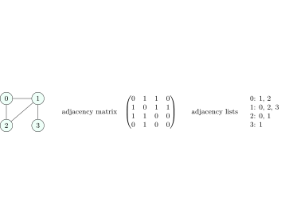

## 10.1 Vocabulary {#sec-dsa-graphvocab}

<em>Prototypical example for this section: a road map: cities are vertices, roads are edges, distances are weights.</em>

<strong>Definition 10.1.1</strong>. A <strong>graph</strong> $G = (V, E)$ has a set $V$ of vertices and a set $E$ of edges, with $|V| = n$ (or $V$) and $|E| = m$ (or $E$). Edges are <strong>undirected</strong> pairs $\{u, v\}$ or <strong>directed</strong> arcs $(u, v)$, possibly <strong>weighted</strong>. A <strong>simple</strong> graph has no self-loops and no parallel edges. The <strong>degree</strong> of a vertex is its number of incident edges; in a directed graph it splits into <strong>in-degree</strong> and <strong>out-degree</strong>.

<strong>Definition 10.1.2</strong>. A <strong>path</strong> is a sequence of vertices joined by edges with no repeated vertex (a <strong>walk</strong> may repeat). A <strong>cycle</strong> returns to its start. An undirected graph is <strong>connected</strong> if every pair is joined by a path; a directed graph is <strong>strongly connected</strong> if every vertex reaches every other, <strong>weakly connected</strong> if its undirected version is connected. A <strong>DAG</strong> is a directed acyclic graph. A <strong>tree</strong> is a connected acyclic undirected graph; a <strong>forest</strong> is acyclic. A <strong>bipartite</strong> graph splits $V$ into two sides with every edge crossing between them. A graph is <strong>dense</strong> if $m = \Theta(n^2)$ and <strong>sparse</strong> if $m = O(n)$ or close to it.

## 10.2 Counting facts {#sec-dsa-graphfacts}

<strong>Theorem 10.2.1</strong>

1. <em>Handshake lemma</em>: $\sum_v \deg(v) = 2m$ in an undirected graph, so the number of odd-degree vertices is even. In a directed graph $\sum \text{in-deg} = \sum \text{out-deg} = m$.
2. A simple undirected graph has at most $\binom n2 = n(n-1)/2$ edges; a simple directed graph at most $n(n-1)$; a DAG at most $n(n-1)/2$.
3. A tree on $n$ vertices has exactly $n - 1$ edges; a forest with $c$ components has $n - c$. Any connected graph has at least $n - 1$ edges; any graph with $n$ or more edges has a cycle.
4. A connected graph has at least one spanning tree; the complete graph $K_n$ has $n^{n-2}$ of them (Cayley’s formula): $3$ for $K_3$, $16$ for $K_4$.
5. A graph is bipartite iff it has no odd cycle. A complete bipartite graph $K_{a,b}$ has $ab$ edges.
6. The number of simple undirected graphs on $n$ labelled vertices is $2^{n(n-1)/2}$.

## 10.3 Representations {#sec-dsa-graphrepr}

<em>Prototypical example for this section: a social network with $10^9$ users and a few hundred friends each cannot be a matrix.</em>

<figure class="nb-fig"></figure>

|  | Adjacency matrix | Adjacency lists | Edge list |
|:--|:--|:--|:--|
| Space | $\Theta(n^2)$ | $\Theta(n + m)$ | $\Theta(m)$ |
| Is $(u, v)$ an edge? | $\Theta(1)$ | $O(\deg u)$ | $O(m)$ |
| Iterate over neighbours of $u$ | $\Theta(n)$ | $\Theta(\deg u)$ | $O(m)$ |
| Add an edge | $\Theta(1)$ | $\Theta(1)$ | $\Theta(1)$ |
| Remove an edge | $\Theta(1)$ | $O(\deg u)$ | $O(m)$ |
| BFS/DFS over the whole graph | $\Theta(n^2)$ | $\Theta(n + m)$ | – |
| Best for | dense graphs, Floyd–Warshall | almost everything | Kruskal, Bellman–Ford |

<strong>Table 10.1.</strong> Graph representations.

<strong>Remark 10.3.1</strong> (Details that matter) —

- An undirected edge is stored twice in adjacency lists (once per endpoint): $2m$ entries.
- The matrix of an undirected graph is symmetric; $A^k[i][j]$ counts the walks of length $k$ from $i$ to $j$, and the diagonal of $A^3$ divided by $6$ (summed) counts triangles.
- Storing each adjacency list in a hash set gives $O(1)$ expected edge queries with $\Theta(n + m)$ space. <strong>Compressed sparse row</strong> (all lists concatenated in one array plus an offset array) is the cache-friendly static version.
- An <strong>incidence matrix</strong> is $n \times m$, one column per edge: rarely the right choice.
- Implicit graphs (a grid, a puzzle’s states) need no stored edges at all: neighbours are computed on the fly.

Use adjacency lists unless the graph is dense or you need $O(1)$ edge queries; every traversal bound $O(n + m)$ silently assumes lists.

## 10.4 A few harder problems to think about {#s10-4}

<strong>Problem 10A</strong> (Degrees)

A simple undirected graph has $10$ vertices: $4$ of degree $3$, $3$ of degree $2$, and the rest of degree $d$. Find all possible $d$ and the number of edges.

Hint

The degree sum is even and $\le 2\binom{10}{2}$.

Solution

$12 + 6 + 3d = 2m$, so $3d$ is even: $d \in \{0, 2, 4, 6, 8\}$ (at most $9$). The edge count is $m = 9 + 3d/2$: $9, 12, 15, 18, 21$. Parity is necessary, not sufficient, so each case must be checked (the Havel–Hakimi test: repeatedly connect the largest-degree vertex to the next largest ones); here all five sequences pass. For $d = 8$: the three degree-$8$ vertices are joined to each other and to all four degree-$3$ vertices, and each degree-$2$ vertex is joined to two of them, so every degree-$8$ vertex misses exactly one degree-$2$ vertex.

<strong>Problem 10B</strong> (Memory)

A directed graph has $10^5$ vertices and $10^6$ edges. Estimate the memory of an adjacency matrix of bits and of adjacency lists of 4-byte integers.

Hint

$n^2$ bits versus $n + m$ integers.

Solution

Matrix: $10^{10}$ bits $\approx 1.25$ GB. Lists: about $10^6$ entries plus $10^5$ offsets, roughly $4.4$ MB as compressed sparse row (more with `std::vector` per vertex, still a few tens of MB).

<strong>Problem 10C</strong> (Cycles and trees)

A connected undirected graph has $n$ vertices and $n + 2$ edges. What is the minimum number of edges you must delete to obtain a spanning tree? How many independent cycles does it have?

Hint

A spanning tree keeps $n - 1$ edges.

Solution

Delete $(n + 2) - (n - 1) = 3$ edges. The <em>cyclomatic number</em> $m - n + 1 = 3$ is the number of independent cycles.

