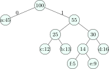

## 14.1 When does greedy work? {#sec-dsa-greedyproof}

<div class="nb-proto">

<em><span>Prototypical example for this section:</span> giving change in Indian or US coins by always taking the largest coin that fits.</em>

</div>

<div class="nb nb-definition" id="definition-14-1-1">

<strong>Definition 14.1.1</strong>. A <strong>greedy algorithm</strong> builds a solution by repeatedly making the choice that looks best now, and never revisits it. It is correct when the problem has

1. the <strong>greedy-choice property</strong>: some optimal solution contains the greedy first choice; and
2. <strong>optimal substructure</strong>: after that choice, what remains is a smaller instance of the same problem whose optimal solution completes an optimal one.

</div>

<div class="nb nb-definition" id="fact-14-1-2">

<strong>Fact 14.1.2</strong> (How greedy algorithms are proved).

- <strong>Exchange argument</strong>: take any optimal solution that differs from the greedy one; swap in the greedy choice and show the result is no worse. Repeating turns the optimum into the greedy solution.
- <strong>Greedy stays ahead</strong>: show by induction that after every step the greedy partial solution is at least as good as any other.
- <strong>Matroids</strong>: when the feasible sets form a matroid (e.g. forests of a graph), the greedy algorithm on weights is optimal; this is the deep reason Kruskal works.

Without a proof, assume greedy is wrong: test it against small counterexamples first.

</div>

The program `greedy.cpp` runs the four examples of this chapter:

```text {filename="Output of greedy.cpp"}
activities chosen: [1,4) [5,7) [8,11) [12,16)
Huffman merges: 5+9 12+13 14+16 25+30 45+55
  a freq 45 -> code length 1
  b freq 13 -> code length 3
  c freq 12 -> code length 3
  d freq 16 -> code length 3
  e freq  9 -> code length 4
  f freq  5 -> code length 4
  total bits for 100 symbols: 224 (fixed 3-bit code: 300)
fractional knapsack value = 240
coins {1,3,4}, amount  6: greedy 3 coins, optimal 2 coins
coins {1,3,4}, amount 10: greedy 4 coins, optimal 3 coins
```

## 14.2 Activity selection and interval problems {#sec-dsa-activity}

<div class="nb nb-remark" id="algorithm-14-2-1">

<strong>Algorithm 14.2.1</strong> (Maximum number of non-overlapping intervals) — Sort by <em>finishing</em> time; take an interval whenever it starts no earlier than the last taken one finishes. $O(n\log n)$.

</div>

```cpp {filename="greedy.cpp, lines 14–19"}
    std::vector<std::pair<int, int>> act = {{1, 4}, {3, 5}, {0, 6}, {5, 7}, {3, 9}, {5, 9}, {6, 10}, {8, 11}, {8, 12}, {2, 14}, {12, 16}};
    std::sort(act.begin(), act.end(), [](std::pair<int, int> a, std::pair<int, int> b) { return a.second < b.second; });
    int lastEnd = -1;
    std::printf("activities chosen:");
    for (auto& a : act) if (a.first >= lastEnd) { std::printf(" [%d,%d)", a.first, a.second); lastEnd = a.second; }
    std::printf("\n");
```

<div class="nb nb-proof">

<em>Why finishing time.</em> Exchange argument: an optimal solution’s first interval can be replaced by the earliest-finishing one, which ends no later and so conflicts with nothing that the original first interval did not. Sorting by start time fails (one long early interval blocks everything) and so does sorting by length (a short interval can overlap two disjoint long ones).

</div>

<div class="nb nb-definition" id="fact-14-2-2">

<strong>Fact 14.2.2</strong> (Related interval problems).

- Minimum number of rooms (platforms) for all intervals: sort the start and end events and sweep, tracking the maximum overlap; $O(n\log n)$. It equals the maximum number of intervals that share a point.
- Minimum number of points that stab every interval: sort by end, place a point at the end of the first unstabbed interval.
- Merging overlapping intervals: sort by start and extend the current interval.
- <em>Weighted</em> interval scheduling is <em>not</em> greedy; it needs DP with binary search ([Chapter 15](../15-dp/)).

</div>

## 14.3 Fractional knapsack {#s14-3}

<div class="nb nb-remark" id="algorithm-14-3-1">

<strong>Algorithm 14.3.1</strong> (Fractional knapsack) — Items may be split. Sort by value per unit weight and take items in that order, the last one partially. $O(n\log n)$. With capacity $50$ and items $(60, 10)$, $(100, 20)$, $(120, 30)$ it takes the first two whole and $20/30$ of the third: $60 + 100 + 80 = 240$, as printed above.

</div>

<div class="nb nb-remark" id="remark-14-3-2">

<strong>Remark 14.3.2</strong> (The 0/1 version is not greedy) — If items cannot be split, greedy by ratio takes the first two items for $160$, while the optimum takes the second and third for $220$. The 0/1 knapsack needs DP and is NP-hard ([Section 15.3](../15-dp/#sec-dsa-knapsack)).

</div>

## 14.4 Huffman coding {#sec-dsa-huffman}

<div class="nb-proto">

<em><span>Prototypical example for this section:</span> compressing a text in which `e` is far more frequent than `z`.</em>

</div>

<div class="nb nb-definition" id="definition-14-4-1">

<strong>Definition 14.4.1</strong>. A <strong>prefix code</strong> assigns bit strings to symbols so that no code word is a prefix of another, which makes decoding unambiguous; it is a binary tree with symbols at the leaves. The cost of a code is $\sum_c f(c)\cdot \text{depth}(c)$.

</div>

<div class="nb nb-remark" id="algorithm-14-4-2">

<strong>Algorithm 14.4.2</strong> (Huffman’s algorithm) — Put every symbol in a min-heap keyed by frequency. Repeatedly remove the two smallest trees and insert a new tree with them as children and the sum of their frequencies. After $n - 1$ merges one tree remains. $O(n\log n)$.

</div>

```cpp {filename="greedy.cpp, lines 21–43"}
    // 2. Huffman: repeatedly merge the two least frequent trees.
    const char sym[] = {'a', 'b', 'c', 'd', 'e', 'f'};
    long freq[] = {45, 13, 12, 16, 9, 5};
    std::vector<int> par(11, -1);
    std::priority_queue<H, std::vector<H>, Cmp> pq;
    for (int i = 0; i < 6; ++i) pq.push({freq[i], i});
    int next = 6;
    std::printf("Huffman merges:");
    while (pq.size() > 1) {
        H x = pq.top(); pq.pop(); H y = pq.top(); pq.pop();
        par[x.id] = par[y.id] = next;
        std::printf(" %ld+%ld", x.f, y.f);
        pq.push({x.f + y.f, next++});
    }
    std::printf("\n");
    long bits = 0;
    for (int i = 0; i < 6; ++i) {
        int d = 0;
        for (int v = i; par[v] != -1; v = par[v]) ++d;
        bits += d * freq[i];
        std::printf("  %c freq %2ld -> code length %d\n", sym[i], freq[i], d);
    }
    std::printf("  total bits for 100 symbols: %ld (fixed 3-bit code: 300)\n", bits);
```

<figure class="nb-fig"></figure>

With frequencies $a{:}45, b{:}13, c{:}12, d{:}16, e{:}9, f{:}5$ (per $100$ symbols), the merges are $5 + 9$, $12 + 13$, $14 + 16$, $25 + 30$, $45 + 55$, the code lengths are $1, 3, 3, 3, 4, 4$, and the cost is $224$ bits instead of $300$ for a fixed $3$-bit code.

<div class="nb nb-theorem nb-block" id="theorem-14-4-3">

<strong>Theorem 14.4.3</strong>

Huffman’s code is an optimal prefix code.

</div>

<div class="nb nb-proof">

<em>Sketch.</em> Some optimal tree has the two least frequent symbols as sibling leaves at the maximum depth (exchange: swapping them down never increases the cost). Merging them into one symbol of their combined frequency reduces the problem by one symbol and changes every tree’s cost by the same constant, so an optimal tree for the reduced problem extends to an optimal tree for the original.

</div>

<div class="nb nb-remark" id="remark-14-4-4">

<strong>Remark 14.4.4</strong> (Exam details) — Ties may be broken either way: the codes change, the total cost does not. The number of merges is $n - 1$. The cost equals the sum of the values of all internal nodes ($14 + 25 + 30 + 55 + 100 = 224$), which is the quickest way to compute it by hand. The same algorithm gives the cheapest order to merge sorted files (“optimal merge pattern”).

</div>

## 14.5 Where greedy fails {#sec-dsa-greedyfail}

<div class="nb nb-example nb-block" id="example-14-5-1">

<strong>Example 14.5.1</strong> (Coin change)

With coins $\{1, 3, 4\}$ and amount $6$, greedy takes $4 + 1 + 1$ (three coins) but $3 + 3$ uses two; the program above confirms it and finds $10 = 3 + 3 + 4$ against greedy’s $4 + 4 + 1 + 1$. Greedy is optimal for <strong>canonical</strong> coin systems such as $\{1, 2, 5, 10, 20, 50, 100, \ldots \}$, but deciding whether a coin system is canonical is itself a non-trivial test; the safe algorithm is DP, $O(\text{amount} \times \text{coins})$.

</div>

<div class="nb nb-definition" id="fact-14-5-2">

<strong>Fact 14.5.2</strong> (Greedy successes and failures to remember).

| Greedy is optimal | Greedy fails |
|:--|:--|
| activity selection (earliest finish) | weighted interval scheduling |
| fractional knapsack | 0/1 knapsack |
| Huffman coding | coin change for arbitrary coins |
| MST: Kruskal, Prim | travelling salesman (nearest neighbour) |
| Dijkstra (non-negative weights) | shortest paths with negative edges |
| job sequencing with deadlines | longest path, graph colouring |
| minimising waiting time (shortest job first) | set cover (greedy is only $\ln n$-approximate) |

</div>

<div class="nb nb-remark" id="algorithm-14-5-3">

<strong>Algorithm 14.5.3</strong> (Job sequencing with deadlines) — Unit-time jobs with deadlines and profits: sort by profit, descending, and place each job in the latest free slot not after its deadline (a DSU makes finding the slot near-constant time). $O(n\log n)$. Its correctness follows from a matroid structure (sets of jobs that can all meet their deadlines).

</div>

<div class="nb nb-moral">

Greedy is fast and simple, and it is wrong unless you can prove the exchange argument. When it is wrong, the problem usually needs dynamic programming.

</div>

## 14.6 A few harder problems to think about {#s14-6}

<div class="nb nb-problem nb-block" id="problem-14a">

<strong>Problem 14A</strong> 🌶🌶 (Huffman cost)

Frequencies `A:1, B:1, C:2, D:3, E:5, F:8`. Find the total cost of the Huffman code and the code length of every symbol.

<details class="nb-hint">
<summary>Hint</summary>

Sum the internal nodes: $1 + 1$, then $2 + 2$, …

</details>

<details class="nb-sol">
<summary>Solution</summary>

Merges: $1 + 1 = 2$, $2 + 2 = 4$, $3 + 4 = 7$, $5 + 7 = 12$, $8 + 12 = 20$. Cost $2 + 4 + 7 + 12 + 20 = 45$ bits. Code lengths: `A` and `B` $5$, `C` $4$, `D` $3$, `E` $2$, `F` $1$; check: $5 + 5 + 8 + 9 + 10 + 8 = 45$. Fibonacci frequencies produce the most skewed Huffman tree, a path.

</details>

</div>

<div class="nb nb-problem nb-block" id="problem-14b">

<strong>Problem 14B</strong> (Rooms)

Meetings: $[1, 4), [2, 5), [3, 6), [5, 8), [6, 9), [8, 10)$. What is the maximum number of meetings one room can host, and how many rooms are needed for all of them?

<details class="nb-hint">
<summary>Hint</summary>

Earliest finish for the first; maximum overlap for the second.

</details>

<details class="nb-sol">
<summary>Solution</summary>

One room: $[1, 4), [5, 8), [8, 10)$, three meetings. Rooms: at time $3$ three meetings are running ($[1,4), [2,5), [3,6)$), and no point has more, so $3$ rooms.

</details>

</div>

<div class="nb nb-problem nb-block" id="problem-14c">

<strong>Problem 14C</strong> (Counterexample)

“Sort jobs by deadline and do them in that order” is optimal for minimising the maximum lateness. Is “sort by shortest processing time” also optimal for it? Give a counterexample.

<details class="nb-hint">
<summary>Hint</summary>

Two jobs suffice.

</details>

<details class="nb-sol">
<summary>Solution</summary>

No. Job 1: time $1$, deadline $100$; job 2: time $10$, deadline $10$. Shortest first finishes job 2 at $11$, lateness $1$; deadline order finishes it at $10$, maximum lateness $0$.

</details>

</div>
