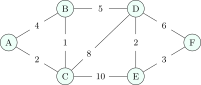

All bounds in this chapter assume adjacency lists ([Section 10.3](../10-graphrep/#sec-dsa-graphrepr)); with an adjacency matrix every $O(V + E)$ becomes $O(V^2)$.

## 16.1 Breadth-first search {#sec-dsa-bfs}

<div class="nb-proto">

<em><span>Prototypical example for this section:</span> the minimum number of moves of a knight between two squares.</em>

</div>

<div class="nb nb-remark" id="algorithm-16-1-1">

<strong>Algorithm 16.1.1</strong> (BFS) — Put the source in a queue with distance $0$. Repeatedly dequeue a vertex and enqueue each unvisited neighbour with distance one larger, marking it visited <em>when it is enqueued</em> (marking on dequeue lets a vertex enter the queue many times). $O(V + E)$ time, $O(V)$ space.

</div>

<div class="nb nb-theorem nb-block" id="theorem-16-1-2">

<strong>Theorem 16.1.2</strong>

BFS visits vertices in non-decreasing order of distance, and the distance it assigns is the length of a shortest path (fewest edges) from the source. The parent pointers form a <strong>shortest-path tree</strong>.

</div>

<div class="nb nb-definition" id="fact-16-1-3">

<strong>Fact 16.1.3</strong> (Uses of BFS). Shortest paths in unweighted graphs and grids; level-order traversal; connected components; bipartite testing (2-colour by BFS level; an edge inside one level means an odd cycle); <strong>multi-source BFS</strong> (start with all sources in the queue: distance to the nearest one); <strong>0-1 BFS</strong> for edge weights $0$ or $1$ (a deque: push $0$-edges to the front, $1$-edges to the back), $O(V + E)$.

</div>

## 16.2 Depth-first search {#sec-dsa-dfs}

<div class="nb-proto">

<em><span>Prototypical example for this section:</span> exploring a maze by always taking an unexplored corridor and backtracking at dead ends.</em>

</div>

<div class="nb nb-remark" id="algorithm-16-2-1">

<strong>Algorithm 16.2.1</strong> (DFS with discovery and finish times) — Colour every vertex white. `dfs(u)`: colour $u$ grey and record its discovery time; for each neighbour $v$, if $v$ is white call `dfs(v)`; finally colour $u$ black and record its finish time. Run it from every white vertex. $O(V + E)$ time, $O(V)$ stack.

</div>

```cpp {filename="traverse.cpp, lines 11–19"}
void dfs(const G& g, int u) {
    color[u] = 1; disc[u] = ++timer_;
    for (int v : g[u]) {
        const char* type = color[v] == 0 ? "tree" : color[v] == 1 ? "back" : disc[v] > disc[u] ? "forward" : "cross";
        std::printf("  edge %d->%d: %s\n", u, v, type);
        if (color[v] == 0) dfs(g, v);
    }
    color[u] = 2; fin[u] = ++timer_;
}
```

<div class="nb nb-definition" id="definition-16-2-2">

<strong>Definition 16.2.2</strong> (Edge classification in a directed graph). When DFS examines edge $(u, v)$: if $v$ is white it is a <strong>tree edge</strong>; grey (an ancestor still on the stack): a <strong>back edge</strong>; black and discovered after $u$: a <strong>forward edge</strong> (to a descendant); black and discovered before $u$: a <strong>cross edge</strong>. In an undirected graph only tree and back edges occur.

</div>

The program `traverse.cpp` runs BFS on a small undirected graph, then DFS, SCCs and topological sorting on directed graphs, then bridges and articulation points:

```text {filename="Output of traverse.cpp"}
BFS from 0, visit order: 0(d=0) 1(d=1) 2(d=1) 3(d=2) 4(d=2) 5(d=3)
DFS of the directed graph (vertices in order 0..7):
  edge 0->1: tree
  edge 1->2: tree
  edge 2->0: back
  edge 1->3: tree
  edge 3->4: tree
  edge 4->5: tree
  edge 5->3: back
  edge 0->2: forward
  edge 6->5: cross
  edge 6->7: tree
  edge 7->6: back
  0: d= 1 f=12
  1: d= 2 f=11
  2: d= 3 f= 4
  3: d= 5 f=10
  4: d= 6 f= 9
  5: d= 7 f= 8
  6: d=13 f=16
  7: d=14 f=15
SCCs: {6,7} {0,1,2} {3,4,5}
Kahn topological order: 4 5 0 2 3 1
DFS topological order (reverse finish): 5 4 2 3 1 0
bridges / articulation points:
  bridge 5-6
  articulation point 5
  articulation point 3
  bridge 2-3
  articulation point 2
```

<div class="nb nb-theorem nb-block" id="theorem-16-2-3">

<strong>Theorem 16.2.3</strong> (Parenthesis and white-path theorems)

The intervals $[d(u), f(u)]$ of any two vertices are either disjoint or nested, and $v$ is a descendant of $u$ iff $[d(v), f(v)] \subset [d(u), f(u)]$ (in the output, $[5, 10]$ for vertex $3$ contains $[6, 9]$ and $[7, 8]$). A directed graph has a cycle iff DFS finds a back edge: here $2 \to 0$, $5 \to 3$ and $7 \to 6$.

</div>

## 16.3 Topological sort {#sec-dsa-topo}

<div class="nb nb-definition" id="definition-16-3-1">

<strong>Definition 16.3.1</strong>. A <strong>topological order</strong> of a DAG lists the vertices so that every edge goes from an earlier to a later vertex. It exists iff the graph is acyclic; it is unique iff the DAG has a Hamiltonian path.

</div>

<div class="nb nb-remark" id="algorithm-16-3-2">

<strong>Algorithm 16.3.2</strong> (Two algorithms, both $O(V + E)$) —

- <strong>Kahn</strong>: repeatedly output a vertex of in-degree $0$ and decrement its neighbours’ in-degrees. If vertices remain when no in-degree is $0$, there is a cycle.
- <strong>DFS</strong>: output vertices in decreasing order of finish time (reverse post-order). An edge $(u, v)$ in a DAG always has $f(u) > f(v)$.

</div>

For the DAG $5 \to 2, 5 \to 0, 4 \to 0, 4 \to 1, 2 \to 3, 3 \to 1$ the output shows two valid but different orders, `4 5 0 2 3 1` (Kahn, smallest label first) and `5 4 2 3 1 0` (DFS). Uses: build systems, course prerequisites, spreadsheet recalculation, and shortest or longest paths in a DAG in $O(V + E)$ by relaxing edges in topological order (longest path is NP-hard in general graphs but easy in DAGs).

## 16.4 Connectivity {#sec-dsa-connectivity}

<div class="nb nb-definition" id="definition-16-4-1">

<strong>Definition 16.4.1</strong>. A <strong>strongly connected component</strong> (SCC) of a directed graph is a maximal set of vertices that all reach each other. Contracting every SCC to one vertex leaves a DAG (the <strong>condensation</strong>).

</div>

<div class="nb nb-remark" id="algorithm-16-4-2">

<strong>Algorithm 16.4.2</strong> (Kosaraju) — Run DFS on $G$ and record the finish order. Run DFS on the reversed graph $G^T$, starting from vertices in decreasing finish time; each tree of the second pass is one SCC. Two DFS passes: $O(V + E)$. <strong>Tarjan’s</strong> algorithm finds the same SCCs in one DFS with low-link values.

</div>

In the output the SCCs are $\{0, 1, 2\}$, $\{3, 4, 5\}$ and $\{6, 7\}$.

<div class="nb nb-definition" id="definition-16-4-3">

<strong>Definition 16.4.3</strong>. In an undirected connected graph, a <strong>bridge</strong> is an edge whose removal disconnects the graph, and an <strong>articulation point</strong> (cut vertex) is such a vertex. With DFS times $\text{tin}$ and $\text{low}(u)$ = the earliest $\text{tin}$ reachable from $u$’s subtree by one back edge, a tree edge $(u, v)$ is a bridge iff $\text{low}(v) > \text{tin}(u)$; a non-root $u$ is an articulation point iff some child has $\text{low}(v) \ge \text{tin}(u)$; the root iff it has two or more DFS children. $O(V + E)$.

</div>

```cpp {filename="traverse.cpp, lines 27–41"}
int tin[16], low[16], t2;
void bridges(const G& g, int u, int parent) {
    tin[u] = low[u] = ++t2;
    int children = 0;
    bool cut = false;
    for (int v : g[u]) {
        if (v == parent) continue;
        if (tin[v]) { low[u] = std::min(low[u], tin[v]); continue; }
        bridges(g, v, u); ++children;
        low[u] = std::min(low[u], low[v]);
        if (low[v] > tin[u]) std::printf("  bridge %d-%d\n", u, v);
        if (parent != -1 && low[v] >= tin[u]) cut = true;
    }
    if ((parent == -1 && children > 1) || cut) std::printf("  articulation point %d\n", u);
}
```

The test graph is two triangles $0\text{-}1\text{-}2$ and $3\text{-}4\text{-}5$ joined by the edge $2\text{-}3$, plus a pendant edge $5\text{-}6$: the bridges are $2\text{-}3$ and $5\text{-}6$, the cut vertices $2$, $3$ and $5$.

## 16.5 Shortest paths {#sec-dsa-shortest}

<div class="nb-proto">

<em><span>Prototypical example for this section:</span> a navigation app’s fastest route.</em>

</div>

<figure class="nb-fig"></figure>

### 16.5.i Dijkstra {#sec-dsa-dijkstra}

<div class="nb nb-remark" id="algorithm-16-5-1">

<strong>Algorithm 16.5.1</strong> (Dijkstra, non-negative weights) — Keep tentative distances, $0$ for the source and $\infty$ elsewhere, in a min-priority queue. Repeatedly extract the closest unsettled vertex $u$, <strong>settle</strong> it, and <strong>relax</strong> each edge $(u, v, w)$: if $d(u) + w < d(v)$, set $d(v) = d(u) + w$. The version below pushes a new heap entry on every improvement and skips stale ones (<strong>lazy deletion</strong>) instead of decrease-key.

</div>

```cpp {filename="shortest.cpp, lines 26–39"}
    // Dijkstra from A with a binary heap (lazy deletion of stale entries).
    std::printf("Dijkstra from A               A     B     C     D     E     F\n");
    std::vector<int> d(N, INF), prev(N, -1); std::vector<bool> done(N, false);
    std::priority_queue<std::pair<int, int>, std::vector<std::pair<int, int>>, std::greater<std::pair<int, int>>> pq;
    d[0] = 0; pq.push({0, 0});
    row("start", d);
    while (!pq.empty()) {
        int du = pq.top().first, x = pq.top().second; pq.pop();
        if (done[x] || du > d[x]) continue;               // stale entry
        done[x] = true;
        for (auto& p : g[x]) if (d[x] + p.second < d[p.first]) { d[p.first] = d[x] + p.second; prev[p.first] = x; pq.push({d[p.first], p.first}); }
        char lab[16]; std::snprintf(lab, sizeof lab, "settle %c", nm[x]);
        row(lab, d);
    }
```

```text {filename="Output of shortest.cpp"}
Dijkstra from A               A     B     C     D     E     F
  start            0   inf   inf   inf   inf   inf
  settle A         0     4     2   inf   inf   inf
  settle C         0     3     2    10    12   inf
  settle B         0     3     2     8    12   inf
  settle D         0     3     2     8    10    14
  settle E         0     3     2     8    10    13
  settle F         0     3     2     8    10    13
  path to F: A C B D E F
Prim from A: AC(2) BC(1) BD(5) DE(2) EF(3)  total 13
Kruskal takes: BC(1) AC(2) DE(2) EF(3) BD(5)  total 13
  and skips: AB(4) DF(6) CD(8) CE(10)
Bellman-Ford round 1: S=0 A=1 B=5 C=2
Bellman-Ford round 2: S=0 A=1 B=5 C=2
Bellman-Ford round 3: S=0 A=1 B=5 C=2
Dijkstra on the same graph:  S=0 A=2 B=5 C=3  (A and C are wrong)
add C->B 1 (cycle A->C->B->A, weight -2): round |V| relaxes? yes: negative cycle
Floyd-Warshall, all pairs:
   0   3   5   6
   5   0   2   3
   3   6   0   1
   2   5   7   0
```

<div class="nb nb-example nb-block" id="example-16-5-2">

<strong>Example 16.5.2</strong> (Reading the Dijkstra table)

Each row is the distance array after settling one vertex. Settling C improves B from $4$ to $3$ (via C), D to $10$ and E to $12$; settling B improves D to $8$; settling D improves E to $10$ and F to $14$; settling E improves F to $13$. Settled distances never change again. The shortest path to F is `A C B D E F`, of length $13$.

</div>

<div class="nb nb-theorem nb-block" id="theorem-16-5-3">

<strong>Theorem 16.5.3</strong> (Correctness, and why negative edges break it)

With non-negative weights, when $u$ is extracted $d(u)$ is final: any other path to $u$ leaves the settled set through some vertex $x$ with $d(x) \ge d(u)$ and then adds non-negative weights. With a negative edge a later path can be cheaper than an already settled distance. The output’s second graph ($S \to A$ $2$, $S \to B$ $5$, $B \to A$ $-4$, $A \to C$ $1$) shows it: textbook Dijkstra settles $A$ at $2$ and never revisits it, so it reports $A = 2$, $C = 3$, while the truth is $A = 1$, $C = 2$. Adding a constant to every weight does not fix it, because it penalises paths with more edges.

</div>

<div class="nb nb-definition" id="fact-16-5-4">

<strong>Fact 16.5.4</strong> (Dijkstra’s complexity depends on the priority queue). $V$ extractions and up to $E$ relaxations:

| Queue | Time |
|:--|:--|
| array (scan for the minimum) | $O(V^2 + E) = O(V^2)$: best for dense graphs |
| binary heap (decrease-key or lazy) | $O((V + E)\log V)$ |
| Fibonacci heap | $O(E + V\log V)$ |

With lazy deletion the heap holds up to $E$ entries: $O(E\log E) = O(E\log V)$, the same bound.

</div>

### 16.5.ii Bellman–Ford {#s16-5-ii}

<div class="nb nb-remark" id="algorithm-16-5-5">

<strong>Algorithm 16.5.5</strong> (Bellman–Ford) — Relax <em>every</em> edge, $V - 1$ times. A shortest path has at most $V - 1$ edges, and after round $i$ every shortest path with at most $i$ edges is correct. If a $V$-th round still improves some distance, a negative cycle is reachable from the source. $O(VE)$ time, $O(V)$ space. It allows negative edges, and works on an edge list, which is why it is the basis of distance-vector routing.

</div>

In the output the correct distances appear already in round $1$, because the edges happened to be listed in a good order; the $V - 1$ bound is for the worst order. After the edge $C \to B$ of weight $1$ is added, the cycle $A \to C \to B \to A$ has weight $1 + 1 - 4 = -2$ and round $|V|$ still relaxes, which is the negative-cycle test.

### 16.5.iii Floyd–Warshall {#s16-5-iii}

<div class="nb nb-remark" id="algorithm-16-5-6">

<strong>Algorithm 16.5.6</strong> (All pairs) — $d_k(i, j)$ = shortest path from $i$ to $j$ using only intermediate vertices from $\{1..k\}$; $d_k(i, j) = \min(d_{k-1}(i, j),\; d_{k-1}(i, k) + d_{k-1}(k, j))$. Three nested loops with $k$ <em>outermost</em>, one matrix updated in place: $\Theta(V^3)$ time, $\Theta(V^2)$ space. Negative edges are fine; a negative value on the diagonal reveals a negative cycle.

</div>

The last lines of the output are the all-pairs matrix for the graph $0 \to 1$ $3$, $0 \to 3$ $7$, $1 \to 0$ $8$, $1 \to 2$ $2$, $2 \to 0$ $5$, $2 \to 3$ $1$, $3 \to 0$ $2$: for instance $d(1, 0) = 5$ via $1 \to 2 \to 3 \to 0$, beating the direct edge of weight $8$.

| Situation | Algorithm | Time |
|:--|:--|:--|
| Unweighted | BFS | $O(V + E)$ |
| Weights $0$ or $1$ | 0-1 BFS | $O(V + E)$ |
| DAG, any weights | relax in topological order | $O(V + E)$ |
| Non-negative weights, one source | Dijkstra | $O((V + E)\log V)$ |
| Negative weights, one source | Bellman–Ford (SPFA in practice) | $O(VE)$ |
| All pairs, dense or small | Floyd–Warshall | $O(V^3)$ |
| All pairs, sparse, negative edges | Johnson (Bellman–Ford reweighting + $V$ Dijkstras) | $O(VE\log V)$ |
| Single pair with a good heuristic | A\* (Dijkstra ordered by $d(v) + h(v)$, $h$ admissible) | problem dependent |

<div class="nb-caption" id="table-16-1">

<strong>Table 16.1.</strong> Choosing a shortest-path algorithm.

</div>

## 16.6 Minimum spanning trees {#sec-dsa-mst}

<div class="nb-proto">

<em><span>Prototypical example for this section:</span> connecting villages with the least total length of cable.</em>

</div>

<div class="nb nb-definition" id="definition-16-6-1">

<strong>Definition 16.6.1</strong>. A <strong>minimum spanning tree</strong> (MST) of a connected weighted undirected graph is a spanning tree of minimum total weight. It has $V - 1$ edges.

</div>

<div class="nb nb-theorem nb-block" id="theorem-16-6-2">

<strong>Theorem 16.6.2</strong> (Cut and cycle properties)

For any cut (a split of $V$ into two sides), a lightest edge crossing it belongs to some MST; if it is the unique lightest, to every MST. The heaviest edge of a cycle belongs to no MST if it is the unique heaviest. If all weights are distinct, the MST is unique.

</div>

<div class="nb nb-remark" id="algorithm-16-6-3">

<strong>Algorithm 16.6.3</strong> (Kruskal and Prim) —

- <strong>Kruskal</strong>: sort the edges by weight; add each edge unless it closes a cycle, detected with a disjoint-set union structure. $O(E\log E)$, dominated by the sort.
- <strong>Prim</strong>: grow one tree from a start vertex, always adding the lightest edge from the tree to a new vertex (a priority queue of crossing edges). $O(E\log V)$ with a binary heap, $O(V^2)$ with an array (better for dense graphs), $O(E + V\log V)$ with a Fibonacci heap.
- <strong>Boruvka</strong>: in rounds, every component adds its lightest outgoing edge; $O(E\log V)$, and easy to parallelise.

All three are justified by the cut property.

</div>

```cpp {filename="shortest.cpp, lines 58–71"}
    // Kruskal: edges by weight, skip an edge whose ends are already connected.
    std::vector<E> s = edges;
    std::stable_sort(s.begin(), s.end(), [](const E& a, const E& b) { return a.w < b.w; });
    std::vector<int> par(N); for (int i = 0; i < N; ++i) par[i] = i;
    std::function<int(int)> find = [&](int x) { return par[x] == x ? x : par[x] = find(par[x]); };
    total = 0;
    std::string taken, skipped;
    for (auto& e : s) {
        int a = find(e.u), b = find(e.v);
        char buf[16]; std::snprintf(buf, sizeof buf, " %c%c(%d)", nm[e.u], nm[e.v], e.w);
        if (a == b) { skipped += buf; continue; }          // would close a cycle
        par[a] = b; total += e.w; taken += buf;
    }
    std::printf("Kruskal takes:%s  total %d\n  and skips:%s\n", taken.c_str(), total, skipped.c_str());
```

On the graph above both give weight $13$ (output lines after the path), with edges $\{BC, AC, DE, EF, BD\}$. Prim from A adds $AC(2), BC(1), BD(5), DE(2), EF(3)$ in that order; Kruskal adds the same edges in weight order and skips $AB(4)$, $DF(6)$, $CD(8)$ and $CE(10)$, each of which would close a cycle.

<div class="nb nb-remark" id="remark-16-6-4">

<strong>Remark 16.6.4</strong> (Traps) — The MST does not contain shortest paths: the MST path from A to F has weight $2 + 1 + 5 + 2 + 3 = 13$, the same as the shortest path here only by coincidence. MSTs are defined for undirected graphs; the directed analogue (minimum arborescence) needs the Chu–Liu/Edmonds algorithm. Negative weights are fine for MSTs.

</div>

## 16.7 Flows, matching and hard problems {#sec-dsa-flow}

<div class="nb nb-definition" id="fact-16-7-1">

<strong>Fact 16.7.1</strong> (Maximum flow). In a network with capacities, the maximum flow from $s$ to $t$ equals the minimum capacity of an $s$–$t$ cut (<strong>max-flow min-cut theorem</strong>). <strong>Ford–Fulkerson</strong> repeatedly augments along a path in the residual graph, $O(E \cdot f^*)$ for integer capacities; choosing shortest augmenting paths by BFS (<strong>Edmonds–Karp</strong>) gives $O(VE^2)$; Dinic’s algorithm $O(V^2E)$, and $O(E\sqrt V)$ on unit-capacity bipartite graphs (Hopcroft–Karp). Maximum bipartite matching is a flow problem.

</div>

<div class="nb nb-definition" id="fact-16-7-2">

<strong>Fact 16.7.2</strong> (Easy-looking problems that are hard).

- <strong>Euler path</strong> (every <em>edge</em> once): exists iff the graph is connected (ignoring isolated vertices) and has $0$ or $2$ odd-degree vertices; found in $O(V + E)$ (Hierholzer). In a directed graph: in-degree equals out-degree everywhere, except possibly one start and one end.
- <strong>Hamiltonian path</strong> (every <em>vertex</em> once): NP-complete; $O(2^n n^2)$ by bitmask DP.
- <strong>Graph colouring</strong>: $2$-colourability is bipartiteness ($O(V + E)$); $3$-colourability is NP-complete; every planar graph is $4$-colourable. Greedy colouring uses at most $\Delta + 1$ colours.
- Longest simple path, TSP, maximum clique, minimum vertex cover: NP-hard in general.

</div>

| Algorithm | Time |
|:--|:--|
| BFS, DFS, connected components, bipartite check | $O(V + E)$ |
| Topological sort, cycle detection, SCC, bridges, articulation points | $O(V + E)$ |
| Dijkstra (binary heap) | $O((V + E)\log V)$ |
| Bellman–Ford | $O(VE)$ |
| Floyd–Warshall | $O(V^3)$ |
| Kruskal / Prim (binary heap) | $O(E\log V)$ |
| Edmonds–Karp | $O(VE^2)$ |

<div class="nb-caption" id="table-16-2">

<strong>Table 16.2.</strong> Graph algorithms at a glance.

</div>

<div class="nb nb-moral">

Recognise the graph first (directed? weighted? negative? acyclic?); the algorithm and its complexity follow from the answers, and most of them are BFS or DFS with a twist.

</div>

## 16.8 A few harder problems to think about {#s16-8}

<div class="nb nb-problem nb-block" id="problem-16a">

<strong>Problem 16A</strong> 🌶🌶 (Dijkstra by hand)

Run Dijkstra from A on: A–B $7$, A–C $9$, A–F $14$, B–C $10$, B–D $15$, C–D $11$, C–F $2$, D–E $6$, E–F $9$ (undirected). Give the order in which vertices are settled and the final distances.

<details class="nb-hint">
<summary>Hint</summary>

C settles before F, and lowers F from $14$ to $11$.

</details>

<details class="nb-sol">
<summary>Solution</summary>

Settle order A $0$, B $7$, C $9$, F $11$, D $20$, E $20$ (tie between D and E: D at $9 + 11 = 20$, E at $11 + 9 = 20$). Final distances: A $0$, B $7$, C $9$, D $20$, E $20$, F $11$ (verified by `graphcheck.cpp`).

</details>

</div>

<div class="nb nb-problem nb-block" id="problem-16b">

<strong>Problem 16B</strong> (MST weight)

Find the MST weight of the graph of the previous problem, and the edges Kruskal takes.

<details class="nb-hint">
<summary>Hint</summary>

Sorted: CF $2$, DE $6$, AB $7$, AC $9$, EF $9$, BC $10$, …

</details>

<details class="nb-sol">
<summary>Solution</summary>

Kruskal takes CF $2$, DE $6$, AB $7$, AC $9$, EF $9$ ($5 = V - 1$ edges), skipping BC, CD, AF and BD: total $33$.

</details>

</div>

<div class="nb nb-problem nb-block" id="problem-16c">

<strong>Problem 16C</strong> (Topological orders)

How many topological orders does the DAG with edges $a \to b$, $a \to c$, $b \to d$, $c \to d$ have? What if the edge $b \to c$ is added?

<details class="nb-hint">
<summary>Hint</summary>

$a$ is first and $d$ is last in every order.

</details>

<details class="nb-sol">
<summary>Solution</summary>

Two ($a\,b\,c\,d$ and $a\,c\,b\,d$). With $b \to c$ only $a\,b\,c\,d$ remains: a Hamiltonian path, so the order is unique.

</details>

</div>

<div class="nb nb-problem nb-block" id="problem-16d">

<strong>Problem 16D</strong> (Which algorithm?)

(a) Fewest flights between two airports. (b) Cheapest flights with prices, some discounted to a negative “credit”. (c) Distances between all pairs of $300$ cities. (d) Whether a set of course prerequisites is satisfiable. (e) The minimum total length of road connecting all towns.

<details class="nb-hint">
<summary>Hint</summary>

Count edges, check signs, check acyclicity.

</details>

<details class="nb-sol">
<summary>Solution</summary>

(a) BFS. (b) Bellman–Ford (check for negative cycles). (c) Floyd–Warshall ($300^3 = 2.7 \times 10^7$). (d) Topological sort / cycle detection. (e) MST (Kruskal or Prim).

</details>

</div>
