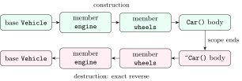

<div class="nb-proto">

<em><span>Prototypical example for this section:</span> a file handle: opened when the object is created, closed when it dies, never shared by accident.</em>

</div>

Every object is born in a <strong>constructor</strong> and dies in a <strong>destructor</strong>. Most C++ interview questions about classes are really questions about <em>which</em> constructor runs, <em>in what order</em>, and <em>what happens to the resources</em> an object owns.

## 1.3.i The kinds of constructor {#s1-3-i}

<div class="nb-proto">

<em><span>Prototypical example for this section:</span> a phone contact: blank, filled in, copied from another contact, or moved to a new phone.</em>

</div>

<div class="nb nb-definition" id="definition-1-3-1">

<strong>Definition 1.3.1</strong>. The constructors you will be asked about:

- <strong>default constructor</strong>: callable with no arguments, `Contact()`;
- <strong>parameterised constructor</strong>: takes the values, `Contact(name, phone)`;
- <strong>copy constructor</strong>: `Contact(const Contact&)`, makes a new object equal to an existing one;
- <strong>move constructor</strong> (C++11): `Contact(Contact&&)`, makes a new object by <em>taking</em> the resources of one that is about to be discarded;
- <strong>delegating constructor</strong> (C++11): a constructor that hands the work to another constructor of the same class in its initialiser list.

</div>

```cpp {filename="ctor-kinds.cpp"}
#include <iostream>
#include <string>
#include <utility>

class Contact {
public:
    Contact() : Contact("unknown", "-") {              // delegating
        std::cout << "  default ctor\n";
    }
    Contact(std::string name, std::string phone)       // parameterised
        : name_(name), phone_(phone) {
        std::cout << "  parameterised ctor: " << name_ << "\n";
    }
    Contact(const Contact& other)                      // copy
        : name_(other.name_), phone_(other.phone_) {
        std::cout << "  copy ctor: " << name_ << "\n";
    }
    Contact(Contact&& other) noexcept                  // move
        : name_(std::move(other.name_)), phone_(std::move(other.phone_)) {
        std::cout << "  move ctor: " << name_ << "\n";
    }
private:
    std::string name_, phone_;
};

int main() {
    std::cout << "a:\n"; Contact a;
    std::cout << "b:\n"; Contact b("Ravi", "98400");
    std::cout << "c:\n"; Contact c = b;              // copy
    std::cout << "d:\n"; Contact d(std::move(c));    // move: c is now empty
}
```

```text {filename="Output (MinGW g++ 6.3.0, -std=c++14, 32-bit)"}
a:
  parameterised ctor: unknown
  default ctor
b:
  parameterised ctor: Ravi
c:
  copy ctor: Ravi
d:
  move ctor: Ravi
```

- For `a`, the delegated-to constructor runs <em>first</em>, then the body of the default constructor.
- `Contact c = b;` is a copy <em>construction</em>, not an assignment: `c` did not exist before, so no assignment operator is involved.
- `std::move(c)` does not move anything by itself. It is a cast to `Contact&&` that makes overload resolution pick the move constructor, which then steals `c`’s strings. Afterwards `c` is in a “valid but unspecified” state: safe to destroy or assign to, not to rely on.

<div class="nb nb-ques" id="question-1-3-2">

<strong>Question 1.3.2</strong> — Why must the copy constructor take its argument by reference?

</div>

If it took `Contact other` by value, calling it would require copying the argument into `other`, which calls the copy constructor, which requires another copy… an infinite recursion. The compiler rejects such a declaration. It takes a `const` reference so that it can copy from `const` objects and temporaries.

<div class="nb nb-definition" id="fact-1-3-3">

<strong>Fact 1.3.3</strong>. If you declare no constructor at all, the compiler generates a default constructor. As soon as you declare <em>any</em> constructor, it does not; write `Contact() = default;` to get it back.

</div>

## 1.3.ii Member initialiser lists {#s1-3-ii}

<div class="nb-proto">

<em><span>Prototypical example for this section:</span> `Book(std::string t, int c) : title_(t), copies_(c) `.</em>

</div>

The part after the colon is the <strong>member initialiser list</strong>. It is not a style choice: members are initialised <em>before</em> the constructor body runs, and the list is the only place to say how. Inside the body it is already too late; the body can only assign. For some members, assigning is not even possible:

```cpp {filename="const-member-err.cpp"}
class Student {
public:
    Student(int roll, int& counter) {
        roll_ = roll;          // too late: a const must be initialised
        counter_ = counter;    // too late: a reference must be bound
    }
private:
    const int roll_;
    int& counter_;
};

int main() {
    int n = 0;
    Student s(25, n);
}
```

```text {filename="Compiler error (MinGW g++ 6.3.0, -std=c++14, 32-bit) — this file is meant not to compile"}
const-member-err.cpp:3:5: error: uninitialized const member in 'const int' [-fpermissive]
const-member-err.cpp:3:5: error: uninitialized reference member in 'int&' [-fpermissive]
const-member-err.cpp:4:17: error: assignment of read-only member 'Student::roll_'
```

<div class="nb nb-definition" id="fact-1-3-4">

<strong>Fact 1.3.4</strong>. You must use the initialiser list for `const` members, reference members, members of a class type with no default constructor, and base classes that need arguments. For everything else it is still better: initialising once is cheaper than default-constructing and then assigning.

</div>

<div class="nb nb-theorem nb-block" id="theorem-1-3-5">

<strong>Theorem 1.3.5</strong> (Initialisation order)

Base classes are initialised first, in the order they are <em>declared</em> in the class head; then data members, in the order they are <em>declared</em> in the class; then the constructor body runs. The order in which you write the initialiser list is ignored.

</div>

```cpp {filename="init-order-warn.cpp"}
#include <iostream>

struct Tracer {
    explicit Tracer(const char* name) { std::cout << "init " << name << "\n"; }
};

class Report {
public:
    Report() : first_("first"), second_("second") {}  // list order...
private:
    Tracer second_;                                   // ...but this is
    Tracer first_;                                    // declared first
};

int main() { Report r; }
```

```text {filename="Compiler warning (MinGW g++ 6.3.0, -std=c++14, 32-bit, -Wall -Wextra)"}
init-order-warn.cpp:12:12: warning: 'Report::first_' will be initialized after [-Wreorder]
init-order-warn.cpp:11:12: warning:   'Tracer Report::second_' [-Wreorder]
init-order-warn.cpp:9:5: warning:   when initialized here [-Wreorder]
```

```text {filename="Output (MinGW g++ 6.3.0, -std=c++14, 32-bit)"}
init second
init first
```

The list says `first_` then `second_`, but `second_` is declared first, so it is built first; `-Wall` warns about the mismatch. This becomes a real bug when one member’s initialiser reads another member that has not been initialised yet. The reason for the rule: destruction must be the exact reverse of construction, and the destructor cannot know which initialiser list (of several constructors) built the object, so the order has to come from the class definition.

## 1.3.iii `explicit` and implicit conversions {#s1-3-iii}

<div class="nb-proto">

<em><span>Prototypical example for this section:</span> `pay(500)` compiling when `pay` takes a `Rupees`.</em>

</div>

<div class="nb nb-definition" id="definition-1-3-6">

<strong>Definition 1.3.6</strong>. A constructor that can be called with a single argument is also a <strong>converting constructor</strong>: the compiler may use it silently to turn that argument type into your class. Marking it `explicit` forbids the silent use.

</div>

```cpp {filename="explicit-conversion.cpp"}
#include <iostream>

class Rupees {
public:
    Rupees(long amount) : amount_(amount) {}   // NOT explicit
    long value() const { return amount_; }
private:
    long amount_;
};

void pay(Rupees r) { std::cout << "Paying Rs " << r.value() << "\n"; }

int main() {
    pay(Rupees(500));   // intended
    pay(500);           // compiles: 500 is silently converted to Rupees
    pay('A');           // also compiles: the char 'A' is the number 65
}
```

```text {filename="Output (MinGW g++ 6.3.0, -std=c++14, 32-bit)"}
Paying Rs 500
Paying Rs 500
Paying Rs 65
```

Charging someone Rs 65 because a character slipped in is exactly the bug `explicit` exists to prevent:

```cpp {filename="explicit-err.cpp"}
class Rupees {
public:
    explicit Rupees(long amount) : amount_(amount) {}
private:
    long amount_;
};

void pay(Rupees) {}

int main() {
    pay(Rupees(500));   // fine: the conversion is written out
    pay(500);           // error: no implicit conversion any more
}
```

```text {filename="Compiler error (MinGW g++ 6.3.0, -std=c++14, 32-bit) — this file is meant not to compile"}
explicit-err.cpp:12:12: error: could not convert '500' from 'int' to 'Rupees'
```

<div class="nb nb-moral">

Make every single-argument constructor `explicit` unless you actually want the implicit conversion (as `std::string` does from `const char*`).

</div>

## 1.3.iv Destructors and the order of construction and destruction {#s1-3-iv}

<div class="nb-proto">

<em><span>Prototypical example for this section:</span> a car: the frame is built before the engine is fitted, and the engine is removed before the frame is scrapped.</em>

</div>

<div class="nb nb-example nb-block" id="example-1-3-7">

<strong>Example 1.3.7</strong> (Building and demolishing)

A building is built from the foundation up and demolished from the top down. Objects are the same: a derived class is built on top of its base, and its members are fitted before its own constructor body runs. Taking it apart happens in exactly the reverse order, so every part is still there when something that depends on it is being dismantled.

</div>

```cpp {filename="lifecycle-order.cpp"}
#include <iostream>

struct Engine {
    Engine()  { std::cout << "  Engine built\n"; }
    ~Engine() { std::cout << "  Engine scrapped\n"; }
};
struct Wheels {
    Wheels()  { std::cout << "  Wheels fitted\n"; }
    ~Wheels() { std::cout << "  Wheels removed\n"; }
};
struct Vehicle {
    Vehicle()  { std::cout << "  Vehicle frame\n"; }
    ~Vehicle() { std::cout << "  Vehicle frame gone\n"; }
};
struct Car : Vehicle {
    Engine engine;                      // members in declaration order
    Wheels wheels;
    Car()  { std::cout << "  Car body ready\n"; }
    ~Car() { std::cout << "  Car body stripped\n"; }
};

int main() {
    std::cout << "build:\n";
    {
        Car c;
        std::cout << "scope ends:\n";
    }
}
```

```text {filename="Output (MinGW g++ 6.3.0, -std=c++14, 32-bit)"}
build:
  Vehicle frame
  Engine built
  Wheels fitted
  Car body ready
scope ends:
  Car body stripped
  Wheels removed
  Engine scrapped
  Vehicle frame gone
```

<figure class="nb-fig"></figure>

<div class="nb nb-definition" id="fact-1-3-8">

<strong>Fact 1.3.8</strong>. Local objects are destroyed in reverse order of construction when their scope ends, including when it ends because of `return`, `break` or an exception. Objects created with `new` are destroyed only when you `delete` them.

</div>

## 1.3.v Shallow copy vs deep copy {#s1-3-v}

<div class="nb-proto">

<em><span>Prototypical example for this section:</span> sharing the link to a Google Doc vs making your own copy of it.</em>

</div>

<div class="nb nb-example nb-block" id="example-1-3-9">

<strong>Example 1.3.9</strong> (Link or copy?)

If I share a document link with you and you edit it, my version changes too, because there is only one document. If I send you a copy, your edits are yours. Copying an object that holds a pointer has the same two options: copy the <em>pointer</em> (share the thing) or copy <em>what it points to</em>.

</div>

<div class="nb nb-definition" id="definition-1-3-10">

<strong>Definition 1.3.10</strong>. A <strong>shallow copy</strong> copies each member as it is; for a pointer member, both objects end up pointing at the same memory. A <strong>deep copy</strong> allocates new memory and copies the pointed-to data. The compiler-generated copy constructor and copy assignment are shallow: they copy member by member.

</div>

```cpp {filename="shallow-copy.cpp"}
#include <cstring>
#include <iostream>

// Owns a heap buffer, but relies on the compiler-generated copy.
class Note {
public:
    explicit Note(const char* text) : text_(new char[std::strlen(text) + 1]) {
        std::strcpy(text_, text);
    }
    ~Note() { delete[] text_; }
    void set(char c) { text_[0] = c; }
    const char* text() const { return text_; }
private:
    char* text_;
};

int main() {
    Note original("hello");
    Note copy = original;         // copies the POINTER, not the text
    copy.set('J');
    std::cout << original.text() << " " << copy.text() << "\n";
}   // both destructors delete[] the same buffer: undefined behaviour
```

```text {filename="Output (MinGW g++ 6.3.0, -std=c++14, 32-bit)"}
Jello Jello
```

Changing the copy changed the original, because there is only one buffer. Worse, at the end of `main` both destructors `delete[]` that same buffer. That is undefined behaviour; on this run the program happened to exit normally, which is the most dangerous outcome, because the bug stays hidden until it corrupts something else.

## 1.3.vi The Rule of Three, Five and Zero {#s1-3-vi}

<div class="nb-proto">

<em><span>Prototypical example for this section:</span> `Note`, which owns a `new[]`-ed buffer.</em>

</div>

<div class="nb nb-theorem nb-block" id="theorem-1-3-11">

<strong>Theorem 1.3.11</strong> (Rule of Three / Five)

If a class needs a user-written destructor, copy constructor or copy assignment operator, it almost certainly needs all three, because the need for any one of them means the class manages a resource by hand. Since C++11, add the move constructor and move assignment: the <strong>Rule of Five</strong>.

</div>

```cpp {filename="deep-copy.cpp"}
#include <cstring>
#include <iostream>
#include <utility>

// Rule of five: the class owns a resource, so it defines all five.
class Note {
public:
    explicit Note(const char* t) : text_(new char[std::strlen(t) + 1]) {
        std::strcpy(text_, t);
    }
    ~Note() { delete[] text_; }                                 // 1
    Note(const Note& o) : Note(o.text_) {}                      // 2
    Note& operator=(const Note& o) {                            // 3
        if (this != &o) { Note tmp(o); std::swap(text_, tmp.text_); }
        return *this;
    }
    Note(Note&& o) noexcept : text_(o.text_) { o.text_ = nullptr; } // 4
    Note& operator=(Note&& o) noexcept {                        // 5
        std::swap(text_, o.text_);
        return *this;
    }
    void set(char c) { text_[0] = c; }
    const char* text() const { return text_ ? text_ : "(moved-from)"; }
private:
    char* text_;
};

int main() {
    Note original("hello");
    Note copy = original;                // new buffer
    copy.set('J');
    Note moved = std::move(copy);        // steals the buffer
    std::cout << original.text() << " " << copy.text() << " "
              << moved.text() << "\n";
}
```

```text {filename="Output (MinGW g++ 6.3.0, -std=c++14, 32-bit)"}
hello (moved-from) Jello
```

- The copy constructor delegates to the `const char*` constructor, which allocates a fresh buffer: a deep copy.
- The copy assignment uses <strong>copy-and-swap</strong>: build a temporary copy, swap buffers with it, and let the temporary’s destructor free the old buffer. It is safe for self-assignment and, if the copy throws, leaves `*this` unchanged ([Section 1.11](../11-exceptions/)).
- The move operations just steal the pointer and leave the source empty, which is why the moved-from `copy` prints `(moved-from)`.

<div class="nb nb-remark" id="remark-1-3-12">

<strong>Remark 1.3.12</strong> (The broken middle case) — The classic interview bug is a class that writes the destructor and the copy constructor but forgets copy assignment. Then `b = a;` uses the compiler’s shallow assignment: `b`’s old buffer leaks and both objects later delete `a`’s buffer. [Section 1.16](../16-problems/) has it as a find-the-bug problem.

</div>

<div class="nb nb-theorem nb-block" id="theorem-1-3-13">

<strong>Theorem 1.3.13</strong> (Rule of Zero)

Better than writing five functions correctly is writing none: if every member manages its own resource (`std::string`, `std::vector`, smart pointers), the compiler-generated special members are already correct.

</div>

```cpp {filename="rule-of-zero.cpp"}
#include <iostream>
#include <string>
#include <vector>

// Rule of zero: members manage themselves, so the class declares none
// of the five special functions and still copies and moves correctly.
class Playlist {
public:
    explicit Playlist(std::string name) : name_(name) {}
    void add(std::string song) { songs_.push_back(song); }
    void rename(std::string n) { name_ = n; }
    void print() const {
        std::cout << name_ << ":";
        for (const auto& s : songs_) std::cout << " " << s;
        std::cout << "\n";
    }
private:
    std::string name_;
    std::vector<std::string> songs_;
};

int main() {
    Playlist mine("Gym");
    mine.add("Kun Faya Kun");
    Playlist yours = mine;          // deep copy, for free
    yours.rename("Study");
    yours.add("Raag Yaman");
    mine.print();
    yours.print();
}
```

```text {filename="Output (MinGW g++ 6.3.0, -std=c++14, 32-bit)"}
Gym: Kun Faya Kun
Study: Kun Faya Kun Raag Yaman
```

<div class="nb nb-moral">

Write a destructor only in a class whose single job is to own one resource. Every other class should follow the Rule of Zero.

</div>

## 1.3.vii Copy elision and return value optimisation {#s1-3-vii}

<div class="nb-proto">

<em><span>Prototypical example for this section:</span> a function that builds a big object and returns it by value.</em>

</div>

Returning an object by value looks expensive: build a local, copy or move it out, destroy the local. Compilers skip those steps.

```cpp {filename="rvo.cpp"}
#include <iostream>

struct Big {
    Big()                { std::cout << "  ctor\n"; }
    Big(const Big&)      { std::cout << "  copy\n"; }
    Big(Big&&) noexcept  { std::cout << "  move\n"; }
    ~Big()               { std::cout << "  dtor\n"; }
};

Big makeUnnamed() { return Big(); }          // candidate for RVO
Big makeNamed()   { Big b; return b; }        // candidate for NRVO

int main() {
    std::cout << "unnamed:\n"; { Big x = makeUnnamed(); }
    std::cout << "named:\n";   { Big y = makeNamed(); }
}
```

```text {filename="Output (MinGW g++ 6.3.0, -std=c++14, 32-bit)"}
unnamed:
  ctor
  dtor
named:
  ctor
  dtor
```

Only one object is ever built: the compiler constructs it directly in the caller’s variable. The same program compiled with `-fno-elide-constructors`, which forbids this optimisation, shows what was saved:

```text {filename="Output (MinGW g++ 6.3.0, -std=c++14, 32-bit)"}
unnamed:
  ctor
  move
  dtor
  move
  dtor
  dtor
named:
  ctor
  move
  dtor
  move
  dtor
  dtor
```

(That output comes from the same code built with the extra flag; the file is `rvo-noelide.cpp`.)

<div class="nb nb-definition" id="definition-1-3-14">

<strong>Definition 1.3.14</strong>. <strong>Copy elision</strong> is the compiler constructing an object directly where it will end up, skipping a copy or move. For a returned temporary it is called <strong>RVO</strong>; for a returned named local, <strong>NRVO</strong>. The copy or move constructor is skipped even if it has visible side effects, like printing.

</div>

<div class="nb nb-remark" id="remark-1-3-15">

<strong>Remark 1.3.15</strong> (C++14 vs C++17) — In C++14 (this chapter) elision is <em>allowed</em>, not required, so the move constructor must still exist. C++17 made RVO of a returned temporary <em>mandatory</em>; NRVO is still optional. Do not write `return std::move(local);`: it turns the local into an expression that is no longer eligible for NRVO.

</div>

## 1.3.viii RAII {#s1-3-viii}

<div class="nb-proto">

<em><span>Prototypical example for this section:</span> a hotel key card: you get it at check-in and hand it back at check-out, whatever happens during your stay.</em>

</div>

<div class="nb nb-definition" id="definition-1-3-16">

<strong>Definition 1.3.16</strong>. <strong>RAII</strong> (Resource Acquisition Is Initialisation) ties a resource’s lifetime to an object’s: the constructor acquires it, the destructor releases it. Because destructors of local objects run on every way out of a scope, including exceptions, the resource can never leak.

</div>

```cpp {filename="raii-file.cpp"}
#include <cstdio>
#include <iostream>
#include <stdexcept>

// RAII: acquire in the constructor, release in the destructor.
class File {
public:
    File() : f_(std::tmpfile()) {
        if (!f_) throw std::runtime_error("cannot open");
        std::cout << "  file opened\n";
    }
    ~File() { std::fclose(f_); std::cout << "  file closed\n"; }
    File(const File&) = delete;              // one owner only
    File& operator=(const File&) = delete;
    void write(const char* s) { std::fputs(s, f_); }
private:
    std::FILE* f_;
};

void saveReport(bool fail) {
    File f;
    f.write("marks");
    if (fail) throw std::runtime_error("disk full");
    std::cout << "  report saved\n";
}

int main() {
    saveReport(false);
    try {
        saveReport(true);
    } catch (const std::exception& e) {
        std::cout << "  caught: " << e.what() << "\n";
    }
}
```

```text {filename="Output (MinGW g++ 6.3.0, -std=c++14, 32-bit)"}
  file opened
  report saved
  file closed
  file opened
  file closed
  caught: disk full
```

The second call threw before “report saved”, and the file was still closed, before the exception even reached the `catch`. This is called <strong>stack unwinding</strong>. Copying is deleted (`= delete`) because two objects closing the same file would be the shallow-copy bug again.

The most common RAII class in interviews is a lock guard. This toolchain has no `std::mutex`, so here is the same idea with a stand-in mutex that prints:

```cpp {filename="raii-lock.cpp"}
#include <iostream>

// A stand-in mutex that prints, since this toolchain has no std::mutex.
struct FakeMutex {
    void lock()   { std::cout << "  lock\n"; }
    void unlock() { std::cout << "  unlock\n"; }
};

template <class M>
class ScopedLock {                       // what std::lock_guard does
public:
    explicit ScopedLock(M& m) : m_(m) { m_.lock(); }
    ~ScopedLock() { m_.unlock(); }
    ScopedLock(const ScopedLock&) = delete;
    ScopedLock& operator=(const ScopedLock&) = delete;
private:
    M& m_;
};

FakeMutex seatMutex;
int seatsLeft = 1;

bool bookSeat() {
    ScopedLock<FakeMutex> guard(seatMutex);
    if (seatsLeft == 0) return false;    // early return: still unlocks
    --seatsLeft;
    return true;
}

int main() {
    std::cout << std::boolalpha << bookSeat() << "\n";
    std::cout << bookSeat() << "\n";
}
```

```text {filename="Output (MinGW g++ 6.3.0, -std=c++14, 32-bit)"}
  lock
  unlock
true
  lock
  unlock
false
```

The second call returns early, and the lock is still released. With a real mutex the code is (not compiled here, since this toolchain lacks `<mutex>`):

```cpp
std::mutex seatMutex;
bool bookSeat() {
    std::lock_guard<std::mutex> guard(seatMutex);   // unlocks in ~lock_guard
    if (seatsLeft == 0) return false;
    --seatsLeft;
    return true;
}
```

<div class="nb nb-moral">

In C++ you never write “remember to close/unlock/free”. You put the release in a destructor, and the language remembers for you.

</div>
