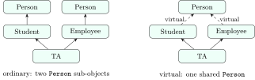

<div class="nb-proto">

<em><span>Prototypical example for this section:</span> `Manager` derived from `Employee`: a manager is an employee who also has reports and a bonus.</em>

</div>

## 1.6.i Public, protected and private inheritance {#s1-6-i}

<div class="nb nb-definition" id="definition-1-6-1">

<strong>Definition 1.6.1</strong>. In <code>class D : <em>access</em> B</code>, the access keyword caps how accessible the members inherited from `B` are <em>through `D`</em>. Private members of `B` are never accessible in `D`, whatever the keyword; they are inherited (they are part of every `D` object) but cannot be named.

</div>

| member in `B` | `: public B` | `: protected B` | `: private B` |
|:--|:-:|:-:|:-:|
| `public` | public in D | protected in D | private in D |
| `protected` | protected in D | protected in D | private in D |
| `private` | inaccessible | inaccessible | inaccessible |
| `D*` converts to `B*` | everywhere | in D and its derived classes | only inside D |

```cpp {filename="inherit-access-err.cpp"}
class Base {
public:    int pub = 1;
protected: int prot = 2;
private:   int priv = 3;
};

class PubD  : public Base    { void f() { pub = prot; } };  // priv: no
class ProtD : protected Base { };
class PrivD : private Base   { };

int main() {
    PubD a;  a.pub = 0;     // ok: public stays public
    ProtD b; b.pub = 0;     // error: pub became protected in ProtD
    PrivD c; c.pub = 0;     // error: pub became private in PrivD
    Base* p = &b;           // error: base is not accessible
}
```

```text {filename="Compiler error (MinGW g++ 6.3.0, -std=c++14, 32-bit) — this file is meant not to compile"}
inherit-access-err.cpp:13:16: error: 'int Base::pub' is inaccessible within this context
inherit-access-err.cpp:14:16: error: 'int Base::pub' is inaccessible within this context
inherit-access-err.cpp:15:16: error: 'Base' is an inaccessible base of 'ProtD'
```

The last error matters most: with non-public inheritance, outside code cannot even treat a `ProtD` as a `Base`. Only `public` inheritance means “is-a”. Private inheritance means “is implemented in terms of”, which composition expresses better. The default is `private` for `class` and `public` for `struct`, so write the keyword every time.

## 1.6.ii “Is-a” vs “has-a” {#s1-6-ii}

<div class="nb-proto">

<em><span>Prototypical example for this section:</span> a car has an engine; it is not an engine.</em>

</div>

<div class="nb nb-definition" id="definition-1-6-2">

<strong>Definition 1.6.2</strong>. <strong>Composition</strong> builds a class out of other objects stored as members: a <strong>has-a</strong> relationship. <strong>Inheritance</strong> (public) builds a class as a special case of another: an <strong>is-a</strong> relationship.

</div>

```cpp {filename="composition.cpp"}
#include <iostream>
#include <string>

class Engine {
public:
    explicit Engine(int hp) : hp_(hp) {}
    void start() const { std::cout << "  " << hp_ << " hp engine running\n"; }
private:
    int hp_;
};

class Car {                 // a Car HAS an Engine: composition, not "is-a"
public:
    Car(std::string model, int hp) : model_(model), engine_(hp) {}
    void drive() const {
        engine_.start();    // delegate to the part
        std::cout << "  " << model_ << " moving\n";
    }
private:
    std::string model_;
    Engine engine_;         // the part lives and dies with the car
};

int main() {
    Car c("Nexon", 118);
    c.drive();
}
```

```text {filename="Output (MinGW g++ 6.3.0, -std=c++14, 32-bit)"}
  118 hp engine running
  Nexon moving
```

<div class="nb nb-remark" id="remark-1-6-3">

<strong>Remark 1.6.3</strong> (Prefer composition over inheritance) — The test is substitutability: can a `Car` be used <em>everywhere</em> an `Engine` is expected? No, so `Car` must not inherit from `Engine`, even though that would “reuse” `start()`. Composition keeps the part’s interface out of the whole’s, lets the part be swapped (an electric motor), and does not tie the two classes’ evolution together. Inherit only for genuine is-a relationships where you want polymorphism; [Section 1.12](../12-solid/) shows how a wrong is-a (a square is a rectangle) breaks programs.

</div>

## 1.6.iii Constructor chaining {#s1-6-iii}

```cpp {filename="ctor-chaining.cpp"}
#include <iostream>
#include <string>

class Employee {
public:
    Employee(std::string name, long salary) : name_(name), salary_(salary) {
        std::cout << "  Employee(" << name_ << ")\n";
    }
    long salary() const { return salary_; }
    const std::string& name() const { return name_; }
private:
    std::string name_;
    long salary_;
};

class Manager : public Employee {
public:
    Manager(std::string name, long salary, int reports)
        : Employee(name, salary), reports_(reports) {   // base first
        std::cout << "  Manager with " << reports_ << " reports\n";
    }
    long bonus() const { return salary() / 10 * reports_; }
private:
    int reports_;
};

int main() {
    Manager m("Divya", 200000, 3);
    std::cout << m.name() << " bonus " << m.bonus() << "\n";
}
```

```text {filename="Output (MinGW g++ 6.3.0, -std=c++14, 32-bit)"}
  Employee(Divya)
  Manager with 3 reports
Divya bonus 60000
```

<div class="nb nb-definition" id="fact-1-6-4">

<strong>Fact 1.6.4</strong>. A derived constructor initialises its base class in its member initialiser list, `Employee(name, salary)`; the base part is always constructed before the derived class’s members and body. If the list does not mention the base, its default constructor is used, and it is an error if there is none. Base-class constructors are not inherited unless you write `using Base::Base;` ([Section 1.1](../01-why/)).

</div>

## 1.6.iv Name hiding {#s1-6-iv}

<div class="nb-proto">

<em><span>Prototypical example for this section:</span> a colour printer that adds `print(double)` and loses the base’s `print(const char*)`.</em>

</div>

```cpp {filename="name-hiding-err.cpp"}
struct Printer {
    void print(int)         {}
    void print(const char*) {}
};

struct ColourPrinter : Printer {
    void print(double) {}     // hides BOTH base overloads
};

int main() {
    ColourPrinter p;
    p.print(3.5);             // fine
    p.print("hello");         // error: Printer::print(const char*) hidden
}
```

```text {filename="Compiler error (MinGW g++ 6.3.0, -std=c++14, 32-bit) — this file is meant not to compile"}
name-hiding-err.cpp:13:20: error: no matching function for call to 'ColourPrinter::print(const char [6])'
```

<div class="nb nb-theorem nb-block" id="theorem-1-6-5">

<strong>Theorem 1.6.5</strong> (Name lookup stops at the first scope that has the name)

When you call `p.print(...)`, the compiler looks for the <em>name</em> `print` first in `ColourPrinter`. It finds one there and stops: base-class functions with the same name are never considered, whatever their parameter types. Overload resolution then chooses only among the functions found.

</div>

The fix is a `using`-declaration, which brings the base’s overloads into the derived scope so that all three compete:

```cpp {filename="name-hiding-using.cpp"}
#include <iostream>

struct Printer {
    void print(int)         { std::cout << "Printer::print(int)\n"; }
    void print(const char*) { std::cout << "Printer::print(const char*)\n"; }
};

struct ColourPrinter : Printer {
    using Printer::print;     // bring the base overloads back into scope
    void print(double)      { std::cout << "ColourPrinter::print(double)\n"; }
};

int main() {
    ColourPrinter p;
    p.print(3.5);
    p.print("hello");
    p.print(7);
}
```

```text {filename="Output (MinGW g++ 6.3.0, -std=c++14, 32-bit)"}
ColourPrinter::print(double)
Printer::print(const char*)
Printer::print(int)
```

## 1.6.v Multiple inheritance {#s1-6-v}

<div class="nb-proto">

<em><span>Prototypical example for this section:</span> a smartphone is a camera and a phone.</em>

</div>

```cpp {filename="multiple-inheritance.cpp"}
#include <iostream>

class Camera {
public:
    void takePhoto() const { std::cout << "  click\n"; }
    void powerOn() const   { std::cout << "  camera sensor on\n"; }
};
class Phone {
public:
    void call(const char* who) const {
        std::cout << "  calling " << who << "\n";
    }
    void powerOn() const   { std::cout << "  radio on\n"; }
};

class Smartphone : public Camera, public Phone {   // a Camera AND a Phone
public:
    void powerOn() const {          // resolve the clash explicitly
        Camera::powerOn();
        Phone::powerOn();
    }
};

int main() {
    Smartphone s;
    s.powerOn();
    s.takePhoto();
    s.call("Amma");
}
```

```text {filename="Output (MinGW g++ 6.3.0, -std=c++14, 32-bit)"}
  camera sensor on
  radio on
  click
  calling Amma
```

A class may have several base classes. When two bases have a member with the same name, calling it through the derived class is ambiguous until you say which one (`Camera::powerOn()`) or, as here, define it in the derived class.

## 1.6.vi The diamond problem and virtual inheritance {#s1-6-vi}

<div class="nb-proto">

<em><span>Prototypical example for this section:</span> a teaching assistant is both a `Student` and an `Employee`, and each of those is a `Person`.</em>

</div>

<figure class="nb-fig"></figure>

With ordinary inheritance a `TeachingAssistant` contains <em>two</em> `Person` sub-objects, one through each path, so “the TA’s age” does not name one thing:

```cpp {filename="diamond-err.cpp"}
struct Person            { int age = 20; };
struct Student  : Person { };
struct Employee : Person { };
struct TeachingAssistant : Student, Employee { };

int main() {
    TeachingAssistant ta;
    ta.age = 24;             // error: which Person's age?
}
```

```text {filename="Compiler error (MinGW g++ 6.3.0, -std=c++14, 32-bit) — this file is meant not to compile"}
diamond-err.cpp:8:8: error: request for member 'age' is ambiguous
```

<div class="nb nb-definition" id="definition-1-6-6">

<strong>Definition 1.6.6</strong>. With <strong>virtual inheritance</strong> (`struct Student : virtual Person`), all paths to a virtual base in the most-derived object share a single sub-object.

</div>

```cpp {filename="diamond-virtual.cpp"}
#include <iostream>

struct Person {
    explicit Person(int age) : age(age) { std::cout << "  Person\n"; }
    int age;
};
struct Student : virtual Person {             // virtual inheritance
    Student() : Person(18) { std::cout << "  Student\n"; }
};
struct Employee : virtual Person {
    Employee() : Person(30) { std::cout << "  Employee\n"; }
};
struct TeachingAssistant : Student, Employee {
    // the MOST DERIVED class constructs the shared virtual base
    TeachingAssistant() : Person(24) { std::cout << "  TeachingAssistant\n"; }
};

int main() {
    TeachingAssistant ta;
    ta.age += 1;                              // unambiguous: one Person
    std::cout << "age " << ta.age << "\n";
}
```

```text {filename="Output (MinGW g++ 6.3.0, -std=c++14, 32-bit)"}
  Person
  Student
  Employee
  TeachingAssistant
age 25
```

<div class="nb nb-ques" id="question-1-6-7">

<strong>Question 1.6.7</strong> — `Student` passes $18$ to `Person` and `Employee` passes $30$. Why is the age $24$, and why is `Person` printed only once and first?

</div>

Because there is only one `Person`, it cannot be built twice with two different ages. The rule is that a virtual base is constructed by the <em>most derived</em> class, before any non-virtual base, and the initialisers `Person(18)` and `Person(30)` in the intermediate classes are ignored when they are not the most derived. So `Person(24)` runs first, then `Student`, `Employee` and `TeachingAssistant`.

The sharing is not free. The intermediate classes need a way to find the shared base at run time, which g++ implements with a hidden pointer:

```cpp {filename="diamond-sizes.cpp"}
#include <iostream>

struct Person { int age; };
struct S1 : Person {};                  struct E1 : Person {};
struct TA1 : S1, E1 {};                 // two Person sub-objects
struct S2 : virtual Person {};          struct E2 : virtual Person {};
struct TA2 : S2, E2 {};                 // one shared Person

int main() {
    std::cout << "plain:   Student " << sizeof(S1) << ", TA " << sizeof(TA1)
              << "\nvirtual: Student " << sizeof(S2) << ", TA " << sizeof(TA2)
              << "\n";
}
```

```text {filename="Output (MinGW g++ 6.3.0, -std=c++14, 32-bit)"}
plain:   Student 4, TA 8
virtual: Student 8, TA 12
```

On this compiler a `Student` grows from $4$ to $8$ bytes (the `int` plus one pointer), and the `TeachingAssistant` holds one `Person` instead of two but two such pointers. The standard does not say how virtual bases are implemented, only how they behave.

<div class="nb nb-moral">

Use public inheritance only for is-a, prefer composition for has-a, and reach for virtual inheritance only when a diamond really needs one shared base. Most designs avoid the diamond instead, by inheriting from interfaces with no data.

</div>
