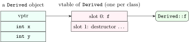

<div class="nb-proto">

<em><span>Prototypical example for this section:</span> a notification service that calls `send()` and gets an SMS, an email or a push notification depending on the object behind the reference.</em>

</div>

## 1.7.i Compile-time polymorphism: overloading {#s1-7-i}

<div class="nb nb-definition" id="definition-1-7-1">

<strong>Definition 1.7.1</strong>. <strong>Function overloading</strong> is several functions with the same name and different parameter lists in one scope. The compiler picks one at compile time by <strong>overload resolution</strong>. The return type is not part of it: two functions differing only in return type cannot be overloaded.

</div>

```cpp {filename="overloading.cpp"}
#include <iostream>

void show(int)          { std::cout << "int\n"; }
void show(double)       { std::cout << "double\n"; }
void show(const char*)  { std::cout << "const char*\n"; }

int main() {
    show(42);          // exact match
    show(4.2);         // exact match
    show("hi");        // array-to-pointer: exact match category
    show('x');         // char -> int is a PROMOTION: beats char -> double
    show(4.2f);        // float -> double is a promotion too
}
```

```text {filename="Output (MinGW g++ 6.3.0, -std=c++14, 32-bit)"}
int
double
const char*
int
double
```

<div class="nb nb-definition" id="fact-1-7-2">

<strong>Fact 1.7.2</strong> (Overload resolution, simplified). Each argument’s conversion is ranked, best first:

1. <em>exact match</em> (including array-to-pointer and adding `const`);
2. <em>promotion</em>: `char`, `short` or `bool` to `int`, and `float` to `double`;
3. <em>standard conversion</em>: any other arithmetic conversion (`int` to `double`, `long` to `int`, …), derived-to-base pointers;
4. user-defined conversion (a converting constructor or conversion operator).

The best-ranked candidate wins; a tie between the best ones is an ambiguity error.

</div>

That is why `show('x')` chose `int`: `char`$\to$`int` is a promotion, `char`$\to$`double` only a conversion. For a `long` both candidates are conversions of the same rank:

```cpp {filename="overload-ambiguous-err.cpp"}
void show(int)    {}
void show(double) {}

int main() {
    show(42L);    // long -> int and long -> double are both conversions
}
```

```text {filename="Compiler error (MinGW g++ 6.3.0, -std=c++14, 32-bit) — this file is meant not to compile"}
overload-ambiguous-err.cpp:5:13: error: call of overloaded 'show(long int)' is ambiguous
```

## 1.7.ii Compile-time polymorphism: templates {#s1-7-ii}

```cpp {filename="template-max.cpp"}
#include <iostream>
#include <string>

// One definition; the compiler writes a separate version per type used.
template <typename T>
const T& largest(const T& a, const T& b) { return (a < b) ? b : a; }

int main() {
    std::cout << largest(3, 9) << " "
              << largest(2.5, 1.5) << " "
              << largest(std::string("apple"), std::string("mango")) << "\n";
}
```

```text {filename="Output (MinGW g++ 6.3.0, -std=c++14, 32-bit)"}
9 2.5 mango
```

One template, three types. The compiler generates (<strong>instantiates</strong>) a separate function for each type used, so the choice costs nothing at run time. The only requirement on `T` is that `a < b` compiles for it. [Section 1.10](../10-templates/) goes further.

## 1.7.iii Run-time polymorphism: `virtual` {#s1-7-iii}

<div class="nb-proto">

<em><span>Prototypical example for this section:</span> calling `send()` through a `const Notifier&` that refers to an `Sms`.</em>

</div>

<div class="nb nb-definition" id="definition-1-7-3">

<strong>Definition 1.7.3</strong>. For a call through a pointer or reference to a base class, the <strong>static type</strong> is the type written in the code (`Notifier`) and the <strong>dynamic type</strong> is the type of the actual object (`Sms`). A non-virtual call is resolved by the static type at compile time (<strong>early binding</strong>); a call to a `virtual` function is resolved by the dynamic type at run time (<strong>late binding</strong> or dynamic dispatch).

</div>

```cpp {filename="binding.cpp"}
#include <iostream>

struct Notifier {
    void name() const          { std::cout << "Notifier::name\n"; }  // static
    virtual void send() const  { std::cout << "Notifier::send\n"; }  // dynamic
    virtual ~Notifier() = default;
};
struct Sms : Notifier {
    void name() const          { std::cout << "Sms::name\n"; }
    void send() const override { std::cout << "Sms::send\n"; }
};

int main() {
    Sms sms;
    const Notifier& n = sms;   // base reference to a derived object
    n.name();                  // early binding: decided by the static type
    n.send();                  // late binding: decided by the object
}
```

```text {filename="Output (MinGW g++ 6.3.0, -std=c++14, 32-bit)"}
Notifier::name
Sms::send
```

`Sms::name` <em>hides</em> `Notifier::name`, but through a `Notifier&` the compiler only knows about `Notifier::name`. `send` is `virtual`, so the object decides.

<div class="nb nb-definition" id="fact-1-7-4">

<strong>Fact 1.7.4</strong>. Once a function is `virtual` in a base, the same signature in every derived class overrides it and is virtual too, with or without the keyword. Dispatch only happens through pointers and references; calling a virtual function on an object (`sms.send()`) or with explicit qualification (`n.Notifier::send()`) is resolved at compile time.

</div>

### `override` and `final` {#override-and-final}

A derived function with a slightly different signature does not override: it is a new function that hides the old one, and the base version keeps being called through base references. C++11’s `override` makes that mistake a compile error, and `final` stops further overriding or derivation:

```cpp {filename="override-err.cpp"}
struct Notifier {
    virtual void send(int priority) const {}
    virtual ~Notifier() = default;
};

struct Email : Notifier {
    void send(long priority) const override {}   // not the same signature
};

struct Push final : Notifier {};
struct LoudPush : Push {};                        // Push is final

int main() {}
```

```text {filename="Compiler error (MinGW g++ 6.3.0, -std=c++14, 32-bit) — this file is meant not to compile"}
override-err.cpp:7:10: error: 'void Email::send(long int) const' marked 'override', but does not override
override-err.cpp:11:8: error: cannot derive from 'final' base 'Push' in derived type 'LoudPush'
```

<div class="nb nb-moral">

Write `override` on every overriding function. It costs nothing and turns a silent bug into a compile error.

</div>

## 1.7.iv How virtual calls work: the vptr and the vtable {#s1-7-iv}

<div class="nb-proto">

<em><span>Prototypical example for this section:</span> `sizeof` jumping from $4$ to $8$ the moment a class gets a virtual function.</em>

</div>

```cpp {filename="vptr-size.cpp"}
#include <iostream>

struct Plain       { int x; void f() {} };
struct WithVirtual { int x; virtual void f() {} };
struct TwoVirtuals { int x; virtual void f() {} virtual void g() {} };
struct Derived : WithVirtual { int y; void f() override {} };

int main() {
    std::cout << "Plain       " << sizeof(Plain) << "\n"
              << "WithVirtual " << sizeof(WithVirtual) << "\n"
              << "TwoVirtuals " << sizeof(TwoVirtuals) << "\n"
              << "Derived     " << sizeof(Derived) << "\n";
}
```

```text {filename="Output (MinGW g++ 6.3.0, -std=c++14, 32-bit)"}
Plain       4
WithVirtual 8
TwoVirtuals 8
Derived     12
```

Adding a first virtual function added $4$ bytes (one pointer on this 32-bit build); adding a second added nothing. That is exactly what the usual implementation predicts.

<figure class="nb-fig"></figure>

<div class="nb nb-definition" id="fact-1-7-5">

<strong>Fact 1.7.5</strong> (The common implementation, not a rule of the standard). The standard only specifies what virtual calls do. Every major compiler implements them the same way:

- each class with virtual functions has one <strong>vtable</strong>: a table of pointers to the final overrider of each virtual function;
- each object of such a class stores a hidden pointer, the <strong>vptr</strong>, to its class’s vtable, set by the constructor;
- `p->f()` becomes “load `p`’s vptr, load slot 0, call it”: two memory loads and an indirect call, which also prevents inlining.

</div>

## 1.7.v Virtual destructors {#s1-7-v}

<div class="nb-proto">

<em><span>Prototypical example for this section:</span> deleting a database connection through a `Connection*`.</em>

</div>

```cpp {filename="virtual-dtor-warn.cpp"}
#include <iostream>

struct Connection {                      // no virtual destructor!
    virtual void open() {}
    ~Connection() { std::cout << "  ~Connection\n"; }
};
struct DbConnection : Connection {
    int* pool = new int[100];
    ~DbConnection() { delete[] pool; std::cout << "  ~DbConnection\n"; }
};

int main() {
    Connection* c = new DbConnection;
    delete c;      // undefined behaviour: derived part not destroyed
}
```

```text {filename="Compiler warning (MinGW g++ 6.3.0, -std=c++14, 32-bit, -Wall -Wextra)"}
virtual-dtor-warn.cpp:14:12: warning: deleting object of polymorphic class type 'Connection' which has non-virtual destructor might cause undefined behavior [-Wdelete-non-virtual-dtor]
```

```text {filename="Output (MinGW g++ 6.3.0, -std=c++14, 32-bit)"}
  ~Connection
```

Only `~Connection` ran: the connection pool was never freed. Formally, deleting a derived object through a base pointer whose destructor is not virtual is undefined behaviour; the missing destructor call is just what usually happens. Making the destructor virtual fixes it:

```cpp {filename="virtual-dtor-fixed.cpp"}
#include <iostream>

struct Connection {
    virtual void open() {}
    virtual ~Connection() { std::cout << "  ~Connection\n"; }
};
struct DbConnection : Connection {
    int* pool = new int[100];
    ~DbConnection() override {
        delete[] pool;
        std::cout << "  ~DbConnection\n";
    }
};

int main() {
    Connection* c = new DbConnection;
    delete c;      // virtual dispatch finds ~DbConnection first
}
```

```text {filename="Output (MinGW g++ 6.3.0, -std=c++14, 32-bit)"}
  ~DbConnection
  ~Connection
```

<div class="nb nb-theorem nb-block" id="theorem-1-7-6">

<strong>Theorem 1.7.6</strong> (When a destructor must be virtual)

If a class is meant to be used polymorphically, that is, objects of derived classes may be deleted through a pointer to it, its destructor must be `public` and `virtual`. (The C++ Core Guidelines add the alternative: make it `protected` and non-virtual, so deletion through the base is impossible.)

</div>

## 1.7.vi Object slicing {#s1-7-vi}

<div class="nb-proto">

<em><span>Prototypical example for this section:</span> passing a `Circle` to a function that takes a `Shape` by value.</em>

</div>

```cpp {filename="slicing.cpp"}
#include <iostream>
#include <string>

struct Shape {
    virtual std::string name() const { return "Shape"; }
    virtual ~Shape() = default;
};
struct Circle : Shape {
    double r = 1;
    std::string name() const override { return "Circle"; }
};

void byValue(Shape s)      { std::cout << "by value: " << s.name() << "\n"; }
void byRef(const Shape& s) { std::cout << "by ref:   " << s.name() << "\n"; }

int main() {
    Circle c;
    byValue(c);          // copies only the Shape part: the Circle is sliced
    byRef(c);
    Shape copy = c;      // slicing when copying into a base object, too
    std::cout << "copy:     " << copy.name() << "\n";
}
```

```text {filename="Output (MinGW g++ 6.3.0, -std=c++14, 32-bit)"}
by value: Shape
by ref:   Circle
copy:     Shape
```

<div class="nb nb-definition" id="definition-1-7-7">

<strong>Definition 1.7.7</strong>. <strong>Object slicing</strong> happens when a derived object is copied into an object of a base type: only the base part is copied, and the result is a genuine `Shape`, with `Shape`’s vptr. Nothing polymorphic survives.

</div>

<div class="nb nb-moral">

Polymorphism needs indirection: pass polymorphic objects by reference or pointer, and store them in containers as pointers (`std::vector<std::unique_ptr<Shape>>`), never by value.

</div>

## 1.7.vii Virtual calls inside constructors and destructors {#s1-7-vii}

```cpp {filename="virtual-in-ctor.cpp"}
#include <iostream>

struct Base {
    Base()  { std::cout << "Base ctor calls: ";  who(); }
    virtual ~Base() { std::cout << "Base dtor calls: "; who(); }
    virtual void who() const { std::cout << "Base::who\n"; }
    void later() const { std::cout << "later() calls:   "; who(); }
};
struct Derived : Base {
    Derived() { std::cout << "Derived ctor\n"; }
    void who() const override { std::cout << "Derived::who\n"; }
};

int main() {
    Derived d;
    d.later();
}
```

```text {filename="Output (MinGW g++ 6.3.0, -std=c++14, 32-bit)"}
Base ctor calls: Base::who
Derived ctor
later() calls:   Derived::who
Base dtor calls: Base::who
```

<div class="nb nb-ques" id="question-1-7-8">

<strong>Question 1.7.8</strong> — Why does the constructor of `Base` call `Base::who`, even for a `Derived` object?

</div>

While `Base`’s constructor runs, the `Derived` part does not exist yet: its members are not initialised. Calling `Derived::who` then could read garbage, so the language says the object’s dynamic type during construction is the class whose constructor is running. (With the usual implementation, the vptr points at `Base`’s vtable until `Derived`’s constructor updates it.) The same holds in reverse during destruction: by the time `~Base` runs, `Derived` is already gone. Calling a <em>pure</em> virtual function this way is undefined behaviour.

## 1.7.viii Default arguments on virtual functions {#s1-7-viii}

```cpp {filename="virtual-default-arg.cpp"}
#include <iostream>

struct Printer {
    virtual void print(int copies = 1) const {
        std::cout << "Printer prints " << copies << "\n";
    }
    virtual ~Printer() = default;
};
struct OfficePrinter : Printer {
    void print(int copies = 10) const override {
        std::cout << "OfficePrinter prints " << copies << "\n";
    }
};

int main() {
    OfficePrinter op;
    const Printer& p = op;
    p.print();       // which function? which default?
    op.print();
}
```

```text {filename="Output (MinGW g++ 6.3.0, -std=c++14, 32-bit)"}
OfficePrinter prints 1
OfficePrinter prints 10
```

<div class="nb nb-theorem nb-block" id="theorem-1-7-9">

<strong>Theorem 1.7.9</strong>

Which function a virtual call runs is decided by the dynamic type; which default argument it uses is decided by the static type, at compile time.

</div>

So `p.print()` runs `OfficePrinter::print` with `Printer`’s default of $1$: a mixture no one intended. The rule: never redefine a default argument in an override (Meyers, <em>Effective C++</em>, Item 37).

## 1.7.ix Pure virtual functions, abstract classes and interfaces {#s1-7-ix}

<div class="nb-proto">

<em><span>Prototypical example for this section:</span> a payment gateway interface with a real implementation and a test fake.</em>

</div>

<div class="nb nb-definition" id="definition-1-7-10">

<strong>Definition 1.7.10</strong>. A <strong>pure virtual function</strong> is declared with `= 0`. A class with at least one (declared or inherited and not overridden) is <strong>abstract</strong>: it cannot be instantiated, only derived from. A class with only pure virtual functions and no data is what other languages call an <strong>interface</strong>.

</div>

```cpp {filename="abstract-err.cpp"}
struct PaymentGateway {                      // an interface
    virtual bool charge(long paise) = 0;
    virtual ~PaymentGateway() = default;
};

struct HalfDone : PaymentGateway {};         // did not implement charge()

int main() {
    PaymentGateway g;      // error: abstract
    HalfDone h;            // error: still abstract
}
```

```text {filename="Compiler error (MinGW g++ 6.3.0, -std=c++14, 32-bit) — this file is meant not to compile"}
abstract-err.cpp:9:20: error: cannot declare variable 'g' to be of abstract type 'PaymentGateway'
abstract-err.cpp:10:14: error: cannot declare variable 'h' to be of abstract type 'HalfDone'
```

```cpp {filename="interface-gateway.cpp"}
#include <iostream>

struct PaymentGateway {                     // interface: only pure virtuals
    virtual bool charge(long paise) = 0;
    virtual const char* name() const = 0;
    virtual ~PaymentGateway() = default;
};

struct Razorpay : PaymentGateway {
    bool charge(long p) override { return p <= 10000000; }
    const char* name() const override { return "Razorpay"; }
};
struct TestGateway : PaymentGateway {       // a fake for unit tests
    bool charge(long) override { return true; }
    const char* name() const override { return "Test"; }
};

void checkout(PaymentGateway& g, long paise) {    // knows only the interface
    bool ok = g.charge(paise);
    std::cout << g.name() << ": " << (ok ? "paid" : "declined") << "\n";
}

int main() {
    Razorpay live;
    TestGateway fake;
    checkout(live, 50000);
    checkout(live, 999999999);
    checkout(fake, 999999999);
}
```

```text {filename="Output (MinGW g++ 6.3.0, -std=c++14, 32-bit)"}
Razorpay: paid
Razorpay: declined
Test: paid
```

`checkout` depends only on the interface, so the same code runs against the live gateway and a test fake. This is the dependency inversion principle of [Section 1.12](../12-solid/).

<div class="nb nb-remark" id="remark-1-7-11">

<strong>Remark 1.7.11</strong> — A pure virtual function may still have a definition, which derived classes can call as `Base::f()`. A pure virtual <em>destructor</em> must have one, because every derived destructor calls it.

</div>

## 1.7.x `dynamic_cast`, RTTI and the four casts {#s1-7-x}

<div class="nb-proto">

<em><span>Prototypical example for this section:</span> checking whether a `Vehicle&` is actually a `Car`.</em>

</div>

```cpp {filename="dynamic-cast.cpp"}
#include <iostream>
#include <typeinfo>

struct Vehicle { virtual ~Vehicle() = default; };
struct Car : Vehicle {
    void openBoot() const { std::cout << "  boot open\n"; }
};
struct Truck : Vehicle {};

void inspect(Vehicle& v) {
    std::cout << "typeid(v).name() = " << typeid(v).name() << "\n";
    if (Car* c = dynamic_cast<Car*>(&v))      // pointer: nullptr on failure
        c->openBoot();
    else
        std::cout << "  not a car\n";
    try {
        Car& c = dynamic_cast<Car&>(v);        // reference: throws on failure
        (void)c;
    } catch (const std::bad_cast&) {
        std::cout << "  std::bad_cast for the reference cast\n";
    }
}

int main() {
    Car car;
    Truck truck;
    inspect(car);
    inspect(truck);
}
```

```text {filename="Output (MinGW g++ 6.3.0, -std=c++14, 32-bit)"}
typeid(v).name() = 3Car
  boot open
typeid(v).name() = 5Truck
  not a car
  std::bad_cast for the reference cast
```

<div class="nb nb-definition" id="fact-1-7-12">

<strong>Fact 1.7.12</strong>. `dynamic_cast` checks at run time whether the object really has the target type, using <strong>RTTI</strong> (run-time type information), which exists only for polymorphic classes (classes with at least one virtual function). A failed pointer cast returns `nullptr`; a failed reference cast throws `std::bad_cast`. `typeid(v).name()` is implementation-defined: g++ prints <em>mangled</em> names such as `3Car`.

</div>

<div class="nb nb-remark" id="remark-1-7-13">

<strong>Remark 1.7.13</strong> (A `dynamic_cast` in business logic is a design smell) — “If it is a `Car`, open the boot” usually means a virtual function is missing from the base class. Downcasting is fine at boundaries (deserialisation, plugins), not as a replacement for polymorphism.

</div>

```cpp {filename="casts.cpp"}
#include <cstdint>
#include <iostream>

void legacyPrint(char* s) { std::cout << s << "\n"; }  // old API, never writes

int main() {
    double avg = 7.9;
    int rounded = static_cast<int>(avg);          // ordinary conversion
    std::cout << "static_cast: " << rounded << "\n";

    const char* msg = "hello";
    legacyPrint(const_cast<char*>(msg));          // remove const: safe only
                                                  // because it never writes
    int x = 1;
    auto bits = reinterpret_cast<std::uintptr_t>(&x);   // pointer as integer
    std::cout << "reinterpret_cast: address "
              << (bits % alignof(int) == 0 ? "is" : "is not")
              << " a multiple of alignof(int)\n";
}
```

```text {filename="Output (MinGW g++ 6.3.0, -std=c++14, 32-bit)"}
static_cast: 7
hello
reinterpret_cast: address is a multiple of alignof(int)
```

| Cast | Use it for |
|:--|:--|
| `static_cast` | well-defined conversions checked at compile time: numeric conversions, up-casts, down-casts you <em>know</em> are correct (no run-time check) |
| `dynamic_cast` | down-casts in a polymorphic hierarchy with a run-time check |
| `const_cast` | adding or removing `const`; writing to an object that was <em>defined</em> `const` is still undefined behaviour |
| `reinterpret_cast` | reinterpreting bits: pointers to integers, unrelated pointer types; almost always non-portable |
| C-style `(T)x` | tries the others in turn and can silently become a `reinterpret_cast` or `const_cast`; avoid it in C++ |

<div class="nb nb-moral">

Run-time polymorphism is `virtual` functions called through pointers or references. Its costs are one vptr per object, one indirect call per dispatch, and a list of rules (virtual destructors, no slicing, no virtual calls in constructors, no new default arguments) that every interview checks.

</div>
