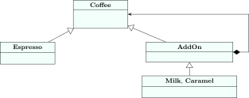

<div class="nb-proto">

<em><span>Prototypical example for this section:</span> a Maps app that computes an ETA by car, bike or on foot, where the route algorithm can be swapped at run time.</em>

</div>

A <strong>design pattern</strong> is a named, reusable solution to a problem that keeps coming up in object-oriented design. The classic catalogue is the “Gang of Four” book (Gamma, Helm, Johnson and Vlissides, <em>Design Patterns</em>, 1994), which sorts them into <strong>creational</strong> (how objects are made), <strong>structural</strong> (how they are composed) and <strong>behavioural</strong> (how they interact) patterns. Interviews expect you to know a few well: the problem each solves, its structure, and when <em>not</em> to use it.

In the diagrams, a hollow triangle means “inherits from”, a filled diamond means “owns” (composition), and a dashed arrow means “uses”.

## 1.13.i Singleton (creational) {#s1-13-i}

<div class="nb-proto">

<em><span>Prototypical example for this section:</span> an application-wide logger.</em>

</div>

<div class="nb nb-definition" id="definition-1-13-1">

<strong>Definition 1.13.1</strong>. <strong>Singleton</strong>: a class that has exactly one instance and a global access point to it.

</div>

<figure class="nb-fig"></figure>

```cpp {filename="singleton.cpp"}
#include <iostream>
#include <string>

class Logger {
public:
    static Logger& instance() {
        static Logger only;        // built on first call; since C++11 this
        return only;               // initialisation is thread-safe
    }
    void log(const std::string& m) {
        std::cout << "[" << ++count_ << "] " << m << "\n";
    }
    Logger(const Logger&) = delete;             // no second one by copying
    Logger& operator=(const Logger&) = delete;
private:
    Logger() { std::cout << "Logger created\n"; }   // nor by constructing
    int count_ = 0;
};

void placeOrder() { Logger::instance().log("order placed"); }

int main() {
    std::cout << "start\n";
    Logger::instance().log("app started");
    placeOrder();
    std::cout << std::boolalpha
              << (&Logger::instance() == &Logger::instance()) << "\n";
}
```

```text {filename="Output (MinGW g++ 6.3.0, -std=c++14, 32-bit)"}
start
Logger created
[1] app started
[2] order placed
true
```

“Logger created” appears after “start”: the instance is created on first use. This function-local `static` form is called the <strong>Meyers singleton</strong>. Since C++11 the standard guarantees that a local static is initialised exactly once even if several threads call `instance()` at the same time, so no explicit lock is needed. Deleting the copy operations and making the constructor private makes a second instance impossible.

<div class="nb nb-remark" id="remark-1-13-2">

<strong>Remark 1.13.2</strong> (Why it is often an anti-pattern) — A singleton is a global variable with better manners. Every function that calls `Logger::instance()` has a hidden dependency that does not show in its signature, tests cannot substitute a fake, and the order in which singletons are destroyed at exit is hard to control. Prefer creating one object in `main` and passing it in (dependency injection, [Section 1.12](../12-solid/)); use a singleton only for something that is truly unique and stateless from the program’s point of view.

</div>

## 1.13.ii Factory (creational) {#s1-13-ii}

<div class="nb-proto">

<em><span>Prototypical example for this section:</span> creating a payment object from the string the user picked.</em>

</div>

<div class="nb nb-definition" id="definition-1-13-3">

<strong>Definition 1.13.3</strong>. <strong>Factory</strong>: a function or class whose job is to create objects, so that the rest of the code asks for an interface and never names a concrete class.

</div>

<figure class="nb-fig"></figure>

```cpp {filename="factory.cpp"}
#include <iostream>
#include <memory>
#include <stdexcept>
#include <string>

struct Payment {
    virtual void pay(int rupees) const = 0;
    virtual ~Payment() = default;
};
struct Upi : Payment {
    void pay(int r) const override { std::cout << "UPI " << r << "\n"; }
};
struct Card : Payment {
    void pay(int r) const override { std::cout << "Card " << r << "\n"; }
};

// The factory: the ONLY place that knows the concrete classes.
std::unique_ptr<Payment> makePayment(const std::string& method) {
    if (method == "upi")  return std::make_unique<Upi>();
    if (method == "card") return std::make_unique<Card>();
    throw std::invalid_argument("unknown payment method: " + method);
}

int main() {
    for (std::string choice : {"upi", "card", "bitcoin"}) {
        try {
            makePayment(choice)->pay(499);
        } catch (const std::invalid_argument& e) {
            std::cout << e.what() << "\n";
        }
    }
}
```

```text {filename="Output (MinGW g++ 6.3.0, -std=c++14, 32-bit)"}
UPI 499
Card 499
unknown payment method: bitcoin
```

Adding a wallet changes one function; the checkout, which calls `makePayment`, does not change. The factory is also the natural place for validation (“bitcoin” is rejected).

## 1.13.iii Strategy (behavioural) {#s1-13-iii}

<div class="nb-proto">

<em><span>Prototypical example for this section:</span> car, bike or walking route in a navigation app.</em>

</div>

<div class="nb nb-definition" id="definition-1-13-4">

<strong>Definition 1.13.4</strong>. <strong>Strategy</strong>: define a family of interchangeable algorithms behind one interface, and let the object that uses them (the <strong>context</strong>) hold one and swap it at run time.

</div>

<figure class="nb-fig"></figure>

```cpp {filename="strategy.cpp"}
#include <iostream>
#include <memory>

struct RouteStrategy {                      // how to get from A to B
    virtual int minutes(int km) const = 0;
    virtual const char* name() const = 0;
    virtual ~RouteStrategy() = default;
};
struct ByCar : RouteStrategy {
    int minutes(int km) const override { return km * 2; }
    const char* name() const override { return "car"; }
};
struct ByBike : RouteStrategy {
    int minutes(int km) const override { return km * 4; }
    const char* name() const override { return "bike"; }
};
struct OnFoot : RouteStrategy {
    int minutes(int km) const override { return km * 12; }
    const char* name() const override { return "walk"; }
};

class Navigator {                           // the context
public:
    void setStrategy(std::unique_ptr<RouteStrategy> s) { s_ = std::move(s); }
    void eta(int km) const {
        std::cout << km << " km by " << s_->name() << ": "
                  << s_->minutes(km) << " min\n";
    }
private:
    std::unique_ptr<RouteStrategy> s_ = std::make_unique<ByCar>();
};

int main() {
    Navigator nav;
    nav.eta(5);
    nav.setStrategy(std::make_unique<ByBike>());   // swapped at run time
    nav.eta(5);
    nav.setStrategy(std::make_unique<OnFoot>());
    nav.eta(5);
}
```

```text {filename="Output (MinGW g++ 6.3.0, -std=c++14, 32-bit)"}
5 km by car: 10 min
5 km by bike: 20 min
5 km by walk: 60 min
```

Strategy is the open/closed principle in action, and it is everywhere in the standard library in a template form: the comparator you pass to `std::sort` is a strategy chosen at compile time.

## 1.13.iv Observer (behavioural) {#s1-13-iv}

<div class="nb-proto">

<em><span>Prototypical example for this section:</span> subscribers of a YouTube channel getting a notification when a video is uploaded.</em>

</div>

<div class="nb nb-definition" id="definition-1-13-5">

<strong>Definition 1.13.5</strong>. <strong>Observer</strong>: a subject keeps a list of observers and notifies all of them when its state changes, without knowing their concrete types. Also called publish–subscribe.

</div>

<figure class="nb-fig"></figure>

```cpp {filename="observer.cpp"}
#include <algorithm>
#include <iostream>
#include <string>
#include <vector>

struct Subscriber {                                   // the observer
    virtual void notify(const std::string& video) = 0;
    virtual ~Subscriber() = default;
};

class Channel {                                       // the subject
public:
    void subscribe(Subscriber* s)   { subs_.push_back(s); }
    void unsubscribe(Subscriber* s) {
        subs_.erase(std::remove(subs_.begin(), subs_.end(), s), subs_.end());
    }
    void upload(const std::string& video) {
        for (Subscriber* s : subs_) s->notify(video); // push to everyone
    }
private:
    std::vector<Subscriber*> subs_;                   // non-owning
};

struct User : Subscriber {
    explicit User(std::string n) : name(n) {}
    void notify(const std::string& v) override {
        std::cout << "  " << name << " notified: " << v << "\n";
    }
    std::string name;
};

int main() {
    Channel dsa;
    User asha("Asha"), ravi("Ravi");
    dsa.subscribe(&asha);
    dsa.subscribe(&ravi);
    dsa.upload("Segment trees");
    dsa.unsubscribe(&ravi);
    dsa.upload("Tries");
}
```

```text {filename="Output (MinGW g++ 6.3.0, -std=c++14, 32-bit)"}
  Asha notified: Segment trees
  Ravi notified: Segment trees
  Asha notified: Tries
```

<div class="nb nb-remark" id="remark-1-13-6">

<strong>Remark 1.13.6</strong> (The lifetime trap) — The channel stores raw, non-owning pointers. If a `User` is destroyed without unsubscribing, the next `upload` calls through a dangling pointer. Real designs unsubscribe in the observer’s destructor, or store `std::weak_ptr`s and skip the expired ones ([Section 1.9](../09-memory/)).

</div>

## 1.13.v Decorator (structural) {#s1-13-v}

<div class="nb-proto">

<em><span>Prototypical example for this section:</span> an espresso with milk, caramel and more milk, each add-on changing the price.</em>

</div>

<div class="nb nb-definition" id="definition-1-13-7">

<strong>Definition 1.13.7</strong>. <strong>Decorator</strong>: wrap an object in another object with the same interface that adds behaviour before or after delegating to it. Wrappers can be stacked in any order and number at run time.

</div>

<figure class="nb-fig"></figure>

```cpp {filename="decorator.cpp"}
#include <iostream>
#include <memory>
#include <string>

struct Coffee {
    virtual int cost() const = 0;
    virtual std::string describe() const = 0;
    virtual ~Coffee() = default;
};
struct Espresso : Coffee {
    int cost() const override { return 120; }
    std::string describe() const override { return "espresso"; }
};

// A decorator IS a Coffee and HAS a Coffee: it wraps and adds.
struct AddOn : Coffee {
    explicit AddOn(std::unique_ptr<Coffee> c) : inner(std::move(c)) {}
    std::unique_ptr<Coffee> inner;
};
struct Milk : AddOn {
    using AddOn::AddOn;
    int cost() const override { return inner->cost() + 30; }
    std::string describe() const override {
        return inner->describe() + " + milk";
    }
};
struct Caramel : AddOn {
    using AddOn::AddOn;
    int cost() const override { return inner->cost() + 50; }
    std::string describe() const override {
        return inner->describe() + " + caramel";
    }
};

int main() {
    std::unique_ptr<Coffee> order = std::make_unique<Espresso>();
    order = std::make_unique<Milk>(std::move(order));
    order = std::make_unique<Caramel>(std::move(order));
    order = std::make_unique<Milk>(std::move(order));     // double milk
    std::cout << order->describe() << " = Rs " << order->cost() << "\n";
}
```

```text {filename="Output (MinGW g++ 6.3.0, -std=c++14, 32-bit)"}
espresso + milk + caramel + milk = Rs 230
```

With inheritance alone, every combination would need its own class (`EspressoWithMilk`, `EspressoWithMilkAndCaramel`, …): a combinatorial explosion. Decorators compose instead. Stream buffers and middleware chains in web servers follow the same idea.

## 1.13.vi Adapter (structural) {#s1-13-vi}

<div class="nb-proto">

<em><span>Prototypical example for this section:</span> a travel plug adapter: your charger does not change, the socket does not change, the adapter sits in between.</em>

</div>

<div class="nb nb-definition" id="definition-1-13-8">

<strong>Definition 1.13.8</strong>. <strong>Adapter</strong>: a class that implements the interface your code expects by translating calls to an existing class with an incompatible interface.

</div>

<figure class="nb-fig"></figure>

```cpp {filename="adapter.cpp"}
#include <iostream>
#include <string>

// What our checkout code expects.
struct PaymentGateway {
    virtual bool charge(long paise) = 0;
    virtual ~PaymentGateway() = default;
};

// A legacy bank SDK we cannot change: different names, rupees as doubles.
class LegacyBankSdk {
public:
    int makeTxn(double rupees, const std::string& currency) {
        std::cout << "  legacy SDK: " << rupees << " " << currency << "\n";
        return 0;                                  // 0 means success
    }
};

// The adapter: implements our interface by translating calls to the SDK.
class LegacyBankAdapter : public PaymentGateway {
public:
    bool charge(long paise) override {
        return sdk_.makeTxn(paise / 100.0, "INR") == 0;
    }
private:
    LegacyBankSdk sdk_;
};

void checkout(PaymentGateway& g) {
    std::cout << (g.charge(49950) ? "paid\n" : "failed\n");
}

int main() {
    LegacyBankAdapter bank;
    checkout(bank);                  // checkout never sees LegacyBankSdk
}
```

```text {filename="Output (MinGW g++ 6.3.0, -std=c++14, 32-bit)"}
  legacy SDK: 499.5 INR
paid
```

The adapter converts paise to rupees, fills in the currency and turns an integer status code into a `bool`. The checkout code and the SDK are both unchanged, and if the bank’s SDK is replaced, only the adapter changes.

<div class="nb nb-moral">

Patterns are vocabulary, not goals. Name the problem first (“I need to swap algorithms”, “I need to notify many listeners”, “I cannot change this interface”), and the pattern follows. Using one where the problem does not exist only adds classes.

</div>
