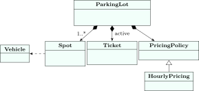
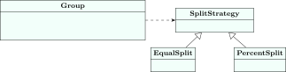

<div class="nb-proto">

<em><span>Prototypical example for this section:</span> “Design a parking lot”: the most common low-level design question.</em>

</div>

A low-level design (LLD) round gives a vague prompt and about 45 minutes. What is being tested is the process, more than the code:

1. <strong>Clarify requirements.</strong> Ask what is in scope; write down a short list.
2. <strong>Find the entities.</strong> The nouns in the requirements become candidate classes; the verbs become methods.
3. <strong>Assign responsibilities and relationships.</strong> Who owns what (composition), who uses what (association), what varies (an interface).
4. <strong>Write the core classes</strong>, then walk through one or two scenarios.
5. <strong>Discuss extensions</strong>: the interviewer will add a requirement to see whether the design bends or breaks.

Each case study below follows those steps. The code is one complete program per case study, shown in pieces with its real line numbers.

## 1.14.i Parking lot {#s1-14-i}

<div class="nb nb-example nb-block" id="example-1-14-1">

<strong>Example 1.14.1</strong> (Requirements, after clarifying)

After a few questions to the interviewer, the scope is:

- Spots come in three sizes: small (bikes), medium (cars), large (trucks).
- A vehicle may park in any free spot at least as large as it; give it the smallest.
- Parking issues a ticket; leaving returns the fee, charged per hour by spot size.
- The lot may be full; pricing rules will change.

</div>

<figure class="nb-fig"></figure>

The entities and the pricing strategy:

```cpp {filename="parking-lot.cpp, lines 8–45",linenos=table,linenostart=8}
enum class Size { Small = 0, Medium = 1, Large = 2 };   // bike, car, truck

struct Vehicle {
    std::string plate;
    Size size;
};

class Spot {
public:
    Spot(int id, Size size) : id_(id), size_(size) {}
    bool fits(const Vehicle& v) const { return !taken_ && v.size <= size_; }
    void occupy() { taken_ = true; }
    void release() { taken_ = false; }
    int id() const { return id_; }
    Size size() const { return size_; }
private:
    int id_;
    Size size_;
    bool taken_ = false;
};

struct Ticket {
    int number;
    std::string plate;
    int spotId;
    int entryHour;
};

struct PricingPolicy {                               // strategy
    virtual long fee(Size spot, int hours) const = 0;
    virtual ~PricingPolicy() = default;
};
struct HourlyPricing : PricingPolicy {
    long fee(Size spot, int hours) const override {
        static const long rate[] = {10, 30, 60};     // Rs per hour by size
        return rate[static_cast<int>(spot)] * (hours < 1 ? 1 : hours);
    }
};
```

The lot itself: it owns the spots, the active tickets and the pricing policy.

```cpp {filename="parking-lot.cpp, lines 47–81",linenos=table,linenostart=47}
class ParkingLot {
public:
    ParkingLot(std::vector<Spot> spots, std::unique_ptr<PricingPolicy> p)
        : spots_(std::move(spots)), pricing_(std::move(p)) {}

    // Smallest free spot that fits; returns false when the lot is full.
    bool park(const Vehicle& v, int hour, Ticket& out) {
        Spot* best = nullptr;
        for (Spot& s : spots_)
            if (s.fits(v) && (!best || s.size() < best->size())) best = &s;
        if (!best) return false;
        best->occupy();
        out = Ticket{++lastTicket_, v.plate, best->id(), hour};
        active_[out.number] = out;
        return true;
    }

    long leave(int ticketNo, int hour) {
        Ticket t = active_.at(ticketNo);             // throws if unknown
        active_.erase(ticketNo);
        Spot& s = spotById(t.spotId);
        s.release();
        return pricing_->fee(s.size(), hour - t.entryHour);
    }

private:
    Spot& spotById(int id) {
        for (Spot& s : spots_) if (s.id() == id) return s;
        throw std::out_of_range("no such spot");
    }
    std::vector<Spot> spots_;
    std::unique_ptr<PricingPolicy> pricing_;
    std::map<int, Ticket> active_;
    int lastTicket_ = 0;
};
```

A scenario: one spot of each size, a van that finds the lot full and gets in after a car leaves.

```cpp {filename="parking-lot.cpp, lines 83–103",linenos=table,linenostart=83}
int main() {
    ParkingLot lot({Spot(1, Size::Small), Spot(2, Size::Medium),
                    Spot(3, Size::Large)},
                   std::make_unique<HourlyPricing>());
    Ticket bike{}, car{}, truck{}, van{};
    lot.park({"TN01 B", Size::Small}, 9, bike);
    lot.park({"TN02 C", Size::Medium}, 9, car);
    lot.park({"TN03 T", Size::Large}, 10, truck);
    std::cout << "bike in spot " << bike.spotId << ", car in spot "
              << car.spotId << ", truck in spot " << truck.spotId << "\n";

    bool vanIn = lot.park({"TN04 V", Size::Medium}, 11, van);
    std::cout << "van parked at 11? " << std::boolalpha << vanIn << "\n";

    long fee = lot.leave(car.number, 12);           // car stayed 3 hours
    std::cout << "car pays Rs " << fee << "\n";

    vanIn = lot.park({"TN04 V", Size::Medium}, 12, van);
    std::cout << "van parked at 12? " << vanIn << ", spot " << van.spotId
              << "\n";
}
```

```text {filename="Output (MinGW g++ 6.3.0, -std=c++14, 32-bit)"}
bike in spot 1, car in spot 2, truck in spot 3
van parked at 11? false
car pays Rs 90
van parked at 12? true, spot 2
```

- <strong>Encapsulation</strong>: a `Spot` can only be taken or released through `occupy`/`release`; nobody outside the lot can edit tickets.
- <strong>Strategy / open–closed</strong>: weekend or flat pricing is a new `PricingPolicy`, injected in the constructor; `ParkingLot` does not change.
- <strong>Single responsibility</strong>: the spot knows whether a vehicle fits; the lot decides which spot to use; the pricing policy knows money.

<div class="nb nb-remark" id="remark-1-14-2">

<strong>Remark 1.14.2</strong> (Follow-ups interviewers ask) — Expect one or two of these:

- <em>Multiple floors?</em> Add a `Level` class that owns spots; the lot owns levels and asks each for a spot. The allocation rule becomes a strategy of its own.
- <em>Faster allocation?</em> Keep one free list (or min-heap by spot id) per size instead of scanning every spot: $\mathcal{O}\!\left(1\right)$ or $\mathcal{O}\!\left(\log n\right)$ per park.
- <em>Several entry gates at once?</em> `park` must be atomic: a lock around the allocation, or one free list per gate.
- <em>Should `ParkingLot` be a singleton?</em> It is tempting, but a company runs many lots, and tests want fresh ones; create it once and pass it around.

</div>

## 1.14.ii Library management {#s1-14-ii}

<div class="nb nb-example nb-block" id="example-1-14-3">

<strong>Example 1.14.3</strong> (Requirements, after clarifying)

After a few questions to the interviewer, the scope is:

- A book (title, ISBN) can have several physical copies.
- Members borrow copies up to a limit, for 14 days; late returns are fined.
- If every copy is out, the member joins a wait-list and is told when one comes back.

</div>

The key modelling decision is to separate `Book` (the title, one per ISBN) from `Copy` (a physical item with its own id and loan status). Candidates who model only “Book” cannot express “two copies of CLRS, one on loan”.

<figure class="nb-fig"></figure>

```cpp {filename="library-system.cpp, lines 7–46",linenos=table,linenostart=7}
struct Book {                          // the title: one per ISBN
    std::string isbn, title;
};

struct Copy {                          // a physical copy on the shelf
    int id;
    std::string isbn;
    bool onLoan = false;
};

class Member {
public:
    Member(int id, std::string name, int limit)
        : id_(id), name_(name), limit_(limit) {}
    bool canBorrow() const { return borrowed_ < limit_; }
    void borrowed() { ++borrowed_; }
    void returned() { --borrowed_; }
    void notify(const std::string& msg) const {       // observer hook
        std::cout << "  [to " << name_ << "] " << msg << "\n";
    }
    int id() const { return id_; }
private:
    int id_;
    std::string name_;
    int limit_, borrowed_ = 0;
};

struct Loan {
    int copyId, memberId, dueDay;
};

struct FinePolicy {                    // strategy: rules change often
    virtual long fine(int daysLate) const = 0;
    virtual ~FinePolicy() = default;
};
struct PerDayFine : FinePolicy {
    long fine(int daysLate) const override {
        return daysLate > 0 ? 5L * daysLate : 0;
    }
};
```

`Library` is a <strong>facade</strong>: one simple entry point in front of books, copies, members, loans and the wait-list.

```cpp {filename="library-system.cpp, lines 48–75",linenos=table,linenostart=48}
class Library {                        // facade over the whole system
public:
    explicit Library(const FinePolicy& f) : fines_(f) {}
    void addBook(const Book& b, int copies) {
        books_[b.isbn] = b;
        for (int i = 0; i < copies; ++i)
            copies_.push_back({nextCopy_++, b.isbn});
    }
    void addMember(const Member& m) { members_.emplace(m.id(), m); }

    // Returns the copy id, or -1 (and joins the wait-list) if none is free.
    int issue(int memberId, const std::string& isbn, int today) {
        Member& m = members_.at(memberId);
        if (!m.canBorrow()) { m.notify("borrowing limit reached"); return -1; }
        for (Copy& c : copies_)
            if (c.isbn == isbn && !c.onLoan) {
                c.onLoan = true;
                m.borrowed();
                loans_[c.id] = {c.id, memberId, today + 14};
                m.notify("issued '" + books_[isbn].title + "', copy " +
                         std::to_string(c.id));
                return c.id;
            }
        waitlist_[isbn].push_back(memberId);
        m.notify("all copies out; added to wait-list");
        return -1;
    }
```

```cpp {filename="library-system.cpp, lines 76–99",linenos=table,linenostart=76}
    long giveBack(int copyId, int today) {
        Loan loan = loans_.at(copyId);
        loans_.erase(copyId);
        members_.at(loan.memberId).returned();
        Copy& c = copies_[copyId - 1];
        c.onLoan = false;
        auto& queue = waitlist_[c.isbn];
        if (!queue.empty()) {                         // notify the next one
            members_.at(queue.front()).notify("'" + books_[c.isbn].title +
                                              "' is back");
            queue.pop_front();
        }
        return fines_.fine(today - loan.dueDay);
    }

private:
    const FinePolicy& fines_;
    std::map<std::string, Book> books_;
    std::vector<Copy> copies_;
    std::map<int, Member> members_;
    std::map<int, Loan> loans_;
    std::map<std::string, std::deque<int>> waitlist_;
    int nextCopy_ = 1;
};
```

```cpp {filename="library-system.cpp, lines 101–113",linenos=table,linenostart=101}
int main() {
    PerDayFine policy;
    Library lib(policy);
    lib.addBook({"978-0262046305", "CLRS"}, 1);
    lib.addMember(Member(1, "Asha", 2));
    lib.addMember(Member(2, "Ravi", 2));

    int copy = lib.issue(1, "978-0262046305", 1);    // day 1, due day 15
    lib.issue(2, "978-0262046305", 2);               // none left: wait-list
    long fine = lib.giveBack(copy, 18);              // 3 days late
    std::cout << "fine: Rs " << fine << "\n";
    lib.issue(2, "978-0262046305", 18);
}
```

```text {filename="Output (MinGW g++ 6.3.0, -std=c++14, 32-bit)"}
  [to Asha] issued 'CLRS', copy 1
  [to Ravi] all copies out; added to wait-list
  [to Ravi] 'CLRS' is back
fine: Rs 15
  [to Ravi] issued 'CLRS', copy 1
```

- <strong>Observer</strong>: returning a copy notifies the first member on that title’s wait-list through `Member::notify`. With email, SMS and push, `notify` would take a `Notifier` interface (dependency inversion, [Section 1.12](../12-solid/)).
- <strong>Strategy</strong>: fines are a `FinePolicy`; a capped fine or a grace period is a new class.
- <strong>Invariants</strong>: a copy cannot be issued twice, and a member cannot exceed the limit, because the only way to borrow is `issue`.

<div class="nb nb-remark" id="remark-1-14-4">

<strong>Remark 1.14.4</strong> (Follow-ups) — Reservations that expire if not collected; different member types (students, faculty) with different limits (a `MembershipPolicy`, not a subclass per type); search by title or author (an index class, keeping `Library` from growing into a “god class”).

</div>

## 1.14.iii Expense sharing (Splitwise) {#s1-14-iii}

<div class="nb nb-example nb-block" id="example-1-14-5">

<strong>Example 1.14.5</strong> (Requirements, after clarifying)

After a few questions to the interviewer, the scope is:

- A group of users records expenses: who paid, how much, and who shares it.
- Expenses can be split equally or by percentage (and later, by exact amounts).
- At any time, show a short list of payments that settles all balances.

</div>

Two design decisions matter most. First, money is stored as an integer number of paise: floating-point rupees would make balances like $0.1 + 0.2 \ne 0.3$ appear. Second, the group keeps only one <strong>net balance</strong> per user (positive: is owed, negative: owes) instead of a matrix of who owes whom; the matrix can always be recomputed from it.

<figure class="nb-fig"></figure>

```cpp {filename="splitwise.cpp, lines 10–31",linenos=table,linenostart=10}
struct SplitStrategy {
    virtual std::vector<long> shares(long total, int people) const = 0;
    virtual ~SplitStrategy() = default;
};
struct EqualSplit : SplitStrategy {
    std::vector<long> shares(long total, int n) const override {
        std::vector<long> s(n, total / n);
        s[0] += total % n;                          // first person absorbs
        return s;                                   // the rounding remainder
    }
};
struct PercentSplit : SplitStrategy {
    explicit PercentSplit(std::vector<int> pct) : pct_(pct) {}
    std::vector<long> shares(long total, int n) const override {
        if ((int)pct_.size() != n) throw std::invalid_argument("bad split");
        std::vector<long> s;
        for (int p : pct_) s.push_back(total * p / 100);
        return s;
    }
private:
    std::vector<int> pct_;
};
```

```cpp {filename="splitwise.cpp, lines 33–67",linenos=table,linenostart=33}
class Group {
public:
    void addUser(int id, std::string name) { names_[id] = name; net_[id] = 0; }

    void addExpense(int paidBy, long total, const std::vector<int>& among,
                    const SplitStrategy& how) {
        std::vector<long> s = how.shares(total, (int)among.size());
        net_[paidBy] += total;                      // they are owed this...
        for (std::size_t i = 0; i < among.size(); ++i)
            net_[among[i]] -= s[i];                 // ...and each owes a share
    }

    // Settle with few payments: largest debtor pays largest creditor.
    void settle() const {
        std::map<int, long> net = net_;
        while (true) {
            auto cmp = [](const std::pair<const int, long>& a,
                          const std::pair<const int, long>& b) {
                return a.second < b.second;
            };
            auto debtor = std::min_element(net.begin(), net.end(), cmp);
            auto creditor = std::max_element(net.begin(), net.end(), cmp);
            if (creditor->second == 0) break;       // everyone is even
            long amt = std::min(-debtor->second, creditor->second);
            std::cout << "  " << names_.at(debtor->first) << " pays "
                      << names_.at(creditor->first) << " Rs " << amt / 100
                      << "\n";
            debtor->second += amt;
            creditor->second -= amt;
        }
    }
private:
    std::map<int, std::string> names_;
    std::map<int, long> net_;                       // + owed, - owes
};
```

```cpp {filename="splitwise.cpp, lines 69–79",linenos=table,linenostart=69}
int main() {
    Group trip;
    trip.addUser(1, "Asha");
    trip.addUser(2, "Ravi");
    trip.addUser(3, "Meera");
    trip.addExpense(1, 300000, {1, 2, 3}, EqualSplit());       // hotel
    trip.addExpense(2, 90000, {1, 2, 3}, EqualSplit());        // cab
    trip.addExpense(3, 60000, {1, 2, 3}, PercentSplit({50, 25, 25}));  // food
    std::cout << "settlement:\n";
    trip.settle();
}
```

```text {filename="Output (MinGW g++ 6.3.0, -std=c++14, 32-bit)"}
settlement:
  Meera pays Asha Rs 850
  Ravi pays Asha Rs 550
```

<div class="nb nb-example nb-block" id="example-1-14-6">

<strong>Example 1.14.6</strong> (Checking the answer by hand)

Hotel Rs 3000 paid by Asha, split three ways: Asha $+2000$, Ravi $-1000$, Meera $-1000$. Cab Rs 900 paid by Ravi: Asha $+1700$, Ravi $-400$, Meera $-1300$. Food Rs 600 paid by Meera, split $50/25/25$: Asha $+1400$, Ravi $-550$, Meera $-850$. The balances sum to $0$, and the two printed payments settle them.

</div>

- <strong>Strategy</strong>: each split rule is a class; adding “split by exact amounts” touches nothing else.
- <strong>Rounding is a rule</strong>, not an accident: `EqualSplit` gives the leftover paise to the first person, so shares always add up to the total.
- <strong>Settlement</strong> repeatedly matches the largest debtor with the largest creditor; each step zeroes at least one balance, so there are at most $n-1$ payments. (Finding the true minimum number of payments is NP-hard in general, which is worth saying if asked.)

<div class="nb nb-remark" id="remark-1-14-7">

<strong>Remark 1.14.7</strong> (Follow-ups) — Groups and one-to-one expenses; editing or deleting an expense (store expenses and recompute balances, rather than only mutating balances); multiple currencies (a currency on each expense and an exchange-rate service injected into the group).

</div>

<div class="nb nb-moral">

In an LLD round, the interviewer is watching for three things: nouns turned into classes with clear ownership, the parts that vary hidden behind interfaces, and invariants protected by encapsulation. Code that compiles is a bonus; a design that survives the follow-up question is the goal.

</div>
