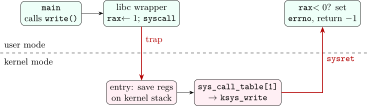
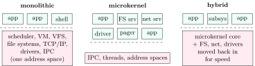

<div class="nb nb-remark" id="remark-1-0-1">

<strong>Remark 1.0.1</strong> (How to read this book) — Every C listing is a complete program that was compiled with `gcc -std=c11 -Wall -Wextra` (plus the flags on its first line) and run on Linux 6.18, x86-64, glibc 2.39; the grey box under it is what it printed. Every numerical (Gantt charts, page-fault counts, disk-head movements, Banker’s traces) was produced by a Python 3.11 simulator in the same folder, whose core is printed next to its output. Output that depends on timing is labelled “one possible output”. All of it is regenerated by `chapters/os/code/build.sh`.

<strong>Sources.</strong> The material follows the standard textbooks: Silberschatz, Galvin and Gagne, <em>Operating System Concepts</em>; Stallings, <em>Operating Systems: Internals and Design Principles</em> (9th ed.); Tanenbaum and Bos, <em>Modern Operating Systems</em>; and Arpaci-Dusseau and Arpaci-Dusseau, <em>Operating Systems: Three Easy Pieces</em>. The topic list and the GATE-style numerical patterns were cross-checked against the GO Classes operating-systems lecture series (lectures by Deepak Poonia). Linux specifics were checked against the man pages and by running the programs.

</div>

## 1.1 What an operating system is for {#sec-os-role}

<div class="nb-proto">

<em><span>Prototypical example for this section:</span> two programs that both believe they own the whole CPU, all of memory and the disk, and neither of which can damage the other.</em>

</div>

### 1.1.i Three jobs {#s1-1-i}

An operating system does three things, and almost every interview question is about one of them.

1. <strong>Illusionist (virtualization).</strong> Each process sees its own CPU (time-sharing), its own flat memory starting at a small address (virtual memory), and files instead of disk blocks. None of these exist physically.
2. <strong>Referee (protection and isolation).</strong> A buggy or hostile program cannot read another’s memory, hog the CPU forever, or write raw disk blocks. This needs hardware help: a privileged mode, a timer and an MMU.
3. <strong>Resource manager.</strong> CPU time, memory frames, disk bandwidth and devices are finite and contended; the OS decides who gets what (scheduling, replacement, disk scheduling) and tries to keep everything busy.

<div class="nb nb-definition" id="definition-1-1-1">

<strong>Definition 1.1.1</strong>. The <strong>kernel</strong> is the part of the OS that runs in the privileged mode of the CPU and is always resident. The rest (shell, libraries, daemons, utilities) are ordinary user programs that ask the kernel for service through <strong>system calls</strong>.

</div>

### 1.1.ii Batch, multiprogramming, time-sharing, real-time {#s1-1-ii}

<div class="nb nb-definition" id="definition-1-1-2">

<strong>Definition 1.1.2</strong>. The vocabulary of early systems, still used in OA options:

- <strong>Multiprogramming</strong>: several jobs are in memory; when the running one blocks for I/O, the CPU switches to another. Goal: CPU utilisation.
- <strong>Time-sharing</strong> (<strong>multitasking</strong>): multiprogramming plus a timer that preempts the running job every few milliseconds. Goal: response time for interactive users.
- <strong>Multiprocessing</strong>: more than one CPU (core) executing at once.
- <strong>Real-time</strong> OS: correctness includes meeting deadlines. <em>Hard</em> real-time: a missed deadline is a failure (airbag controller); <em>soft</em>: it degrades quality (video frame dropped).
- <strong>Spooling</strong> (simultaneous peripheral operations on-line): slow-device output (classically the printer) is written to a disk queue and drained by a daemon, so the job finishes without waiting for the device.

</div>

<div class="nb nb-remark" id="remark-1-1-3">

<strong>Remark 1.1.3</strong> (OA trap: “which keeps the CPU and I/O devices busy at the same time?”) — Both multiprogramming and spooling overlap computation with I/O, and question banks use both as the key. Read the options: if <em>spooling</em> is offered next to buffering, the textbook answer is spooling: the older editions of Silberschatz introduce spooling exactly as the technique that overlaps the I/O of one job with the computation of other jobs, keeping both the CPU and the devices busy. <em>Buffering</em> overlaps the I/O of a job with its <em>own</em> computation. If spooling is not offered, multiprogramming is the answer.

</div>

<div class="nb nb-moral">

An OS virtualises the hardware, protects programs from each other, and arbitrates finite resources; the kernel is the privileged core that makes all three enforceable.

</div>

## 1.2 Dual-mode operation {#sec-os-dualmode}

<div class="nb-proto">

<em><span>Prototypical example for this section:</span> a user program executing `cli` (disable interrupts) to make itself un-preemptible, and getting killed instead.</em>

</div>

<div class="nb nb-definition" id="definition-1-2-1">

<strong>Definition 1.2.1</strong>. The CPU has at least two privilege levels: <strong>kernel mode</strong> (supervisor, ring 0 on x86) and <strong>user mode</strong> (ring 3). A <strong>privileged instruction</strong> executes only in kernel mode; in user mode it raises an exception and the kernel (usually) kills the process. The mode is a bit in a CPU register; the only ways from user to kernel mode are a system call, an exception or an interrupt, and each enters the kernel at an address the kernel chose.

</div>

| Operation | Privileged? | Why |
|:--|:-:|:--|
| Set the timer / disable interrupts | yes | otherwise a process could never be preempted |
| Load the page-table base (CR3) or TLB control | yes | would let a process map any physical memory |
| Direct device I/O (`in`/`out`, DMA set-up) | yes | bypasses file permissions |
| Halt the CPU, modify interrupt vector table | yes | system-wide effect |
| Switch to kernel mode directly | yes | that is the whole point |
| Read the clock | no | harmless (Linux even maps it into user space: vDSO) |
| Issue a trap / `syscall` instruction | no | it is <em>how</em> user code asks |
| Ordinary arithmetic, loads/stores to own pages | no | checked by the MMU, not by mode |

<div class="nb-caption" id="table-1-1">

<strong>Table 1.1.</strong> Which operations must be privileged.

</div>

<div class="nb nb-remark" id="remark-1-2-2">

<strong>Remark 1.2.2</strong> (Why the timer matters) — Without a periodic timer interrupt, a process in `while(1);` would keep the CPU forever: the kernel runs only when something traps into it. The timer interrupt is what makes preemptive scheduling possible, and setting it is privileged for that reason.

</div>

## 1.3 System calls {#sec-os-syscalls}

<div class="nb-proto">

<em><span>Prototypical example for this section:</span> `write(1, "hi\n", 3)`: a library call, a trap, a table lookup in the kernel, and a return value of $3$ or $-1$ with `errno`.</em>

</div>

### 1.3.i The trap path, step by step {#s1-3-i}

<div class="nb nb-remark" id="algorithm-1-3-1">

<strong>Algorithm 1.3.1</strong> (A Linux system call on x86-64) — From the C call into the kernel and back:

1. User code calls the libc wrapper `write(fd, buf, n)`.
2. The wrapper puts the system-call number in `rax` (`SYS_write` $=1$) and the arguments in `rdi`, `rsi`, `rdx` (then `r10`, `r8`, `r9`), and executes the `syscall` instruction.
3. The CPU saves the user `rip` in `rcx` and `rflags` in `r11`, switches to ring 0 and jumps to the kernel entry point stored in a model-specific register at boot. The user program cannot choose where the kernel is entered.
4. The entry code switches to the thread’s kernel stack, saves the user registers there (Linux’s `struct pt_regs`), checks the number and calls `sys_call_table[rax]`.
5. The handler validates every argument (is `buf` really in the caller’s address space? is `fd` open?) and does the work, possibly blocking.
6. The return value goes in `rax`; `sysret` restores `rip`, `rflags` and user mode.
7. The wrapper turns a return value in $[-4095,-1]$ into $-1$ plus `errno`.

</div>

The program below makes the same call through the libc wrapper, through the generic `syscall()` function, and with the instruction itself:

```c {filename="raw-syscall.c"}
// flags: -D_GNU_SOURCE
// The same system call made three ways: libc wrapper, syscall(), raw
// instruction.
#include <stdio.h>
#include <string.h>
#include <unistd.h>
#include <sys/syscall.h>

static long raw_write(int fd, const void *buf, unsigned long len) {
    long ret;
    // x86-64 Linux ABI: number in rax, arguments in rdi, rsi, rdx; the
    // `syscall` instruction switches to ring 0; rcx and r11 are clobbered.
    __asm__ volatile ("syscall"
                      : "=a"(ret)
                      : "a"(SYS_write), "D"(fd), "S"(buf), "d"(len)
                      : "rcx", "r11", "memory");
    return ret;
}

int main(void) {
    const char *a = "1. write() from libc\n";
    const char *b = "2. syscall(SYS_write, ...)\n";
    const char *c = "3. the syscall instruction itself\n";
    write(1, a, strlen(a));
    syscall(SYS_write, 1, b, strlen(b));
    long n = raw_write(1, c, strlen(c));
    printf("SYS_write = %d, SYS_getpid = %d, raw call returned %ld\n",
           SYS_write, SYS_getpid, n);
    printf("bad fd: write returns %ld (that is -EBADF, EBADF = 9)\n",
           raw_write(42, c, 1));
    return 0;
}
```

```text {filename="Output (gcc 13.3, glibc 2.39, Linux 6.18 x86-64)"}
1. write() from libc
2. syscall(SYS_write, ...)
3. the syscall instruction itself
SYS_write = 1, SYS_getpid = 39, raw call returned 34
bad fd: write returns -9 (that is -EBADF, EBADF = 9)
```

The raw instruction returns $-9$ for a bad descriptor: the kernel reports errors as negative numbers, and `errno` is purely a libc convention.

<figure class="nb-fig"></figure>

### 1.3.ii What a system call costs {#s1-3-ii}

```c {filename="syscall-cost.c"}
// flags: -D_GNU_SOURCE -O2
// Rough cost of entering the kernel: a system call vs a function call.
#include <stdio.h>
#include <time.h>
#include <unistd.h>
#include <sys/syscall.h>

__attribute__((noinline)) static long plain(long x) {
    __asm__ volatile("");
    return x + 1;
}

static double now_ns(void) {
    struct timespec ts;
    clock_gettime(CLOCK_MONOTONIC, &ts);   // vDSO: no kernel entry
    return ts.tv_sec * 1e9 + ts.tv_nsec;
}

int main(void) {
    enum { N = 2000000 };
    long s = 0;
    double t0 = now_ns();
    for (int i = 0; i < N; i++) s += plain(i);
    double t1 = now_ns();
    for (int i = 0; i < N; i++) s += syscall(SYS_getppid);
    double t2 = now_ns();
    printf("function call : %6.1f ns\n", (t1 - t0) / N);
    printf("getppid system call: %6.1f ns\n", (t2 - t1) / N);
    return s == 42;   // use s so the loops are not removed
}
```

```text {filename="One possible output (gcc 13.3, glibc 2.39, Linux 6.18 x86-64)"}
function call :    1.3 ns
getppid system call:  117.5 ns
```

A system call costs on the order of a hundred nanoseconds here, about two orders of magnitude more than a function call: saving and restoring registers, the mode switch, and the speculative-execution mitigations that modern kernels apply on every entry. This is why `read` is called on large buffers, why stdio buffers `printf`, and why `gettimeofday`/`clock_gettime` are served from the <strong>vDSO</strong>, a page of kernel code and data mapped read-only into every process so that no trap happens at all.

<div class="nb nb-remark" id="remark-1-3-2">

<strong>Remark 1.3.2</strong> (A mode switch is not a context switch) — A system call switches the CPU from user to kernel mode and back, in the same process. A <strong>context switch</strong> replaces the running process (or thread) with another: it saves one register set and loads another, and may switch address spaces. A system call that blocks (a `read` with no data) leads to a context switch; `getppid` never does.

</div>

### 1.3.iii The classes of system calls {#s1-3-iii}

| Class | Linux examples |
|:--|:--|
| Process control | `fork`, `clone`, `execve`, `exit`, `wait4`, `kill` |
| File management | `open`, `read`, `write`, `lseek`, `close`, `stat`, `unlink` |
| Device management | `ioctl`, `read`/`write` on `/dev` files, `mmap` of device memory |
| Information | `getpid`, `uname`, `clock_gettime`, `sysinfo` |
| Communication | `pipe`, `socket`, `shmget`, `mmap`, `mq_open` |
| Protection | `chmod`, `chown`, `setuid`, `umask` |

`printf`, `malloc` and `fopen` are <em>library</em> functions. `printf` eventually calls `write`; `malloc` calls `brk` or `mmap` only when its own pool runs out ([Section 8.7](../08-vm/#sec-os-allocators)). “Is `malloc` a system call?” is a common first question; the answer is no.

<div class="nb nb-moral">

A system call is a controlled entry into the kernel: number in a register, a trap instruction, a kernel-chosen entry point, validated arguments, a return value in a register.

</div>

## 1.4 Interrupts, exceptions and traps {#sec-os-interrupts}

<div class="nb-proto">

<em><span>Prototypical example for this section:</span> a key press (interrupt), a division by zero (exception) and a breakpoint (trap) all arriving at the same kind of kernel handler.</em>

</div>

<div class="nb nb-definition" id="definition-1-4-1">

<strong>Definition 1.4.1</strong>. All three transfer control to a kernel handler found through the <strong>interrupt vector table</strong> (the IDT on x86), after the CPU saves enough state to resume.

- An <strong>interrupt</strong> is <em>asynchronous</em>: raised by a device (timer, NIC, disk controller) independently of the instruction being executed.
- An <strong>exception</strong> is <em>synchronous</em>: caused by the current instruction. Intel splits exceptions into <strong>faults</strong> (reported <em>before</em> the instruction completes, and the instruction is re-executed after the handler: page fault, general protection), <strong>traps</strong> (reported <em>after</em> the instruction, execution continues with the next one: `int3` breakpoint, overflow) and <strong>aborts</strong> (unrecoverable: machine check, double fault).
- A <strong>software interrupt</strong> or system-call trap (`int 0x80`, `syscall`, ARM’s `svc`) is a deliberate exception used to request a service.

</div>

Most exceptions in user mode end with the kernel sending a signal to the process. Each child below provokes one:

```c {filename="exceptions.c"}
// flags: -D_GNU_SOURCE
// Four CPU exceptions, each in its own child; the kernel turns each into a
// signal.
#include <stdio.h>
#include <stdlib.h>
#include <string.h>
#include <signal.h>
#include <unistd.h>
#include <sys/wait.h>

static volatile int num = 7, zero = 0;  // volatile: forces a real idiv

static void divide(void)  { printf("%d\n", num / zero); }
static void nullptr_(void) { int *volatile p = NULL; *p = 7; }
static void illegal(void) { __builtin_trap(); }           // emits ud2
static void breakpt(void) { __asm__ volatile ("int3"); }  // a deliberate trap

int main(void) {
    struct { const char *what; void (*f)(void); } t[] = {
        {"integer divide by zero", divide}, {"store through NULL", nullptr_},
        {"undefined opcode (ud2)", illegal}, {"int3 breakpoint", breakpt},
    };
    for (int i = 0; i < 4; i++) {
        pid_t pid = fork();
        if (pid == 0) { t[i].f(); _exit(0); }
        int st;
        waitpid(pid, &st, 0);
        if (WIFSIGNALED(st))
            printf("%-24s -> killed by signal %2d (%s)\n", t[i].what,
                   WTERMSIG(st), sigabbrev_np(WTERMSIG(st)));
        else
            printf("%-24s -> exited %d\n", t[i].what, WEXITSTATUS(st));
    }
    return 0;
}
```

```text {filename="Output (gcc 13.3, glibc 2.39, Linux 6.18 x86-64)"}
integer divide by zero   -> killed by signal  8 (FPE)
store through NULL       -> killed by signal 11 (SEGV)
undefined opcode (ud2)   -> killed by signal  4 (ILL)
int3 breakpoint          -> killed by signal  5 (TRAP)
```

<div class="nb nb-remark" id="remark-1-4-2">

<strong>Remark 1.4.2</strong> (The page fault is the important fault) — A page fault on a page that is legitimately mapped but not in memory is not an error: the kernel loads the page and re-executes the faulting instruction, and the program never notices ([Section 8.2](../08-vm/#sec-os-pagefault)). Only a fault on an address that is not mapped at all, or a write to a read-only page, becomes `SIGSEGV`.

</div>

<div class="nb nb-remark" id="remark-1-4-3">

<strong>Remark 1.4.3</strong> (An undefined-behaviour trap inside the demo) — The first version of this program computed `1 / zero` with only `zero` volatile. gcc compiled it into a comparison with no division at all (dividing $1$ by anything other than $\pm1$ gives $0$, and division by zero is undefined, so it may assume it never happens), and the child exited normally. Making both operands `volatile` forces a real `idiv`. Undefined behaviour is undefined even when you are trying to provoke it.

</div>

### 1.4.i Handling an interrupt {#s1-4-i}

1. The device raises a line on the interrupt controller (APIC); the CPU finishes the current instruction, looks up the vector, switches to kernel mode and the kernel stack, and pushes the interrupted `rip`, `rflags` and stack pointer.
2. The handler’s <strong>top half</strong> runs with that interrupt line masked: acknowledge the device, copy what must be copied, schedule the rest.
3. The <strong>bottom half</strong> (softirqs, tasklets, workqueues in Linux) does the slow work later with interrupts enabled, for example TCP processing of a received packet.
4. On return, the kernel checks whether a reschedule is pending (the timer interrupt sets it when the quantum expires); if so, a different process resumes.

Interrupts can be <strong>masked</strong> (disabled) except the <strong>non-maskable interrupt</strong> (NMI), used for hardware failures and watchdogs. Interrupts have priorities: a higher-priority interrupt may preempt a lower one’s handler.

<div class="nb nb-moral">

Interrupts come from outside and can arrive between any two instructions; exceptions come from the instruction itself; a fault re-executes the instruction, a trap continues after it.

</div>

## 1.5 Booting {#sec-os-boot}

<div class="nb-proto">

<em><span>Prototypical example for this section:</span> power button to login prompt on a Linux PC.</em>

</div>

1. <strong>Firmware.</strong> The CPU starts at a fixed address in ROM/flash. The firmware (legacy BIOS or UEFI) runs the power-on self-test, initialises memory and devices, and picks a boot device.
2. <strong>Boot loader.</strong> BIOS loads the 512-byte master boot record (sector 0, ending in the signature `0x55 0xAA`) which loads a larger second stage; UEFI instead reads a FAT <strong>EFI system partition</strong> and runs a boot-loader program from it. The boot loader (GRUB, systemd-boot) loads the kernel image and the initial RAM disk (`initramfs`) and jumps to the kernel with a command line.
3. <strong>Kernel.</strong> It decompresses itself, switches the CPU into its final mode (on x86 from 16-bit real mode, through protected mode, to 64-bit long mode with paging on), sets up its own page tables, the interrupt table, memory allocators and the scheduler, probes drivers, mounts the initramfs and finally the real root file system.
4. <strong>PID 1.</strong> The kernel starts the first user process, `/sbin/init` (today usually systemd), which starts the daemons, mounts the remaining file systems and launches `getty`/login or a display manager. Every other process descends from PID 1.

<div class="nb nb-remark" id="remark-1-5-1">

<strong>Remark 1.5.1</strong> — “Who runs before the OS?” Firmware and the boot loader. “What is the first process?” `init`/`systemd`, PID 1. (Linux also has PID 2, `kthreadd`, the parent of all kernel threads, and an idle task with PID 0 that is not a real process.)

</div>

## 1.6 Kernel structures {#sec-os-kernels}

<div class="nb-proto">

<em><span>Prototypical example for this section:</span> a buggy USB driver: in Linux it can crash the whole kernel; in a microkernel it crashes one user-space server, which is restarted.</em>

</div>

<figure class="nb-fig"></figure>

<div class="nb nb-definition" id="definition-1-6-1">

<strong>Definition 1.6.1</strong>. Four designs, from most to least in the kernel:

- A <strong>monolithic kernel</strong> runs all OS services (scheduling, memory management, file systems, network stack, drivers) in one privileged address space and calls between them are plain function calls. Linux, the BSDs. Linux adds <strong>loadable kernel modules</strong>, which change what is linked in, not where it runs.
- A <strong>microkernel</strong> keeps only the minimum in kernel mode (address spaces, threads, IPC, basic scheduling) and runs file systems, drivers and networking as user-space servers that talk by message passing. Mach, L4/seL4, QNX, MINIX 3.
- A <strong>hybrid kernel</strong> is microkernel-shaped but keeps many services in kernel space for speed: Windows NT, macOS/iOS XNU (Mach + BSD).
- A <strong>layered</strong> design orders the OS in levels, each using only the ones below (THE system); clean but rigid. An <strong>exokernel</strong> or <strong>unikernel</strong> goes the other way: minimal protection, the application links its own “OS” library.

</div>

|  | Monolithic | Microkernel |
|:--|:--|:--|
| Service call cost | function call | IPC: two or more mode switches and a message copy |
| Fault isolation | a driver bug can corrupt the kernel | a crashed server can be restarted |
| Trusted code base | millions of lines | small (seL4 is formally verified) |
| Extensibility | modules, recompile | add a user-space server |
| Typical use | desktops, servers, Android | embedded/automotive RTOS (QNX), high assurance |

<div class="nb nb-moral">

Monolithic buys speed with a large trusted base; microkernels buy isolation with IPC cost; real systems (Linux with modules, Windows, macOS) sit in between.

</div>
