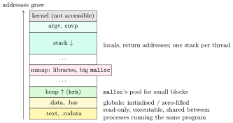
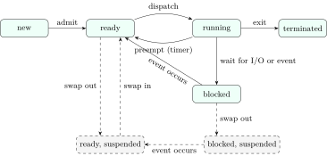

## 2.1 A process and what the OS keeps about it {#sec-os-process}

<div class="nb-proto">

<em><span>Prototypical example for this section:</span> the same `a.out` started twice: one program on disk, two processes, each with its own registers, stack, heap and open files.</em>

</div>

<div class="nb nb-definition" id="definition-2-1-1">

<strong>Definition 2.1.1</strong>. A <strong>program</strong> is a passive file (an executable). A <strong>process</strong> is a program in execution: an address space holding the code and data, one or more threads of execution with their registers and stacks, and the kernel resources it holds (open files, signal handlers, credentials, current directory).

</div>

### 2.1.i The address space {#s2-1-i}

<figure class="nb-fig"></figure>

```c {filename="layout.c"}
// flags: -D_GNU_SOURCE
// Where do the parts of a process live? One address per region, sorted.
#include <stdio.h>
#include <stdlib.h>
#include <string.h>
#include <sys/mman.h>

int initialised = 42;          // .data
int uninitialised;             // .bss (zero-filled, takes no space in the file)
const char greeting[] = "hi";  // .rodata

struct region { const char *name; void *addr; };

static int cmp(const void *a, const void *b) {
    const struct region *x = a, *y = b;
    return (x->addr > y->addr) - (x->addr < y->addr);
}

int main(int argc, char **argv) {
    (void)argc;
    int local = 1;                                  // stack
    void *small = malloc(64);                       // heap (brk area)
    void *big = malloc(1 << 20);                    // 1 MiB: its own mmap
    struct region r[] = {
        {"text      main()", (void *)main},
        {"rodata    greeting", (void *)greeting},
        {"data      initialised", &initialised},
        {"bss       uninitialised", &uninitialised},
        {"heap      malloc(64)", small},
        {"mmap      malloc(1 MiB)", big},
        {"libc      printf()", (void *)printf},
        {"stack     local", &local},
        {"args      argv[0]", argv[0]},
    };
    int n = sizeof r / sizeof r[0];
    qsort(r, n, sizeof r[0], cmp);
    for (int i = 0; i < n; i++) printf("%14p  %s\n", r[i].addr, r[i].name);
    free(small); free(big);
    return 0;
}
```

```text {filename="One possible output (gcc 13.3, glibc 2.39, Linux 6.18 x86-64)"}
0x56352c863211  text      main()
0x56352c864004  rodata    greeting
0x56352c866010  data      initialised
0x56352c866018  bss       uninitialised
0x56356575d2a0  heap      malloc(64)
0x7fea55c60100  libc      printf()
0x7fea55e60010  mmap      malloc(1 MiB)
0x7ffef262d0d4  stack     local
0x7ffef262ee8c  args      argv[0]
```

Addresses change on every run (address-space layout randomisation, [Section 11.1](../11-security/#sec-os-security)), but the order does not. The 64-byte block comes from the heap right after the program’s data; the 1 MiB block got its own anonymous `mmap` (glibc’s threshold is 128 KiB by default), which sits near the shared libraries; the stack is near the top of the user half.

<div class="nb nb-remark" id="remark-2-1-2">

<strong>Remark 2.1.2</strong> (OA: “the area used as a pool for dynamic memory allocation”) — That is the <strong>heap</strong>. The stack holds automatic (local) variables and is managed by the compiler’s push/pop; the heap is managed by `malloc`/`free` (or `new`/`delete`) at run time. The data segment holds globals and statics whose size is fixed at compile time.

</div>

### 2.1.ii The process control block {#s2-1-ii}

<div class="nb nb-definition" id="definition-2-1-3">

<strong>Definition 2.1.3</strong>. The kernel keeps everything it knows about a process in its <strong>process control block</strong> (PCB); Linux calls it `struct task_struct`. It holds

- identity: PID, parent PID, user and group IDs;
- state (running, ready, blocked, …) and scheduling data: priority, nice value, accumulated CPU time, the run-queue links;
- the saved CPU context while not running: program counter, stack pointer, general registers, flags (on Linux the user registers sit on the kernel stack and the PCB points to them);
- memory-management information: the page-table root, the list of memory regions;
- the open-file table (file descriptors), current directory, `umask`;
- signal state: handlers, blocked mask, pending signals;
- accounting and resource limits.

</div>

“Where does the OS keep information about a process?” In its PCB. The PCB is kernel memory; the process cannot read or write it except through system calls (and `/proc`, which the kernel generates from it).

## 2.2 Process states and schedulers {#sec-os-states}

<div class="nb-proto">

<em><span>Prototypical example for this section:</span> a text editor: running while you type, blocked while it waits for the next key, ready the moment the key arrives but a compiler holds the CPU.</em>

</div>

<figure class="nb-fig"></figure>

<div class="nb nb-definition" id="definition-2-2-1">

<strong>Definition 2.2.1</strong>. The five-state model: <strong>new</strong> (being created), <strong>ready</strong> (runnable, waiting for a CPU), <strong>running</strong>, <strong>blocked</strong>/<strong>waiting</strong> (waiting for an event: I/O completion, a lock, a signal, a child), <strong>terminated</strong> (finished, PCB not yet removed). Stallings’ seven-state model adds the two <strong>suspended</strong> states for processes swapped out to disk (dashed above).

</div>

<div class="nb nb-remark" id="remark-2-2-2">

<strong>Remark 2.2.2</strong> (Which transitions are impossible) — In the five-state model these cannot happen:

- <strong>blocked $\to$ running</strong>: when the event arrives the process becomes <em>ready</em>; the scheduler decides separately when it runs.
- <strong>ready $\to$ blocked</strong>: only a running process can execute the call that blocks it.
- <strong>new $\to$ running</strong> and <strong>new $\to$ blocked</strong>: admission always goes through ready.
- anything out of <strong>terminated</strong>.
- <strong>blocked, suspended $\to$ running</strong>: it must be swapped in and become ready first.

Running $\to$ ready exists only with preemption; in a purely non-preemptive system a process leaves the CPU only by blocking or exiting.

</div>

### 2.2.i Long-, medium- and short-term schedulers {#s2-2-i}

<div class="nb nb-definition" id="definition-2-2-3">

<strong>Definition 2.2.3</strong>. Three schedulers and one dispatcher:

- The <strong>long-term scheduler</strong> (job scheduler) decides which submitted jobs are admitted into memory; it controls the <strong>degree of multiprogramming</strong> (how many processes are in memory) and should admit a mix of I/O-bound and CPU-bound jobs. Batch systems have one; interactive systems mostly do not (every started program is admitted).
- The <strong>medium-term scheduler</strong> swaps whole processes out to disk and back (the suspended states) to relieve memory pressure. It is optional.
- The <strong>short-term scheduler</strong> (CPU scheduler) picks the next ready process to run, every few milliseconds; [Chapter 4](../04-scheduling/) is about it.
- The <strong>dispatcher</strong> carries out that choice: context switch, switch to user mode, jump to the saved program counter. Its running time is the <strong>dispatch latency</strong>.

</div>

<div class="nb nb-moral">

A process moves ready $\to$ running only by being dispatched, and leaves running by exiting, blocking or being preempted; a blocked process always goes back through ready.

</div>

## 2.3 Context switch {#sec-os-ctxswitch}

<div class="nb-proto">

<em><span>Prototypical example for this section:</span> a timer interrupt arrives while process A runs; when the kernel returns to user mode, process B is running.</em>

</div>

<div class="nb nb-remark" id="algorithm-2-3-1">

<strong>Algorithm 2.3.1</strong> (What a context switch does) — From A running to B running:

1. Enter the kernel (timer interrupt, or a blocking system call). A’s user registers are saved on A’s kernel stack.
2. The scheduler picks B.
3. Save A’s kernel-mode context (callee-saved registers, kernel stack pointer) in A’s PCB; load B’s.
4. If B is in a different address space: load B’s page-table root (CR3). Without tagged TLBs this flushes the TLB.
5. Return to user mode on B’s kernel stack, restoring B’s user registers.

</div>

<div class="nb nb-remark" id="remark-2-3-2">

<strong>Remark 2.3.2</strong> (Direct and indirect cost) — The direct cost is saving and loading registers and running the scheduler: around a microsecond. The indirect cost is usually larger: the TLB is flushed (or partly evicted), B’s working set is not in the caches, and branch predictors are trained on A. Switching between two threads of the same process skips the address-space change, so it is cheaper.

</div>

```c {filename="ctxswitch.c"}
// flags: -D_GNU_SOURCE
// Two processes pinned to one CPU bounce a byte through two pipes.
// /proc counts voluntary switches (blocked) and involuntary ones (preempted).
#include <stdio.h>
#include <sched.h>
#include <string.h>
#include <time.h>
#include <unistd.h>
#include <sys/wait.h>

static long switches(const char *kind) {     // "voluntary" or "nonvoluntary"
    FILE *f = fopen("/proc/self/status", "r");
    char line[128], key[64]; long v = -1;
    snprintf(key, sizeof key, "%s_ctxt_switches: %%ld", kind);
    while (fgets(line, sizeof line, f))
        if (sscanf(line, key, &v) == 1) break;
    fclose(f);
    return v;
}

int main(void) {
    enum { N = 100000 };
    cpu_set_t one; CPU_ZERO(&one); CPU_SET(0, &one);
    sched_setaffinity(0, sizeof one, &one);          // inherited by the child
    int ab[2], ba[2]; pipe(ab); pipe(ba);
    char c = 'x';
    if (fork() == 0) {
        for (int i = 0; i < N; i++) { read(ab[0], &c, 1); write(ba[1], &c, 1); }
        _exit(0);
    }
    long v0 = switches("voluntary"), n0 = switches("nonvoluntary");
    struct timespec t0, t1;
    clock_gettime(CLOCK_MONOTONIC, &t0);
    for (int i = 0; i < N; i++) { write(ab[1], &c, 1); read(ba[0], &c, 1); }
    clock_gettime(CLOCK_MONOTONIC, &t1);
    long v1 = switches("voluntary"), n1 = switches("nonvoluntary");
    wait(NULL);
    double ns = (t1.tv_sec - t0.tv_sec) * 1e9 + (t1.tv_nsec - t0.tv_nsec);
    printf("round trips: %d\n", N);
    printf("parent's switches: %ld voluntary, %ld involuntary\n",
           v1 - v0, n1 - n0);
    printf("time per switch (incl. 2 syscalls): %.0f ns\n", ns / (2.0 * N));
    return 0;
}
```

```text {filename="One possible output (gcc 13.3, glibc 2.39, Linux 6.18 x86-64)"}
round trips: 100000
parent's switches: 56854 voluntary, 43153 involuntary
time per switch (incl. 2 syscalls): 1522 ns
```

About a microsecond and a half per switch on this machine, including the two system calls on each side. Some switches were involuntary: when the parent’s `write` woke the child, the scheduler preempted the parent at once, so by the time the parent called `read` the answer was already in the pipe.

<div class="nb nb-remark" id="remark-2-3-3">

<strong>Remark 2.3.3</strong> (OA: “which of these reduces context-switch time?”) — Go through the usual options:

- <strong>Multiple register sets</strong> in hardware (SPARC register windows, many microcontrollers’ banked registers for interrupts): a switch changes a pointer instead of copying registers. Yes.
- <strong>Threads instead of processes</strong>: no page-table switch and no TLB flush. Yes.
- <strong>Tagged TLBs</strong> (ASID on ARM, PCID on x86): TLB entries of several address spaces coexist, so CR3 reloads need no flush. Yes.
- <strong>Less memory to swap</strong>: if a switch requires swapping a process in (the medium-term scheduler’s case), a smaller process means less I/O. Yes, in that model.
- A larger time quantum reduces the <em>number</em> of switches (overhead per second), not the time of one switch.

</div>

<div class="nb nb-moral">

A context switch is cheap to do and expensive to recover from: the hidden cost is the cold TLB and caches.

</div>

## 2.4 `fork` {#sec-os-fork}

<div class="nb-proto">

<em><span>Prototypical example for this section:</span> a shell creating the process that will run `ls`.</em>

</div>

<div class="nb nb-definition" id="definition-2-4-1">

<strong>Definition 2.4.1</strong>. `pid_t fork(void)` creates a new process (the <strong>child</strong>) that is a copy of the caller (the <strong>parent</strong>). It returns twice: $0$ in the child and the child’s PID in the parent, or $-1$ in the parent if no child could be created. Both continue from the instruction after the call.

</div>

```c {filename="fork-basic.c"}
// flags: -D_GNU_SOURCE
// fork() returns twice; parent and child then have separate memory.
#include <stdio.h>
#include <unistd.h>
#include <sys/wait.h>

int x = 10;

int main(void) {
    pid_t pid = fork();
    if (pid < 0) { perror("fork"); return 1; }
    if (pid == 0) {                       // child: fork returned 0
        x += 5;
        printf("child : x = %d at %p\n", x, (void *)&x);
        return 0;
    }
    waitpid(pid, NULL, 0);              // parent: fork returned the child's PID
    printf("parent: x = %d at %p\n", x, (void *)&x);
    printf("parent: fork() returned a positive PID: %s\n",
           pid > 0 ? "yes" : "no");
    return 0;
}
```

```text {filename="Output (gcc 13.3, glibc 2.39, Linux 6.18 x86-64)"}
child : x = 15 at 0x55d43ac83010
parent: x = 10 at 0x55d43ac83010
parent: fork() returned a positive PID: yes
```

Same virtual address, different values: the two processes have separate address spaces that happen to use the same virtual addresses. Modern kernels do not copy memory at `fork`; they share the pages read-only and copy a page only when one side writes it (<strong>copy-on-write</strong>, [Section 8.6](../08-vm/#sec-os-cow)).

| The child gets (copied or shared) | The child does <em>not</em> get |
|:--|:--|
| a copy of the address space (COW) | the parent’s PID or PPID |
| copies of all file descriptors, <em>sharing</em> the open-file entries, hence the file offsets | the parent’s pending signals |
| signal handlers and blocked mask | the parent’s other threads: only the calling thread is copied |
| current directory, `umask`, environment, resource limits | record locks (`fcntl`), timers, accumulated CPU time |

<div class="nb-caption" id="table-2-1">

<strong>Table 2.1.</strong> What `fork` copies.

</div>

### 2.4.i Counting processes {#s2-4-i}

<div class="nb nb-theorem nb-block" id="theorem-2-4-2">

<strong>Theorem 2.4.2</strong> (Counting rule)

If every process executes the same $n$ unconditional `fork()` calls (straight-line code or a loop), the program ends with $2^n$ processes ($2^n-1$ of them created). A statement executed by all processes after the $k$-th fork is executed $2^k$ times.

</div>

Conditions break the symmetry, and `&&`/`||` short-circuit, so for anything else draw the tree. The program below runs eight classic puzzles. Each process writes one byte into a pipe when it finishes and one byte per “print”; the parent counts bytes until EOF, which arrives only after the last process has exited.

```c {filename="fork-count.c"}
// flags: -D_GNU_SOURCE
// Count processes and prints in classic fork puzzles. Every process writes
// 'P' to a pipe when it finishes the puzzle and '*' per "print", with the
// unbuffered write(). The judge reads until EOF, which comes only when every
// process holding the write end has exited.
#include <stdio.h>
#include <string.h>
#include <unistd.h>
#include <sys/wait.h>

static int fd;                                   // write end of the pipe
#define PRINT() write(fd, "*", 1)

static void p1(void) { fork(); fork(); fork(); }
static void p2(void) { if (fork() && fork()) fork(); }   // && short-circuits
static void p3(void) { if ((fork() && fork()) || fork()) PRINT(); }
static void p4(void) { for (int i = 0; i < 3; i++) { fork(); PRINT(); } }
static void p5(void) { for (int i = 0; i < 3; i++) if (fork() == 0) break; }
static void p6(void) { if (fork() == 0) { fork(); PRINT(); } PRINT(); }
static void p7(void) {
    for (int i = 0; i < 2; i++) for (int j = 0; j <= i; j++) fork();
}
static void p8(void) {
    for (int i = 0; i < 3; i++) if (fork() > 0) { PRINT(); break; }
}

static void judge(const char *name, void (*puzzle)(void)) {
    int p[2];
    pipe(p);
    pid_t pid = fork();
    if (pid == 0) {                  // the puzzle runs in a fresh process
        close(p[0]); fd = p[1];
        puzzle();
        write(fd, "P", 1);           // every process reports once
        _exit(0);
    }
    close(p[1]);
    char buf[256]; ssize_t n; int procs = 0, prints = 0;
    while ((n = read(p[0], buf, sizeof buf)) > 0)
        for (ssize_t i = 0; i < n; i++) buf[i] == 'P' ? procs++ : prints++;
    close(p[0]);
    waitpid(pid, NULL, 0);
    printf("%-40s processes = %2d   prints = %2d\n", name, procs, prints);
}

int main(void) {
    judge("fork(); fork(); fork();", p1);
    judge("if (fork() && fork()) fork();", p2);
    judge("if ((fork() && fork()) || fork()) print", p3);
    judge("for i<3: { fork(); print }", p4);
    judge("for i<3: if (fork()==0) break;", p5);
    judge("if (fork()==0) {fork(); print} print", p6);
    judge("for i<2: for j<=i: fork();", p7);
    judge("for i<3: if (fork()>0) {print; break}", p8);
    return 0;
}
```

```text {filename="Output (gcc 13.3, glibc 2.39, Linux 6.18 x86-64)"}
fork(); fork(); fork();                  processes =  8   prints =  0
if (fork() && fork()) fork();            processes =  4   prints =  0
if ((fork() && fork()) || fork()) print  processes =  5   prints =  3
for i<3: { fork(); print }               processes =  8   prints = 14
for i<3: if (fork()==0) break;           processes =  4   prints =  0
if (fork()==0) {fork(); print} print     processes =  3   prints =  5
for i<2: for j<=i: fork();               processes =  8   prints =  0
for i<3: if (fork()>0) {print; break}    processes =  4   prints =  3
```

<div class="nb nb-example nb-block" id="example-2-4-3">

<strong>Example 2.4.3</strong> (Reading the tricky ones)

Draw the tree for the ones that are not $2^n$:

- `if ((fork() && fork()) || fork()) print`: the parent P creates A; in P the first fork is nonzero, so the second runs and creates B. In P both are nonzero, so P prints. In B the second fork was $0$, so the `||` runs a third fork: B creates C, B prints, C does not. In A the first fork was $0$, so `&&` skips the second and `||` runs the third: A creates D and prints. Five processes, three prints.
- `for i<3: { fork(); print }`: after iteration $i$ there are $2^{i+1}$ processes, each printing once: $2+4+8=14$.
- `for i<3: if (fork()==0) break;`: only the original keeps looping, so it creates three children, which leave the loop: $4$ processes, a “fan”.
- `for i<3: if (fork()>0) {print; break}`: now the <em>child</em> keeps looping: a chain of $4$ processes, and every process except the last prints.

</div>

### 2.4.ii The stdio-buffering trap {#s2-4-ii}

<div class="nb-proto">

<em><span>Prototypical example for this section:</span> `printf("*")` with no newline, then `fork()`: the star is printed twice.</em>

</div>

`printf` does not call `write`; it appends to a buffer in user memory, and `fork` copies that buffer along with everything else. The buffer is flushed when it fills, at a newline <em>if stdout is a terminal</em>, on `fflush`, and at `exit` (but not at `_exit`).

<div class="nb nb-definition" id="fact-2-4-4">

<strong>Fact 2.4.4</strong> (stdio buffering modes). `stdout` is <strong>line-buffered</strong> when it refers to a terminal and <strong>fully buffered</strong> (typically 4 KiB) when it is a pipe or a file. `stderr` is always <strong>unbuffered</strong>.

</div>

```c {filename="fork-printf.c"}
// flags: -D_GNU_SOURCE
// norun (fork-buffer.sh runs it on a terminal and into a pipe)
// The classic "how many stars" shape, plus one line with a newline.
#include <stdio.h>
#include <unistd.h>
#include <sys/wait.h>

int main(void) {
    printf("start\n");          // flushed at once only on a terminal
    if (fork() >= 0) {
        printf("*");            // no newline: stays in the stdio buffer
        if (fork() == 0)
            printf("*");
    }
    while (wait(NULL) > 0) {}   // children finish (and flush) first
    printf("|\n");
    return 0;                   // exit() flushes what is still buffered
}
```

The same binary, run once on a terminal and once into a pipe (lines sorted, because the interleaving of the four processes varies):

```bash {filename="fork-buffer.sh"}
# Run the same binary with stdout on a terminal (a pseudo-terminal made by
# `script`) and into a pipe. Lines are sorted: the process order varies.
cd "$BIN" || exit 1
echo '$ ./fork-printf            # stdout is a terminal: line buffered'
script -qec ./fork-printf /dev/null | tr -d '\r' | sort
echo "  stars: $(script -qec ./fork-printf /dev/null | tr -cd '*' | wc -c)"
echo '$ ./fork-printf | cat      # stdout is a pipe: fully buffered'
./fork-printf | cat | sort
echo "  stars: $(./fork-printf | tr -cd '*' | wc -c)"
```

```text {filename="Terminal session (bash, Linux 6.18)"}
$ ./fork-printf            # stdout is a terminal: line buffered
**|
**|
*|
*|
start
  stars: 6
$ ./fork-printf | cat      # stdout is a pipe: fully buffered
**|
**|
*|
*|
start
start
start
start
  stars: 6
```

<div class="nb nb-example nb-block" id="example-2-4-5">

<strong>Example 2.4.5</strong> (Count the stars)

Naively there are four `printf("*")` executions (P and C1 print one each, then C2 and C3, the children of the second fork, print one each), so four stars. In reality there are <strong>six</strong>, on a terminal <em>and</em> into a pipe, because a star without a newline is still in the buffer when the second fork copies it: C2 and C3 inherit one star each and add their own. The newline-terminated `"start\n"` shows the difference between the two modes: one line on a terminal (flushed before the first fork), four into a pipe (still buffered, so copied into every process).

</div>

<div class="nb nb-remark" id="remark-2-4-6">

<strong>Remark 2.4.6</strong> (How to answer in an OA) — If the question shows `printf` <em>without</em> `\n` before a `fork`, count copies of the buffer, not calls. If every `printf` ends in `\n` and nothing says otherwise, assume a terminal and count calls. In your own code, `fflush(stdout)` before `fork`, and make children leave with `_exit` if they must not flush the parent’s buffer.

</div>

### 2.4.iii How many forks does `system()` do? {#s2-4-iii}

`system(cmd)` runs `/bin/sh -c cmd` in a child and waits for it. The classic answer is “one `fork`, one `exec`, one `wait`”, and that is the right model. What glibc 2.39 really does is visible with `strace -f`. The script `system-strace.py` (in the code folder) runs the program below under `strace -f -e trace=fork,vfork,clone,clone3,execve,wait4`, names the processes instead of printing PIDs, and counts the process-creating calls. (How the lines of different processes interleave varies from run to run; the calls do not.)

```c {filename="system-call.c"}
// flags: -D_GNU_SOURCE
// norun (driven by system-strace.sh)
// system(cmd) = create a child, exec /bin/sh -c cmd in it, wait for it.
#include <stdio.h>
#include <stdlib.h>

int main(int argc, char **argv) {
    int st = system(argc > 1 ? argv[1] : "true");
    printf("system() returned %d\n", st);
    return 0;
}
```

```text {filename="Output (Python 3.11)"}
$ ./system-call 'ls /dev/null'
      main: clone3({flags=CLONE_VM|CLONE_VFORK|CLONE_CLEAR_SIGHAND}, ...)
        sh: execve("/bin/sh", ["sh", "-c", "--", "ls /dev/null"], ...)
      main: wait4(<pid>,  ...
        sh: vfork( ...
sh child 1: execve("/usr/bin/ls", ["ls", "/dev/null"], ...)
        sh: wait4(-1,  ...
        sh: wait4(-1, ..., WNOHANG, NULL) = -1 ECHILD (No child processes)
  process-creating calls: 2

$ ./system-call 'ls /dev/null; ls /dev/null'
      main: clone3({flags=CLONE_VM|CLONE_VFORK|CLONE_CLEAR_SIGHAND}, ...)
        sh: execve("/bin/sh", ["sh", "-c", "--", "ls /dev/null; ls /dev/null"], ...)
      main: wait4(<pid>,  ...
        sh: vfork( ...
sh child 1: execve("/usr/bin/ls", ["ls", "/dev/null"], ...)
        sh: wait4(-1,  ...
        sh: wait4(-1, ..., WNOHANG, NULL) = -1 ECHILD (No child processes)
        sh: vfork( ...
sh child 2: execve("/usr/bin/ls", ["ls", "/dev/null"], ...)
        sh: wait4(-1,  ...
        sh: wait4(-1, ..., WNOHANG, NULL) = -1 ECHILD (No child processes)
  process-creating calls: 3

$ ./system-call 'echo hi'
      main: clone3({flags=CLONE_VM|CLONE_VFORK|CLONE_CLEAR_SIGHAND}, ...)
        sh: execve("/bin/sh", ["sh", "-c", "--", "echo hi"], ...)
      main: wait4(<pid>,  ...
  process-creating calls: 1
```

<div class="nb nb-example nb-block" id="example-2-4-7">

<strong>Example 2.4.7</strong> (Reading the trace)

Three facts:

- `system()` itself creates exactly <strong>one</strong> child, with `clone3` and the flags `CLONE_VM|CLONE_VFORK`: glibc implements it with `posix_spawn`, a vfork-style clone that shares memory until the child calls `execve`. No page tables are copied.
- The child execs `/bin/sh` (here dash). For a shell built-in (`echo`) no further process is made. For an external command, dash creates one more child per command (`vfork` + `execve`), so `system("ls")` creates two processes in total and `system("ls; ls")` three.
- The caller blocks in `wait4` until the shell exits.

So: one process creation inside `system()`; whether the shell forks again depends on the shell and the command (bash, for instance, execs a single simple command directly).

</div>

<div class="nb nb-definition" id="definition-2-4-8">

<strong>Definition 2.4.8</strong>. `vfork()` creates a child that borrows the parent’s memory, with the parent suspended until the child calls `exec` or `_exit`; it is legal for the child to do almost nothing else. `clone()` is Linux’s general primitive: flags decide what is shared (memory, files, signal handlers, …). A thread is a `clone` that shares nearly everything; `fork` is a `clone` that shares nothing.

</div>

<div class="nb nb-moral">

`fork` returns twice and copies everything, including unflushed stdio buffers; count processes with $2^n$ only when every process runs every fork, otherwise draw the tree.

</div>

## 2.5 `exec`, `wait`, zombies and orphans {#sec-os-exec}

<div class="nb-proto">

<em><span>Prototypical example for this section:</span> the shell’s loop: read a command, `fork`, `exec` in the child, `wait` in the parent.</em>

</div>

### 2.5.i `exec` {#s2-5-i}

<div class="nb nb-definition" id="definition-2-5-1">

<strong>Definition 2.5.1</strong>. `execve(path, argv, envp)` replaces the calling process’s program: the address space is discarded and rebuilt from the new executable, the stack gets the new `argv` and environment, and execution starts at its entry point. The PID, parent, open file descriptors (except those marked close-on-exec), current directory, `umask` and ignored signals survive; caught signals are reset to default (the handler code is gone). It returns only on failure.

</div>

| Letter in the name | Meaning |
|:--|:--|
| `l` (`execl`, `execlp`, `execle`) | arguments as a `NULL`-terminated list |
| `v` (`execv`, `execvp`, `execvpe`) | arguments as an array |
| `p` | search `PATH` for the program name |
| `e` | pass an explicit environment |

All six are library functions over the one system call `execve`.

```c {filename="exec-demo.c"}
// flags: -D_GNU_SOURCE
// exec replaces the program, not the process: same PID, same open files.
#include <stdio.h>
#include <errno.h>
#include <string.h>
#include <unistd.h>
#include <sys/wait.h>

int main(void) {
    pid_t pid = fork();
    if (pid == 0) {
        printf("before exec: pid %d, running exec-demo\n", getpid());
        fflush(stdout);              // exec discards the stdio buffer
        char *argv[] = {"sh", "-c",
                        "echo \"after exec:  pid $$, running $0\"", NULL};
        execvp("sh", argv);
        printf("never printed unless exec fails\n");
        _exit(127);
    }
    int st;
    waitpid(pid, &st, 0);
    printf("parent: child %s with status %d\n",
           WIFEXITED(st) ? "exited" : "died", WEXITSTATUS(st));

    if (fork() == 0) {                  // exec of a missing program returns -1
        execlp("no-such-program", "no-such-program", (char *)NULL);
        printf("exec failed: %s\n", strerror(errno));
        _exit(127);                    // the shell's convention for "not found"
    }
    wait(&st);
    printf("parent: second child exit status %d\n", WEXITSTATUS(st));
    return 0;
}
```

```text {filename="Output (gcc 13.3, glibc 2.39, Linux 6.18 x86-64)"}
before exec: pid 17707, running exec-demo
after exec:  pid 17707, running sh
parent: child exited with status 0
parent: second child exit status 127
```

The PID is the same before and after: exec replaces the program, not the process. The `fflush` before `execvp` matters: the new program image has no memory of the old stdio buffer. A failed exec returns $-1$; by convention the child then exits with $127$ (“command not found” in the shell).

### 2.5.ii `wait` and `waitpid` {#s2-5-ii}

<div class="nb nb-definition" id="definition-2-5-2">

<strong>Definition 2.5.2</strong>. `wait(&st)` blocks until any child terminates and returns its PID; `waitpid(pid, &st, options)` waits for a specific child ($-1$ for any), and with `WNOHANG` returns $0$ at once if none has finished. The status word is decoded by macros: `WIFEXITED`/`WEXITSTATUS` (normal exit and its code), `WIFSIGNALED`/`WTERMSIG` (killed by a signal), `WIFSTOPPED` (with `WUNTRACED`).

</div>

```c {filename="wait-status.c"}
// flags: -D_GNU_SOURCE
// What a parent learns from waitpid(): the exit code (low 8 bits only)
// or the signal that killed the child.
#include <stdio.h>
#include <stdlib.h>
#include <string.h>
#include <signal.h>
#include <unistd.h>
#include <sys/wait.h>

static void report(const char *what, int st) {
    if (WIFEXITED(st))
        printf("%-18s -> exited, status %d\n", what, WEXITSTATUS(st));
    else if (WIFSIGNALED(st))
        printf("%-18s -> killed by SIG%s%s\n", what, sigabbrev_np(WTERMSIG(st)),
               WCOREDUMP(st) ? " (core dumped)" : "");
}

int main(void) {
    int codes[] = {0, 3, 255, 256, -1};
    const char *names[] = {"_exit(0)", "_exit(3)", "_exit(255)",
                           "_exit(256)", "_exit(-1)"};
    for (int i = 0; i < 5; i++) {
        pid_t pid = fork();
        if (pid == 0) _exit(codes[i]);   // _exit: no stdio flush in the child
        int st;
        waitpid(pid, &st, 0);
        report(names[i], st);
    }
    pid_t pid = fork();
    if (pid == 0) { pause(); _exit(0); }     // waits for a signal forever
    kill(pid, SIGTERM);
    int st;
    waitpid(pid, &st, 0);
    report("kill(SIGTERM)", st);
    return 0;
}
```

```text {filename="Output (gcc 13.3, glibc 2.39, Linux 6.18 x86-64)"}
_exit(0)           -> exited, status 0
_exit(3)           -> exited, status 3
_exit(255)         -> exited, status 255
_exit(256)         -> exited, status 0
_exit(-1)          -> exited, status 255
kill(SIGTERM)      -> killed by SIGTERM
```

Only the low 8 bits of the exit status reach the parent: `exit(256)` reads as $0$ (success!) and `exit(-1)` as $255$.

### 2.5.iii Zombies {#s2-5-iii}

<div class="nb nb-definition" id="definition-2-5-3">

<strong>Definition 2.5.3</strong>. A <strong>zombie</strong> (state `Z`, “defunct”) is a process that has terminated but whose parent has not yet collected its status with `wait`. Its memory and files are already released; what remains is the PCB entry with the PID, exit status and resource usage, kept so that the parent can ask for them.

</div>

```c {filename="zombie.c"}
// flags: -D_GNU_SOURCE
// A zombie in /proc: the child has exited, the parent has not called wait()
// yet.
#include <stdio.h>
#include <string.h>
#include <signal.h>
#include <time.h>
#include <unistd.h>
#include <sys/wait.h>

static void show(pid_t pid, const char *when) {
    char path[64], buf[256];
    snprintf(path, sizeof path, "/proc/%d/stat", pid);
    FILE *f = fopen(path, "r");
    if (!f) { printf("%-26s /proc/<child> is gone\n", when); return; }
    fgets(buf, sizeof buf, f);
    fclose(f);
    char *p = strrchr(buf, ')');             // field 3 (state) follows "(comm)"
    printf("%-26s state %c  %s\n", when, p[2], p[2] == 'Z' ? "(zombie)" : "");
}

int main(void) {
    pid_t pid = fork();
    if (pid == 0) { _exit(7); }               // child exits at once
    struct timespec t = {0, 200 * 1000 * 1000};
    nanosleep(&t, NULL);                     // parent busy elsewhere, no wait()
    show(pid, "after the child exited:");
    kill(pid, SIGKILL);                      // cannot kill what is already dead
    nanosleep(&t, NULL);
    show(pid, "after kill(SIGKILL):");
    int st;
    pid_t r = waitpid(pid, &st, 0);            // reap: collect the exit status
    printf("waitpid returned the child: %s, exit status %d\n",
           r == pid ? "yes" : "no", WEXITSTATUS(st));
    show(pid, "after waitpid:");
    return 0;
}
```

```text {filename="Output (gcc 13.3, glibc 2.39, Linux 6.18 x86-64)"}
after the child exited:    state Z  (zombie)
after kill(SIGKILL):       state Z  (zombie)
waitpid returned the child: yes, exit status 7
after waitpid:             /proc/<child> is gone
```

<div class="nb nb-remark" id="remark-2-5-4">

<strong>Remark 2.5.4</strong> (The zombie multi-select) — Typical statements and their truth:

- <em>Killed by `SIGKILL`?</em> No: it is already dead, so there is nothing to kill (shown above). It is removed by its parent’s `wait`, or by the parent dying.
- <em>Created when a child terminates before its parent waits for it?</em> Yes; every child is briefly a zombie.
- <em>Harmful?</em> One is harmless. Many hold PIDs and process-table slots; a long-running server that never reaps its children eventually cannot fork.
- <em>How to avoid?</em> `wait`/`waitpid`, a `SIGCHLD` handler that reaps, or setting `SIGCHLD` to `SIG_IGN` (POSIX: children are then reaped automatically). Killing the parent also works: the zombies are adopted by `init` (or a subreaper), which reaps them.

</div>

### 2.5.iv Orphans {#s2-5-iv}

<div class="nb nb-definition" id="definition-2-5-5">

<strong>Definition 2.5.5</strong>. An <strong>orphan</strong> is a still-running process whose parent has terminated. The kernel re-parents it to PID 1 (or to the nearest ancestor that marked itself a <strong>child subreaper</strong>, as systemd and container runtimes do); the new parent reaps it when it exits. Orphans are normal (every daemon is one deliberately); zombies that are never reaped are the bug.

</div>

```c {filename="orphan.c"}
// flags: -D_GNU_SOURCE
// An orphan is re-parented. The top process declares itself a "child
// subreaper", so the orphan is adopted by it instead of by PID 1.
#include <stdio.h>
#include <time.h>
#include <unistd.h>
#include <sys/prctl.h>
#include <sys/wait.h>

int main(void) {
    setvbuf(stdout, NULL, _IONBF, 0);  // no stdio buffer to duplicate
    prctl(PR_SET_CHILD_SUBREAPER, 1);
    pid_t top = getpid();
    int ready[2], gone[2];
    pipe(ready); pipe(gone);
    pid_t middle = fork();
    if (middle == 0) {
        pid_t me = getpid();
        if (fork() == 0) {             // the grandchild
            close(gone[1]);
            printf("child : my parent is the middle process: %s\n",
                   getppid() == me ? "yes" : "no");
            write(ready[1], "r", 1);   // the middle one may exit now
            char c;
            read(gone[0], &c, 1);      // 0 (EOF) once the middle one exits
            struct timespec t = {0, 50 * 1000 * 1000};
            nanosleep(&t, NULL);       // let the re-parenting complete
            printf("child : parent gone; adopted by the subreaper: %s\n",
                   getppid() == top ? "yes" : "no");
            _exit(0);
        }
        char c;
        read(ready[0], &c, 1);         // wait until the child has looked
        _exit(0);                      // middle exits: child is orphaned
    }
    close(gone[0]); close(gone[1]); close(ready[1]);
    waitpid(middle, NULL, 0);          // reap the middle process
    pid_t r = wait(NULL);              // the orphan is now *our* child
    printf("top   : reaped the orphan as well: %s\n", r > 0 ? "yes" : "no");
    return 0;
}
```

```text {filename="Output (gcc 13.3, glibc 2.39, Linux 6.18 x86-64)"}
child : my parent is the middle process: yes
child : parent gone; adopted by the subreaper: yes
top   : reaped the orphan as well: yes
```

<div class="nb nb-moral">

Zombie = dead, not yet reaped (fix: `wait`); orphan = alive, parent dead (adopted by `init`). `SIGKILL` does nothing to a zombie.

</div>

## 2.6 Signals {#sec-os-signals}

<div class="nb-proto">

<em><span>Prototypical example for this section:</span> Ctrl-C in a terminal sends `SIGINT`; the program can catch it, clean up and exit. `kill -9` cannot be caught.</em>

</div>

<div class="nb nb-definition" id="definition-2-6-1">

<strong>Definition 2.6.1</strong>. A <strong>signal</strong> is an asynchronous notification sent to a process by the kernel (a fault, a child’s death, a terminal key) or by another process (`kill()`). For each signal the process has a <strong>disposition</strong>: the default action, ignore, or a handler function. A signal can be <strong>blocked</strong> (kept pending) via the signal mask.

</div>

```c {filename="signal-table.c"}
// flags: -D_GNU_SOURCE
// The signals interviews ask about: number on this platform, name, default
// action (from signal(7)), and whether a handler can be installed (tested).
#include <stdio.h>
#include <signal.h>
#include <string.h>

int main(void) {
    struct { int sig; const char *dflt; } t[] = {
        {SIGHUP, "Term"},  {SIGINT, "Term"},  {SIGQUIT, "Core"}, {SIGILL, "Core"},
        {SIGABRT, "Core"}, {SIGFPE, "Core"},  {SIGKILL, "Term"},
        {SIGSEGV, "Core"}, {SIGPIPE, "Term"}, {SIGALRM, "Term"},
        {SIGTERM, "Term"}, {SIGCHLD, "Ign"},  {SIGCONT, "Cont"},
        {SIGSTOP, "Stop"}, {SIGTSTP, "Stop"}, {SIGUSR1, "Term"},
    };
    printf("%-3s %-8s %-5s %-9s %s\n",
           "no", "name", "dflt", "catchable", "description");
    for (size_t i = 0; i < sizeof t / sizeof t[0]; i++) {
        struct sigaction sa = {0}, old;
        sa.sa_handler = SIG_IGN;
        int ok = sigaction(t[i].sig, &sa, &old) == 0;  // try to change it
        if (ok) sigaction(t[i].sig, &old, NULL);         // and put it back
        printf("%-3d SIG%-5s %-5s %-9s %s\n", t[i].sig, sigabbrev_np(t[i].sig),
               t[i].dflt, ok ? "yes" : "NO", strsignal(t[i].sig));
    }
    return 0;
}
```

```text {filename="Output (gcc 13.3, glibc 2.39, Linux 6.18 x86-64)"}
no  name     dflt  catchable description
1   SIGHUP   Term  yes       Hangup
2   SIGINT   Term  yes       Interrupt
3   SIGQUIT  Core  yes       Quit
4   SIGILL   Core  yes       Illegal instruction
6   SIGABRT  Core  yes       Aborted
8   SIGFPE   Core  yes       Floating point exception
9   SIGKILL  Term  NO        Killed
11  SIGSEGV  Core  yes       Segmentation fault
13  SIGPIPE  Term  yes       Broken pipe
14  SIGALRM  Term  yes       Alarm clock
15  SIGTERM  Term  yes       Terminated
17  SIGCHLD  Ign   yes       Child exited
18  SIGCONT  Cont  yes       Continued
19  SIGSTOP  Stop  NO        Stopped (signal)
20  SIGTSTP  Stop  yes       Stopped
10  SIGUSR1  Term  yes       User defined signal 1
```

Default actions: <em>Term</em> terminates, <em>Core</em> terminates and writes a core dump (if `ulimit -c` allows), <em>Ign</em> ignores, <em>Stop</em>/<em>Cont</em> stop and resume. `SIGKILL` and `SIGSTOP` can be neither caught, ignored nor blocked: they are the administrator’s guarantee.

```c {filename="signals.c"}
// flags: -D_GNU_SOURCE
// Which signals can be caught, and what each default action does to a child.
#include <stdio.h>
#include <errno.h>
#include <string.h>
#include <signal.h>
#include <unistd.h>
#include <sys/wait.h>

static volatile sig_atomic_t got = 0;
static void handler(int sig) {
    got = sig;
    const char msg[] = "  handler ran (write() is async-signal-safe)\n";
    write(1, msg, sizeof msg - 1);            // printf here would not be safe
}

static void fate(int sig) {                  // send sig to a sleeping child
    pid_t pid = fork();
    if (pid == 0) { for (;;) pause(); }
    kill(pid, sig);
    int st;
    waitpid(pid, &st, WUNTRACED);            // also report "stopped"
    if (WIFSIGNALED(st))
        printf("SIG%-5s -> child terminated%s\n", sigabbrev_np(sig),
               WCOREDUMP(st) ? " + core" : "");
    else if (WIFSTOPPED(st)) {
        printf("SIG%-5s -> child stopped; ", sigabbrev_np(sig));
        kill(pid, SIGCONT);
        kill(pid, SIGKILL);
        waitpid(pid, &st, 0);
        printf("SIGCONT + SIGKILL to finish it\n");
    }
}

int main(void) {
    setvbuf(stdout, NULL, _IONBF, 0);   // unbuffered, ordered with write()
    struct sigaction sa = {0};
    sa.sa_handler = handler;
    sigemptyset(&sa.sa_mask);
    int sigs[] = {SIGINT, SIGTERM, SIGSEGV, SIGCHLD, SIGKILL, SIGSTOP};
    for (int i = 0; i < 6; i++) {
        int r = sigaction(sigs[i], &sa, NULL);
        printf("sigaction(SIG%-4s) = %2d %s\n", sigabbrev_np(sigs[i]), r,
               r ? strerror(errno) : "(handler installed)");
    }
    printf("raise(SIGTERM):\n");
    raise(SIGTERM);
    printf("  still alive, got = %d\n", got);

    signal(SIGTERM, SIG_DFL); signal(SIGINT, SIG_DFL);  // back to defaults
    signal(SIGSEGV, SIG_DFL); signal(SIGCHLD, SIG_DFL);
    int fates[] = {SIGTERM, SIGINT, SIGKILL, SIGQUIT, SIGSTOP};
    for (int i = 0; i < 5; i++) fate(fates[i]);
    return 0;
}
```

```text {filename="Output (gcc 13.3, glibc 2.39, Linux 6.18 x86-64)"}
sigaction(SIGINT ) =  0 (handler installed)
sigaction(SIGTERM) =  0 (handler installed)
sigaction(SIGSEGV) =  0 (handler installed)
sigaction(SIGCHLD) =  0 (handler installed)
sigaction(SIGKILL) = -1 Invalid argument
sigaction(SIGSTOP) = -1 Invalid argument
raise(SIGTERM):
  handler ran (write() is async-signal-safe)
  still alive, got = 15
SIGTERM  -> child terminated
SIGINT   -> child terminated
SIGKILL  -> child terminated
SIGQUIT  -> child terminated
SIGSTOP  -> child stopped; SIGCONT + SIGKILL to finish it
```

<div class="nb nb-remark" id="remark-2-6-2">

<strong>Remark 2.6.2</strong> (OA: “which signals are best suited to terminate a process?”) — `SIGTERM` (15) is <em>the</em> termination request: the default for `kill PID`, catchable, so the program can clean up (flush files, remove locks). `SIGKILL` (9) terminates unconditionally and should be the fallback after `SIGTERM` times out (what `systemd` and `docker stop` do). `SIGINT` (Ctrl-C) and `SIGQUIT` (Ctrl-&#92;, with core) also terminate by default but are meant for interactive use; `SIGHUP` means “terminal closed” and many daemons treat it as “reload configuration”. `SIGSTOP` does not terminate, it pauses; `SIGCHLD` is ignored by default.

</div>

### 2.6.i How delivery works {#s2-6-i}

Sending sets a bit in the target’s pending set. The kernel checks for pending, unblocked signals whenever the target is about to return to user mode (after a system call, interrupt or exception). For a handler it builds a frame on the user stack so that the process “calls” the handler and then, via `sigreturn`, resumes where it was. A blocked system call (`read` on a pipe) is interrupted and fails with `EINTR` unless the handler was installed with `SA_RESTART`. Standard signals do not queue: two `SIGCHLD`s arriving while one is pending are delivered once.

```c {filename="sigchld.c"}
// flags: -D_GNU_SOURCE
// Reaping children from a SIGCHLD handler. Standard signals do not queue:
// several children can exit while one SIGCHLD is pending, so the handler must
// loop.
#include <stdio.h>
#include <errno.h>
#include <signal.h>
#include <unistd.h>
#include <sys/wait.h>

static volatile sig_atomic_t reaped = 0;

static void on_child(int sig) {
    (void)sig;
    int saved = errno;                         // waitpid may change errno
    while (waitpid(-1, NULL, WNOHANG) > 0)     // reap *all* that are ready
        reaped++;
    errno = saved;
}

int main(void) {
    struct sigaction sa = {0};
    sa.sa_handler = on_child;
    sa.sa_flags = SA_RESTART;                // restart interrupted system calls
    sigemptyset(&sa.sa_mask);
    sigaction(SIGCHLD, &sa, NULL);

    sigset_t block, old;          // block SIGCHLD while checking `reaped`
    sigemptyset(&block); sigaddset(&block, SIGCHLD);
    sigprocmask(SIG_BLOCK, &block, &old);
    for (int i = 0; i < 5; i++)
        if (fork() == 0) _exit(i);             // five children exit at once
    while (reaped < 5)
        sigsuspend(&old);                      // atomically unblock and sleep
    printf("reaped %d children, no zombies left: %s\n", reaped,
           waitpid(-1, NULL, WNOHANG) == -1 && errno == ECHILD ? "yes" : "no");
    return 0;
}
```

```text {filename="Output (gcc 13.3, glibc 2.39, Linux 6.18 x86-64)"}
reaped 5 children, no zombies left: yes
```

The handler loops on `waitpid(-1, ..., WNOHANG)` precisely because one `SIGCHLD` may stand for several dead children. `sigsuspend` unblocks and sleeps atomically; with a separate unblock and `pause`, a signal arriving in between would be missed and the program would sleep forever.

### 2.6.ii Async-signal safety {#s2-6-ii}

<div class="nb nb-definition" id="definition-2-6-3">

<strong>Definition 2.6.3</strong>. A handler can run between any two instructions of the main program, including in the middle of `malloc` or `printf` while they hold an internal lock or have a data structure half-updated. A function is <strong>async-signal-safe</strong> if it may be called from a handler anyway; POSIX lists them (`write`, `_exit`, `read`, `kill`, `waitpid`, `sigaction`, …). `printf`, `malloc`, `free` and `exit` are <em>not</em>: `printf` in a handler that interrupted `printf` can deadlock or corrupt the buffer.

</div>

<div class="nb nb-moral">

In a handler: set a `volatile sig_atomic_t` flag or call only async-signal-safe functions, save and restore `errno`, and do the real work in the main loop.

</div>

## 2.7 Inter-process communication {#sec-os-ipc}

<div class="nb-proto">

<em><span>Prototypical example for this section:</span> `ls | wc -l`: two processes, one pipe.</em>

</div>

<div class="nb nb-definition" id="definition-2-7-1">

<strong>Definition 2.7.1</strong>. Processes are isolated, so they communicate through the kernel. Two models:

- <strong>shared memory</strong>: the kernel maps the same physical pages into both address spaces; afterwards communication is ordinary loads and stores, with no system calls, so it is the fastest, but the processes must synchronise themselves;
- <strong>message passing</strong>: every message goes through a system call that copies it into and out of the kernel (pipes, FIFOs, message queues, sockets); slower per byte, but synchronisation is built in and it works across machines.

</div>

### 2.7.i Pipes and FIFOs {#s2-7-i}

```c {filename="ipc-pipe.c"}
// flags: -D_GNU_SOURCE
// Anonymous pipe: one-way byte stream between related processes.
#include <stdio.h>
#include <errno.h>
#include <fcntl.h>
#include <signal.h>
#include <string.h>
#include <unistd.h>
#include <sys/wait.h>

int main(void) {
    int fd[2];
    pipe(fd);                     // fd[0] read end, fd[1] write end
    printf("pipe capacity: %d bytes\n", fcntl(fd[0], F_GETPIPE_SZ));
    if (fork() == 0) {
        close(fd[1]);             // child only reads
        char buf[64]; ssize_t n; size_t total = 0;
        while ((n = read(fd[0], buf, sizeof buf)) > 0) total += n;
        printf("child: read %zu bytes, then read() returned 0 (EOF)\n", total);
        _exit(0);
    }
    close(fd[0]);                 // parent only writes
    for (int i = 0; i < 3; i++) write(fd[1], "hello ", 6);
    close(fd[1]);                 // last writer closes: reader sees EOF
    wait(NULL);

    pipe(fd);                     // now: writing with no reader left
    close(fd[0]);
    signal(SIGPIPE, SIG_IGN);     // default action would kill us
    ssize_t r = write(fd[1], "x", 1);
    printf("write with no reader: %zd, errno = %s\n", r, strerror(errno));
    return 0;
}
```

```text {filename="Output (gcc 13.3, glibc 2.39, Linux 6.18 x86-64)"}
pipe capacity: 65536 bytes
write with no reader: -1, errno = Broken pipe
```

<div class="nb nb-definition" id="fact-2-7-2">

<strong>Fact 2.7.2</strong> (Pipe semantics). A pipe is a one-way byte stream with a kernel buffer (64 KiB by default on Linux, as printed). `read` blocks while the pipe is empty and returns $0$ (EOF) once it is empty <em>and</em> every write end is closed: that is why both processes must close the ends they do not use, or the reader never sees EOF. `write` blocks while the pipe is full; writing when no read end is open raises `SIGPIPE` (or fails with `EPIPE` if the signal is ignored). Writes of at most `PIPE_BUF` ($4096$ bytes on Linux) are atomic: they are never interleaved with other writers’ data.

</div>

An anonymous pipe only connects related processes (it is inherited through `fork`). A <strong>FIFO</strong> (named pipe) has a name in the file system, so unrelated processes can open it:

```c {filename="ipc-fifo.c"}
// flags: -D_GNU_SOURCE
// Named pipe (FIFO): a pipe with a name in the file system, so unrelated
// processes can open it. open() for reading blocks until a writer opens it, and
// vice versa.
#include <stdio.h>
#include <fcntl.h>
#include <string.h>
#include <unistd.h>
#include <sys/stat.h>
#include <sys/wait.h>

int main(void) {
    const char *path = "/tmp/os-book-fifo";
    unlink(path);
    mkfifo(path, 0600);
    struct stat st; stat(path, &st);
    printf("%s is a FIFO: %s\n", path, S_ISFIFO(st.st_mode) ? "yes" : "no");
    if (fork() == 0) {
        int w = open(path, O_WRONLY);           // blocks until the reader opens
        const char *msg = "message through the FIFO";
        write(w, msg, strlen(msg));
        close(w);
        _exit(0);
    }
    int r = open(path, O_RDONLY);
    char buf[64] = {0};
    read(r, buf, sizeof buf - 1);
    printf("reader got: \"%s\"\n", buf);
    close(r); wait(NULL); unlink(path);
    return 0;
}
```

```text {filename="Output (gcc 13.3, glibc 2.39, Linux 6.18 x86-64)"}
/tmp/os-book-fifo is a FIFO: yes
reader got: "message through the FIFO"
```

### 2.7.ii Shared memory {#s2-7-ii}

```c {filename="ipc-shm.c"}
// flags: -D_GNU_SOURCE -pthread
// POSIX shared memory: both processes map the same physical pages. The kernel
// only sets it up; afterwards reads and writes are plain memory accesses, so
// the processes must synchronise themselves (here: a process-shared semaphore).
#include <stdio.h>
#include <fcntl.h>
#include <semaphore.h>
#include <unistd.h>
#include <sys/mman.h>
#include <sys/wait.h>

struct shared { sem_t lock; long counter; };

int main(void) {
    int fd = shm_open("/os-book-shm", O_CREAT | O_RDWR, 0600);
    ftruncate(fd, sizeof(struct shared));
    struct shared *s = mmap(NULL, sizeof *s, PROT_READ | PROT_WRITE,
                            MAP_SHARED, fd, 0);
    close(fd);
    shm_unlink("/os-book-shm");   // name gone; mapping stays valid
    sem_init(&s->lock, 1, 1);     // pshared = 1: works across processes
    s->counter = 0;
    for (int p = 0; p < 2; p++)
        if (fork() == 0) {
            for (int i = 0; i < 100000; i++) {
                sem_wait(&s->lock); s->counter++; sem_post(&s->lock);
            }
            _exit(0);
        }
    while (wait(NULL) > 0) {}
    printf("counter = %ld (2 processes x 100000 increments)\n", s->counter);
    return 0;
}
```

```text {filename="Output (gcc 13.3, glibc 2.39, Linux 6.18 x86-64)"}
counter = 200000 (2 processes x 100000 increments)
```

Without the semaphore the two processes would race on `counter++` exactly as threads do ([Section 5.1](../05-sync/#sec-os-race)). System V offers the same with `shmget`/`shmat`; an anonymous `mmap(MAP_SHARED)` before `fork` is the simplest version for related processes.

### 2.7.iii Message queues and sockets {#s2-7-iii}

```c {filename="ipc-mq.c"}
// flags: -D_GNU_SOURCE -lrt
// POSIX message queue: the kernel keeps discrete messages; mq_receive returns
// the oldest message of the highest priority. Message boundaries are preserved.
#include <stdio.h>
#include <fcntl.h>
#include <mqueue.h>
#include <string.h>
#include <unistd.h>
#include <sys/wait.h>

int main(void) {
    struct mq_attr attr = {.mq_maxmsg = 8, .mq_msgsize = 64};
    mq_unlink("/os-book-mq");
    mqd_t q = mq_open("/os-book-mq", O_CREAT | O_RDWR, 0600, &attr);
    if (fork() == 0) {                         // sender
        mq_send(q, "low-1", 6, 1);
        mq_send(q, "high", 5, 9);
        mq_send(q, "low-2", 6, 1);
        mq_send(q, "medium", 7, 5);
        _exit(0);
    }
    wait(NULL);                                // all four are queued now
    char buf[64]; unsigned prio;
    for (int i = 0; i < 4; i++) {
        ssize_t n = mq_receive(q, buf, sizeof buf, &prio);
        printf("received \"%s\" (%zd bytes, priority %u)\n", buf, n, prio);
    }
    mq_close(q); mq_unlink("/os-book-mq");
    return 0;
}
```

```text {filename="Output (gcc 13.3, glibc 2.39, Linux 6.18 x86-64)"}
received "high" (5 bytes, priority 9)
received "medium" (7 bytes, priority 5)
received "low-1" (6 bytes, priority 1)
received "low-2" (6 bytes, priority 1)
```

Unlike a pipe, a message queue keeps message boundaries and orders by priority.

```c {filename="ipc-socket.c"}
// flags: -D_GNU_SOURCE
// A Unix-domain socket pair: like a pipe, but bidirectional. Network sockets
// (AF_INET) use the same read/write calls; their set-up is in the networks
// book.
#include <stdio.h>
#include <ctype.h>
#include <string.h>
#include <unistd.h>
#include <sys/socket.h>
#include <sys/wait.h>

int main(void) {
    int sv[2];
    socketpair(AF_UNIX, SOCK_STREAM, 0, sv);
    if (fork() == 0) {                        // child: an upper-casing "server"
        close(sv[0]);
        char buf[64]; ssize_t n = read(sv[1], buf, sizeof buf);
        for (ssize_t i = 0; i < n; i++) buf[i] = toupper((unsigned char)buf[i]);
        write(sv[1], buf, n);
        _exit(0);
    }
    close(sv[1]);
    write(sv[0], "ping from parent", 16);
    char buf[64] = {0};
    read(sv[0], buf, sizeof buf - 1);
    printf("parent got back: %s\n", buf);
    wait(NULL);
    return 0;
}
```

```text {filename="Output (gcc 13.3, glibc 2.39, Linux 6.18 x86-64)"}
parent got back: PING FROM PARENT
```

| Mechanism | Who can use it | Data | Notes |
|:--|:--|:--|:--|
| pipe | related processes | byte stream, one way | EOF when writers close; `SIGPIPE` |
| FIFO | any, by path name | byte stream, one way | `open` blocks until both ends exist |
| message queue | any, by name | discrete messages, priorities | bounded queue in the kernel |
| shared memory | any, by name or key | raw memory | fastest; needs separate synchronisation |
| Unix socket | any, by path or pair | stream or datagram, two-way | can pass file descriptors |
| TCP/UDP socket | any host | stream / datagram | the networks book |
| signal | any (permissions) | a number only | not for data |

<div class="nb-caption" id="table-2-2">

<strong>Table 2.2.</strong> IPC mechanisms compared.

</div>

<div class="nb nb-moral">

Shared memory is fastest because the kernel steps aside after set-up, which is exactly why it needs explicit synchronisation; message passing is slower and safer.

</div>
