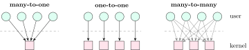

## 3.1 Threads versus processes {#sec-os-threads}

<div class="nb-proto">

<em><span>Prototypical example for this section:</span> a web server: one process, one thread per connection, all reading the same in-memory cache.</em>

</div>

<div class="nb nb-definition" id="definition-3-1-1">

<strong>Definition 3.1.1</strong>. A <strong>thread</strong> is a single sequential flow of execution inside a process: a program counter, a register set and a stack. All threads of a process share its address space (code, globals, heap, memory mappings) and its kernel resources (open files, signal handlers, current directory, PID). The process is the unit of resource ownership and protection; the thread is the unit of scheduling.

</div>

| Shared by all threads of a process | Private to each thread |
|:--|:--|
| code (text), globals and statics (data, bss), heap | stack (local variables, return addresses) |
| memory mappings, shared libraries | registers, program counter, stack pointer |
| open file descriptors, current directory, `umask` | thread ID, scheduling priority and state |
| signal <em>handlers</em>, PID, user and group IDs | signal <em>mask</em>, `errno` |
|  | thread-local storage (`_Thread_local`, `thread_local`) |

The stack is private in the sense that each thread has its own, not that the others cannot reach it: they share the address space, so a pointer to another thread’s local variable works (and dangles once that thread returns).

```c {filename="threads-share.c"}
// flags: -D_GNU_SOURCE -pthread
// What threads share (globals, heap, file descriptors) and what each has
// alone (stack, registers, thread-local storage) -- compared with fork().
#include <stdio.h>
#include <stdlib.h>
#include <pthread.h>
#include <unistd.h>
#include <sys/wait.h>

int global = 0;                     // one copy per process
_Thread_local int tls = 0;          // one copy per thread
int *heap;                          // the heap is shared too
pthread_mutex_t m = PTHREAD_MUTEX_INITIALIZER;
pthread_barrier_t both_alive;
void *stack_addr[2];
int tls_seen[2];

static void *worker(void *arg) {
    int id = *(int *)arg;
    int local = id;                 // on this thread's own stack
    pthread_mutex_lock(&m);
    global += 10; *heap += 100;
    pthread_mutex_unlock(&m);
    tls += 1000;                    // no lock needed: nobody else sees it
    stack_addr[id] = &local; tls_seen[id] = tls;
    pthread_barrier_wait(&both_alive);   // both stacks exist at once
    return NULL;
}

int main(void) {
    heap = calloc(1, sizeof *heap);
    pthread_barrier_init(&both_alive, NULL, 2);
    pthread_t t[2]; int id[2] = {0, 1};
    for (int i = 0; i < 2; i++) pthread_create(&t[i], NULL, worker, &id[i]);
    for (int i = 0; i < 2; i++) pthread_join(t[i], NULL);
    printf("stacks differ: %s (%p vs %p)\n",
           stack_addr[0] != stack_addr[1] ? "yes" : "no",
           stack_addr[0], stack_addr[1]);
    printf("tls in threads: %d %d; tls in main: %d\n",
           tls_seen[0], tls_seen[1], tls);
    printf("after threads: global=%d *heap=%d\n", global, *heap);

    if (fork() == 0) {                  // a child process changes its copies
        global += 10; *heap += 100;
        _exit(0);
    }
    wait(NULL);
    printf("after child  : global=%d *heap=%d (unchanged)\n", global, *heap);
    return 0;
}
```

```text {filename="One possible output (gcc 13.3, glibc 2.39, Linux 6.18 x86-64)"}
stacks differ: yes (0x7fd67bdfeeb0 vs 0x7fd67b5fdeb0)
tls in threads: 1000 1000; tls in main: 0
after threads: global=20 *heap=200
after child  : global=20 *heap=200 (unchanged)
```

In this run the two stacks are $8$ MiB plus one 4 KiB guard page apart: glibc gives each thread a stack the size of `ulimit -s` (8 MiB here) with an unmapped guard page below it, so an overflow faults instead of silently running into the neighbour.

<div class="nb nb-remark" id="remark-3-1-2">

<strong>Remark 3.1.2</strong> (Interview: “process vs thread” in four sentences) — A process is an isolated address space plus resources; a thread is an execution context inside one. Threads of a process share memory, so they communicate by plain loads and stores, but one wild pointer or crash takes down all of them, and shared data needs locks. Creating and switching threads is cheaper: no address space to copy or switch, no TLB flush. Processes give isolation (a browser runs each site in its own process for that reason); threads give cheap sharing.

</div>

```c {filename="create-cost.c"}
// flags: -D_GNU_SOURCE -pthread
// Creating and finishing 2000 threads vs 2000 processes (each does nothing).
#include <stdio.h>
#include <stdlib.h>
#include <pthread.h>
#include <time.h>
#include <unistd.h>
#include <sys/wait.h>

static void *nothing(void *a) { return a; }

static double us(struct timespec a, struct timespec b) {
    return (b.tv_sec - a.tv_sec) * 1e6 + (b.tv_nsec - a.tv_nsec) / 1e3;
}

int main(void) {
    enum { N = 2000 };
    char *big = malloc(64 << 20);          // 64 MiB of touched memory makes
    for (long i = 0; i < (64 << 20); i += 4096) big[i] = 1;  // fork costlier
    struct timespec t0, t1, t2;
    clock_gettime(CLOCK_MONOTONIC, &t0);
    for (int i = 0; i < N; i++) {
        pthread_t t;
        pthread_create(&t, NULL, nothing, NULL);
        pthread_join(t, NULL);
    }
    clock_gettime(CLOCK_MONOTONIC, &t1);
    for (int i = 0; i < N; i++) {
        if (fork() == 0) _exit(0);
        wait(NULL);
    }
    clock_gettime(CLOCK_MONOTONIC, &t2);
    printf("pthread_create + join: %6.1f us each\n", us(t0, t1) / N);
    printf("fork + wait          : %6.1f us each (parent maps 64 MiB)\n",
           us(t1, t2) / N);
    free(big);
    return 0;
}
```

```text {filename="One possible output (gcc 13.3, glibc 2.39, Linux 6.18 x86-64)"}
pthread_create + join:   49.3 us each
fork + wait          : 2391.3 us each (parent maps 64 MiB)
```

With 64 MiB mapped, `fork` has to copy the parent’s page tables (copy-on-write still copies the tables, not the pages) and the child must tear them down; a thread copies nothing.

<div class="nb nb-definition" id="definition-3-1-3">

<strong>Definition 3.1.3</strong>. <strong>Concurrency</strong> means several tasks are in progress at once (their lifetimes overlap, possibly by interleaving on one core). <strong>Parallelism</strong> means several tasks execute at the same instant, which needs several cores. A single-core time-sharing system is concurrent but not parallel. How much parallelism helps is bounded by the serial fraction of the program (Amdahl’s law, in the COA book).

</div>

<div class="nb nb-moral">

Threads share everything except stack, registers and TLS: cheaper to create and switch, easier to share, harder to keep correct.

</div>

## 3.2 User-level and kernel-level threads {#sec-os-threadmodels}

<div class="nb-proto">

<em><span>Prototypical example for this section:</span> a green-thread library that runs 10 000 coroutines on one kernel thread, and freezes all of them when one calls a blocking `read`.</em>

</div>

<div class="nb nb-definition" id="definition-3-2-1">

<strong>Definition 3.2.1</strong>. <strong>User-level threads</strong> are implemented by a library in user space: thread creation, switching and scheduling are function calls, and the kernel sees one schedulable entity. <strong>Kernel-level threads</strong> are created and scheduled by the kernel (Linux `clone`, Windows `CreateThread`).

</div>

|  | User-level threads | Kernel-level threads |
|:--|:--|:--|
| Create / switch | function call, no mode switch: very fast | system call and kernel scheduler: slower |
| Blocking system call | blocks the whole process (all threads) | blocks only that thread |
| Multicore parallelism | none: the kernel runs the process on one CPU | yes |
| Scheduling policy | chosen by the application | the kernel’s |
| Kernel support needed | none; portable | yes |

<figure class="nb-fig"></figure>

<div class="nb nb-definition" id="definition-3-2-2">

<strong>Definition 3.2.2</strong>. Three ways to map user threads onto kernel threads:

- <strong>Many-to-one</strong>: all user threads on one kernel thread (old green threads, GNU Portable Threads). Fast, but one blocking call stops everything and there is no parallelism.
- <strong>One-to-one</strong>: each user thread is a kernel thread. Linux (NPTL) and Windows. Parallel and simple; cost is a kernel object per thread.
- <strong>Many-to-many</strong> ($M{:}N$): $M$ user threads multiplexed onto $N\le M$ kernel threads (Go’s goroutines on OS threads, Erlang processes, old Solaris). The <strong>two-level</strong> model also lets a user thread be bound to its own kernel thread.

<strong>Contention scope</strong>: with process-contention scope (PCS) the library schedules user threads onto the process’s kernel threads; with system-contention scope (SCS) each thread competes with all threads in the system. One-to-one systems use SCS only.

</div>

<div class="nb nb-remark" id="remark-3-2-3">

<strong>Remark 3.2.3</strong> (Linux has no special thread object) — The kernel schedules `task_struct`s. A process is a task; a thread is a task created by `clone(CLONE_VM|CLONE_FS|CLONE_FILES|CLONE_SIGHAND|CLONE_THREAD|...)` that shares those resources with its creator. All threads of a process share one PID (the <strong>thread group</strong> ID) and each has its own TID; they appear in `/proc/PID/task/`.

</div>

## 3.3 The pthreads API and its traps {#sec-os-pthreads}

<div class="nb-proto">

<em><span>Prototypical example for this section:</span> `pthread_create(&t, NULL, worker, &i)` inside a loop, with every thread reading the same `i`.</em>

</div>

| Call | Purpose |
|:--|:--|
| `pthread_create(&t, attr, f, arg)` | start `f(arg)` in a new thread |
| `pthread_join(t, &ret)` | wait for `t` and collect its return value (like `waitpid`) |
| `pthread_detach(t)` | no one will join; resources are freed at exit |
| `pthread_exit(v)` / return from `f` | end this thread only (`exit()` ends the process) |
| `pthread_self()`, `pthread_equal` | identity |
| `pthread_cancel(t)` | request cancellation (deferred: acted on at cancellation points) |
| `pthread_mutex_*`, `pthread_cond_*`, `pthread_rwlock_*` | synchronisation ([Chapter 5](../05-sync/)) |
| `pthread_key_create`, `_Thread_local` | thread-local storage |

<div class="nb nb-remark" id="remark-3-3-1">

<strong>Remark 3.3.1</strong> (Classic bugs) — Four bugs every reviewer has seen:

- Passing `&i` of a loop variable: by the time the thread reads it, `i` may have changed. Pass a per-thread copy (an array element, or the value cast into the pointer).
- Returning a pointer to a local variable from the thread function: the stack is gone after the thread exits.
- `main` returning while threads run: returning from `main` calls `exit`, which kills every thread. Join them, or end `main` with `pthread_exit`.
- An un-joined, non-detached thread is the thread analogue of a zombie: its stack and descriptor are kept until joined.

</div>

<div class="nb nb-remark" id="remark-3-3-2">

<strong>Remark 3.3.2</strong> (`fork` in a multithreaded process) — The child gets a copy of all memory but only the thread that called `fork`. If another thread held a lock (say `malloc`’s) at that instant, the lock is copied in its locked state with no owner to release it, and the child deadlocks on its first `malloc`. Rule: after `fork` in a threaded program, call only async-signal-safe functions and then `exec`.

</div>

<div class="nb nb-remark" id="remark-3-3-3">

<strong>Remark 3.3.3</strong> (Signals and threads) — Handlers are per process; the mask is per thread. A signal sent to the process is delivered to one thread that does not block it; a fault (`SIGSEGV`) goes to the thread that caused it. Robust servers block signals in all threads and let one thread wait for them with `sigwait`.

</div>

### 3.3.i Thread-local storage {#s3-3-i}

<div class="nb nb-definition" id="definition-3-3-4">

<strong>Definition 3.3.4</strong>. <strong>Thread-local storage</strong> (TLS) is a variable with one instance per thread, at the same name: `_Thread_local` (C11), `thread_local` (C++11), `__thread` (gcc), or the `pthread_key_*` API. On x86-64 Linux each thread’s TLS block is reached through the `fs` segment register, which the kernel switches with the thread. `errno` is thread-local; that is how it can be a “global” in a multithreaded program.

</div>

In the program above each worker’s `tls` ended at $1000$ and `main`’s stayed $0$. Uses: per-thread caches (glibc’s `malloc` arenas, allocators’ thread caches), random number generator state, counters merged at the end to avoid contention.

### 3.3.ii Thread pools {#s3-3-ii}

Creating a thread per request costs tens of microseconds and an unbounded number of threads under load. A <strong>thread pool</strong> creates $N$ workers once (typically about the number of cores for CPU-bound work, more for I/O-bound work) and feeds them tasks through a queue, which bounds concurrency and amortises creation.

<div class="nb nb-moral">

Linux threads are one-to-one kernel tasks sharing an address space; user-level threads are faster to switch but block together and never run in parallel.

</div>
