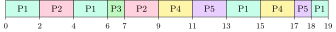
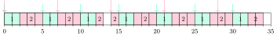
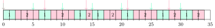

## 4.1 What is being optimised {#sec-os-sched-criteria}

<div class="nb-proto">

<em><span>Prototypical example for this section:</span> a compiler (one long CPU burst) and an editor (many tiny bursts between key presses) sharing one core.</em>

</div>

Processes alternate <strong>CPU bursts</strong> and <strong>I/O bursts</strong>. Most bursts are short; a few are long. An <strong>I/O-bound</strong> process has many short CPU bursts, a <strong>CPU-bound</strong> one a few long ones. The short-term scheduler runs whenever the running process blocks or exits (<strong>non-preemptive</strong> scheduling needs only these two points) and, in a <strong>preemptive</strong> scheduler, also when a process arrives or wakes up or when the timer interrupt ends a quantum.

<div class="nb nb-definition" id="definition-4-1-1">

<strong>Definition 4.1.1</strong>. For a process with arrival time $A$, total CPU burst $B$, first time on the CPU $F$ and completion time $C$:

$$
\text{turnaround } T = C - A, \qquad \text{waiting } W = T - B, \qquad
	\text{response } R = F - A.
$$

(With I/O inside the job, $W = T - B - \text{I/O time}$.) Waiting time counts only time spent in the ready queue. <strong>Throughput</strong> is completed processes per unit time; <strong>CPU utilisation</strong> is the fraction of time the CPU does useful work.

</div>

<div class="nb nb-remark" id="remark-4-1-2">

<strong>Remark 4.1.2</strong> (OA: “also called the release time of a process”) — The <strong>arrival time</strong>. “Release time” is the real-time-systems name for the instant a job becomes ready to run ([Section 4.6](#sec-os-rt)); burst time is also called service or execution time, and “exit time” is the completion time.

</div>

Goals pull in different directions: batch systems want throughput and low turnaround, interactive systems want low response time, every system wants fairness (no starvation) and low overhead (few context switches).

## 4.2 The classic algorithms on one workload {#sec-os-sched-classic}

<div class="nb-proto">

<em><span>Prototypical example for this section:</span> five processes, seven algorithms, one table of averages.</em>

</div>

All examples use this workload (priority: a smaller number is more urgent). Ties are broken by arrival time, then by name; in round robin a process arriving at the instant a quantum expires joins the queue <em>before</em> the preempted one. These are the usual exam conventions; state them when you answer.

| Process | P1 | P2 | P3 | P4 | P5 |
|:--|:-:|:-:|:-:|:-:|:-:|
| Arrival | 0 | 2 | 4 | 5 | 6 |
| Burst | 7 | 4 | 1 | 4 | 3 |
| Priority | 3 | 1 | 4 | 2 | 5 |

Every chart and number below was produced by this simulator (the scheduling core of `libsched.py`; `sched-compare.py` runs it and writes the charts):

```python {filename="libsched.py, lines 42–100",linenos=table,linenostart=42}
def nonpreemptive(procs, key):
    """Run to completion; pick the ready process minimising key(p, t)."""
    t, left, segs = 0, sorted(procs, key=lambda p: (p.arrival, p.name)), []
    while left:
        ready = [p for p in left if p.arrival <= t]
        if not ready:
            nxt = min(p.arrival for p in left)
            segs.append(('idle', t, nxt)); t = nxt; continue
        p = min(ready, key=lambda q: (key(q, t), q.arrival, q.name))
        segs.append((p.name, t, t + p.burst)); t += p.burst
        left.remove(p)
    return _merge(segs)

def preemptive(procs, key):
    """Re-decide every time unit; run the ready process minimising key."""
    rem = {p.name: p.burst for p in procs}
    t, segs = 0, []
    while any(rem.values()):
        ready = [p for p in procs if p.arrival <= t and rem[p.name] > 0]
        if not ready:
            segs.append(('idle', t, t + 1)); t += 1; continue
        p = min(ready, key=lambda q: (key(q, rem[q.name]), q.arrival, q.name))
        segs.append((p.name, t, t + 1)); rem[p.name] -= 1; t += 1
    return _merge(segs)

def fcfs(procs):  return nonpreemptive(procs, lambda p, t: p.arrival)
def sjf(procs):   return nonpreemptive(procs, lambda p, t: p.burst)
def prio_np(procs): return nonpreemptive(procs, lambda p, t: p.prio)
def hrrn(procs):  # highest response ratio (w + s) / s first: minimise -ratio
    return nonpreemptive(procs,
                         lambda p, t: -((t - p.arrival) + p.burst) / p.burst)
def srtf(procs):  return preemptive(procs, lambda p, r: r)
def prio_p(procs): return preemptive(procs, lambda p, r: p.prio)

def rr(procs, q, cs=0):
    """Round robin with quantum q and context-switch cost cs (between different
    processes only; none at time 0 and none when the same process continues)."""
    procs = sorted(procs, key=lambda p: (p.arrival, p.name))
    rem = {p.name: p.burst for p in procs}
    queue, t, i, segs, last = [], 0, 0, [], None
    def admit(upto):
        nonlocal i
        while i < len(procs) and procs[i].arrival <= upto:
            queue.append(procs[i]); i += 1
    admit(0)
    while queue or i < len(procs):
        if not queue:
            segs.append(('idle', t, procs[i].arrival)); t = procs[i].arrival
            admit(t); continue
        p = queue.pop(0)
        if cs and last is not None and last != p.name:
            segs.append(('cs', t, t + cs)); t += cs; admit(t)
        run = min(q, rem[p.name])
        segs.append((p.name, t, t + run)); t += run; rem[p.name] -= run
        admit(t)                      # arrivals up to t go first ...
        if rem[p.name] > 0:
            queue.append(p)           # ... then the preempted process
        last = p.name
    return _merge(segs)
```

### 4.2.i FCFS {#s4-2-i}

<div class="nb nb-definition" id="definition-4-2-1">

<strong>Definition 4.2.1</strong>. <strong>First-come, first-served</strong> runs processes in arrival order, each to completion. Non-preemptive, no starvation, trivial to implement with a FIFO queue.

</div>

<figure class="nb-fig"></figure>

<div class="nb nb-remark" id="remark-4-2-2">

<strong>Remark 4.2.2</strong> (Convoy effect) — Short processes queue behind a long one. Three jobs arriving together with bursts $24, 3, 3$ wait on average $17$ under FCFS but $3$ under SJF (both printed at the end of `sched-compare.out`). With I/O, the convoy also idles the devices: the I/O-bound jobs sit in the ready queue instead of keeping the disks busy.

</div>

### 4.2.ii SJF and SRTF {#s4-2-ii}

<div class="nb nb-definition" id="definition-4-2-3">

<strong>Definition 4.2.3</strong>. <strong>Shortest job first</strong> (also <strong>shortest process next</strong>, SPN) runs, at each decision point, the ready process with the smallest next CPU burst, to completion. Its preemptive version, <strong>shortest remaining time first</strong> (SRTF), re-decides when a process arrives and preempts if the newcomer’s burst is shorter than what remains of the current one.

</div>

SJF

<figure class="nb-fig"></figure>

SRTF

<figure class="nb-fig"></figure>

| SRTF | AT | BT | CT | TAT | WT | RT |
|:--|:-:|:-:|:-:|:-:|:-:|:-:|
| P1 | 0 | 7 | 19 | 19 | 12 | 0 |
| P2 | 2 | 4 | 7 | 5 | 1 | 0 |
| P3 | 4 | 1 | 5 | 1 | 0 | 0 |
| P4 | 5 | 4 | 14 | 9 | 5 | 5 |
| P5 | 6 | 3 | 10 | 4 | 1 | 1 |

At $t=2$, P2 (burst 4) arrives while P1 has 5 left, so P1 is preempted; at $t=4$ P3 (1) preempts P2 (2 left); P1, the longest, finishes last at 19.

<div class="nb nb-theorem nb-block" id="theorem-4-2-4">

<strong>Theorem 4.2.4</strong> (SJF is optimal)

For a set of jobs all available at time $0$, SJF minimises the average waiting time among non-preemptive schedules. With arbitrary arrivals, SRTF minimises the average waiting time among all (preemptive) schedules.

</div>

<div class="nb nb-proof">

<em>Proof.</em> Exchange argument: if a longer job $L$ runs immediately before a shorter job $S$, swapping them lowers $S$’s wait by $|L|$ and raises $L$’s by only $|S|<|L|$. For SRTF the same swap applies to any unit of time spent on a job that does not have the least remaining work.

</div>

The catch is that the next burst is unknown. Schedulers predict it from history by <strong>exponential averaging</strong>: $\tau_{n+1} = \alpha t_n + (1-\alpha)\tau_n$, where $t_n$ is the last actual burst and $\tau_n$ the last prediction. With $\alpha=0$ the prediction never changes; with $\alpha=1$ it is just the last burst; $\alpha=1/2$ is the textbook choice. Unrolled, $\tau_{n+1} = \alpha t_n + (1-\alpha)\alpha t_{n-1} + \dots + (1-\alpha)^{n+1}\tau_0$: older bursts count geometrically less.

```python {filename="sched-predict.py"}
# Predicting the next CPU burst by exponential averaging:
#   tau[n+1] = alpha * t[n] + (1 - alpha) * tau[n]
alpha, tau = 0.5, 8.0
bursts = [4, 6, 8, 8, 2, 2, 10]
print(f"alpha = {alpha}, tau0 = {tau:g}")
print("n  actual t[n]  predicted tau[n]  error")
for n, t in enumerate(bursts):
    print(f"{n:<3}{t:>8}{tau:>15.3f}{t - tau:>10.3f}")
    tau = alpha * t + (1 - alpha) * tau
print(f"next prediction tau[{len(bursts)}] = {tau:.3f}")
```

```text {filename="Output (Python 3.11)"}
alpha = 0.5, tau0 = 8
n  actual t[n]  predicted tau[n]  error
0         4          8.000    -4.000
1         6          6.000     0.000
2         8          6.000     2.000
3         8          7.000     1.000
4         2          7.500    -5.500
5         2          4.750    -2.750
6        10          3.375     6.625
next prediction tau[7] = 6.688
```

### 4.2.iii Priority scheduling and aging {#s4-2-iii}

<div class="nb nb-definition" id="definition-4-2-5">

<strong>Definition 4.2.5</strong>. Each process has a priority; the highest-priority ready process runs (preemptively or not). SJF is priority scheduling with priority $=1/\text{(predicted burst)}$. A low-priority process can wait forever (<strong>starvation</strong>, or indefinite blocking); the cure is <strong>aging</strong>: raise a process’s priority the longer it waits.

</div>

non-preemptive

<figure class="nb-fig"></figure>

preemptive

<figure class="nb-fig"></figure>

### 4.2.iv HRRN {#s4-2-iv}

<div class="nb nb-definition" id="definition-4-2-6">

<strong>Definition 4.2.6</strong>. <strong>Highest response ratio next</strong> (Brinch Hansen) is non-preemptive; at each decision it picks the largest $\text{RR} = (w+s)/s$, where $w$ is the time waited so far and $s$ the burst. Short jobs start with a high ratio (favoured like SJF), and a long job’s ratio grows while it waits, so it cannot starve: aging built into the formula.

</div>

<figure class="nb-fig"></figure>

At $t=7$ the ratios are P2 $(5+4)/4=2.25$, P3 $(3+1)/1=4$, P4 $(2+4)/4=1.5$, P5 $(1+3)/3\approx1.33$: P3 runs. At $t=8$: P2 $2.5$, P4 $1.75$, P5 $1.67$: P2. At $t=12$: P4 $11/4=2.75$, P5 $9/3=3$: P5, even though it is not the shortest overall.

### 4.2.v Round robin {#s4-2-v}

<div class="nb nb-definition" id="definition-4-2-7">

<strong>Definition 4.2.7</strong>. <strong>Round robin</strong> keeps a FIFO ready queue; the head runs for at most one <strong>time quantum</strong> $q$, then goes to the tail if unfinished. With $n$ ready processes none waits more than $(n-1)q$ for its next turn.

</div>

<figure class="nb-fig"></figure>

| RR, $q=2$ | AT | BT | CT | TAT | WT | RT |
|:--|:-:|:-:|:-:|:-:|:-:|:-:|
| P1 | 0 | 7 | 19 | 19 | 12 | 0 |
| P2 | 2 | 4 | 9 | 7 | 3 | 0 |
| P3 | 4 | 1 | 7 | 3 | 2 | 2 |
| P4 | 5 | 4 | 17 | 12 | 8 | 4 |
| P5 | 6 | 3 | 18 | 12 | 9 | 5 |

### 4.2.vi The comparison {#s4-2-vi}

| Algorithm | avg TAT | avg WT | avg RT | context switches |
|:--|:-:|:-:|:-:|:-:|
| FCFS | 9.60 | 5.80 | 5.80 | 4 |
| SJF (non-preemptive) | 8.60 | 4.80 | 4.80 | 4 |
| SRTF (preemptive SJF) | 7.60 | 3.80 | 1.20 | 6 |
| Priority, non-preemptive | 10.20 | 6.40 | 6.40 | 4 |
| Priority, preemptive | 9.80 | 6.00 | 4.40 | 5 |
| Round robin, q = 2 | 10.60 | 6.80 | 2.20 | 10 |
| HRRN | 8.80 | 5.00 | 5.00 | 4 |

SRTF wins turnaround and waiting time, as the theorem says; round robin has the second-best response time but the worst turnaround and by far the most switches; FCFS and non-preemptive priority are worst for response.

<div class="nb nb-moral">

Shortest-first minimises waiting; round robin minimises response at the cost of turnaround and switches; priority needs aging, and HRRN is aging built in.

</div>

## 4.3 The round-robin quantum {#sec-os-quantum}

<div class="nb-proto">

<em><span>Prototypical example for this section:</span> a 100 ms quantum makes an editor feel sluggish; a 0.1 ms quantum spends most of the CPU switching.</em>

</div>

The same workload with a context switch costing one time unit:

```python {filename="sched-rr-q.py"}
# Round robin: the effect of the quantum, with a context switch costing 1 unit.
from libsched import *

P = [Proc('P1', 0, 7), Proc('P2', 2, 4), Proc('P3', 4, 1),
     Proc('P4', 5, 4), Proc('P5', 6, 3)]
print("q    finish  avgTAT  avgRT  switches  CPU busy with work")
for q in (1, 2, 3, 4, 6, 8, 100):
    segs = rr(P, q, cs=1)
    _, rows, avg = table(P, segs, '')
    work = sum(p.burst for p in P)
    end = segs[-1][2]
    nsw = sum(1 for n, _, _ in segs if n == 'cs')
    print(f"{q:<5}{end:>6}{avg['tat']:>8.2f}{avg['rt']:>7.2f}{nsw:>9}"
          f"{100 * work / end:>12.1f} %")
same = rr(P, 100) == fcfs(P)
print("q = 100 (no context switches) gives exactly the FCFS schedule:", same)

# Utilisation when every quantum ends in a switch: q / (q + s)
for q, s in ((95, 5), (10, 1), (4, 1)):
    print(f"q = {q:>2}, s = {s}: useful CPU fraction = {q}/{q + s}"
          f" = {q / (q + s):.4f}")
```

```text {filename="Output (Python 3.11)"}
q    finish  avgTAT  avgRT  switches  CPU busy with work
1        36   23.40   3.40       17        52.8 %
2        29   18.00   4.60       10        65.5 %
3        27   18.40   6.20        8        70.4 %
4        24   12.40   7.00        5        79.2 %
6        24   14.20   7.00        5        79.2 %
8        23   11.60   7.80        4        82.6 %
100      23   11.60   7.80        4        82.6 %
q = 100 (no context switches) gives exactly the FCFS schedule: True
q = 95, s = 5: useful CPU fraction = 95/100 = 0.9500
q = 10, s = 1: useful CPU fraction = 10/11 = 0.9091
q =  4, s = 1: useful CPU fraction = 4/5 = 0.8000
```

<div class="nb nb-theorem nb-block" id="theorem-4-3-1">

<strong>Theorem 4.3.1</strong> (Quantum trade-off)

Three regimes:

- As $q\to \infty$ (larger than every burst), round robin <em>is</em> FCFS: nobody is ever preempted. The simulator confirms the schedules are identical.
- As $q\to 0$, it approaches <strong>processor sharing</strong> (each of $n$ processes seems to run at speed $1/n$), but every quantum costs a switch: with switch cost $s$ and every quantum used fully, the useful fraction of CPU time is $q/(q+s)$.
- Turnaround is not monotonic in $q$ (above, $q=3$ is worse than $q=2$, and $q=6$ worse than $q=4$); it is best when most bursts finish within one quantum.

Rule of thumb (Silberschatz): choose $q$ so that about 80% of CPU bursts are shorter than $q$, and $q$ much larger than the switch time. Typical values are 10–100 ms.

</div>

<div class="nb nb-example nb-block" id="example-4-3-2">

<strong>Example 4.3.2</strong> (Utilisation with switch overhead)

Quantum $95$ ms, switch $5$ ms, all processes CPU-bound: each $100$ ms of wall time does $95$ ms of work, so utilisation is $95\%$. If the processes were I/O-bound and blocked after $4$ ms, the fraction would be $4/(4+5)\approx 44\%$: overhead is per switch, not per quantum.

</div>

## 4.4 Multilevel queues {#sec-os-mlfq}

<div class="nb-proto">

<em><span>Prototypical example for this section:</span> interactive shells in a high-priority round-robin queue, nightly batch jobs in a low-priority FCFS queue.</em>

</div>

<div class="nb nb-definition" id="definition-4-4-1">

<strong>Definition 4.4.1</strong>. A <strong>multilevel queue</strong> (MLQ) partitions the ready queue into several queues by process type (system, interactive, batch), each with its own algorithm, and schedules between them by fixed priority (a lower queue runs only when all higher ones are empty) or by time slices (say 80% to the foreground). A process stays in its queue for life, so lower queues can starve.

</div>

<div class="nb nb-definition" id="definition-4-4-2">

<strong>Definition 4.4.2</strong>. A <strong>multilevel feedback queue</strong> (MLFQ) lets processes move between queues according to their observed behaviour, so it needs no advance knowledge of burst lengths:

1. a new process enters the top queue;
2. a process that uses its whole quantum (CPU-bound) moves down one level;
3. a process that gives up the CPU before its quantum ends (blocks for I/O) stays;
4. higher queues preempt lower ones; lower queues get longer quanta;
5. periodically (or after a long wait) everyone is boosted to the top: aging, so nothing starves and a process that becomes interactive is noticed.

To stop a process from staying on top by blocking just before its quantum ends, the time it uses at a level is accounted across quanta (OSTEP’s “allotment”).

</div>

<figure class="nb-fig"></figure>

A run with a CPU-bound job A (12 units), a medium job B (6) and an interactive job C (four 1-unit bursts, each followed by 3 units of I/O):

```text {filename="Output (Python 3.11)"}
time  0123456789012345678901
CPU   AABBCAAACABBCBBACAAAAA
A: arrives 0, CPU need 12, finishes at 22, final level Q2
B: arrives 1, CPU need  6, finishes at 15, final level Q1
C: arrives 2, CPU need  4, finishes at 17, final level Q0
```

C is served the instant it wakes (positions 4, 8, 12, 16) and never leaves Q0; A and B sink, and A, the longest, finishes last. This is how MLFQ approximates SRTF without being told any burst lengths. Windows and the old BSD/Solaris schedulers are MLFQ variants.

## 4.5 Linux: CFS and `nice` {#sec-os-cfs}

<div class="nb-proto">

<em><span>Prototypical example for this section:</span> `nice -n 5 ./backup` gets about a quarter of the CPU when it competes with one normal process.</em>

</div>

<div class="nb nb-definition" id="definition-4-5-1">

<strong>Definition 4.5.1</strong>. The <strong>Completely Fair Scheduler</strong> (Linux 2.6.23–6.5; since 6.6 its successor EEVDF, with the same weights) gives each runnable task a share of the CPU proportional to its <strong>weight</strong>. Weight comes from the <strong>nice</strong> value ($-20$ to $19$, default $0$): nice 0 has weight $1024$ and each nice step changes the weight by a factor of about $1.25$, i.e. about 10% of CPU. Each task has a <strong>virtual runtime</strong> that grows by $\Delta t \cdot 1024/w$ while it runs; the scheduler always runs the task with the smallest vruntime (kept in a red-black tree, so the pick is $O(1)$ via a cached leftmost node and insertion is $O(\log n)$). A heavy task’s vruntime grows slowly, so it is picked more often. A task that slept comes back with its vruntime raised to near the current minimum, so it cannot hoard credit, but it is still near the front: interactive tasks get low latency.

</div>

```python {filename="sched-cfs.py"}
# Linux's fair scheduler in miniature: each task's virtual runtime grows at
# 1024/weight per unit of real CPU time; always run the task with the least.
# Weights are the kernel's sched_prio_to_weight[] entries for these nice values.
WEIGHT = {-5: 3121, 0: 1024, 1: 820, 5: 335}

def simulate(tasks, ms=1000, slice_ms=1):
    vr = {n: 0.0 for n in tasks}
    got = {n: 0 for n in tasks}
    for _ in range(0, ms, slice_ms):
        n = min(vr, key=lambda k: (vr[k], k))       # leftmost in the rbtree
        got[n] += slice_ms
        vr[n] += slice_ms * 1024 / WEIGHT[tasks[n]]
    return got

for tasks in ({'A': 0, 'B': 0}, {'A': 0, 'B': 1}, {'A': 0, 'B': 5},
              {'A': -5, 'B': 0, 'C': 5}):
    got = simulate(tasks)
    total = sum(WEIGHT[v] for v in tasks.values())
    parts = ", ".join(f"{n}(nice {v:+d}) {got[n] / 10:.1f}% "
                      f"[w/sum = {100 * WEIGHT[v] / total:.1f}%]"
                      for n, v in tasks.items())
    print(parts)
```

```text {filename="Output (Python 3.11)"}
A(nice +0) 50.0% [w/sum = 50.0%], B(nice +0) 50.0% [w/sum = 50.0%]
A(nice +0) 55.5% [w/sum = 55.5%], B(nice +1) 44.5% [w/sum = 44.5%]
A(nice +0) 75.3% [w/sum = 75.3%], B(nice +5) 24.7% [w/sum = 24.7%]
A(nice -5) 69.6% [w/sum = 69.7%], B(nice +0) 22.9% [w/sum = 22.9%], C(nice +5) 7.5% [w/sum = 7.5%]
```

And on the real kernel (6.18, so EEVDF), two busy loops pinned to one CPU for three seconds:

```bash {filename="nice-real.sh"}
# The real kernel: two CPU-bound loops pinned to CPU 0, one at nice 0 and one
# at nice 5, for 3 seconds. Compare their CPU time (utime + stime from /proc).
cd "$BIN" || exit 1
taskset -c 0 nice -n 0 ./spin & a=$!
taskset -c 0 nice -n 5 ./spin & b=$!
sleep 3
t() { awk '{print $14 + $15}' "/proc/$1/stat"; }   # clock ticks of CPU time
ta=$(t $a); tb=$(t $b)
kill $a $b; wait 2>/dev/null
echo "nice 0: $ta ticks, nice 5: $tb ticks"
awk -v a="$ta" -v b="$tb" 'BEGIN {
  printf "share of nice 0 = %.1f%% (weights predict %.1f%%)\n",
         100 * a / (a + b), 100 * 1024 / (1024 + 335) }'
```

```text {filename="One possible output (gcc 13.3, glibc 2.39, Linux 6.18 x86-64)"}
nice 0: 221 ticks, nice 5: 73 ticks
share of nice 0 = 75.2% (weights predict 75.3%)
```

The measured share agrees with $1024/(1024+335)$ to within a few tenths of a percent.

<div class="nb nb-remark" id="remark-4-5-2">

<strong>Remark 4.5.2</strong> (Real-time classes) — Above the fair class, Linux has `SCHED_FIFO` and `SCHED_RR` (static priorities 1–99, strict priority, FIFO or round robin within a level) and `SCHED_DEADLINE` (EDF with admission control). A runaway `SCHED_FIFO` task starves everything below it, which is why the kernel reserves 5% of each second for normal tasks by default (`sched_rt_runtime_us`).

</div>

## 4.6 Real-time scheduling {#sec-os-rt}

<div class="nb-proto">

<em><span>Prototypical example for this section:</span> a motor controller that must run 1 ms of code every 5 ms, next to a display task that needs 4 ms every 7 ms.</em>

</div>

<div class="nb nb-definition" id="definition-4-6-1">

<strong>Definition 4.6.1</strong>. A periodic task $i$ needs $C_i$ units of CPU every period $T_i$; each job is <strong>released</strong> at a multiple of $T_i$ and must finish by the next release (its deadline). Its <strong>utilisation</strong> is $C_i/T_i$, and $U=\sum_i C_i/T_i$.

- <strong>Rate-monotonic scheduling</strong> (RMS): static priorities, shorter period $=$ higher priority, preemptive. Optimal among static-priority schemes.
- <strong>Earliest deadline first</strong> (EDF): dynamic priorities, the job with the nearest absolute deadline runs. Optimal among all schemes on one CPU.

</div>

<div class="nb nb-theorem nb-block" id="theorem-4-6-2">

<strong>Theorem 4.6.2</strong> (Schedulability tests)

EDF meets every deadline iff $U\le1$. RMS meets every deadline if $U\le n\left(2^{1/n}-1\right)$ (Liu and Layland, 1973); the bound is $1$ for $n=1$, $0.8284$ for $n=2$, $0.7798$ for $n=3$, and tends to $\ln 2\approx0.693$. It is sufficient, not necessary: a set above the bound may still be schedulable (simulate to find out).

</div>

```text {filename="Output (Python 3.11)"}
A: T1(C=1, T=4), T2(C=2, T=6), T3(C=1, T=8)
  U = 0.7083, Liu-Layland bound for n = 3: 0.7798, hyperperiod 24
  RMS: 12231.2213..122.13221...   misses: none
  EDF: 12231.2213..122.13221...   misses: none
B: T1(C=2, T=5), T2(C=4, T=7)
  U = 0.9714, Liu-Layland bound for n = 2: 0.8284, hyperperiod 35
  RMS: 1122211222112.21122211222112221122.   misses: T2 at 7
  EDF: 1122221122221121122211222211221122.   misses: none
n =  1: n(2^(1/n) - 1) = 1.0000
n =  2: n(2^(1/n) - 1) = 0.8284
n =  3: n(2^(1/n) - 1) = 0.7798
n =  4: n(2^(1/n) - 1) = 0.7568
n =  5: n(2^(1/n) - 1) = 0.7435
n = 10: n(2^(1/n) - 1) = 0.7177
```

Set A ($U=0.708$, under the bound) is schedulable by both. Set B ($U=0.971$) is above the RMS bound, and RMS indeed misses: in the first period T2 gets only 3 of its 4 units before its deadline at 7. EDF schedules it (in the charts, 1 and 2 are T1 and T2; arrows mark releases):

set B, RMS (T2 misses at 7)

<figure class="nb-fig"></figure>

set B, EDF (no misses)

<figure class="nb-fig"></figure>

At $t=5$ the difference shows: T1’s second job (deadline 10) arrives while T2 (deadline 7) has one unit left. RMS gives the CPU to T1 because its period is shorter; EDF keeps T2 because its deadline is earlier.

<div class="nb nb-remark" id="remark-4-6-3">

<strong>Remark 4.6.3</strong> (RTOS specifics) — An RTOS adds bounded interrupt and dispatch latency, preemptible kernels and priority-inheritance mutexes ([Section 5.7](../05-sync/#sec-os-inversion)). Synchronisation in an RTOS comes in two kinds that question banks name differently: <em>must not happen together</em> (mutual exclusion: a mutex, ideally with priority inheritance) and <em>must happen in order</em> (one task waits for another or for an ISR: a binary semaphore, event flag or message queue that the ISR signals). Identify which kind a question means before choosing.

</div>

## 4.7 Multiprocessor scheduling {#sec-os-smp}

<div class="nb-proto">

<em><span>Prototypical example for this section:</span> a process that ran on core 0 is moved to core 3 and has to refill its caches.</em>

</div>

- <strong>Asymmetric</strong> multiprocessing: one CPU runs the scheduler and kernel; simple, a bottleneck. <strong>Symmetric</strong> (SMP): every CPU schedules itself, from a common queue (needs locking, contended) or, as in Linux, from a <strong>per-CPU run queue</strong>.
- <strong>Load balancing</strong>: <strong>push</strong> migration (a periodic task moves work off busy CPUs) and <strong>pull</strong> migration (an idle CPU steals from a busy one). Linux does both, in a hierarchy of scheduling domains (SMT siblings, cores sharing a cache, NUMA nodes).
- <strong>Processor affinity</strong>: migration throws away warm caches and TLB entries, so the scheduler prefers to keep a task where it ran (<strong>soft affinity</strong>). <strong>Hard affinity</strong> is a set of allowed CPUs fixed by the program (`sched_setaffinity`, `taskset`; the experiments in this book use it). On NUMA machines, staying near the memory you allocated matters even more. Load balancing and affinity pull in opposite directions.
- <strong>Hardware threads</strong> (SMT, hyper-threading) share one core’s execution units; two busy tasks on sibling threads run slower than on two cores, so balancers fill cores first.

## 4.8 Starvation and the statements OAs test {#sec-os-sched-starve}

<div class="nb-proto">

<em><span>Prototypical example for this section:</span> “Which scheduling algorithms can cause starvation? (more than one)”</em>

</div>

| Algorithm | Preemptive | Starvation | Why |
|:--|:-:|:-:|:--|
| FCFS | no | no | everyone eventually reaches the head |
| SJF / SPN | no | yes | a stream of short jobs postpones a long one |
| SRTF | yes | yes | same, worse |
| Priority | either | yes | without aging |
| Round robin | yes | no | bounded wait $(n-1)q$ |
| HRRN | no | no | the ratio grows with waiting |
| MLQ (fixed priority) | yes | yes | lower queues run only if higher are empty |
| MLFQ | yes | yes without boost | priority boost / aging fixes it |
| CFS | yes | no | minimum vruntime always catches up |
| EDF | yes | yes when overloaded | $U>1$: some deadlines must be missed |

<div class="nb nb-remark" id="remark-4-8-1">

<strong>Remark 4.8.1</strong> (Statements to judge) — These are the usual claims:

- “SPN has higher throughput than FCFS”: true; Stallings’ comparison table rates SPN’s throughput high and FCFS’s as not emphasised (short jobs finish early, so more completions per unit time over any prefix of the schedule), although a fixed batch takes the same total time under both if the CPU never idles.
- “SRTF has the minimum average waiting time”: true (theorem above).
- “Round robin with a very large quantum degenerates to FCFS”: true.
- “Round robin gives the best response time”: not always (SRTF had the best response above), but RR guarantees a bound on it.
- “HRRN can starve long jobs”: false.
- “FCFS suffers from the convoy effect”: true.

</div>

<div class="nb nb-moral">

Anything that always prefers some class (short, high priority, top queue) can starve the rest unless waiting itself raises priority.

</div>
