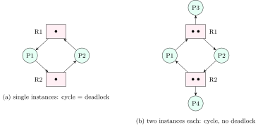

## 6.1 What a deadlock is {#sec-os-deadlock-def}

<div class="nb-proto">

<em><span>Prototypical example for this section:</span> two threads, two locks, opposite orders.</em>

</div>

<div class="nb nb-definition" id="definition-6-1-1">

<strong>Definition 6.1.1</strong>. A set of processes is <strong>deadlocked</strong> if each is waiting for an event (typically the release of a resource) that only another process in the set can cause. None of them will ever run again without outside intervention.

</div>

```c {filename="deadlock.c, lines 14–33",linenos=table,linenostart=14}
static void *worker(void *arg) {
    int id = *(int *)arg;
    pthread_mutex_t *first = id == 1 ? &A : &B, *second = id == 1 ? &B : &A;
    pthread_mutex_lock(first);
    pthread_barrier_wait(&both_hold_one);         // now: hold and wait
    struct timespec until;
    clock_gettime(CLOCK_REALTIME, &until);
    until.tv_sec += 1;
    int r = pthread_mutex_timedlock(second, &until);
    pthread_barrier_wait(&both_hold_one);         // print in a fixed order
    if (id == 2) pthread_barrier_wait(&both_hold_one);
    printf("thread %d holds %c, wants %c: %s\n", id, id == 1 ? 'A' : 'B',
           id == 1 ? 'B' : 'A',
           r == ETIMEDOUT ? "still waiting after 1 s (ETIMEDOUT)" : "got it");
    if (id == 1) pthread_barrier_wait(&both_hold_one);
    if (!r) pthread_mutex_unlock(second);
    pthread_mutex_unlock(first);
    return NULL;
}
```

```text {filename="Output (gcc 13.3, glibc 2.39, Linux 6.18 x86-64)"}
thread 1 holds A, wants B: still waiting after 1 s (ETIMEDOUT)
thread 2 holds B, wants A: still waiting after 1 s (ETIMEDOUT)
fix: both threads lock A before B (a global lock order)
```

Without the timeout both threads would sleep forever, using no CPU: a deadlock looks like a hang, not a busy loop.

<div class="nb nb-theorem nb-block" id="theorem-6-1-2">

<strong>Theorem 6.1.2</strong> (Coffman conditions)

A deadlock can arise only if all four hold at once:

1. <strong>mutual exclusion</strong>: at least one resource is non-shareable;
2. <strong>hold and wait</strong>: a process holds at least one resource while waiting for another;
3. <strong>no preemption</strong>: a resource is released only voluntarily by its holder;
4. <strong>circular wait</strong>: there is a cycle $P_0\to P_1\to \dots \to P_0$ in which each waits for a resource held by the next.

</div>

### 6.1.i Resource-allocation graphs {#s6-1-i}

<div class="nb nb-definition" id="definition-6-1-3">

<strong>Definition 6.1.3</strong>. A <strong>resource-allocation graph</strong> (RAG) has process nodes (circles), resource-type nodes (boxes, with one dot per instance), <strong>request edges</strong> $P\to R$ and <strong>assignment edges</strong> $R\to P$ (from a specific instance).

</div>

<figure class="nb-fig"></figure>

In (b) the cycle $P1\to R1\to P2\to R2\to P1$ exists, but P3 and P4 hold the other instances and wait for nothing; when P4 finishes, its R2 instance goes to P2, which then finishes and frees R1 for P1.

<div class="nb nb-theorem nb-block" id="theorem-6-1-4">

<strong>Theorem 6.1.4</strong> (Cycles and deadlock)

No cycle in the RAG $\Rightarrow$ no deadlock. If every resource has a single instance, a cycle $\Leftrightarrow$ deadlock. With multiple instances a cycle is necessary but not sufficient (figure (b)); a <strong>knot</strong> (a set of nodes none of whose outgoing paths leave it) is sufficient in that case.

</div>

<div class="nb nb-remark" id="remark-6-1-5">

<strong>Remark 6.1.5</strong> (OA: “A: circular wait is necessary; B: circular wait is sufficient”) — A is true (it is one of the four necessary conditions). B is false in general: with multiple instances a cycle need not be a deadlock, and even with single instances the other three conditions must hold too. It is sufficient only for single-instance resources under the usual assumptions (mutual exclusion, hold-and-wait and no preemption are given by the model). Similarly, “the four conditions together are sufficient” is true only for single-instance resources.

</div>

<div class="nb nb-theorem nb-block" id="theorem-6-1-6">

<strong>Theorem 6.1.6</strong> (How many resources rule out deadlock)

$n$ processes share $R$ identical units of one resource; process $i$ needs at most $S_i$ units at once. Deadlock is impossible iff

$$
R \ \ge \ \sum_{i=1}^{n}(S_i-1) + 1.
$$

</div>

<div class="nb nb-proof">

<em>Proof.</em> A deadlock needs every process to be waiting (holding at most $S_i-1$) with no unit free, which is possible iff $R \le \sum(S_i-1)$. With one more unit, some process can always get its last unit, finish and release everything.

</div>

The script below checks it by brute force on small cases (last three lines of its output).

## 6.2 Handling deadlocks: prevention {#sec-os-prevention}

<div class="nb-proto">

<em><span>Prototypical example for this section:</span> every thread in a program acquires locks in address order, so no cycle can form.</em>

</div>

Four strategies: <strong>ignore</strong> (most general-purpose OSs for application deadlocks: the “ostrich algorithm”; the user kills the hung program), <strong>prevent</strong> (make one condition impossible by design), <strong>avoid</strong> (decide each request at run time so that the system stays safe), <strong>detect and recover</strong>.

| Condition | How to break it | Cost |
|:--|:--|:--|
| Mutual exclusion | make resources shareable (read-only files, spooling a printer) | impossible for most resources |
| Hold and wait | request everything at start; or release all before requesting more | poor utilisation; starvation of processes needing many popular resources |
| No preemption | if a request cannot be granted, release what you hold (or the OS takes it from a waiting holder) and retry later | only for resources whose state can be saved: CPU, memory, database transactions (abort and restart) |
| Circular wait | number the resource types; request only in increasing order | must know the order; the most practical (lock ordering) |

<div class="nb nb-remark" id="remark-6-2-1">

<strong>Remark 6.2.1</strong> (OA: “A: permitting preemption alone prevents deadlock; B: preventing circular wait alone prevents deadlock”) — Both are true as statements about the theory: deadlock needs all four conditions, so removing any one of them, alone, is enough. In practice preemption is applicable only to preemptible resources (you cannot take a half-printed page away), which is the usual reason for marking A false in a “practical” reading; circular-wait prevention by lock ordering is the technique used in real code. State the reading you assume.

</div>

<div class="nb nb-proof">

<em>Why ordering prevents cycles.</em> If each process requests resources in increasing order of number, then in a waiting cycle $P_0\to P_1\to \dots \to P_k\to P_0$, each $P_i$ holds resource $r_i$ and waits for $r_{i+1}$ held by $P_{i+1}$, so $r_0<r_1<\dots<r_k<r_0$, a contradiction.

</div>

## 6.3 Avoidance: safe states and the Banker’s algorithm {#sec-os-banker}

<div class="nb-proto">

<em><span>Prototypical example for this section:</span> a bank that lends only if it can still satisfy every customer’s maximum credit line in some order.</em>

</div>

<div class="nb nb-definition" id="definition-6-3-1">

<strong>Definition 6.3.1</strong>. Each process declares its <strong>maximum</strong> need in advance. A state is <strong>safe</strong> if there is an order $\langle P_{i_1},\dots,P_{i_n}\rangle$ (a <strong>safe sequence</strong>) in which each process can obtain its remaining need from the currently available resources plus those released by the processes before it. Safe $\Rightarrow$ no deadlock; unsafe does <em>not</em> mean deadlocked, only that the OS can no longer guarantee to avoid one. Avoidance grants a request only if the resulting state is safe.

</div>

<div class="nb nb-remark" id="algorithm-6-3-2">

<strong>Algorithm 6.3.2</strong> (Banker’s algorithm) — Data: `Available[m]`, `Max[n][m]`, `Allocation[n][m]`, <code>Need = Max $-$ Allocation</code>. <strong>Safety</strong>: `Work = Available`; repeatedly find an unfinished $P_i$ with <code>Need[i] $\le$ Work</code>, then `Work += Allocation[i]` and mark it finished. Safe iff all finish. Cost $O(m n^2)$. <strong>Request</strong> `Req` by $P_i$: error if `Req > Need[i]`; wait if `Req > Available`; otherwise pretend to allocate (<code>Available $-$= Req</code>, `Allocation[i] += Req`, <code>Need[i] $-$= Req</code>), run the safety check, and grant iff safe (else roll back and make $P_i$ wait).

</div>

```python {filename="banker.py, lines 4–24",linenos=table,linenostart=4}
def safety(avail, alloc, need, label="safety check", word="Need"):
    """Return a safe sequence or None, printing each step."""
    work, finish, seq = list(avail), [False] * len(alloc), []
    print(f"{label}: Work = {vec(work)}")
    progress = True
    while progress:
        progress = False
        for i in range(len(alloc)):            # lowest index first
            if not finish[i] and all(n <= w for n, w in zip(need[i], work)):
                work = [w + a for w, a in zip(work, alloc[i])]
                finish[i], progress = True, True
                seq.append(f"P{i}")
                print(f"  P{i}: {word} {vec(need[i])} <= Work -> runs, "
                      f"releases {vec(alloc[i])}, Work = {vec(work)}")
    if all(finish):
        print("  safe sequence: <" + ", ".join(seq) + ">")
        return seq
    print("  " + ("DEADLOCKED: " if word == "Request" else "UNSAFE: ") +
          "no process can finish among " +
          ", ".join(f"P{i}" for i in range(len(alloc)) if not finish[i]))
    return None
```

Three resource types with $10, 6, 7$ instances; each request below is judged against the original state:

```text {filename="Output (Python 3.11)"}
Total (10, 6, 7)  Available (3, 2, 2)
Need = Max - Allocation: P0 (4, 3, 3), P1 (1, 2, 1), P2 (3, 0, 1), P3 (2, 0, 1), P4 (3, 2, 2)
safety check: Work = (3, 2, 2)
  P1: Need (1, 2, 1) <= Work -> runs, releases (2, 0, 1), Work = (5, 2, 3)
  P2: Need (3, 0, 1) <= Work -> runs, releases (3, 0, 2), Work = (8, 2, 5)
  P3: Need (2, 0, 1) <= Work -> runs, releases (0, 2, 1), Work = (8, 4, 6)
  P4: Need (3, 2, 2) <= Work -> runs, releases (1, 1, 1), Work = (9, 5, 7)
  P0: Need (4, 3, 3) <= Work -> runs, releases (1, 1, 0), Work = (10, 6, 7)
  safe sequence: <P1, P2, P3, P4, P0>

P1 requests (1, 0, 1)
  pretend to grant; Available = (2, 2, 1): Work = (2, 2, 1)
  P1: Need (0, 2, 0) <= Work -> runs, releases (3, 0, 2), Work = (5, 2, 3)
  P2: Need (3, 0, 1) <= Work -> runs, releases (3, 0, 2), Work = (8, 2, 5)
  P3: Need (2, 0, 1) <= Work -> runs, releases (0, 2, 1), Work = (8, 4, 6)
  P4: Need (3, 2, 2) <= Work -> runs, releases (1, 1, 1), Work = (9, 5, 7)
  P0: Need (4, 3, 3) <= Work -> runs, releases (1, 1, 0), Work = (10, 6, 7)
  safe sequence: <P1, P2, P3, P4, P0>
  -> GRANT

P4 requests (2, 1, 0)
  pretend to grant; Available = (1, 1, 2): Work = (1, 1, 2)
  P4: Need (1, 1, 2) <= Work -> runs, releases (3, 2, 1), Work = (4, 3, 3)
  P0: Need (4, 3, 3) <= Work -> runs, releases (1, 1, 0), Work = (5, 4, 3)
  P1: Need (1, 2, 1) <= Work -> runs, releases (2, 0, 1), Work = (7, 4, 4)
  P2: Need (3, 0, 1) <= Work -> runs, releases (3, 0, 2), Work = (10, 4, 6)
  P3: Need (2, 0, 1) <= Work -> runs, releases (0, 2, 1), Work = (10, 6, 7)
  safe sequence: <P4, P0, P1, P2, P3>
  -> GRANT

P0 requests (3, 0, 0)
  pretend to grant; Available = (0, 2, 2): Work = (0, 2, 2)
  UNSAFE: no process can finish among P0, P1, P2, P3, P4
  -> DENY (P0 waits)

Deadlock detection (current Request instead of Need, same loop):
detection: Work = (0, 0, 0)
  P0: Request (0, 0, 0) <= Work -> runs, releases (0, 1, 0), Work = (0, 1, 0)
  DEADLOCKED: no process can finish among P1, P2, P3, P4
needs [2, 2, 2]: deadlock-free from R = 4; formula sum(S-1)+1 = 4
needs [3, 3, 3, 3]: deadlock-free from R = 9; formula sum(S-1)+1 = 9
needs [2, 3, 4]: deadlock-free from R = 7; formula sum(S-1)+1 = 7
```

<div class="nb nb-example nb-block" id="example-6-3-3">

<strong>Example 6.3.3</strong> (Reading the run)

The initial state is safe: P1 can finish with what is free, and its release lets P2, P3, P4 and finally P0 finish. P1’s request $(1,0,1)$ and P4’s $(2,1,0)$ are granted because a safe sequence still exists afterwards. P0’s request $(3,0,0)$ is <em>available</em>, yet denied: after it only $(0,2,2)$ would be free and no process’s remaining need fits, so the state would be unsafe. (Unsafe, not deadlocked: maybe nobody would ask for its maximum. The banker does not gamble.)

</div>

<div class="nb nb-remark" id="remark-6-3-4">

<strong>Remark 6.3.4</strong> (Limits) — Avoidance needs the maximum needs in advance, a fixed number of processes and resources, and a check on every request. Real kernels do not use it for general resources; it lives on in admission control (a real-time scheduler admitting a task only if $U$ stays schedulable) and in some resource managers. With single-instance resources, the RAG version adds dashed <strong>claim edges</strong> and grants a request only if converting the claim edge to an assignment edge creates no cycle.

</div>

## 6.4 Detection and recovery {#sec-os-detection}

<div class="nb-proto">

<em><span>Prototypical example for this section:</span> a database that finds a cycle in its wait-for graph and aborts the youngest transaction.</em>

</div>

<div class="nb nb-definition" id="definition-6-4-1">

<strong>Definition 6.4.1</strong>. With single-instance resources, collapse the RAG into a <strong>wait-for graph</strong> ($P_i\to P_j$ if $P_i$ waits for a resource $P_j$ holds) and look for a cycle: $O(n^2)$ with DFS on an adjacency matrix. With multiple instances, run the safety loop with each process’s current <em>Request</em> in place of <em>Need</em>: processes that cannot be marked finished are exactly the deadlocked ones (the last part of the output above: P1–P4 are deadlocked, P0 is not).

</div>

How often to run it is a trade-off: on every blocked request (immediate, expensive), every few minutes, or when CPU utilisation drops suspiciously.

<strong>Recovery.</strong> Terminate all deadlocked processes (simple, loses all their work), or one at a time, re-running detection after each (choose the victim by priority, work done, resources held, how many must still be killed, interactive or batch). Or preempt resources: take a resource from a victim and <strong>roll it back</strong> to a safe point (a checkpoint, or a transaction abort). Always choosing the same victim causes starvation; count rollbacks in the cost. Databases do exactly this (the DBMS book).

## 6.5 Livelock and starvation {#sec-os-livelock}

<div class="nb-proto">

<em><span>Prototypical example for this section:</span> two people in a corridor who keep stepping aside the same way.</em>

</div>

<div class="nb nb-definition" id="definition-6-5-1">

<strong>Definition 6.5.1</strong>. <strong>Livelock</strong>: processes keep changing state in response to each other without making progress (each releases its lock and retries at the same moment, forever). Unlike deadlock they are running and consuming CPU. Fix: randomised back-off (Ethernet’s exponential back-off is the textbook example). <strong>Starvation</strong>: a process waits indefinitely while others progress (low priority without aging, an unfair lock, a reader-preferring rwlock under constant reads). Deadlock implies starvation of the processes involved; starvation does not imply deadlock.

</div>

<div class="nb nb-moral">

Deadlock = everyone waits, nobody runs; livelock = everyone runs, nobody progresses; starvation = someone waits while others progress. Break any Coffman condition to prevent deadlock; in practice, order your locks.

</div>
