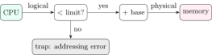
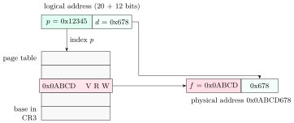
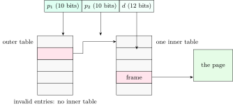

## 7.1 From a program to addresses {#sec-os-binding}

<div class="nb-proto">

<em><span>Prototypical example for this section:</span> two copies of the same program both use address `0x404010` for a global, and both work.</em>

</div>

<div class="nb nb-definition" id="definition-7-1-1">

<strong>Definition 7.1.1</strong>. Source is <strong>compiled</strong> into relocatable object files, <strong>linked</strong> into an executable (symbol references resolved, libraries added), and <strong>loaded</strong> into memory by the OS. <strong>Address binding</strong> (fixing which physical address a symbol occupies) can happen:

- at <strong>compile time</strong>: absolute code; must be loaded at a fixed address (MS-DOS `.com` files, firmware);
- at <strong>load time</strong>: the loader <strong>relocates</strong> the code (patches every address-dependent word) for wherever it is placed; it cannot move afterwards;
- at <strong>execution time</strong>: the CPU issues <strong>logical</strong> (virtual) addresses and the <strong>memory-management unit</strong> (MMU) translates every access into a <strong>physical</strong> address. The process can be moved at any time. Every modern general-purpose OS does this.

</div>

<div class="nb nb-definition" id="definition-7-1-2">

<strong>Definition 7.1.2</strong>. <strong>Static linking</strong> copies library code into each executable. <strong>Dynamic linking</strong> defers it to run time: the executable names its shared libraries (`.so`, DLL) and the dynamic linker maps them when the program starts (or lazily at the first call through the PLT); one copy of `libc` in RAM serves every process, and a library update needs no relinking. <strong>Dynamic loading</strong> (`dlopen`) loads a routine only when the program asks for it; it needs no special OS support beyond mapping files.

</div>

### 7.1.i Base and limit registers {#s7-1-i}

The simplest MMU has two registers per process, loaded on every context switch:

<figure class="nb-fig"></figure>

Every logical address $a$ must satisfy $0\le a<\text{limit}$; the physical address is $\text{base}+a$. Moving a process means copying it and changing `base`. The weakness is that the process must be contiguous in physical memory. (<strong>Swapping</strong> whole processes to disk and back, the original use of the medium-term scheduler, works with this scheme.)

## 7.2 Contiguous allocation and fragmentation {#sec-os-contiguous}

<div class="nb-proto">

<em><span>Prototypical example for this section:</span> 290 KB free in four holes, and a 140 KB request that does not fit.</em>

</div>

<div class="nb nb-definition" id="definition-7-2-1">

<strong>Definition 7.2.1</strong>. With <strong>fixed partitions</strong>, memory is divided in advance and each partition holds one process. The unused part of an allocated partition is <strong>internal fragmentation</strong>. With <strong>variable partitions</strong>, each process gets exactly what it asks for, carved from a free <strong>hole</strong>; after processes leave, the free memory is split into many holes, and a request can fail although the total free memory would suffice: <strong>external fragmentation</strong>.

</div>

<div class="nb nb-definition" id="definition-7-2-2">

<strong>Definition 7.2.2</strong> (Placement algorithms). For a request of size $n$: <strong>first fit</strong> takes the first hole $\ge n$; <strong>best fit</strong> the smallest hole $\ge n$ (leaves the smallest leftover); <strong>worst fit</strong> the largest hole (leaves the largest, most reusable leftover); <strong>next fit</strong> is first fit that starts searching where the last search stopped.

</div>

The placement core of `fit.py` (the file also has the fixed-partition bookkeeping):

```python {filename="fit.py, lines 4–21",linenos=table,linenostart=4}
def variable(holes, requests, how):
    """Variable partitions: a request is carved out of a hole (the rest stays
    free). Returns the per-request choice and the final hole list."""
    holes, last, log = list(holes), 0, []
    for r in requests:
        fits = [i for i, h in enumerate(holes) if h >= r]
        if not fits:
            log.append(f"{r}->wait"); continue
        if how == 'first':  i = fits[0]
        elif how == 'best': i = min(fits, key=lambda k: (holes[k], k))
        elif how == 'worst': i = max(fits, key=lambda k: (holes[k], -k))
        else:  # next fit: first fit starting where the last search stopped
            order = list(range(last, len(holes))) + list(range(0, last))
            i = next(k for k in order if holes[k] >= r)
        log.append(f"{r}->H{i + 1}({holes[i]})")
        holes[i] -= r
        last = i
    return log, holes
```

```text {filename="Output (Python 3.11)"}
holes [150, 90, 220, 70], requests [80, 100, 60, 140] (in order)
  first : 80->H1(150)  100->H3(220)  60->H1(70)  140->wait
          holes left [10, 90, 120, 70]
  best  : 80->H2(90)  100->H1(150)  60->H4(70)  140->H3(220)
          holes left [50, 10, 80, 10]
  worst : 80->H3(220)  100->H1(150)  60->H3(140)  140->wait
          holes left [50, 90, 80, 70]
  next  : 80->H1(150)  100->H3(220)  60->H3(120)  140->wait
          holes left [70, 90, 60, 70]

fixed partitions [500, 300, 150, 400], three processes of 250, first fit
  placement: 250->500, 250->300, 250->400
  internal fragmentation = 450, unused partitions (external) = 150 [150]
  ratio internal : external = 450:150

fixed partitions [150, 90, 220, 70], requests [80, 100, 60, 140] by first fit
  placement: 80->150, 100->220, 60->90, 140: no partition (free total 70)
  internal fragmentation = 220, free partitions [70]
```

<div class="nb nb-example nb-block" id="example-7-2-3">

<strong>Example 7.2.3</strong> (Reading the run)

With variable partitions and holes 150, 90, 220, 70 (KB), the requests 80, 100, 60, 140 all succeed only with best fit. First fit puts 80 and 60 into the 150 hole and 100 into the 220 hole, leaving holes 10, 90, 120, 70: 290 KB free, but no hole of 140. That failure is external fragmentation. Worst fit breaks the biggest hole first and fails too. In the fixed-partition run (partitions 500, 300, 150, 400; three processes of 250 by first fit) the three partitions used waste $250+50+150=450$ inside them (internal), and the 150-partition stays free but too small for anyone (external): ratio $450:150 = 3:1$.

</div>

<div class="nb nb-remark" id="remark-7-2-4">

<strong>Remark 7.2.4</strong> (OA: “which fragmentation?”) — Fixed partitions (blocks not split): the waste inside allocated blocks is <em>internal</em>; a request that fails while enough memory is free in total, scattered over blocks, is <em>external</em>. Variable partitions: only <em>external</em>. Paging: only <em>internal</em> (the last page of each region; half a page per region on average). Segmentation: external.

</div>

<div class="nb nb-definition" id="fact-7-2-5">

<strong>Fact 7.2.5</strong> (How bad it gets). Simulations (Knuth’s <strong>50-percent rule</strong>) show that with first fit, for $N$ allocated blocks about $N/2$ blocks are lost to fragmentation: one third of memory may be unusable. First fit and best fit beat worst fit in time and utilisation; first fit is usually the fastest. <strong>Compaction</strong> (moving processes to merge holes) fixes it but needs execution-time binding and costs a full memory copy.

</div>

<div class="nb nb-moral">

Contiguous allocation fragments memory. Paging removes external fragmentation by giving up contiguity.

</div>

## 7.3 Paging {#sec-os-paging}

<div class="nb-proto">

<em><span>Prototypical example for this section:</span> a 32-bit address `0x12345678` split into page `0x12345` and offset `0x678`.</em>

</div>

<div class="nb nb-definition" id="definition-7-3-1">

<strong>Definition 7.3.1</strong>. Physical memory is divided into fixed-size <strong>frames</strong>, the logical address space into <strong>pages</strong> of the same size $2^d$ (4 KiB on x86). A logical address is split into a page number $p$ (high bits) and an offset $d$ (low $d$ bits). The per-process <strong>page table</strong> maps $p$ to a frame number $f$; the physical address is $f\cdot 2^d + \text{offset}$:

$$
p = \lfloor a / \text{page size}\rfloor,\qquad d = a \bmod \text{page size}.
$$

</div>

<figure class="nb-fig"></figure>

<div class="nb nb-definition" id="definition-7-3-2">

<strong>Definition 7.3.2</strong>. A <strong>page-table entry</strong> (PTE) holds the frame number plus bits: <strong>valid/present</strong> (the page is in memory; otherwise a page fault), <strong>protection</strong> (read/write/execute, user/supervisor), <strong>referenced</strong> (accessed; set by hardware on use, read by replacement algorithms), <strong>dirty</strong> (modified; set on write, so clean pages need no write-back), and caching bits.

</div>

```text {filename="Output (Python 3.11)"}
1. Split of virtual address 0x12345678, 32-bit, 4 KiB pages
   VPN = 0x12345, offset = 0x678; if VPN -> frame 0x0ABCD, PA = 0x0ABCD678
2. Flat page table: VA 30 bits, page 1 KiB, PA 32 MiB, PTE = valid + frame
   entries = 2^20, frame number = 15 bits, PTE = 16 bits -> 2 B
   table = 2 MiB per process, 200 MiB for 100 processes
3. 32-bit VA, 4 KiB pages, 4-byte PTE
   flat table = 2^20 x 4 B = 4 MiB per process
   two-level: 1024 PTEs per page -> 10 + 10 + 12 split; outer table 1 page
   VA 48 bits, page 4 KiB, PTE 8 B: 9 index bits per level -> 4 levels
   VA 57 bits, page 4 KiB, PTE 8 B: 9 index bits per level -> 5 levels
   VA 32 bits, page 4 KiB, PTE 4 B: 10 index bits per level -> 2 levels
   VA 46 bits, page 8 KiB, PTE 4 B: 11 index bits per level -> 3 levels
   VA 64 bits, page 4 KiB, PTE 8 B: 9 index bits per level -> 6 levels
4. Sparse process, 32-bit VA, two-level 10+10+12, 4-byte PTEs:
   code 48 KiB at 0x00000000, data 600 KiB at 0x40000000,
   stack 64 KiB ending at 0xC0000000
   mapped pages = 178; inner tables needed = 3
   total = 1 outer + 3 inner = 16 KiB (a flat table would be 4096 KiB)
5. Inverted page table: 4 GiB of RAM, 4 KiB frames,
   entry = PID 16 bits + VPN 36 bits + 12 bits of flags/chain = 8 B
   1048576 entries x 8 B = 8 MiB for the whole machine
6. Effective access time, TLB lookup 10 ns, memory 100 ns
   1-level table, hit ratio 0.80: EAT = 0.80x110 + 0.20x210 = 130.0 ns
   1-level table, hit ratio 0.90: EAT = 0.90x110 + 0.10x210 = 120.0 ns
   1-level table, hit ratio 0.98: EAT = 0.98x110 + 0.02x210 = 112.0 ns
   4-level table, hit ratio 0.98: EAT = 0.98x110 + 0.02x510 = 118.0 ns
   4-level table, hit ratio 0.99: EAT = 0.99x110 + 0.01x510 = 114.0 ns
   for EAT <= 120 ns (1 level) the hit ratio must be >= 0.90
```

Items 1–3 are the standard numericals: the split, the flat table size (entries $\times$ PTE size, with the PTE size rounded up to whole bytes; the frame-number width comes from the <em>physical</em> memory size), and the fact that a flat 32-bit table is 4 MiB per process whether the process uses it or not.

<div class="nb nb-remark" id="remark-7-3-3">

<strong>Remark 7.3.3</strong> (Page size trade-offs) — Larger pages: smaller page tables, more TLB reach, fewer page faults for the same data, more efficient disk transfers, but more internal fragmentation and coarser protection and sharing. Smaller pages: the reverse. Hence “a smaller page size leads to a smaller page table” is false, “more TLB misses” is true, “less I/O per fault” is true, and “fewer page faults” is false in general. Systems offer both: 4 KiB base pages and 2 MiB or 1 GiB <strong>huge pages</strong> on x86-64.

</div>

<div class="nb nb-remark" id="remark-7-3-4">

<strong>Remark 7.3.4</strong> (Sharing) — Two page tables can map the same frame: every process running `bash` shares its code pages, every process shares `libc`’s text, and `fork` shares everything copy-on-write ([Section 8.6](../08-vm/#sec-os-cow)). Shared code must be reentrant (never modifies itself).

</div>

## 7.4 The TLB and effective access time {#sec-os-tlb}

<div class="nb-proto">

<em><span>Prototypical example for this section:</span> every load needs a page-table lookup first; without a cache, memory is twice as slow.</em>

</div>

<div class="nb nb-definition" id="definition-7-4-1">

<strong>Definition 7.4.1</strong>. The <strong>translation lookaside buffer</strong> (TLB) is a small, fast, associative cache of recent translations (VPN $\to$ PTE), typically tens to a few thousand entries. On a <strong>TLB hit</strong> the translation is free (in parallel with the cache lookup); on a <strong>miss</strong> the hardware (x86, ARM) or the OS (MIPS, old SPARC) walks the page table and refills the TLB. On a context switch the TLB must be flushed unless entries are tagged with an <strong>address-space identifier</strong> (ASID, PCID). TLB coverage is $\text{entries}\times \text{page size}$: 1536 entries of 4 KiB cover 6 MiB.

</div>

<div class="nb nb-theorem nb-block" id="theorem-7-4-2">

<strong>Theorem 7.4.2</strong> (Effective access time)

With TLB lookup time $t$, memory access time $m$, hit ratio $h$ and a $k$-level page table (no caching of the table itself):

$$
\text{EAT} = h\,(t+m) + (1-h)\,(t + (k+1)\,m).
$$

(If the TLB lookup overlaps the cache access, drop $t$ from the hit term; read the question.)

</div>

Item 6 above evaluates it. With 4 levels a miss costs five memory accesses, so the hit ratio matters more; real CPUs also cache upper-level entries (page-walk caches), which is why 4-level tables are tolerable. The TLB timing numericals that combine with the data cache are in the COA book.

## 7.5 Page tables for large address spaces {#sec-os-multilevel}

<div class="nb-proto">

<em><span>Prototypical example for this section:</span> a 64-bit process that uses 10 MB scattered over a 256 TB address space.</em>

</div>

A flat table must have an entry for every page of the address space, used or not. Three ways out:

1. <strong>Hierarchical (multi-level) tables</strong>: page the page table. The VPN is split into indices; the first indexes the outer table, whose entry points to an inner table, and so on. Inner tables for unused regions are simply not allocated (their outer entry is invalid). x86-64 uses 4 levels of 512 entries ($9+9+9+9+12=48$ bits), or 5 with 57-bit addresses. Item 4 shows the saving: a process with three regions needs $16$ KiB of tables instead of $4$ MiB. The cost is one memory access per level on a TLB miss.
2. <strong>Hashed page tables</strong>: hash the VPN into a table of chains of (VPN, frame) entries. Good for sparse 64-bit spaces; <strong>clustered</strong> variants store several consecutive pages per entry.
3. <strong>Inverted page table</strong>: one entry per physical <em>frame</em>, holding (PID, VPN). Its size depends on RAM, not on the number of processes (item 5: 8 MiB for 4 GiB). The lookup must search for (PID, VPN), so it is done through a hash table; sharing a frame between processes is awkward, since a frame has one entry. PowerPC and UltraSPARC used variants of it.

<figure class="nb-fig"></figure>

## 7.6 Segmentation {#sec-os-segmentation}

<div class="nb-proto">

<em><span>Prototypical example for this section:</span> code, data, heap and stack as separate variable-sized pieces, each with its own base, limit and permissions.</em>

</div>

<div class="nb nb-definition" id="definition-7-6-1">

<strong>Definition 7.6.1</strong>. With <strong>segmentation</strong> a logical address is a pair (segment number $s$, offset $d$). The <strong>segment table</strong> entry for $s$ holds a base, a limit and protection bits; the access is legal iff $d<\text{limit}$, and the physical address is $\text{base}+d$. Segments match the program’s logical units (code, data, stack), so protection and sharing are natural, but they are variable-sized: external fragmentation returns.

</div>

<div class="nb nb-example nb-block" id="example-7-6-2">

<strong>Example 7.6.2</strong> (Translation)

Segment table: segment 0 (base 2000, limit 600), segment 1 (base 5200, limit 300), segment 2 (base 3600, limit 900). Address (2, 77) $\to 3600+77=3677$. Address (1, 300) traps: offset 300 is not $<$ limit 300. Address (0, 599) $\to 2599$.

</div>

<div class="nb nb-definition" id="definition-7-6-3">

<strong>Definition 7.6.3</strong>. <strong>Segmented paging</strong> (paged segmentation) pages each segment: the segment table entry points to that segment’s page table, and the offset is split into page number and page offset. It keeps segmentation’s logical units with paging’s lack of external fragmentation. 32-bit x86 did this (segment registers, then two-level paging); in 64-bit mode the segment bases are forced to zero except `fs`/`gs` (used for thread-local storage), so x86-64 is effectively pure paging.

</div>

|  | Contiguous | Paging | Segmentation |
|:--|:--|:--|:--|
| Unit | whole process | fixed-size page | variable-size logical segment |
| Fragmentation | external (variable), internal (fixed) | internal only | external |
| Visible to programmer | no | no | yes (segment, offset) |
| Sharing / protection | whole process | per page | per logical unit |
| Translation | base + limit | page table, TLB | segment table |

<div class="nb nb-moral">

Paging trades a translation step (made cheap by the TLB) for the end of external fragmentation; multi-level tables make that translation affordable in space.

</div>
