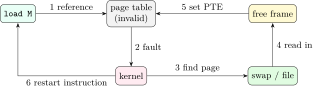
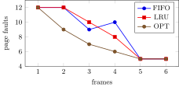

## 8.1 Why “virtual”, and demand paging {#sec-os-demand}

<div class="nb-proto">

<em><span>Prototypical example for this section:</span> a process maps 100 MiB and the resident memory does not move until it touches the pages.</em>

</div>

<div class="nb nb-definition" id="definition-8-1-1">

<strong>Definition 8.1.1</strong>. <strong>Virtual memory</strong> separates the addresses a program uses from physical memory. Each process gets its own large, contiguous, private address space; the OS and the MMU map the parts in use onto physical frames and keep the rest on disk or nowhere at all. The address is <em>virtual</em> because it does not name a physical location: the same virtual address in two processes means two different places, a virtual page may currently be in a frame, on disk, or not yet exist, and the program cannot tell which.

</div>

Consequences: a program can be larger than RAM; only the pages actually used occupy memory, so more processes fit (higher degree of multiprogramming); processes are isolated; sharing (libraries, `fork`) and memory-mapped files fall out of the same mechanism.

<div class="nb nb-definition" id="definition-8-1-2">

<strong>Definition 8.1.2</strong>. With <strong>demand paging</strong> a page is brought into memory only when it is first accessed. The PTE of a page not in memory is marked invalid; touching it raises a <strong>page fault</strong>, the kernel loads the page and restarts the instruction. <strong>Pure demand paging</strong> starts a process with no pages at all. A <strong>minor</strong> fault needs no I/O (the page is in the page cache, or is a fresh zero page); a <strong>major</strong> fault reads from disk.

</div>

```c {filename="demand.c"}
// flags: -D_GNU_SOURCE
// Demand paging and copy-on-write, measured with the kernel's own counters:
// minor page faults (getrusage) and resident set size (/proc/self/statm).
#include <stdio.h>
#include <unistd.h>
#include <sys/mman.h>
#include <sys/resource.h>
#include <sys/wait.h>

static long faults(void) {
    struct rusage u; getrusage(RUSAGE_SELF, &u); return u.ru_minflt;
}
static long rss_pages(void) {
    long size, rss; FILE *f = fopen("/proc/self/statm", "r");
    fscanf(f, "%ld %ld", &size, &rss); fclose(f); return rss;
}

int main(void) {
    enum { PAGES = 25600 };                      // 100 MiB of 4 KiB pages
    setvbuf(stdout, NULL, _IONBF, 0);            // nothing buffered at fork
    long pg = sysconf(_SC_PAGESIZE);
    rss_pages(); faults();                       // warm up stdio and libc first
    long r0 = rss_pages();
    char *m = mmap(NULL, PAGES * pg, PROT_READ | PROT_WRITE,
                   MAP_PRIVATE | MAP_ANONYMOUS, -1, 0);
    long f0 = faults(), rm = rss_pages();
    printf("page size %ld; mapped 100 MiB: RSS grew by %ld pages\n",
           pg, rm - r0);
    for (long i = 0; i < PAGES / 10; i++) m[i * pg] = 1;     // touch 10%
    long f1 = faults(), r1 = rss_pages();
    printf("touched 2560 pages: %ld minor faults, RSS +%ld pages\n",
           f1 - f0, r1 - r0);

    pid_t pid = fork();
    if (pid == 0) {                              // child shares them (COW)
        long c0 = faults();
        for (long i = 0; i < PAGES / 10; i++)
            (void)*(volatile char *)&m[i * pg];
        long c1 = faults();
        for (long i = 0; i < PAGES / 10; i++) m[i * pg] = 2;  // now write
        long c2 = faults();
        printf("child read 2560 shared pages : %ld faults\n", c1 - c0);
        printf("child wrote 2560 shared pages: %ld faults (one copy each)\n",
               c2 - c1);
        _exit(0);
    }
    waitpid(pid, NULL, 0);
    printf("parent still sees m[0] = %d\n", m[0]);
    return 0;
}
```

```text {filename="Output (gcc 13.3, glibc 2.39, Linux 6.18 x86-64)"}
page size 4096; mapped 100 MiB: RSS grew by 0 pages
touched 2560 pages: 2561 minor faults, RSS +2576 pages
child read 2560 shared pages : 1 faults
child wrote 2560 shared pages: 2560 faults (one copy each)
parent still sees m[0] = 1
```

Mapping 100 MiB changed nothing: the kernel only recorded the region. Each first touch of a page cost one minor fault (a zero-filled frame); the child after `fork` could read all 2560 pages with no fault (shared, read-only, copy-on-write), and each write faulted once to get a private copy ([Section 8.6](#sec-os-cow)).

## 8.2 Servicing a page fault {#sec-os-pagefault}

<div class="nb-proto">

<em><span>Prototypical example for this section:</span> a load from a page that was swapped out an hour ago.</em>

</div>

<div class="nb nb-remark" id="algorithm-8-2-1">

<strong>Algorithm 8.2.1</strong> (Page-fault handling) — From the faulting load to its restart:

1. The MMU finds the PTE not present (or a protection violation) and raises a fault; the CPU saves the state and the faulting address (CR2 on x86) and enters the kernel.
2. The kernel looks the address up in the process’s list of memory regions. Not in any region, or a write to a read-only region that is not copy-on-write: send `SIGSEGV`. (That is the segmentation fault.)
3. Find a free frame; if none, run the replacement algorithm to choose a victim, and if the victim is dirty, write it to swap or its file first.
4. Fill the frame: zero it (anonymous memory), copy it (COW), or schedule a disk read (file page or swapped page). During the read the process is blocked and another runs.
5. When the I/O completes, update the PTE (frame number, present, protection), and mark the process ready.
6. When it runs again, restart the faulting instruction, which now succeeds.

</div>

<figure class="nb-fig"></figure>

<div class="nb nb-theorem nb-block" id="theorem-8-2-2">

<strong>Theorem 8.2.2</strong> (Effective access time with faults)

With fault probability $p$, memory access time $m$ and fault service time $F$: $\text{EAT} = (1-p)\,m + p\,F$.

</div>

Since $F$ is milliseconds and $m$ is nanoseconds, $p$ must be tiny:

```text {filename="Output (Python 3.11)"}
1. Frame allocation: m = 62 frames, P1 has 10 pages, P2 has 127 pages
   equal: 31 each
   proportional a_i = s_i/S * m: 4.53 -> 4, 57.47 -> 57  (S = 137; 1 frame left over)
2. m = 40 frames, sizes 5, 15, 30 pages
   proportional: 4.00 -> 4, 12.00 -> 12, 24.00 -> 24
3. EAT with page faults: memory 100 ns, fault service 5 ms
   p = 0.001: EAT = 5,099.9 ns (5,000% slower than no faults)
   p = 0.0001: EAT = 600.0 ns (500% slower than no faults)
   p = 1e-06: EAT = 105.0 ns (5% slower than no faults)
   slowdown <= 10% needs p <= 2e-06, i.e. at most one fault in 499,990 accesses
4. Working set, window = 5 references
   t =  4 (refs [1, 2, 1, 3, 2]): WS = [1, 2, 3], |WS| = 3
   t =  9 (refs [1, 4, 5, 4, 5]): WS = [1, 4, 5], |WS| = 3
   t = 14 (refs [6, 4, 5, 4, 6]): WS = [4, 5, 6], |WS| = 3
```

Item 3: one fault in a thousand accesses makes memory about 50 times slower; for at most 10% slowdown, fewer than one fault per $499{,}990$ accesses. That is why locality matters, and why SSD swap (tens of microseconds) changes the picture but not the conclusion.

## 8.3 Page replacement {#sec-os-replacement}

<div class="nb-proto">

<em><span>Prototypical example for this section:</span> memory is full, a page must come in; which page goes out?</em>

</div>

<div class="nb nb-definition" id="definition-8-3-1">

<strong>Definition 8.3.1</strong>. The classic policies:

- <strong>FIFO</strong>: evict the page loaded longest ago.
- <strong>OPT</strong> (Bélády’s optimal, MIN): evict the page whose next use is furthest in the future. Needs the future, so it is a yardstick, not an algorithm.
- <strong>LRU</strong>: evict the page unused for the longest time (OPT run backwards in time). Exact LRU needs a timestamp or a stack update on every access, too costly in hardware.
- <strong>Clock</strong> (<strong>second chance</strong>): frames in a circle with a hand; each has a <strong>reference bit</strong> set by hardware on access. To evict, look at the frame under the hand: if its bit is 1, clear it and advance; if 0, evict it. A cheap approximation of LRU. (Here a newly loaded page starts with its bit set, since the faulting access references it, and the hand moves past the frame it filled; some texts start new pages at 0, which changes the counts. State the convention.)
- <strong>Enhanced second chance</strong> uses (reference, dirty) pairs and prefers to evict clean, unreferenced pages, since a dirty victim costs a write.
- <strong>LFU</strong>/<strong>MFU</strong>: evict the least / most frequently used page; neither approximates OPT well, and both are rare.

</div>

The simulator (`replace.py`) on one reference string with 3 frames, every frame shown after every reference:

| <strong>FIFO</strong> | <strong>0</strong> | <strong>5</strong> | <strong>3</strong> | <strong>1</strong> | <strong>0</strong> | <strong>1</strong> | <strong>3</strong> | <strong>5</strong> | <strong>1</strong> | <strong>5</strong> | <strong>3</strong> | <strong>1</strong> | <strong>3</strong> | <strong>4</strong> | <strong>3</strong> | <strong>5</strong> |
|:--|:-:|:-:|:-:|:-:|:-:|:-:|:-:|:-:|:-:|:-:|:-:|:-:|:-:|:-:|:-:|:-:|
| frame 0 | 0 | 0 | 0 | 1 | 1 | 1 | 1 | 1 | 1 | 1 | 3 | 3 | 3 | 3 | 3 | 5 |
| frame 1 |  | 5 | 5 | 5 | 0 | 0 | 0 | 0 | 0 | 0 | 0 | 1 | 1 | 1 | 1 | 1 |
| frame 2 |  |  | 3 | 3 | 3 | 3 | 3 | 5 | 5 | 5 | 5 | 5 | 5 | 4 | 4 | 4 |
| faults: 10 | $\bullet$ | $\bullet$ | $\bullet$ | $\bullet$ | $\bullet$ |  |  | $\bullet$ |  |  | $\bullet$ | $\bullet$ |  | $\bullet$ |  | $\bullet$ |

| <strong>OPT</strong> | <strong>0</strong> | <strong>5</strong> | <strong>3</strong> | <strong>1</strong> | <strong>0</strong> | <strong>1</strong> | <strong>3</strong> | <strong>5</strong> | <strong>1</strong> | <strong>5</strong> | <strong>3</strong> | <strong>1</strong> | <strong>3</strong> | <strong>4</strong> | <strong>3</strong> | <strong>5</strong> |
|:--|:-:|:-:|:-:|:-:|:-:|:-:|:-:|:-:|:-:|:-:|:-:|:-:|:-:|:-:|:-:|:-:|
| frame 0 | 0 | 0 | 0 | 0 | 0 | 0 | 0 | 5 | 5 | 5 | 5 | 5 | 5 | 5 | 5 | 5 |
| frame 1 |  | 5 | 5 | 1 | 1 | 1 | 1 | 1 | 1 | 1 | 1 | 1 | 1 | 4 | 4 | 4 |
| frame 2 |  |  | 3 | 3 | 3 | 3 | 3 | 3 | 3 | 3 | 3 | 3 | 3 | 3 | 3 | 3 |
| faults: 6 | $\bullet$ | $\bullet$ | $\bullet$ | $\bullet$ |  |  |  | $\bullet$ |  |  |  |  |  | $\bullet$ |  |  |

| <strong>LRU</strong> | <strong>0</strong> | <strong>5</strong> | <strong>3</strong> | <strong>1</strong> | <strong>0</strong> | <strong>1</strong> | <strong>3</strong> | <strong>5</strong> | <strong>1</strong> | <strong>5</strong> | <strong>3</strong> | <strong>1</strong> | <strong>3</strong> | <strong>4</strong> | <strong>3</strong> | <strong>5</strong> |
|:--|:-:|:-:|:-:|:-:|:-:|:-:|:-:|:-:|:-:|:-:|:-:|:-:|:-:|:-:|:-:|:-:|
| frame 0 | 0 | 0 | 0 | 1 | 1 | 1 | 1 | 1 | 1 | 1 | 1 | 1 | 1 | 1 | 1 | 5 |
| frame 1 |  | 5 | 5 | 5 | 0 | 0 | 0 | 5 | 5 | 5 | 5 | 5 | 5 | 4 | 4 | 4 |
| frame 2 |  |  | 3 | 3 | 3 | 3 | 3 | 3 | 3 | 3 | 3 | 3 | 3 | 3 | 3 | 3 |
| faults: 8 | $\bullet$ | $\bullet$ | $\bullet$ | $\bullet$ | $\bullet$ |  |  | $\bullet$ |  |  |  |  |  | $\bullet$ |  | $\bullet$ |

| <strong>Clock</strong> | <strong>0</strong> | <strong>5</strong> | <strong>3</strong> | <strong>1</strong> | <strong>0</strong> | <strong>1</strong> | <strong>3</strong> | <strong>5</strong> | <strong>1</strong> | <strong>5</strong> | <strong>3</strong> | <strong>1</strong> | <strong>3</strong> | <strong>4</strong> | <strong>3</strong> | <strong>5</strong> |
|:--|:-:|:-:|:-:|:-:|:-:|:-:|:-:|:-:|:-:|:-:|:-:|:-:|:-:|:-:|:-:|:-:|
| frame 0 | 0 | 0 | 0 | 1 | 1 | 1 | 1 | 1 | 1 | 1 | 1 | 1 | 1 | 1 | 1 | 5 |
| frame 1 |  | 5 | 5 | 5 | 0 | 0 | 0 | 0 | 0 | 0 | 3 | 3 | 3 | 3 | 3 | 3 |
| frame 2 |  |  | 3 | 3 | 3 | 3 | 3 | 5 | 5 | 5 | 5 | 5 | 5 | 4 | 4 | 4 |
| faults: 9 | $\bullet$ | $\bullet$ | $\bullet$ | $\bullet$ | $\bullet$ |  |  | $\bullet$ |  |  | $\bullet$ |  |  | $\bullet$ |  | $\bullet$ |

```text {filename="Output (Python 3.11)"}
reference string: 0 5 3 1 0 1 3 5 1 5 3 1 3 4 3 5
FIFO, 3 frames: 10 faults, 6 hits
OPT, 3 frames: 6 faults, 10 hits
LRU, 3 frames: 8 faults, 8 hits
Clock, 3 frames: 9 faults, 7 hits
LFU, 3 frames: 8 faults, 8 hits

Belady's anomaly: 1 2 3 4 1 2 5 1 2 3 4 5
  frames:    1   2   3   4   5   6
  FIFO    12  12   9  10   5   5
  LRU     12  12  10   8   5   5
  OPT     12   9   7   6   5   5
  stack property, FIFO : violated at reference 7 (3 vs 4 frames)
  stack property, LRU  : holds for 1..6 frames
  stack property, OPT  : holds for 1..6 frames
  stack property, Clock: violated at reference 7 (3 vs 4 frames)
```

<div class="nb nb-example nb-block" id="example-8-3-2">

<strong>Example 8.3.2</strong> (Reading the tables)

At the 5th reference (page 0) the frames hold 1, 5, 3. FIFO evicts 5 (oldest); LRU evicts 5 too (least recently used); OPT looks ahead and evicts 5 as well, since 5 is next used at reference 8, after 1 and 3. At reference 8 (page 5) they diverge: FIFO evicts 3 (oldest) although 3 is needed again two references later; OPT evicts 0, never used again. The counts are OPT 6 $<$ LRU 8 $<$ Clock 9 $<$ FIFO 10, the usual order, though not a law: on other strings FIFO can beat LRU.

</div>

### 8.3.i Bélády’s anomaly and stack algorithms {#s8-3-i}

<figure class="nb-fig"></figure>

<div class="nb nb-theorem nb-block" id="theorem-8-3-3">

<strong>Theorem 8.3.3</strong> (Bélády’s anomaly)

For FIFO, more frames can mean more faults: on $1\,2\,3\,4\,1\,2\,5\,1\,2\,3\,4\,5$, FIFO has 9 faults with 3 frames and 10 with 4 (plotted above from the same run). A <strong>stack algorithm</strong> is one for which the set of pages in memory with $n$ frames is always a subset of the set with $n+1$ frames; stack algorithms cannot show the anomaly. LRU and OPT are stack algorithms; FIFO and Clock are not (the simulator found the first violation at the 7th reference, for both).

</div>

<div class="nb nb-proof">

<em>Why LRU is a stack algorithm.</em> With $n$ frames LRU holds exactly the $n$ most recently used distinct pages, which are among the $n+1$ most recently used. FIFO holds the $n$ most recently <em>loaded</em>, and what was loaded depends on $n$.

</div>

<div class="nb nb-moral">

OPT is the bound, LRU the target, Clock the implementation; FIFO alone among them can get worse with more memory.

</div>

## 8.4 Allocating frames to processes {#sec-os-frames}

<div class="nb-proto">

<em><span>Prototypical example for this section:</span> 62 frames, a 10-page editor and a 127-page database: equal shares waste 27 frames on the editor.</em>

</div>

<div class="nb nb-definition" id="definition-8-4-1">

<strong>Definition 8.4.1</strong>. <strong>Equal allocation</strong> gives each of $n$ processes $\lfloor m/n\rfloor$ frames. <strong>Proportional allocation</strong> gives process $i$ with $s_i$ pages $a_i = \lfloor s_i \cdot m / S\rfloor$, $S=\sum s_i$ (a priority-weighted variant uses priorities instead of, or with, sizes). Each process needs a <strong>minimum</strong> number of frames fixed by the instruction set: enough for every page a single instruction can touch (an instruction spanning two pages, with two memory operands each spanning two pages, needs six); the <strong>maximum</strong> is bounded by the available memory.

</div>

Items 1 and 2 of the output above: with 62 frames, sizes 10 and 127 give $4.53\to4$ and $57.47\to57$ (one frame left for the free pool); sizes 5, 15, 30 with 40 frames divide exactly into 4, 12, 24.

<div class="nb nb-definition" id="definition-8-4-2">

<strong>Definition 8.4.2</strong>. With <strong>local replacement</strong> a faulting process may only evict its own pages: its fault rate depends on itself alone. With <strong>global replacement</strong> it may take a frame from any process, which adapts allocations to demand and gives better throughput, but one process’s behaviour changes others’ fault rates. Taking frames from other processes is called <strong>page stealing</strong>: the page stealer (Linux’s `kswapd`, the “page daemon” of BSD) reclaims frames from the working sets of other processes when free memory runs low.

</div>

<div class="nb nb-remark" id="remark-8-4-3">

<strong>Remark 8.4.3</strong> (OA: “which is correct about page stealing?”) — Page stealing is the taking of page frames from other processes’ working sets (global replacement). It is not a sign of efficiency or a tuning goal; a lot of it means memory is over-committed and is the road to thrashing.

</div>

## 8.5 Thrashing, working sets and PFF {#sec-os-thrashing}

<div class="nb-proto">

<em><span>Prototypical example for this section:</span> adding one more process to a busy machine and watching CPU utilisation collapse.</em>

</div>

<div class="nb nb-definition" id="definition-8-5-1">

<strong>Definition 8.5.1</strong>. A process is <strong>thrashing</strong> when it spends more time paging than executing: it does not have frames for the pages it is actively using, so every fault evicts a page that is needed again almost at once.

</div>

<figure class="nb-fig"></figure>

<div class="nb nb-remark" id="remark-8-5-2">

<strong>Remark 8.5.2</strong> (The vicious circle) — Faults block processes, CPU utilisation drops, and a naive long-term scheduler reacts by admitting <em>more</em> processes, which steal even more frames. The fix goes the other way.

</div>

<div class="nb nb-definition" id="definition-8-5-3">

<strong>Definition 8.5.3</strong>. The <strong>working set</strong> $W(t,\Delta)$ is the set of pages referenced in the last $\Delta$ references (item 4 of the output above shows it for $\Delta=5$ at three instants; it moves from $\{1,2,3\}$ to $\{4,5,6\}$ as the program changes locality). If $D=\sum_i |W_i| > m$ (total demand exceeds frames), some process must be suspended. <strong>Page-fault frequency</strong> (PFF) control measures each process’s fault rate directly: above an upper bound, give it more frames; below a lower bound, take some away; if no frames are free, suspend a process.

</div>

<div class="nb nb-remark" id="remark-8-5-4">

<strong>Remark 8.5.4</strong> (OA: “which reduce thrashing? (more than one)”) — <strong>Yes</strong>: reduce the degree of multiprogramming (suspend or swap out processes); add physical memory; allocate by working set or PFF; use local (per-process) replacement so one thrashing process cannot drag the others down; improve the program’s locality. <strong>No</strong>: admitting more processes; a faster CPU; a bigger swap area (it only allows more over-commitment); a larger disk.

</div>

## 8.6 Copy-on-write and memory-mapped files {#sec-os-cow}

<div class="nb-proto">

<em><span>Prototypical example for this section:</span> `fork` of a 4 GiB process that immediately calls `exec`: nothing should be copied.</em>

</div>

<div class="nb nb-definition" id="definition-8-6-1">

<strong>Definition 8.6.1</strong>. <strong>Copy-on-write</strong> (COW): `fork` makes both processes’ PTEs point to the same frames, marked read-only. The first write by either one faults; the kernel copies that one page, gives the writer the copy with write permission, and restarts the write. Pages never written are never copied. `demand.c` above measured it: reading 2560 shared pages cost no faults, writing them cost exactly 2560.

</div>

<div class="nb nb-definition" id="definition-8-6-2">

<strong>Definition 8.6.2</strong>. `mmap(addr, len, prot, flags, fd, off)` maps a file (or anonymous zero memory) into the address space. Page faults read the file through the page cache; with `MAP_SHARED`, stores go to the page cache and eventually to the file (`msync` forces it), and other processes mapping the file see them; with `MAP_PRIVATE`, the first store to a page makes a private COW copy that never reaches the file. Executables and shared libraries are loaded this way.

</div>

```c {filename="mmap-file.c"}
// flags: -D_GNU_SOURCE
// A file mapped into memory: stores to MAP_SHARED pages reach the file;
// stores to MAP_PRIVATE pages are copied-on-write and never do.
#include <stdio.h>
#include <fcntl.h>
#include <string.h>
#include <unistd.h>
#include <sys/mman.h>

int main(void) {
    const char *path = "/tmp/os-book-mmap.txt";
    int fd = open(path, O_RDWR | O_CREAT | O_TRUNC, 0600);
    write(fd, "hello, file\n", 12);

    char *shared = mmap(NULL, 12, PROT_READ | PROT_WRITE, MAP_SHARED, fd, 0);
    char *priv = mmap(NULL, 12, PROT_READ | PROT_WRITE, MAP_PRIVATE, fd, 0);
    memcpy(shared, "HELLO", 5);                // goes to the page cache
    msync(shared, 12, MS_SYNC);                // and now to the disk
    memcpy(priv + 7, "PRIVATE", 4);            // a private copy of the page

    char buf[13] = {0};
    pread(fd, buf, 12, 0);
    printf("file via read(): %s", buf);
    printf("private mapping: %.12s", priv);
    munmap(shared, 12); munmap(priv, 12); close(fd); unlink(path);
    return 0;
}
```

```text {filename="Output (gcc 13.3, glibc 2.39, Linux 6.18 x86-64)"}
file via read(): HELLO, file
private mapping: HELLO, PRIV
```

## 8.7 Kernel and user allocators {#sec-os-allocators}

<div class="nb-proto">

<em><span>Prototypical example for this section:</span> `malloc(24)` returns a 32-byte chunk from the heap; `malloc(1 MiB)` gets its own `mmap`.</em>

</div>

### 8.7.i The buddy system {#s8-7-i}

<div class="nb nb-definition" id="definition-8-7-1">

<strong>Definition 8.7.1</strong>. The kernel’s page allocator manages physical memory as blocks of $2^k$ pages. A request is rounded up to a power of two; a larger free block is split in halves (<strong>buddies</strong>) until it fits; when a block is freed and its buddy (address XOR size) is free too, they merge, recursively. Allocation and freeing are $O(\log n)$ and external fragmentation is kept in check by merging; the price is internal fragmentation of up to almost 50%.

</div>

```text {filename="Output (Python 3.11)"}
start                 [-:1024]
A = alloc(70K)->128K  [A:128] [-:128] [-:256] [-:512]
B = alloc(35K)->64K   [A:128] [B:64] [-:64] [-:256] [-:512]
C = alloc(80K)->128K  [A:128] [B:64] [-:64] [C:128] [-:128] [-:512]
free(A)               [-:128] [B:64] [-:64] [C:128] [-:128] [-:512]
D = alloc(60K)->64K   [-:128] [B:64] [D:64] [C:128] [-:128] [-:512]
free(B)               [-:128] [-:64] [D:64] [C:128] [-:128] [-:512]
free(D)               [-:256] [C:128] [-:128] [-:512]
free(C)               [-:1024]
```

The 70K request took a 128K block (58K internal fragmentation). Freeing D merged D with B’s freed block, then that 128K with A’s old block; freeing C merged everything back.

### 8.7.ii Slab allocation {#s8-7-ii}

<div class="nb nb-definition" id="definition-8-7-2">

<strong>Definition 8.7.2</strong>. The kernel allocates many objects of a few fixed sizes (`task_struct`, inodes, network buffers). A <strong>slab allocator</strong> keeps a <strong>cache</strong> per object type, each made of slabs (one or more contiguous pages) cut into object-sized slots. Allocation pops a free slot, freeing pushes it back: no fragmentation inside a slab, no search, objects can stay initialised between uses, and recently freed (cache-hot) objects are reused first. Linux’s current implementation is SLUB; `/proc/slabinfo` lists the caches.

</div>

### 8.7.iii `malloc` internals {#s8-7-iii}

`malloc` is a user-space library allocator. It asks the kernel for memory in big pieces (`brk`/`sbrk` to grow the heap, `mmap` for large blocks) and carves them up itself:

```c {filename="malloc-demo.c"}
// flags: -D_GNU_SOURCE
// norun (driven by malloc-trace.sh)
// What glibc malloc does underneath: chunk headers, the heap, mmap for big
// blocks.
#include <stdio.h>
#include <stdlib.h>
#include <malloc.h>

int main(void) {
    char *a = malloc(24), *b = malloc(24), *c = malloc(25);
    printf("malloc(24) twice: addresses differ by %ld bytes\n", (long)(b - a));
    printf("usable sizes: malloc(24) -> %zu, malloc(25) -> %zu\n",
           malloc_usable_size(a), malloc_usable_size(c));
    free(b);
    char *d = malloc(20);                         // same size class
    printf("after free(b), malloc(20) reuses b's chunk: %s\n",
           d == b ? "yes" : "no");
    char *big = malloc(1 << 20);                  // above the mmap threshold
    printf("1 MiB block is 16 bytes past a page boundary: %s\n",
           ((unsigned long)big & 4095) == 16 ? "yes" : "no");
    free(big); free(a); free(c); free(d);
    fflush(stdout);
    return 0;
}
```

```bash {filename="malloc-trace.sh"}
# Which system calls do those mallocs make? (start-up calls before main are
# dropped: we keep the trace from the first brk(NULL) issued by malloc)
cd "$BIN" || exit 1
strace -e trace=brk,mmap,munmap ./malloc-demo 2>&1 >/dev/null \
  | awk '/^brk\(NULL\)/ && seen++ {go=1} go' \
  | grep -v '^+++' | sed -E 's/0x[0-9a-f]+/0x.../g; s/ += /  = /'
echo "--- program output ---"
./malloc-demo
```

```text {filename="Terminal session (bash, Linux 6.18)"}
brk(NULL)  = 0x...
brk(0x...)  = 0x...
mmap(NULL, 1052672, PROT_READ|PROT_WRITE, MAP_PRIVATE|MAP_ANONYMOUS, -1, 0)  = 0x...
munmap(0x..., 1052672)  = 0
--- program output ---
malloc(24) twice: addresses differ by 32 bytes
usable sizes: malloc(24) -> 24, malloc(25) -> 40
after free(b), malloc(20) reuses b's chunk: yes
1 MiB block is 16 bytes past a page boundary: yes
```

<div class="nb nb-remark" id="remark-8-7-3">

<strong>Remark 8.7.3</strong> (What the run shows about glibc) — Four things:

- Each chunk carries a 16-byte header (size and flags; the previous chunk’s size overlaps the end of the previous chunk), and sizes are rounded to multiples of 16: `malloc(24)` occupies 32 bytes, `malloc(25)` gets 40 usable bytes in a 48-byte chunk.
- Freed small chunks go to per-size free lists (<strong>tcache</strong> per thread, then fast bins, small bins, large bins, an unsorted bin); `malloc(20)` reused the chunk just freed.
- The heap was created by two `brk` calls on the first `malloc`; the 1 MiB request (above the 128 KiB mmap threshold) got its own `mmap` of 1 MiB plus one page for the header, and `free` returned it at once with `munmap`.
- Common bugs follow from this layout: writing past a block corrupts the next chunk’s header (a crash in a later `malloc`/`free`), double free corrupts the free lists.

</div>

### 8.7.iv Over-commit and the OOM killer {#s8-7-iv}

<div class="nb nb-definition" id="definition-8-7-4">

<strong>Definition 8.7.4</strong>. Linux <strong>over-commits</strong> memory by default: `malloc` and `mmap` succeed even if physical memory plus swap could not back every page, because most allocated memory is never touched (as `demand.c` showed). If memory really runs out, the <strong>OOM killer</strong> picks a process by its `oom_score` (mostly its memory footprint, adjusted by `/proc/PID/oom_score_adj`, from $-1000$, never kill, to $1000$) and kills it with `SIGKILL`. The policy is set by `vm.overcommit_memory` (0 heuristic, 1 always, 2 strict accounting). This is why a C program on Linux rarely sees `malloc` return `NULL`, and dies later instead.

</div>

<div class="nb nb-moral">

Two allocators sit on top of each other: the kernel hands out pages (buddy) and objects (slab); `malloc` turns pages from `brk`/`mmap` into small blocks, with headers and free lists that bugs can corrupt.

</div>
