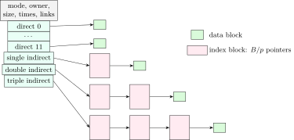
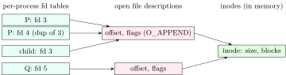

## 9.1 Files and directories {#sec-os-files}

<div class="nb-proto">

<em><span>Prototypical example for this section:</span> `/home/u/notes.txt`: a name in a directory, an inode with metadata, and data blocks somewhere on the disk.</em>

</div>

<div class="nb nb-definition" id="definition-9-1-1">

<strong>Definition 9.1.1</strong>. A <strong>file</strong> is a named, persistent sequence of bytes. Its <strong>metadata</strong> (attributes): type, size, owner and group, permissions, timestamps (access, modification, status change), link count, and where its data lives. In UNIX file systems all of this except the name is stored in an <strong>inode</strong>; a <strong>directory</strong> is a special file whose contents map names to inode numbers. The name is therefore not part of the file: one file can have several names.

</div>

<div class="nb nb-definition" id="definition-9-1-2">

<strong>Definition 9.1.2</strong>. <strong>Access methods</strong>: <strong>sequential</strong> (read the next record, the tape model; what `read` does by default), <strong>direct</strong> (random: read block $n$, what `lseek` and `pread` give), and <strong>indexed</strong> (an index maps keys to blocks; databases build this on top).

</div>

<div class="nb nb-definition" id="definition-9-1-3">

<strong>Definition 9.1.3</strong>. <strong>Directory structures</strong>, in order of generality: <strong>single-level</strong> (one directory for everyone: name clashes), <strong>two-level</strong> (one per user), <strong>tree</strong> (arbitrary subdirectories, absolute and relative path names), <strong>acyclic graph</strong> (a file or subdirectory may appear in several directories: links, shared folders; deleting needs reference counts), <strong>general graph</strong> (cycles allowed: traversal and garbage collection get hard, which is why UNIX forbids hard links to directories).

</div>

## 9.2 Allocating blocks to files {#sec-os-alloc}

<div class="nb-proto">

<em><span>Prototypical example for this section:</span> a 10-block file: where are its blocks, and how many disk reads does it take to reach block 7?</em>

</div>

<div class="nb nb-definition" id="definition-9-2-1">

<strong>Definition 9.2.1</strong>. The four classic layouts:

- <strong>Contiguous</strong>: the directory stores (start, length). Fast sequential and random access (block $i$ is at start $+\,i$), but external fragmentation and files cannot grow easily. Still used for read-only media (ISO 9660) and as <strong>extents</strong> (runs of contiguous blocks) in ext4, XFS, NTFS.
- <strong>Linked</strong>: each block holds a pointer to the next; the directory stores first and last. No fragmentation and easy growth, but random access to block $i$ needs $i$ reads, a pointer costs space in every block (a 512-byte block with a 4-byte pointer holds 508 bytes of data), and one bad pointer loses the rest of the file.
- <strong>FAT</strong> (file allocation table): the linked list’s pointers moved into one table with one entry per block, kept at the start of the volume and cached in memory. Random access walks the chain in RAM instead of on disk. FAT12/16/32, exFAT.
- <strong>Indexed</strong>: each file has an <strong>index block</strong> listing its blocks: fast random access, but small files waste a whole index block and big files need several, linked or multi-level.

</div>

### 9.2.i The UNIX inode {#s9-2-i}

<figure class="nb-fig"></figure>

<div class="nb nb-theorem nb-block" id="theorem-9-2-2">

<strong>Theorem 9.2.2</strong> (Maximum file size)

With block size $B$, pointer size $p$ and $k=B/p$ pointers per index block, an inode with $d$ direct pointers and one single, double and triple indirect pointer addresses

$$
\left(d + k + k^2 + k^3\right)\cdot B \text{ bytes.}
$$

Small files need no index blocks at all; each level multiplies the reach by $k$.

</div>

The core of `inode.py` (the rest of the file locates offsets and sizes FATs and bitmaps):

```python {filename="inode.py, lines 10–13",linenos=table,linenostart=10}
def max_file(block, ptr, direct=12, single=1, double=1, triple=1):
    k = block // ptr                       # pointers per index block
    blocks = direct + single * k + double * k**2 + triple * k**3
    return k, blocks, blocks * block
```

```text {filename="Output (Python 3.11)"}
1. Maximum file size, inode with 12 direct + single + double + triple
   block 4096 B, pointer 4 B: 1024 ptrs/block, 1,074,791,436 blocks = 4.004 TiB
   block 1024 B, pointer 4 B: 256 ptrs/block, 16,843,020 blocks = 16.063 GiB
   block 4096 B, pointer 8 B: 512 ptrs/block, 134,480,396 blocks = 513.002 GiB
   block  512 B, pointer 4 B: 128 ptrs/block, 2,113,676 blocks = 1.008 GiB
   4 KiB/4 B by part: direct 48 KiB, single 4 MiB,
   double 4 GiB, triple 4 TiB
2. Which pointer covers byte offset X? (block 4 KiB, 4-byte pointers;
   reads counted with the inode in memory, data block included)
   offset   40 KiB: direct[10]; 1 block read(s)
   offset  100 KiB: single indirect, entry 13; 2 block read(s)
   offset    8 MiB: double indirect, entries 0, 1012; 3 block read(s)
   offset    5 GiB: triple indirect, entries 0, 254, 1012; 4 block read(s)
3. FAT sizes
   16-bit entries, cluster  512 B: max volume 32 MiB, FAT 128 KiB
   16-bit entries, cluster 32 KiB: max volume 2 GiB, FAT 128 KiB
   28-bit entries, cluster  4 KiB: max volume 1 TiB, FAT 1 GiB
4. Free-space bitmap for a 1 TiB disk with 4 KiB blocks
   268,435,456 blocks -> bitmap 32 MiB
```

<div class="nb nb-example nb-block" id="example-9-2-3">

<strong>Example 9.2.3</strong> (Reading it)

With 4 KiB blocks and 4-byte pointers, $k=1024$: the direct pointers reach $48$ KiB, the single indirect another $4$ MiB, the double $4$ GiB, the triple $4$ TiB; total just over $4$ TiB. (Real file systems may be limited by other fields first: ext2 with 4 KiB blocks caps files at 2 TiB because the size in sectors is a 32-bit number.) Reading byte $100$ KiB costs two block reads (the single-indirect block, then the data), byte $5$ GiB four. With 8-byte pointers $k$ halves and the triple-indirect reach drops by a factor of 8.

</div>

<div class="nb nb-remark" id="remark-9-2-4">

<strong>Remark 9.2.4</strong> (Counting disk operations to append one block) — For a file of $n$ blocks whose directory entry and file-control block (inode) are in memory: contiguous needs 1 write (the new block; if the next block is free); linked needs $n$ reads to find the last block (unless the directory stores a tail pointer), then 1 write of the new block and 1 write of the old last block’s pointer; FAT needs the FAT entries (cached) plus 1 write of the block and a FAT update; indexed needs 1 write of the block and 1 write of the index block. Add a write for the inode if its size field is on disk. State the assumptions; questions differ in what they assume cached.

</div>

## 9.3 Free-space management {#sec-os-freespace}

<div class="nb-proto">

<em><span>Prototypical example for this section:</span> a 1 TiB disk and the question “which blocks are free?”</em>

</div>

<div class="nb nb-definition" id="definition-9-3-1">

<strong>Definition 9.3.1</strong>. Four representations of the free blocks:

- <strong>Bitmap</strong>: one bit per block (1 = free in Silberschatz’s convention). Compact and makes finding contiguous runs easy; a 1 TiB disk with 4 KiB blocks needs a 32 MiB bitmap (item 4 above), which must be cached to be fast.
- <strong>Linked list</strong> of free blocks: no extra space, but traversal is slow (it is rarely needed: take the head).
- <strong>Grouping</strong>: the first free block stores the addresses of $n$ free blocks, the last of which stores the next $n$, and so on.
- <strong>Counting</strong>: store (first block, number of contiguous free blocks) pairs, efficient when free space comes in runs, as with extents.

</div>

## 9.4 Hard links and symbolic links {#sec-os-links}

<div class="nb-proto">

<em><span>Prototypical example for this section:</span> deleting the original file: the hard link still works, the symlink dangles.</em>

</div>

<div class="nb nb-definition" id="definition-9-4-1">

<strong>Definition 9.4.1</strong>. A <strong>hard link</strong> is another directory entry for the same inode; the inode counts its links and the data is freed only when the count reaches zero and no process has the file open. Hard links cannot cross file systems (inode numbers are per file system) and cannot point to directories (that would allow cycles). A <strong>symbolic</strong> (soft) link is a separate small file whose content is a path name; it can point anywhere, across file systems, to directories, or to nothing at all.

</div>

```text {filename="Terminal session (bash, Linux 6.18)"}
$ ln a.txt hard.txt
$ ln -s a.txt soft.txt
$ ls -li --time-style=+%F | awk 'NR>1 {print $1, $2, $3, $8, $9, $10}'
1933725 -rw-r--r-- 2 a.txt 
1933725 -rw-r--r-- 2 hard.txt 
1933726 lrwxrwxrwx 1 soft.txt -> a.txt
$ stat -c '%n: inode %i, links %h, size %s' a.txt hard.txt soft.txt
a.txt: inode 1933725, links 2, size 14
hard.txt: inode 1933725, links 2, size 14
soft.txt: inode 1933726, links 1, size 5
$ rm a.txt
$ cat hard.txt
original text
$ cat soft.txt
cat: soft.txt: No such file or directory
$ stat -c '%n: links %h' hard.txt
hard.txt: links 1
$ mkdir sub
$ stat -c '%n: links %h' sub .
sub: links 2
.: links 3
$ ln sub hardsub
ln: sub: hard link not allowed for directory
```

The hard link shares the inode number and raised the link count to 2; the symlink has its own inode, size 5 (the five characters of `a.txt`). A new directory has link count 2 (its entry in the parent and its own `.`); the parent’s count includes one for each subdirectory’s `..`.

## 9.5 Open files, the page cache and `fsync` {#sec-os-openfiles}

<div class="nb-proto">

<em><span>Prototypical example for this section:</span> a parent and child writing to the same file descriptor append after each other, while two independent `open`s overwrite each other.</em>

</div>

<figure class="nb-fig"></figure>

<div class="nb nb-definition" id="definition-9-5-1">

<strong>Definition 9.5.1</strong>. Three levels: a <strong>file descriptor</strong> is an index into the process’s fd table; it points to an <strong>open file description</strong> (the system-wide open-file table entry) holding the <em>offset</em> and status flags; that points to the in-memory inode. `open` creates a new description; `dup`/`dup2` and `fork` create new descriptors pointing to the <em>same</em> description, so they share the offset.

</div>

```c {filename="fd-share.c"}
// flags: -D_GNU_SOURCE
// File descriptors, open file descriptions and inodes: who shares the offset?
#include <stdio.h>
#include <fcntl.h>
#include <unistd.h>
#include <sys/wait.h>

static const char *path = "/tmp/os-book-fd.txt";
static void show(const char *what) {
    char buf[64] = {0};
    int fd = open(path, O_RDONLY);
    read(fd, buf, sizeof buf - 1);
    close(fd);
    printf("%-34s file = \"%s\"\n", what, buf);
}

int main(void) {
    int fd = open(path, O_WRONLY | O_CREAT | O_TRUNC, 0600);
    if (fork() == 0) { write(fd, "child ", 6); _exit(0); }
    wait(NULL);
    write(fd, "parent", 6);              // continues at the shared offset
    show("fork: one description, 1 offset");

    int a = open(path, O_WRONLY | O_TRUNC), b = open(path, O_WRONLY);
    write(a, "AAAA", 4);
    write(b, "BB", 2);                   // own offset 0: overwrites AA
    show("two open()s: two offsets");

    int c = dup(a);                      // same description as a
    write(c, "CC", 2);                   // continues at a's offset 4
    show("dup(): shares a's offset");

    int d = open(path, O_WRONLY | O_APPEND);
    lseek(d, 0, SEEK_SET);               // ignored for writes with O_APPEND
    write(d, "!", 1);
    show("O_APPEND: always at the end");

    unlink(path);                        // remove the name ...
    printf("after unlink, write() through an open fd returns %zd\n",
           write(a, "x", 1));            // ... the inode lives until close
    close(fd); close(a); close(b); close(c); close(d);
    return 0;
}
```

```text {filename="Output (gcc 13.3, glibc 2.39, Linux 6.18 x86-64)"}
fork: one description, 1 offset    file = "child parent"
two open()s: two offsets           file = "BBAA"
dup(): shares a's offset           file = "BBAACC"
O_APPEND: always at the end        file = "BBAACC!"
after unlink, write() through an open fd returns 1
```

<div class="nb nb-remark" id="remark-9-5-2">

<strong>Remark 9.5.2</strong> (Unlink while open) — `unlink` removes the name; the inode and data stay until the last descriptor is closed. That is how programs make anonymous temporary files, and why deleting a huge log that a daemon still writes does not free the space (`lsof +L1` finds such files).

</div>

### 9.5.i `write` is not durable: the page cache and `fsync` {#s9-5-i}

<div class="nb nb-definition" id="definition-9-5-3">

<strong>Definition 9.5.3</strong>. All file I/O goes through the kernel’s <strong>page cache</strong>: `read` copies from cached pages (reading from disk on a miss, with read-ahead for sequential access); `write` copies into cached pages, marks them dirty and returns. Dirty pages are written back later by kernel threads (after about 30 seconds, or under memory pressure). A crash before then loses the data even though `write` succeeded. `fsync(fd)` blocks until the file’s data and metadata are on stable storage (`fdatasync`: data and the metadata needed to read it); `O_SYNC` makes every `write` do that; `O_DIRECT` bypasses the cache. To make a newly created file durable you must also `fsync` its directory.

</div>

<div class="nb nb-remark" id="remark-9-5-4">

<strong>Remark 9.5.4</strong> (Safe file replacement) — Write the new contents to `tmp`, `fsync(tmp)`, `rename(tmp, name)` (atomic within one file system: readers see the old or the new file, never a mix), then `fsync` the directory. Editors and databases do exactly this.

</div>

### 9.5.ii The virtual file system {#s9-5-ii}

<div class="nb nb-definition" id="definition-9-5-5">

<strong>Definition 9.5.5</strong>. The <strong>VFS</strong> is the kernel layer that gives every file system (ext4, XFS, Btrfs, NFS, FAT, `procfs`, `tmpfs`, pipes, sockets) the same interface. It defines objects (superblock, inode, dentry, file) with operation tables; `read()` on any descriptor calls the `read` operation of whatever file system owns it. The <strong>dentry cache</strong> caches path-name lookups. “Everything is a file” is the VFS at work: `/proc/self/status` is generated by a function, not stored anywhere.

</div>

## 9.6 Crash consistency: journaling and copy-on-write {#sec-os-journal}

<div class="nb-proto">

<em><span>Prototypical example for this section:</span> power fails after the new data block is written but before the inode points to it.</em>

</div>

Appending a block touches at least three structures: the data block, the inode (size, pointer) and the free-space bitmap. A crash between the writes leaves them inconsistent (a block marked used but owned by nobody, or an inode pointing to garbage).

<div class="nb nb-definition" id="definition-9-6-1">

<strong>Definition 9.6.1</strong>. Three answers:

- <strong>fsck</strong>: after a crash, scan the entire file system and repair. Correct but takes time proportional to the disk size (hours on large disks).
- <strong>Journaling</strong> (write-ahead logging): first write the intended updates to a journal and a commit record, then write them in place (<strong>checkpoint</strong>), then free the journal space. After a crash, replay committed transactions and discard incomplete ones: recovery time depends on the journal size. ext4’s default `data=ordered` mode journals only metadata but writes the data blocks before the metadata commits, so metadata never points to stale data.
- <strong>Copy-on-write</strong> file systems (ZFS, Btrfs, APFS): never overwrite in place; write new copies of changed blocks and of every block on the path to the root, then atomically switch the root pointer. Always consistent on disk; snapshots are nearly free. <strong>Log-structured</strong> file systems write everything sequentially to a log and need a cleaner (garbage collection), a design that suits flash.

</div>

<div class="nb nb-moral">

A file is an inode; names are directory entries pointing at it; the offset lives in the open file description; `write` reaches the page cache, `fsync` reaches the disk, and a journal keeps the metadata consistent in between.

</div>
