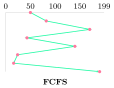
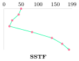
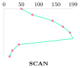
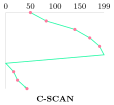
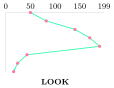
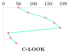

## 10.1 How the CPU talks to devices {#sec-os-iohw}

<div class="nb-proto">

<em><span>Prototypical example for this section:</span> reading one sector: poll the controller, wait for an interrupt, or let a DMA engine copy 4 KiB while the CPU does something else.</em>

</div>

A device is driven through its <strong>controller</strong>’s registers (status, command, data). They are reached either by special instructions on a separate address space (<strong>port-mapped I/O</strong>, x86 `in`/`out`) or by ordinary loads and stores to reserved physical addresses (<strong>memory-mapped I/O</strong>, universal on ARM and for modern PCIe devices). The bus-level details and the DMA timing numericals are in the COA book.

<div class="nb nb-definition" id="definition-10-1-1">

<strong>Definition 10.1.1</strong>. Three ways to wait for a device:

- <strong>Programmed I/O with polling</strong> (busy waiting): the CPU loops reading the status register, then moves every byte itself. Simple, lowest latency when the device is very fast, wasteful otherwise.
- <strong>Interrupt-driven I/O</strong>: the CPU starts the operation and does other work; the controller raises an interrupt when it is done. Each interrupt costs a few microseconds of handler overhead, which is too much per byte for fast devices.
- <strong>Direct memory access</strong> (DMA): the CPU programs a DMA engine (source, destination, count) and the engine moves the whole block between device and memory, interrupting once at the end. In <strong>cycle stealing</strong> it takes the bus a word at a time; in <strong>burst</strong> mode it holds the bus for the block.

</div>

<div class="nb nb-remark" id="remark-10-1-2">

<strong>Remark 10.1.2</strong> (Polling is not always worse) — At millions of operations per second (100 Gb NICs, NVMe SSDs) interrupts dominate, so high-performance stacks switch to polling under load (Linux NAPI for network cards, `io_uring` polling, DPDK and SPDK in user space). Interrupt coalescing is the middle ground: one interrupt per batch.

</div>

## 10.2 The kernel I/O subsystem {#sec-os-kio}

<div class="nb-proto">

<em><span>Prototypical example for this section:</span> `/dev/tty` is read one keystroke at a time; `/dev/vda` is read in whole blocks through a cache and a scheduler.</em>

</div>

<div class="nb nb-definition" id="definition-10-2-1">

<strong>Definition 10.2.1</strong>. A <strong>device driver</strong> is the kernel code that knows one controller’s registers and presents a uniform interface upward. UNIX classifies devices by that interface:

- <strong>character devices</strong>: a stream of bytes, no seeking in general, no kernel block cache: terminals, serial ports, keyboards, mice, sound, `/dev/null`, `/dev/zero`, `/dev/random`, `/dev/tty`;
- <strong>block devices</strong>: fixed-size blocks addressed randomly, accessed through the page cache and an I/O scheduler, can hold a file system: disks, SSDs, partitions, loop devices, CD-ROMs, USB sticks;
- <strong>network devices</strong>: neither; they appear as interfaces (`eth0`) used through sockets, not as files in `/dev`.

A device file’s <strong>major number</strong> selects the driver and its <strong>minor number</strong> the unit.

</div>

```text {filename="Terminal session (bash, Linux 6.18)"}
$ ls -l /dev/null /dev/zero /dev/random /dev/tty /dev/vda /dev/loop0      | awk '{print $1, $5, $6, $NF}'
brw------- 7, 0 /dev/loop0
crw-rw-rw- 1, 3 /dev/null
crw-rw-rw- 1, 8 /dev/random
crw-rw-rw- 5, 0 /dev/tty
brw------- 254, 0 /dev/vda
crw-rw-rw- 1, 5 /dev/zero
$ stat -c '%n: %F' /dev/tty /dev/vda
/dev/tty: character special file
/dev/vda: block special file
$ head -c 8 /dev/zero | od -An -tx1
 00 00 00 00 00 00 00 00
$ cat /sys/block/vda/queue/scheduler
none [mq-deadline] kyber bfq 
$ cat /sys/block/vda/queue/rotational
1
```

<div class="nb nb-remark" id="remark-10-2-2">

<strong>Remark 10.2.2</strong> (OA: “which is a character device?”) — Keyboard, mouse, terminal, serial port, printer (traditionally), sound card, `/dev/null`: character. Hard disk, SSD, USB mass storage, CD-ROM: block. A network card is neither (a network interface). The tape drive is the classic trap: it is sequential and usually a character device in UNIX, although it moves data in blocks.

</div>

<div class="nb nb-definition" id="definition-10-2-3">

<strong>Definition 10.2.3</strong>. Services the kernel adds on top of the drivers:

- <strong>Buffering</strong>: a memory area holding data in transit, to cope with speed mismatch (modem vs disk), transfer-size mismatch (packets vs pages) and copy semantics (`write` may return before the device has the data). <strong>Double buffering</strong>: the device fills one buffer while the process drains the other; a <strong>circular</strong> buffer generalises it.
- <strong>Caching</strong>: keeping copies of data for faster later access (the page cache). A buffer may hold the only copy; a cache holds a copy of something stored elsewhere.
- <strong>Spooling</strong>: a queue on disk for a device that can serve only one job at a time (printer), so that jobs do not interleave and processes need not wait.
- <strong>I/O scheduling</strong> (next section), device reservation, error handling and retry.
- Blocking, <strong>non-blocking</strong> (`O_NONBLOCK`: return at once with what is available or `EAGAIN`) and <strong>asynchronous</strong> I/O (start the operation, be told on completion: `io_uring`, POSIX AIO). Readiness multiplexing (`select`, `poll`, `epoll`) is in the networks book.

</div>

<div class="nb nb-moral">

Polling, interrupts and DMA trade CPU time for latency; character devices are streams, block devices are random-access arrays of blocks behind the page cache.

</div>

## 10.3 Disks and disk scheduling {#sec-os-disksched}

<div class="nb-proto">

<em><span>Prototypical example for this section:</span> seven requests on a 200-cylinder disk with the head at 50: 642 cylinders of motion in arrival order, 208 if served shortest-seek-first.</em>

</div>

<div class="nb nb-definition" id="definition-10-3-1">

<strong>Definition 10.3.1</strong>. A hard disk has platters, each surface divided into concentric <strong>tracks</strong> split into <strong>sectors</strong>; the tracks at one arm position form a <strong>cylinder</strong>. One access costs

$$
\text{seek} + \text{rotational latency} + \text{transfer},
$$

where the seek moves the arm (a few ms), the average rotational latency is half a revolution, and the transfer time is size divided by the transfer rate.

</div>

```text {filename="Output (Python 3.11)"}
queue [82, 170, 43, 140, 24, 16, 190], head 50, cylinders 0-199, moving up
FCFS   82 170 43 140 24 16 190         total 642
SSTF   43 24 16 82 140 170 190         total 208
SCAN   82 140 170 190 199 43 24 16     total 332
C-SCAN 82 140 170 190 199 0 16 24 43   total 391 (jump 199; 192 without it)
LOOK   82 140 170 190 43 24 16         total 314
C-LOOK 82 140 170 190 16 24 43         total 341 (jump 174; 167 without it)

Access time = seek + rotational latency + transfer
   5400 rpm: one rotation 11.11 ms, average latency 5.56 ms
   7200 rpm: one rotation 8.33 ms, average latency 4.17 ms
  15000 rpm: one rotation 4.00 ms, average latency 2.00 ms
  4 KiB read, 4 ms average seek, 7200 rpm, 200 MiB/s:
    4.0 + 4.17 + 0.020 = 8.19 ms
  random 4 KiB reads per second: 122 = 0.48 MiB/s (sequential: 200)
```

The last lines show why scheduling matters: a random 4 KiB read costs about $8$ ms, almost all of it mechanical, so random reads deliver about half a MiB/s from a disk that streams 200 MiB/s.

<div class="nb nb-definition" id="definition-10-3-2">

<strong>Definition 10.3.2</strong>. Disk-scheduling algorithms (head at $h$, moving towards higher cylinders):

- <strong>FCFS</strong>: arrival order. Fair, no optimisation.
- <strong>SSTF</strong>: the pending request nearest the head. Greedy (like SJF), much better on average, but requests far away can starve and it is not optimal.
- <strong>SCAN</strong> (elevator): move in one direction serving requests up to the last cylinder, then reverse.
- <strong>C-SCAN</strong>: serve in one direction only; at the last cylinder jump back to cylinder 0 and continue upward. More uniform waiting times: a request just behind the head waits one sweep, not two.
- <strong>LOOK</strong> / <strong>C-LOOK</strong>: like SCAN / C-SCAN but turn (or jump) at the last pending request instead of the end of the disk.

</div>

```python {filename="disk.py, lines 6–27",linenos=table,linenostart=6}
def fcfs(q, h): return list(q)
def sstf(q, h):
    left, path = list(q), []
    while left:
        nxt = min(left, key=lambda c: (abs(c - h), c))
        path.append(nxt); left.remove(nxt); h = nxt
    return path
def scan(q, h):            # elevator: go up to the last cylinder, then down
    up = sorted(c for c in q if c >= h)
    down = sorted((c for c in q if c < h), reverse=True)
    return up + ([HI] if down else []) + down
def cscan(q, h):           # up to the end, jump to cylinder 0, continue up
    up = sorted(c for c in q if c >= h); low = sorted(c for c in q if c < h)
    return up + ([HI, LO] if low else []) + low
def look(q, h):            # like SCAN but turn at the last request
    up = sorted(c for c in q if c >= h)
    down = sorted((c for c in q if c < h), reverse=True)
    return up + down
def clook(q, h):           # like C-SCAN but jump from the last request
    up = sorted(c for c in q if c >= h); low = sorted(c for c in q if c < h)
    return up + low
```

<figure class="nb-fig"></figure>

<figure class="nb-fig"></figure>

<figure class="nb-fig"></figure>

<figure class="nb-fig"></figure>

<figure class="nb-fig"></figure>

<figure class="nb-fig"></figure>

<div class="nb nb-remark" id="remark-10-3-3">

<strong>Remark 10.3.3</strong> (Conventions that change the number) — Whether C-SCAN’s return sweep counts as head movement differs between books (the output gives both: 391 with it, 192 without); whether SCAN goes to cylinder 199 or turns at 190 is exactly the SCAN/LOOK difference; the initial direction must be given. With SSTF, ties (two requests at equal distance) need a rule. Always state the convention you use.

</div>

<div class="nb nb-remark" id="remark-10-3-4">

<strong>Remark 10.3.4</strong> (What real systems do) — The disk itself reorders requests (native command queuing) using its exact geometry, which the OS does not know. Linux’s block layer offers `mq-deadline` (sorted batches with per-request deadlines, so nothing starves), `bfq` (fair shares per process) and `kyber`, or `none`; above, the virtual disk uses `mq-deadline`. For SSDs, where there is no seek, `none` is common.

</div>

## 10.4 RAID {#sec-os-raid}

<div class="nb-proto">

<em><span>Prototypical example for this section:</span> eight 4 TB disks: 32 TB of raw space, and how much of it survives two failures?</em>

</div>

<div class="nb nb-definition" id="definition-10-4-1">

<strong>Definition 10.4.1</strong>. A <strong>redundant array of independent disks</strong> combines disks for capacity, speed and reliability:

- <strong>RAID 0</strong>: striping only. $n\times$ capacity and bandwidth; any failure loses the array.
- <strong>RAID 1</strong>: mirroring. Capacity of one disk; reads can use either copy.
- <strong>RAID 5</strong>: striping with one parity block per stripe, rotated across disks. Capacity $(n-1)$ disks; survives one failure; a small write costs four I/Os.
- <strong>RAID 6</strong>: two independent parities (P and Q). Capacity $(n-2)$; survives any two failures, important because rebuilding a large disk takes hours, during which a second failure (or an unreadable sector) would kill RAID 5.
- <strong>RAID 10</strong> (1+0): stripes across mirrored pairs. Capacity $n/2$; survives one failure per pair (at least one, up to $n/2$ if they hit different pairs); fast writes, fast rebuild (copy one disk).

</div>

```text {filename="Output (Python 3.11)"}
level  disks  disk size  usable   failures survived
RAID 0      4      4 TB    16 TB   0
RAID 1      2      4 TB     4 TB   1
RAID 5      4      4 TB    12 TB   1
RAID 5      8      4 TB    28 TB   1
RAID 6      8      4 TB    24 TB   2
RAID 10     8      4 TB    16 TB   1 guaranteed (1 per mirror pair)

RAID 5 stripe of 3 data blocks + parity (1 byte each shown):
  D0 = 10110010  D1 = 01101100  D2 = 11100001
  P = D0^D1^D2 = 00111111
  disk 1 dies: D1 = D0^D2^P = 01101100  correct: True
  small write to D1: new P = old P ^ old D1 ^ new D1
  (read 2 blocks, write 2 blocks: the RAID-5 small-write penalty)
```

<div class="nb nb-remark" id="remark-10-4-2">

<strong>Remark 10.4.2</strong> — RAID protects against disk failure, not against deletion, corruption or ransomware: it is not a backup. RAID levels 2, 3 and 4 (bit striping with Hamming code, byte striping with a parity disk, block striping with a dedicated parity disk) exist in textbooks; RAID 4’s single parity disk is the bottleneck that RAID 5 removes by rotating parity.

</div>

## 10.5 SSDs and flash {#sec-os-ssd}

<div class="nb-proto">

<em><span>Prototypical example for this section:</span> rewriting one 4 KiB page of a full SSD forces it to copy and erase a whole 256-page block somewhere.</em>

</div>

<div class="nb nb-definition" id="definition-10-5-1">

<strong>Definition 10.5.1</strong>. NAND flash is read and written in <strong>pages</strong> (a few KiB) but erased only in <strong>blocks</strong> of hundreds of pages, and a page cannot be overwritten until its block is erased. Each block survives a limited number of erase cycles. The SSD’s <strong>flash translation layer</strong> (FTL) therefore writes every update out of place to an already erased page, remaps the logical block, and marks the old page invalid; <strong>garbage collection</strong> later copies the valid pages out of a mostly invalid block and erases it. The extra copying is <strong>write amplification</strong>. <strong>Wear levelling</strong> spreads erases evenly across blocks. <strong>TRIM</strong> (`fstrim`, the `discard` mount option) lets the file system tell the SSD which logical blocks are free, so garbage collection need not copy dead data.

</div>

<div class="nb nb-remark" id="remark-10-5-2">

<strong>Remark 10.5.2</strong> (What changes for the OS) — No seek and no rotation, so disk scheduling by position is pointless (fairness and merging remain); random reads cost about as much as sequential ones; writes should be large and aligned; leaving free space (over-provisioning) lowers write amplification. NVMe exposes many deep hardware queues, which is why Linux’s block layer became multi-queue.

</div>

<div class="nb nb-moral">

Disks pay milliseconds for mechanics, so the OS reorders requests; RAID trades capacity for survival; SSDs remove the mechanics but hide an erase-before-write translation layer that TRIM and large writes keep happy.

</div>
